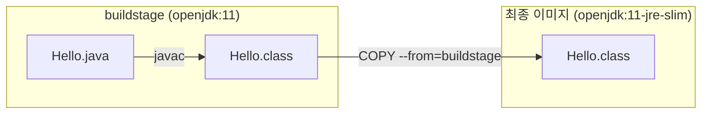
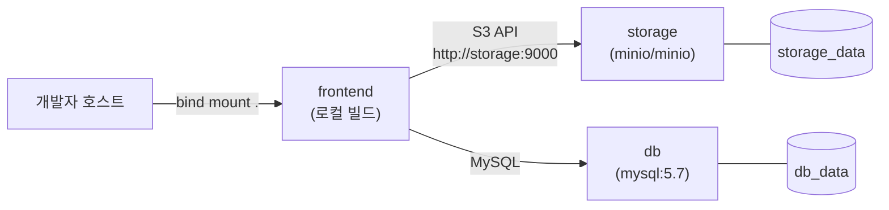
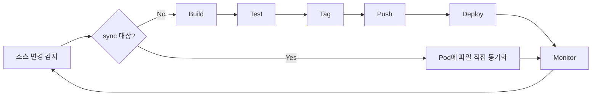
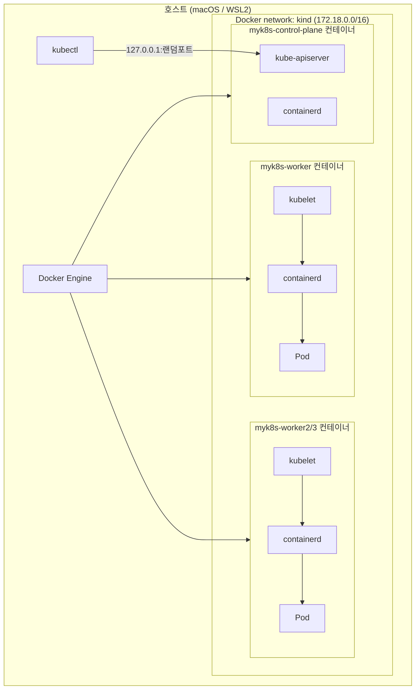
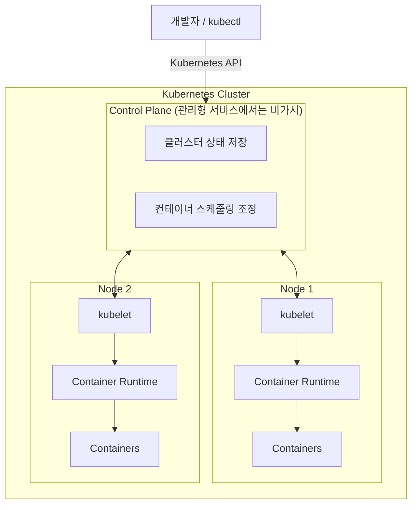
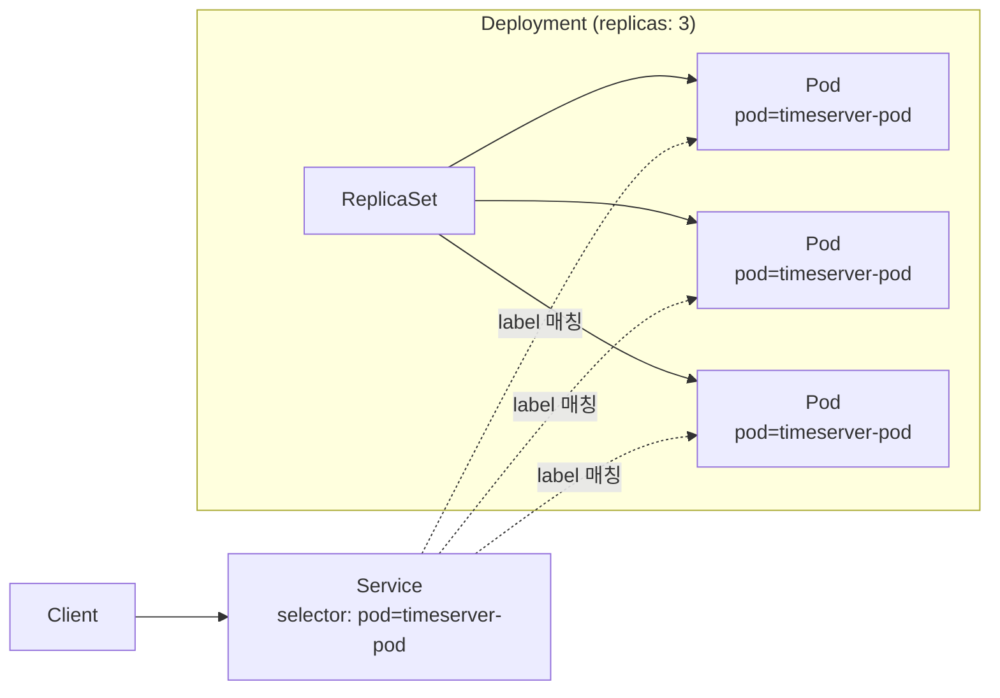
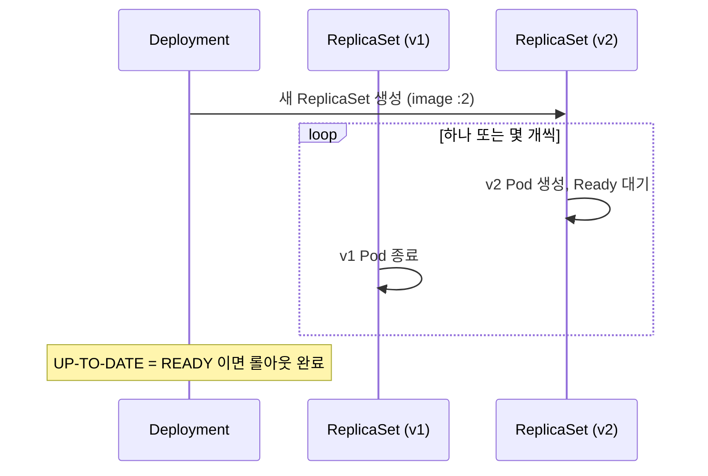
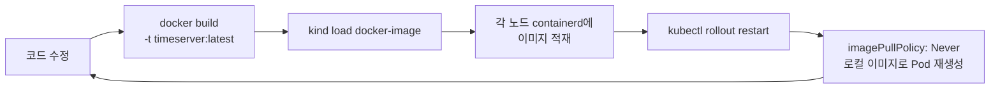

---
tags:
  - ML Platform
  - Kubernetes
  - Docker
  - Docker Compose
  - Skaffold
  - kind
  - Deployment
  - Service
---

# 컨테이너화 & Kubernetes 배포

> 『Kubernetes for Developers』 CH1~3을 바탕으로 컨테이너와 쿠버네티스를 쓰는 이유, 애플리케이션 컨테이너화와 로컬 개발 환경 구성, kind 클러스터에 Deployment·Service로 배포하고 업데이트하는 과정을 정리한다.

## 개요

1주차는 William Denniss의 『Kubernetes for Developers』 1~3장을 다룬다. 실습 소스 코드는 [kubernetes-for-developers](https://github.com/WilliamDenniss/kubernetes-for-developers) 저장소를 사용한다.

| 챕터 | 주제 | 핵심 |
|------|------|------|
| CH 1 | Kubernetes for application deployment | 왜 컨테이너와 쿠버네티스를 사용하는가 |
| CH 2 | Containerizing apps | 애플리케이션을 컨테이너화하여 로컬에서 개발·테스트 |
| CH 3 | Deploying to Kubernetes | Deployment로 로컬 k8s에 배포·업데이트 → GitOps가 필요한 배경 이해 |

책은 GKE를 기준으로 설명하지만, 스터디에서는 로컬 **kind** 클러스터로 동일한 실습을 진행한다.

## CH 1. 컨테이너와 쿠버네티스를 쓰는 이유

### 왜 컨테이너인가

쿠버네티스는 컨테이너를 위한 배포 플랫폼이다. 쿠버네티스에 배포되는 모든 코드는 먼저 컨테이너로 패키징되어야 하며, 컨테이너는 애플리케이션을 패키징하고 실행하는 현대적인 방식이다.

| 이점 | 설명 |
|------|------|
| Language Flexibility | 언어·런타임에 관계없이 동일한 방식으로 빌드하고 실행한다 |
| Isolation without Overhead | VM처럼 게스트 OS를 띄우지 않고 커널을 공유하면서도 프로세스를 격리한다 |
| Developer Efficiency | 로컬에서 운영과 같은 이미지로 개발·테스트할 수 있다 |
| Reproducibility | 의존성까지 이미지에 담기므로 어디서 실행해도 같은 결과를 재현하기 쉽다 |

### 왜 쿠버네티스인가

쿠버네티스는 컨테이너를 **조합 가능한 빌딩 블록**으로 다룬다.

- 컨테이너는 **Pod**로 묶인다. Pod는 함께 스케줄링되어 하나의 단위로 취급되는 컨테이너 집합이다

- 쿠버네티스는 Pod를 감싸는 상위 워크로드 오브젝트를 제공한다. 상태가 없는 애플리케이션은 Pod 정의와 복제본 수를 지정한 **Deployment**로 배포한다

- 어떤 워크로드든 컨테이너화하여 Pod로 묶고, 원하는 실행 방식을 설정 파일로 기술하면 쿠버네티스가 클러스터에서 자리를 찾아 배치한다

설정 파일로 기술할 수 있는 워크로드 유형은 다음과 같다.

- Stateless 애플리케이션
- 데이터베이스 등 영구 상태를 가진 애플리케이션
- 기존에 VM으로 구성하던 애플리케이션
- 정해진 스케줄에 실행하는 배치 프로세스
- ML 모델 학습처럼 한 번만 실행하는 배치 작업

**쿠버네티스의 특징과 이점**:

| 특징 | 설명 |
|------|------|
| Automated Operations | 노드 문제로 Pod에 이상이 생기면 자동 재시작, HPA(Horizontal Pod Autoscaler)로 자동 스케일링 등 운영 자동화 |
| High Scalability | 애플리케이션 확장 시 처리 가능 |
| Workload Abstraction | VM·로드밸런서 같은 인프라가 아닌 워크로드 단위로 다룬다 |
| Declarative Configuration | 원하는 상태를 선언하면 쿠버네티스가 맞춰 간다 |
| Cost Efficiency | bin-packing과 resource pooling으로 자원을 효율적으로 사용한다 |
| Extensibility | CRD(Custom Resource Definition)와 Operator 패턴으로 기능을 확장한다 |
| Open Source | 특정 벤더에 종속되지 않는다 |
| Customized Workflows | 조직에 맞는 배포 워크플로를 구성할 수 있다 |

### Kubernetes vs PaaS

| 구분 | PaaS | Kubernetes |
|------|------|------------|
| 초기 학습 곡선 | 낮음, 빠르게 시작 | 높음, 초기 생산성이 더딤 |
| 경험이 쌓인 후 | 플랫폼 제약에 부딪힘 | 효율이 계속 높아짐 |
| 유연성 | 플랫폼이 허용하는 범위 | 워크로드 유형·워크플로를 자유롭게 구성 |

### 쿠버네티스를 쓰지 말아야 할 때

- **완전 관리형 서비스가 존재하는 소프트웨어**는 쿠버네티스에 직접 배포하지 않는 것을 권장한다. 클라우드 제공자가 SQL 데이터베이스를 관리해 준다면 굳이 쿠버네티스에서 운영할 이유가 적다

- 반대로 **PaaS를 넘어설 만큼 성장**했거나 최신 도구로 더 빠르게 배포하려는 숙련된 팀이라면 쿠버네티스가 적합하다

- 가장 의미 있는 워크로드부터 시작해 팀의 운영 역량이 쌓이는 만큼 점진적으로 이전하는 방식이 현실적이다

## CH 2. 애플리케이션 컨테이너화

컨테이너화는 애플리케이션과 그 의존성을 실행 가능한 컨테이너 이미지로 패키징하는 것이다. 개발 환경으로 macOS는 Docker Desktop, Windows는 WSL2 + Docker를 사용한다. Linux 호스트라면 Docker와 kind만 설치하면 동일하게 실습할 수 있다.

### Dockerfile로 이미지 빌드

Dockerfile은 컨테이너를 빌드하기 위한 절차적 명령의 집합이다. 같은 실습을 Python과 Ruby 두 언어로 진행한다.

```bash
cd Chapter02/2.1.3_Dockerfile

# 이미지 빌드
docker build . -t hello
docker image ls -f reference=hello

# 컨테이너 실행
docker run --rm hello python3 hello.py
```

### Base 이미지

Base 이미지는 보통 또 다른 base 이미지에서 시작하며, 이 연쇄의 끝에는 완전히 비어 있는 `scratch` 이미지가 있다. 언어 런타임이 미리 구성된 `python:3`, `ruby` 같은 공식 이미지를 base로 사용하면 런타임 설치 과정을 생략할 수 있다.

```bash
cd Chapter02/2.1.4_BaseImage
docker build . -t hello2
docker run --rm hello2 python3 hello.py
```

### 기본 명령(CMD) 지정

`CMD`로 컨테이너 기동 시 실행할 명령을 Dockerfile에 지정하면, `docker run` 시 명령을 생략할 수 있다.

```dockerfile
FROM python:3
COPY . /app
WORKDIR /app
CMD python3 hello.py
```

### 의존성 추가

애플리케이션이 MariaDB에 접속해야 한다면 클라이언트 패키지를 이미지에 설치한다.

```dockerfile
FROM python:3
RUN apt-get update
RUN apt-get install -y mariadb-client
COPY . /app
WORKDIR /app
CMD python3 hello.py
```

패키지 매니저뿐 아니라 파일을 내려받아 압축을 풀고 설치하는 작업도 `RUN`으로 수행할 수 있다. 실습에서는 Noto 폰트를 내려받아 `bsdtar`로 해제하고 `fc-cache`로 등록한다.

```dockerfile
FROM python:3
RUN apt-get update
RUN apt-get install -y libarchive-tools  # bsdtar 설치
RUN mkdir -p ~/.fonts; cd ~/.fonts
RUN curl "https://noto-website-2.storage.googleapis.com/pkgs/Noto-hinted.zip" \
    | bsdtar -xvf-
RUN fc-cache -f -v
COPY . /app
WORKDIR /app
CMD python3 hello.py
```

### Docker 안에서 컴파일하기

로컬에서 미리 컴파일한 결과물을 넣을 수도 있지만, Dockerfile 안에서 직접 컴파일할 수도 있다.

```dockerfile
FROM openjdk
COPY . /app
WORKDIR /app
RUN javac Hello.java
CMD java Hello
```

이 방식은 최종 이미지에 **소스 코드와 컴파일러(javac)가 그대로 남는다**는 문제가 있다. `docker run --rm compiled_code ls`로 확인하면 `Hello.java`와 `Hello.class`가 모두 들어 있고, `javac --help`도 실행된다. 둘 다 애플리케이션 실행에는 필요 없다.

### 멀티 스테이지 빌드

멀티 스테이지 빌드는 컴파일 같은 작업을 임시 빌드 컨테이너에서 수행하고, 결과물만 경량 런타임 이미지로 복사한다.

```dockerfile
FROM openjdk:11 AS buildstage        # 빌드 담당 스테이지
COPY . /app
WORKDIR /app
RUN javac Hello.java

FROM openjdk:11-jre-slim             # 컴파일 도구가 없는 경량 런타임
COPY --from=buildstage /app/Hello.class /app/
WORKDIR /app
CMD java Hello
```



| 구분 | 단일 스테이지 | 멀티 스테이지 |
|------|---------------|---------------|
| 최종 이미지 내용 | 소스 + 컴파일러 + 바이너리 | 바이너리만 |
| 이미지 크기 | 큼 | 작음 |
| 공격 표면 | 불필요한 도구 포함 | 최소화 |
| `ls` 결과 | `Dockerfile`, `Hello.class`, `Hello.java` | `Hello.class` |

### 서버 애플리케이션 컨테이너화

2.1의 예제는 배치 작업처럼 한 번 실행되는 프로그램이었다. 대부분의 애플리케이션은 요청을 지속적으로 받아 처리하는 HTTP 서버다. 현재 시각을 반환하는 간단한 Python HTTP 서버 `timeserver`를 컨테이너화한다.

```python
from http.server import ThreadingHTTPServer, BaseHTTPRequestHandler
from datetime import datetime

class RequestHandler(BaseHTTPRequestHandler):
    def do_GET(self):
        self.send_response(200)
        self.send_header('Content-type', 'text/plain')
        self.end_headers()
        now = datetime.now()
        response_string = now.strftime("The time is %-I:%M %p, UTC.\n")
        self.wfile.write(bytes(response_string, "utf-8"))
```

```dockerfile
FROM python:3.12
ENV PYTHONUNBUFFERED 1
COPY . /app
WORKDIR /app
CMD python3 server.py
```

```bash
docker build . -t timeserver
docker run -d -p 8080:80 timeserver

curl http://localhost:8080
# The time is 3:28 PM, UTC.
```

`PYTHONUNBUFFERED=1`은 표준 출력을 버퍼링하지 않게 하여 `docker logs`에서 로그를 즉시 볼 수 있게 한다.

### 컨테이너 디버깅

실행 중인 컨테이너에 셸로 진입하거나 파일을 주고받을 수 있다.

```bash
docker run --rm --name=timesrv -d -p 8080:80 timeserver

docker exec -it timesrv ls -l
docker exec -it timesrv bash

# 호스트 ↔ 컨테이너 파일 복사
docker cp server.py timesrv:/app
docker cp timesrv:/app/server.py .
```

### Docker Compose로 로컬 테스트

Docker Compose는 빌드 경로, 실행 명령, 포트 매핑을 YAML로 선언하고 한 번에 띄운다.

```yaml
services:
  web:
    build: ../timeserver        # 빌드할 Dockerfile이 있는 디렉터리
    command: python3 server.py  # Dockerfile에 CMD가 있으면 생략 가능
    ports:
      - "8080:80"
```

```bash
docker compose build ; docker compose up -d
docker compose ps
curl http://localhost:8080
docker compose logs
docker compose down
```

### 로컬 폴더 마운트로 개발 루프 단축

호스트의 현재 디렉터리를 컨테이너의 `/app`에 bind 마운트하면, 코드를 수정할 때마다 이미지를 다시 빌드하지 않고 컨테이너가 바로 변경된 파일을 읽는다.

```yaml
services:
  frontend:
    build: .
    command: python3 server.py
    volumes:
      - type: bind
        source: .
        target: /app
    environment:
      PYTHONDONTWRITEBYTECODE: 1
    ports:
      - "8080:80"
```

다만 디스크의 파일이 바뀐다고 실행 중인 Python 프로세스가 코드를 다시 읽지는 않는다. `reloading` 라이브러리의 `@reloading` 데코레이터를 `do_GET`에 붙이면 호출될 때마다 디스크에서 함수를 다시 로드한다. 이 리로드 방식은 언어·프레임워크마다 다르다.

```python
from reloading import reloading

class RequestHandler(BaseHTTPRequestHandler):
    @reloading
    def do_GET(self):
        ...
```

호스트에서 `strftime` 포맷을 `"The time is %H:%M, UTC."`로 바꾸면 컨테이너 재시작 없이 `curl` 결과가 `The time is 16:21, UTC.`로 바뀐다.

컴파일 언어에는 이 방식이 큰 도움이 되지 않는다. 로컬에서 바이너리를 빌드해 교체할 수도 있지만, 모든 빌드를 Docker로 하고 싶거나 로컬과 컨테이너의 아키텍처가 다르면 쓸 수 없다. 이 경우 Skaffold 같은 도구로 개발 루프를 구성한다.

### 서비스 의존성 추가

AWS RDS나 S3처럼 애플리케이션이 의존하는 서비스가 있으면 Compose에 함께 정의해 로컬 개발 환경을 만든다. 로컬에서 빌드하는 앱과 공개 이미지를 쓰는 서비스를 여러 개 섞을 수 있다.

```yaml
services:
  frontend:
    build: ../timeserver
    command: python3 server.py
    ports:
      - "8080:80"

  db:
    image: mysql:5.7
    volumes:
      - db_data:/var/lib/mysql   # 재시작 후에도 개발 DB 데이터 유지
    restart: always
    environment:
      MYSQL_DATABASE: my_database
      MYSQL_USER: dev_user
      ...

volumes:
    db_data:
```

### 외부 의존성 Fake로 대체

클라우드 스토리지 API 같은 원격 의존성에 붙어 테스트하고 있었다면, 같은 API를 제공하는 경량 구현체(**Fake**)로 대체할 수 있다. 로컬 서비스로 동작하므로 개발과 테스트가 빨라진다. S3의 경우 Adobe의 S3Mock이나, S3 호환 API를 완전히 구현한 MinIO를 사용한다.

```yaml
services:
  storage:
    image: minio/minio
    command: minio server /data
    environment:
      MINIO_ACCESS_KEY: fakeaccesskey
      MINIO_SECRET_KEY: fakesecretkey
    ports:
      - "9000:9000"

  frontend:
    build: ../timeserver
    environment:
      S3_ENDPOINT:          http://storage:9000
      S3_USE_PATH_STYLE:    1
      S3_ACCESS_KEY_ID:     fakeaccesskey
      S3_SECRET_ACCESS_KEY: fakesecretkey
```



Compose 네트워크 안에서는 서비스 이름(`storage`)이 곧 호스트명이 되므로, 애플리케이션은 환경 변수로 엔드포인트만 바꿔 실제 S3 대신 MinIO에 붙는다.

### Skaffold

[Skaffold](https://skaffold.dev/)는 쿠버네티스 애플리케이션의 지속적 개발을 돕는 CLI 도구다. 로컬에서 소스를 수정하면 빌드·푸시·배포까지 파이프라인을 자동으로 처리하고, CI/CD 파이프라인의 빌딩 블록으로도 사용한다.

**주요 특징**:

- 소스 변경을 감지해 build → push → test → deploy를 자동 수행하고, 정책 기반 이미지 태깅을 지원한다

- 배포된 리소스의 로그 스트리밍과 포트 포워딩을 자동으로 관리한다

- `git clone` 후 `skaffold run`만으로 프로젝트를 공유할 수 있다

- 프로필·환경 변수·플래그로 환경별 차이를 흡수하고, 멀티 플랫폼 빌드로 개발 머신과 노드의 아키텍처 차이를 처리한다

- `skaffold render`로 이미지를 빌드하고 매니페스트를 렌더링해 GitOps 워크플로에 연결할 수 있다



종료(Ctrl+C) 시 배포한 리소스를 정리하는 단계까지 포함된다. 파이프라인 각 단계는 플러그인 구조로 교체할 수 있다.

| 단계 | 지원 방식 |
|------|-----------|
| Image Builders | Dockerfile(local, kaniko, cloud), Jib Maven/Gradle, Bazel, Custom script |
| Testers | container-structure-test, Custom script |
| Deployers | kubectl, Helm, kustomize |
| Tag Policies | git commit, 현재 날짜·시각, 환경 변수 기반 템플릿, 이미지 digest |
| Push Strategies | 로컬 데몬에 유지(push 안 함), 원격 레지스트리 push |

## CH 3. Kubernetes에 배포하기

### kind 소개

[kind](https://kind.sigs.k8s.io/)(Kubernetes IN Docker)는 각 노드를 Docker 컨테이너로 띄워 로컬에 쿠버네티스 클러스터를 구성하는 도구다.

- 쿠버네티스 자체를 테스트하기 위해 만들어졌으며, 멀티 노드와 HA 구성을 지원한다

- 노드 구성에는 kubeadm을 사용한다

- 노드 컨테이너 안에서 containerd가 다시 Pod 컨테이너를 실행하는 "Docker in Docker" 구조다



### kind 설치 및 클러스터 생성

Docker 엔진에 최소 vCPU 4, 메모리 8GB 할당을 권장한다. macOS에서는 Homebrew로 필요한 도구를 설치한다.

```bash
brew install kind kubernetes-cli helm
brew install krew kube-ps1 kubectx kubecolor
echo "alias k=kubectl" >> ~/.zshrc
```

Windows는 DISM으로 WSL과 VirtualMachinePlatform 기능을 활성화한 뒤 `wsl --install Ubuntu-24.04`로 배포판을 설치하고, `get-docker.sh` 스크립트로 Docker를 설치한다. 이후 kind(v0.29.0), kubectl, Helm을 바이너리로 설치한다.

!!! warning "kubeconfig 백업"
    회사에서 사용 중인 kubeconfig가 있다면 미리 백업하거나 `export KUBECONFIG=<별도 경로>`로 분리한 뒤 실습한다. kind는 클러스터 생성 시 `~/.kube/config`에 컨텍스트를 추가하고 삭제 시 제거한다.

**단일 노드 클러스터 확인**:

```bash
kind create cluster
kind get nodes
kubectl get node -o wide

# 컨트롤 플레인 노드에 파드가 배포될까?
kubectl run nginx --image=nginx:alpine
kubectl get pod -owide
kubectl describe node | grep Taints
# Taints: <none>

kind delete cluster
```

일반적으로 컨트롤 플레인 노드에는 `node-role.kubernetes.io/control-plane:NoSchedule` taint가 있지만, kind는 단일 노드 구성에서 이 taint를 제거하므로 nginx Pod가 정상적으로 스케줄된다.

**실습용 멀티 노드 클러스터**:

```bash
kind create cluster --name myk8s --image kindest/node:v1.32.5 --config - <<EOF
kind: Cluster
apiVersion: kind.x-k8s.io/v1alpha4
nodes:
- role: control-plane
  extraPortMappings:
  - containerPort: 30000
    hostPort: 30000
  - containerPort: 30001
    hostPort: 30001
  - containerPort: 30002
    hostPort: 30002
  - containerPort: 30003
    hostPort: 30003
- role: worker
- role: worker
- role: worker
EOF
```

`extraPortMappings`는 컨트롤 플레인 노드 컨테이너의 30000~30003 포트를 호스트에 매핑한다. 이후 NodePort Service를 `127.0.0.1:30000`으로 접근하기 위한 설정이다.

```bash
# kind 전용 도커 네트워크 (기본 172.18.0.0/16)
docker network ls
docker inspect kind | jq

# API 서버 주소: https://127.0.0.1:<port>
kubectl cluster-info

# CRI는 containerd, CNI는 kindnet
kubectl get node -o wide
kubectl get pod -A -o wide

# 노드 = 도커 컨테이너
docker ps
docker exec -it myk8s-control-plane ss -tnlp

# kubectl이 kubeconfig를 로드하고 API를 호출하는 과정 확인
kubectl get pod -v6
```

`kubectl get namespaces`로 보이는 네임스페이스는 쿠버네티스 리소스를 논리적으로 나누는 단위로, 컨테이너 격리에 쓰이는 리눅스 커널 네임스페이스와는 다른 개념이다.

### Kubernetes 아키텍처

컨테이너 오케스트레이션은 여러 머신 위의 많은 컨테이너를 스케줄링하고 모니터링하는 도구를 말한다. 쿠버네티스는 VM·베어메탈·로드밸런서 같은 원시 컴퓨트 위에서 **워크로드 수준의 추상화 계층**을 제공한다. 개발자는 하부 인프라보다 복제본 수, 고가용성(장애 도메인 분산), 서비스 네트워킹 같은 배포 속성에 집중한다.

| 개념 | 역할 |
|------|------|
| Cluster | 컨테이너가 실행되는 노드(VM 또는 베어메탈)의 집합 |
| Pod | 하나 이상의 컨테이너를 묶은 스케줄링 단위 |
| Service | Pod 집합을 네트워크로 노출하는 방법 |
| Deployment | Pod를 더 쉽게 관리하기 위한 상위 오브젝트 |

#### 클러스터와 노드



- **kubelet**: 각 노드에서 실행되며 컨트롤 플레인과 통신하고, 컨테이너 런타임을 통해 컨테이너의 라이프사이클을 관리한다

- **컨트롤 플레인**: 하나 또는 여러 노드(HA 모드)에서 오케스트레이터 자체를 실행한다. 클러스터 상태를 저장하고 모든 노드와 협력해 컨테이너를 시작·중지·재시작한다

- **관리형 서비스**: 대부분의 클라우드에서 컨트롤 플레인은 관리형으로 제공되며, 사용자에게 컨트롤 플레인 노드는 보이지 않는다

- **워커 노드**: 컨트롤 플레인이 어떤 컨테이너를 실행할지 지시하지만, 실제 실행은 노드의 책임이다. 크래시된 컨테이너 재시작이나 메모리 부족 시 회수 같은 일은 컨트롤 플레인 확인 없이 노드가 스스로 처리한다

#### Kubernetes 오브젝트

클러스터가 생성되면 Kubernetes API로 오브젝트를 생성·조회·수정하는 방식으로 상호작용한다. Pod, Deployment, Service는 물론 노드도 오브젝트로 표현되어 리소스 사용량 같은 현재 상태를 조회할 수 있다.

**Pod**:

- Pod는 컨테이너의 집합이며, 쿠버네티스의 기본 스케줄링 단위다. 워크로드가 CPU 2코어를 요구하면 Pod 정의에 명시하고, 쿠버네티스는 해당 자원이 있는 노드를 찾는다

- 노드에서 프로세스를 보면 Pod 자체는 보이지 않고 컨테이너 프로세스만 보인다. Pod는 컨테이너의 논리적 그룹일 뿐이다

- Pod 내 컨테이너들은 함께 생성되고, 하나가 실패하면 함께 재시작되며, 함께 종료되는 **공통 라이프사이클**을 가진다

- 대부분은 Pod 하나에 컨테이너 하나를 배포한다. 인증·로깅 등을 담당하는 **sidecar**처럼 강하게 결합된 경우에만 여러 컨테이너를 함께 둔다

**Deployment**:

- 애플리케이션은 크래시되고 머신은 고장 나므로 Pod는 재시작되거나 재스케줄되어야 한다. 그래서 Pod를 직접 스케줄하기보다 라이프사이클을 관리하는 상위 오브젝트로 감싼다

- 웹 서버처럼 계속 실행되어야 하는 애플리케이션에는 Deployment, 완료될 때까지 실행하는 배치에는 Job을 사용한다

- Deployment에 원하는 복제본 수와 업데이트 방식 등을 지정하면, 쿠버네티스는 관찰된 상태를 원하는 상태로 계속 **reconcile**한다. 노드 장애로 Pod 수가 줄면 새 Pod를 스케줄해 요구사항을 다시 맞춘다

**Service**:

- Pod 집합을 네트워크 서비스로 노출하는 방법이다

- 단일 접근 주소를 제공하고 Pod들에 부하를 분산한다

- 자체 내부 IP와 DNS 레코드를 가지며, 외부 IP를 할당받을 수도 있다



### 애플리케이션 배포

Deployment로 관리되는 Pod를 Service로 노출하고, 개발 → 릴리스 → 업데이트 사이클을 수행한다. 책은 GKE 클러스터를 생성하지만 여기서는 앞서 만든 kind `myk8s` 클러스터를 사용한다.

#### 이미지 업로드

Docker Hub는 `docker.io/$USERNAME/$REPOSITORY_NAME:$VERSION_TAG` 규칙을 따른다. 버전 태그는 `2.2.1`, `2.1.5-beta`처럼 `major.minor.patch`에 선택적 접미사를 붙이는 것이 관례다.

`latest`는 레지스트리가 자동으로 붙이는 특수 태그다. 실행 시 최신 이미지를 가리키는 용도로는 쓸 수 있지만, **업로드할 이미지에 `latest` 태그를 직접 붙이지 않는다**.

```bash
cd Chapter02/timeserver
IMAGE_TAG=docker.io/<USERNAME>/timeserver:1

docker build . -t $IMAGE_TAG
docker login
docker push $IMAGE_TAG
```

#### Deployment 생성

쿠버네티스는 선언적 설정을 사용한다. "컨테이너 복제본 3개를 실행하고 싶다"는 원하는 상태를 설정 파일에 선언해 클러스터에 제출하면, 쿠버네티스가 그 상태를 충족하려고 계속 노력한다.

```yaml
apiVersion: apps/v1
kind: Deployment
metadata:
  name: timeserver
spec:
  replicas: 3
  selector:
    matchLabels:
      pod: timeserver-pod
  template:
    metadata:
      labels:
        pod: timeserver-pod
    spec:
      containers:
      - name: timeserver-container
        image: docker.io/<USERNAME>/timeserver:1
```

```bash
kubectl apply -f deploy.yaml
kubectl get deploy,pod -o wide
# pod/timeserver-...-hn74q  1/1 Running  10.244.1.2  myk8s-worker2
# pod/timeserver-...-vnlfm  1/1 Running  10.244.2.2  myk8s-worker
# pod/timeserver-...-wj89p  1/1 Running  10.244.3.2  myk8s-worker3

kubectl get pods -l pod=timeserver-pod

kubectl port-forward deploy/timeserver 8080:80 &
curl http://localhost:8080
kubectl logs -f deploy/timeserver
```

3개 Pod가 3대의 워커 노드에 하나씩 분산 배치된 것을 확인할 수 있다.

**Pod 상태별 트러블슈팅**:

| 상태 | 원인 | 확인 방법 |
|------|------|-----------|
| `ErrImagePull` / `ImagePullBackOff` | 이미지 이름 오타, 레지스트리에 이미지 없음, 접근 자격 증명 없음 | 이미지 이름과 레지스트리 존재 여부 확인 |
| `Pending` (1분 이상) | 스케줄러가 Pod를 배치할 자원을 찾지 못함 | `kubectl describe pod` → `FailedScheduling ... Insufficient cpu` |
| `CrashLoopBackOff` | 설정 오류로 시작 실패, 시작 직후 크래시, DB 같은 외부 의존성 미충족 | `kubectl describe pod`, `kubectl logs -p $POD_NAME` (이전 컨테이너 로그) |

컨테이너가 처음 크래시되면 `RunContainerError`(시작 시 오류) 또는 `Completed`(종료) 상태가 되고, 크래시가 반복되면 `CrashLoopBackOff`로 바뀐다.

#### PodSpec과 라벨 셀렉터

복제본 3개짜리 Deployment를 만든다는 것은 실제로는 **Deployment 컨트롤러에게 Pod 3개의 생성과 관리를 지시**하는 것이다. 컨트롤러는 새 컨테이너로 업데이트하면 Pod를 교체하고, 유지보수 이벤트로 퇴거된 Pod를 재스케줄한다.

Deployment 안의 Pod 템플릿을 API 문서에서는 **PodSpec**이라고 부른다. 템플릿을 꺼내 `kind: Pod` 헤더를 붙이면 Pod를 단독으로 실행할 수도 있다.

```yaml
apiVersion: v1
kind: Pod
metadata:
  name: timeserver
  labels:
    pod: timeserver-pod
spec:
  containers:
  - name: timeserver-container
    image: docker.io/wdenniss/timeserver:1
```

| 구분 | 단독 Pod | Deployment로 관리되는 Pod |
|------|----------|---------------------------|
| 관리 주체 | 없음 (unmanaged) | Deployment 컨트롤러 |
| 컨테이너 크래시 | 재시작됨 | 재시작됨 |
| 업그레이드·노드 장애로 퇴거 | **재스케줄되지 않음** | 새 Pod로 재스케줄 |
| 버전 업데이트 | 직접 삭제 후 재생성 | 롤링 업데이트 |

그래서 Pod를 직접 스케줄하지 않고 Deployment, StatefulSet, Job 같은 상위 오브젝트를 사용한다.

Deployment의 `spec.selector.matchLabels`와 PodSpec의 `metadata.labels`에 같은 `pod: timeserver-pod`가 반복되는 이유는, **Pod가 생성 후 별도 오브젝트로 존재**하기 때문이다. Deployment는 Pod를 직접 참조하지 않고 라벨로 선택(select)하며, 이 느슨한 결합 덕분에 Service 같은 다른 오브젝트도 같은 라벨로 Pod를 참조할 수 있다.

#### Service 공개

각 Pod는 클러스터 내부 IP를 받지만, Pod는 교체될 때마다 IP가 바뀐다. Pod가 하나뿐인 Deployment라도 안정적인 주소를 위해 Service를 만든다.

- Service는 단일 접근 지점을 제공하고 요청을 Pod들에 부하 분산한다

- 트래픽을 받을 수 있는 실행 중인 Pod만 추적한다. 노드 업그레이드 중이면 2개, 롤아웃 중이면 3개 이상일 수 있다

- 마이크로서비스 간 통신을 위한 서비스 디스커버리를 제공한다

```yaml
apiVersion: v1
kind: Service
metadata:
  name: timeserver
spec:
  selector:
    pod: timeserver-pod
  ports:
  - port: 80
    targetPort: 80
    protocol: TCP
    nodePort: 30000
  type: NodePort
```

```bash
kubectl create -f service.yaml
kubectl get service,ep timeserver -owide
# service/timeserver   NodePort   10.96.236.37   80:30000/TCP   pod=timeserver-pod
# endpoints/timeserver 10.244.1.2:80,10.244.2.2:80,10.244.3.2:80

curl http://127.0.0.1:30000
```

Service는 Deployment를 전혀 알지 못하고, `selector`로 라벨이 일치하는 Pod만 찾는다. Service의 `selector`에는 `matchLabels` 하위 항목이 없지만 의미는 같으며, Deployment가 더 새롭고 표현력 있는 문법을 쓸 뿐이다. 각 Pod와 Service는 고유한 클러스터 IP를 가지므로 Pod 간 포트 충돌을 걱정할 필요가 없다.

kind 클러스터 생성 시 `extraPortMappings`로 30000 포트를 호스트에 매핑했기 때문에 `127.0.0.1:30000`으로 NodePort에 접근된다.

**접속 트러블슈팅**:

- **Unable to connect**: 대부분 selector 불일치 또는 포트 오류다. selector가 Deployment Pod 템플릿의 라벨과 일치하는지 세 번 확인한다

- **External IP가 Pending**: `LoadBalancer` 타입은 외부 IP 할당에 몇 분 걸릴 수 있다. 클라우드 제공자가 해당 타입에 외부 IP를 프로비저닝하는지 확인한다

#### Deployment와 상호작용

`kubectl exec`와 `kubectl cp`는 Docker의 `exec`, `cp`와 같은 역할을 한다. `exec`는 Pod 대상이지만 Deployment를 지정하면 Pod 하나를 임의로 골라 실행한다.

```bash
kubectl exec -it deploy/timeserver -- sh
kubectl exec -it deploy/timeserver -- hostname   # 실행할 때마다 다른 Pod일 수 있음

POD_NAME=<pod-name>
kubectl cp $POD_NAME:/app/server.py server2.py
kubectl cp server2.py $POD_NAME:/app
```

- `exec ... -- sh`는 컨테이너 이미지에 `sh`가 있어야 동작한다

- `kubectl cp`는 컨테이너 이미지에 `tar` 바이너리가 있어야 동작한다. 기본 경로는 컨테이너의 작업 디렉터리다

#### 애플리케이션 업데이트

코드 변경 → 새 버전 태그로 이미지 빌드 → 레지스트리 push → Deployment의 이미지 태그 수정 후 apply 순서로 진행한다.

```bash
# server.py 응답 포맷 수정 후
IMAGE_TAG=docker.io/<USERNAME>/timeserver:2
docker build . -t $IMAGE_TAG
docker push $IMAGE_TAG

# deploy.yaml의 image를 :2로 수정
kubectl apply -f deploy.yaml && kubectl get pod -w
kubectl get deploy,rs,pod -owide
```



- `READY`는 트래픽을 처리 중인 Pod 수 / 요청한 Pod 수, `UP-TO-DATE`는 현재 버전으로 교체된 Pod 수다

- 모든 Pod를 한 번에 교체하면 다운타임이 생기므로, 기본 전략인 **롤링 업데이트**는 하나 또는 몇 개씩 교체한다

- `UP-TO-DATE`가 `READY`와 같아지면 롤아웃이 완료된다

롤아웃 관찰에는 `-w`(`--watch`) 플래그나 Linux `watch` 명령을 쓴다. `watch -d kubectl get deploy`는 전체 출력을 갱신하면서 직전과 달라진 부분을 강조해 준다.

```bash
kubectl delete service timeserver
kubectl delete deploy timeserver && kubectl get pod --watch
```

### 명령형 커맨드

쿠버네티스와 상호작용하는 방식은 두 가지다.

| 구분 | 선언형 (Declarative) | 명령형 (Imperative) |
|------|----------------------|---------------------|
| 방식 | 원하는 상태를 설정 파일에 선언하고 apply | API에 명령을 하나씩 지시 |
| 예시 | `kubectl apply -f deploy.yaml` | `kubectl create`, `expose`, `scale`, `set image` |
| 이력 관리 | 파일을 Git으로 버전 관리 가능 | 실행한 명령이 남지 않음 |
| 실무 선호도 | 대부분의 실무자가 선호 | 빠른 테스트·디버깅용 |

명령형 커맨드만으로도 Deployment 생성부터 업데이트까지 가능하다.

```bash
kubectl create deployment timeserver --image=docker.io/<USERNAME>/timeserver:1
kubectl expose deployment timeserver --type=NodePort --port 80 --target-port=80

# 클러스터 내부에서 Service 이름으로 접근
kubectl run curl-pod --image=curlimages/curl:latest --command -- sh -c "while true; do sleep 3600; done"
kubectl exec -it curl-pod -- curl timeserver

kubectl scale deployment timeserver --replicas 2
kubectl set image deployment timeserver timeserver=<USERNAME>/timeserver:2

kubectl delete deploy,svc timeserver
```

`curl-pod`에서 `curl timeserver`가 동작하는 것은 Service 이름이 클러스터 DNS에 등록되기 때문이다.

### 로컬 쿠버네티스 개발 환경

Compose로 애플리케이션을 개발하더라도, 배포 테스트에는 로컬 쿠버네티스 클러스터를 활용할 수 있다. 레지스트리에 push하지 않고 로컬에서 빌드한 이미지를 kind 노드에 직접 주입하면 개발 루프가 짧아진다.

```bash
cd Chapter02/timeserver
docker build . -t timeserver:latest

# 로컬 이미지를 kind 노드(컨테이너)의 containerd에 주입
kind load docker-image timeserver:latest --name myk8s

for i in control-plane worker worker2 worker3; do
  docker exec -it myk8s-$i crictl images | grep timeserver
done
# docker.io/library/timeserver   latest   0c6aeacd4c689   371MB
```

```yaml
spec:
  containers:
  - name: timeserver-container
    image: timeserver:latest   # 로컬에 있는 이미지 참조
    imagePullPolicy: Never     # 원격에서 pull 시도 금지
```

`latest` 태그의 기본 `imagePullPolicy`는 `Always`이므로, 지정하지 않으면 Docker Hub에서 `library/timeserver`를 pull하려다 `ErrImagePull`이 발생한다. `Never`로 지정해야 노드에 주입된 이미지를 사용한다.



코드를 수정하고 같은 `timeserver:latest`로 다시 빌드·주입한 뒤 `kubectl set image`를 실행해도, 이미지 참조 문자열이 그대로라 PodSpec이 변하지 않으므로 롤아웃이 일어나지 않는다. `kubectl rollout restart`로 Pod를 재생성해야 새로 주입한 이미지가 반영된다. 이처럼 같은 태그로 이미지 내용을 바꾸면 어떤 버전이 실행 중인지 추적하기 어려우므로, 운영 환경에서는 고유한 버전 태그를 사용한다.

같은 방식으로 `nginx:alpine` 기반 정적 웹 이미지(`<NICKNAME>-myweb:1.0`)를 빌드해 kind에 주입하고, `kubectl create deployment`와 NodePort Service로 `localhost:30000`에서 확인하는 실습도 진행한다. 실습 후에는 `kind delete cluster --name myk8s`로 클러스터를 삭제한다.

## 기술 검토

스터디에서 실무 관점으로 논의한 주제를 정리한다.

### DB를 쿠버네티스에서 운영하는가

CH1의 권고처럼 관리형 서비스가 있다면 그것을 우선 고려한다. 쿠버네티스에서 DB를 직접 운영하는 결정에는 비용, 데이터 위치 요구사항, 멀티 클라우드·온프레미스 이식성, Operator 성숙도 같은 배경이 따른다.

### 설정 변경을 Pod에 반영하는 방법

코드 변경은 이미지를 새로 빌드하고 Deployment를 롤링 업데이트하면 되지만, ConfigMap·Secret 변경은 별도 처리가 필요하다.

- ConfigMap·Secret을 **볼륨으로 마운트**하면 쿠버네티스가 변경된 내용을 컨테이너에 반영한다. **환경 변수**로 주입한 경우는 바뀌지 않으므로 일반적으로 볼륨 방식을 선호한다

- 볼륨으로 새 값이 전달되더라도 설정을 다시 읽는 것은 애플리케이션의 몫이다. Spring Boot는 기본적으로 시작 시에만 설정을 읽는다

**반영 방식**:

| 방식 | 동작 |
|------|------|
| 롤링 재시작 | ConfigMap·Secret 변경 후 영향받는 Pod를 롤링 재시작해 설정을 다시 로드 |
| [Stakater Reloader](https://github.com/stakater/Reloader) | ConfigMap·Secret 변경을 감시해 연관된 Deployment·DaemonSet·StatefulSet·Rollout을 자동 롤링 업그레이드 |
| Spring Cloud Kubernetes Configuration Watcher | 마운트된 ConfigMap·Secret을 감시하고 `/actuator/refresh` 또는 Spring Cloud Bus로 애플리케이션 설정을 갱신 |
| Spring Cloud Kubernetes Config Server | Git 저장소와 ConfigMap·Secret을 모두 설정 소스로 사용하고 동일한 새로고침 메커니즘 적용 |
| Vault | Vault로 Spring Boot 설정과 시크릿을 외부에서 관리 |

### Image Builder, Tag Policy, Push Strategy

Skaffold의 파이프라인 구조(Image Builders → Testers → Deployers → Tag Policies → Push Strategies)를 기준으로 각 조직의 방식을 비교했다.

- **Image Builder**: Dockerfile(로컬, kaniko, 클라우드 빌드), Jib(Maven/Gradle 플러그인으로 Dockerfile 없이 Java 이미지 빌드), Bazel, 커스텀 스크립트 중 무엇을 쓰고 개발팀과 DevOps팀 중 누가 담당하는지

- **Tag Policy**: `latest` 사용 여부, git commit SHA, 날짜·시각, 환경 변수 템플릿, 이미지 digest, Jenkins 파이프라인 번호 중 어떤 규칙을 선택했고 그 이유가 무엇인지

- **Push Strategy**: 어떤 컨테이너 이미지 저장소를 사용하는지

- **Tester**: 2.3에서 다룬 Fake(S3Mock, MinIO 등)로 외부 의존성을 대체해 테스트하는지

## 마무리

- 컨테이너는 언어에 관계없이 의존성까지 묶어 재현 가능한 실행 단위를 만들고, 쿠버네티스는 그 컨테이너를 Pod·Deployment·Service라는 조합 가능한 블록으로 선언적으로 운영한다.

- 관리형 서비스가 있는 소프트웨어는 쿠버네티스에 직접 올리지 않는 것이 기본이며, 의미 있는 워크로드부터 점진적으로 이전한다.

- Dockerfile은 base 이미지, CMD, 의존성 설치, 멀티 스테이지 빌드로 구성하며, 멀티 스테이지 빌드는 컴파일 도구와 소스를 최종 이미지에서 제거한다.

- Docker Compose의 bind 마운트, 서비스 의존성, Fake(MinIO 등)로 로컬 개발 루프를 짧게 만들고, Skaffold는 build → test → tag → push → deploy를 쿠버네티스 대상으로 자동화한다.

- Deployment는 라벨 셀렉터로 Pod를 관리하며 원하는 상태로 계속 reconcile하고, Service는 같은 라벨로 실행 중인 Pod만 골라 안정적인 주소와 부하 분산을 제공한다.

- 이미지 빌드 → push → YAML 태그 수정 → apply로 이어지는 수동 업데이트 과정은 반복적이고 추적이 어렵다. 이 과정을 Git 기반으로 자동화하는 것이 GitOps가 필요한 배경이다.

## 참고

- [Kubernetes for Developers - William Denniss (Manning)](https://www.manning.com/books/kubernetes-for-developers)
- [WilliamDenniss/kubernetes-for-developers](https://github.com/WilliamDenniss/kubernetes-for-developers)
- [kind 공식 문서](https://kind.sigs.k8s.io/)
- [Skaffold 공식 문서](https://skaffold.dev/docs/)
- [Docker 멀티 스테이지 빌드](https://docs.docker.com/build/building/multi-stage/)
- [Kubernetes Deployments](https://kubernetes.io/docs/concepts/workloads/controllers/deployment/)
- [Kubernetes Service](https://kubernetes.io/docs/concepts/services-networking/service/)
- [Stakater Reloader](https://github.com/stakater/Reloader)
- [Spring Cloud Kubernetes](https://spring.io/projects/spring-cloud-kubernetes)
- [Jib](https://github.com/GoogleContainerTools/jib)
- [MinIO](https://min.io/)
- [Adobe S3Mock](https://github.com/adobe/S3Mock)
