---
tags:
  - ML Platform
  - MLOps
  - ML Lifecycle
  - Feature Store
  - Model Registry
  - Lineage
  - Kubeflow
  - MLflow
---

# MLOps와 ML 엔지니어링

> 머신러닝 수명주기(실험 → 개발/스테이징/프로덕션)와 ML 엔지니어에게 필요한 역량, ML 플랫폼의 구성 요소를 살펴보고, 반복적인 MLOps 루프의 각 단계와 DevOps와의 차이, 조직의 MLOps 성숙도 수준을 정리한다.

## 개요

1주차는 『Machine Learning Platform Engineering』 1~2장을 다룬다. 1장은 머신러닝 수명주기와 MLOps(Machine Learning Operations)에 필요한 기술, ML 플랫폼을 처음부터 구축하는 데 필요한 기본 컴포넌트를 소개한다. 2장은 반복적인 MLOps 수명주기를 단계별로 살펴보고, DevOps와 비교한 뒤 조직의 성숙도 수준을 정리한다.

| 챕터 | 주제 | 핵심 |
|------|------|------|
| CH 1 | MLOps와 ML 엔지니어링 시작 | ML 수명주기, 필요한 역량, ML 플랫폼 구성 요소, 실습 프로젝트 |
| CH 2 | MLOps란 무엇인가 | ML 루프의 단계별 과제, MLOps가 어려운 이유, DevOps와의 차이, 성숙도 수준 |

책 전반에서 ML 플랫폼을 쿠버네티스 위에 직접 구축하며, 세 가지 프로젝트(OCR(Optical Character Recognition) 신분증 탐지, 영화 추천, RAG(Retrieval-Augmented Generation) 문서 도우미)로 수명주기 전체를 따라간다.

본문의 그림은 원서(영문판)에서 가져온 것이며, 각 캡션에 원서 그림 번호를 표시했다. MLOps 성숙도 그림은 Google Cloud 아키텍처 문서의 다이어그램이다.

## 사전 지식: 머신러닝의 동작 방식

### 가중치와 학습

퍼셉트론이 가중치를 조정하며 최적의 규칙을 찾는 과정, 순전파·역전파, GPU가 병렬 연산에 강한 이유는 [vLLM Week 1 - LLM 기초 & Model Serving](../vllm/week1-llm-basics-model-serving.md#인공지능-기초)에서 정리했다. 여기서는 MLOps 관점에서 필요한 핵심만 짚는다.

| 구분 | 전통 프로그래밍 | 머신러닝 |
|------|-----------------|----------|
| 공식 | 입력 + 규칙 → 결과 | 입력(충분한 데이터) + 결과(정답) → 모델(규칙) |
| 규칙의 출처 | 사람이 작성 | 데이터에서 학습 |
| 새 데이터 처리 | 작성한 규칙으로 판단 | 학습한 가중치로 예측 |

**최적의 가중치를 찾는 과정이 학습**이며, 가중치는 모델의 두뇌와 같은 역할을 한다. 학습이 끝난 모델 파일의 핵심 내용이 바로 이 가중치이고, 이후 다룰 버전 관리·리니지·모델 레지스트리는 모두 "이 가중치가 어떤 조건에서 만들어졌는가"를 관리하는 일이다.

### AI, ML, 생성형 AI, 대규모 언어 모델의 관계

인공지능 분야는 **AI ⊃ ML ⊃ DL ⊇ 생성형 AI ⊇ LLM(Large Language Model)**의 포함 관계다.

| 개념 | 설명 |
|------|------|
| 머신러닝 | 기계가 수많은 예시로부터 학습한다. 망막 스캔 분류 모델은 '정상', '당뇨', '녹내장' 같은 레이블이 붙은 수십만 장의 이미지로 학습한다 |
| 신경망 | 생물의 뉴런에서 영감을 얻은 수학 함수로, 노드로 이루어진 계층(layer) 형태로 표현한다 |
| 생성형 AI | 대량의 데이터로 학습한다는 점에서 ML의 일종이지만, 출력이 훨씬 개방적(open-ended)이다. 텍스트·이미지·영상·오디오를 생성한다 |
| LLM | 자연어를 이해·생성하는 언어 모델 중 크기가 매우 큰 모델로, 대량의 텍스트로 사전 훈련(pretraining)해 파운데이션 모델을 만든 뒤 미세 튜닝(fine-tuning)한다 |

### 훈련과 인퍼런스

머신러닝에는 두 가지 소프트웨어 스택이 필요하다. 하나는 대량의 데이터로 가중치를 조정하는 **훈련 파이프라인**이고, 다른 하나는 훈련된 모델에 처음 보는 데이터를 넣어 출력을 얻는 **인퍼런스(예측)**다. ML 모델은 숫자만 처리하므로 훈련 파이프라인은 입력 데이터를 텐서(tensor)라는 다차원 수치로 변환한다.

| 구분 | Inference | Reasoning |
|------|-----------|-----------|
| 본질 | 결과 중심: 학습된 패턴으로 즉시 답을 도출 | 과정 중심: 문제를 분해하고 근거를 짚어 가는 사고 과정 |
| 목적 | 새로운 데이터에 대한 예측·응답 생성 | 복잡한 문제 해결, 단계별 검증 |
| 속도 | 매우 빠름 (단일 연산 경로) | 느림 (여러 번의 내부 사고 단계) |
| 사례 | 이미지 분류, 챗봇의 즉각 응답 | 수학 문제 풀이, 코드 작성, 논리 증명 |

처음부터 훈련하려면 가중치 수에 비례하는 막대한 데이터가 필요하다. 그래서 다른 데이터로 이미 훈련된 **파운데이션 모델**에 목적에 맞는 능력만 추가로 학습시키는 **전이학습(transfer learning)**을 쓰며, 이때 모든 가중치가 아닌 일부만 갱신해도 된다. 사용자 피드백(오래 보기 같은 암묵적 피드백, '좋아요' 같은 명시적 피드백)은 RLHF(Reinforcement Learning from Human Feedback)로 모델을 더 훈련하는 데 쓰인다.

ML 활용 사례는 다섯 가지 특징으로 분해하면 이해하기 쉽다. 고양이 사진 분류를 예로 들면 다음과 같다.

| 특징 | 고양이 사진 분류 예시 |
|------|------------------------|
| 입력 | 이미지(픽셀) |
| 데이터 | 이미지와 그 내용을 알려주는 레이블의 집합 |
| 모델 | CNN(Convolutional Neural Network)처럼 이미지 분류를 잘하는 수학 함수 |
| 기법 | 레이블된 이미지를 수백만 장 구하기 어려우므로 전이학습으로 파운데이션 모델을 미세 튜닝 |
| 출력 | 제한된 어휘 목록 중 하나의 단어(고양이, 개, 호랑이 등) |

## CH 1. 수명주기와 플랫폼 구성 요소

### 머신러닝 수명주기

ML 프로젝트는 저마다 다르지만 모델을 개발하고 배포하는 단계는 대체로 비슷하다. 그리고 본질적으로 **반복적**이다. 첫 배포로 끝나는 프로젝트는 없다. 수명주기는 크게 **실험 단계**와 **개발/스테이징/프로덕션 단계**로 나뉜다.

#### 실험 단계

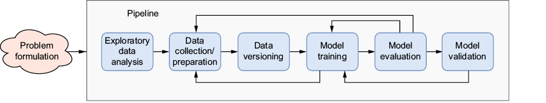

*출처: 원서 Figure 1.1. 문제 정의 이후 탐색적 데이터 분석부터 모델 검증까지가 하나의 파이프라인으로 묶이며, 훈련·평가 단계에서 앞 단계로 되돌아가는 화살표가 반복을 나타낸다.*

화살표는 한 방향이지만 실제로는 거의 모든 단계에서 반복이 일어난다. 평가 지표가 기준에 못 미치면 다른 모델 아키텍처를 검토하거나, 더 앞으로 돌아가 고품질 데이터가 충분한지 확인한다. 이처럼 단계 간 흐름이 루프를 포함한 비선형 구조이기 때문에, 모든 단계를 하나의 **오케스트레이션 파이프라인**으로 묶어 처음부터 자동화한다.

| 단계 | 핵심 내용 |
|------|-----------|
| 문제 정의 | "ML을 써야 하는가?"부터 묻는다. 휴리스틱으로 충분하면 ML이라는 만능 망치를 꺼내지 않는다 |
| 데이터 수집·준비 | 훈련·평가 데이터를 확보한다. 실제 데이터가 부족하면 합성 데이터를 고려하고, 애노테이션으로 레이블을 붙인다 |
| 데이터 버전 관리 | 데이터가 바뀌어도 모델 동작이 바뀌므로, 재현성을 위해 데이터도 버전을 관리한다 |
| 모델 훈련 | 예측값과 실젯값의 오차가 최소화되도록 가중치를 조정한다. 처음부터 자동화하면 실험을 쉽게 반복하고 파라미터·아티팩트가 추적된다. 흔히 훈련에 시간이 가장 많이 든다고 생각하지만 실제로는 그 반대이며, 책의 초점도 훈련이 아니다 |
| 모델 평가 | 훈련에 쓰지 않은 데이터로 정밀도, 재현율, AUC 등 지표를 측정한다 |
| 모델 검증 | 모델이 기대대로 동작하는지 확인한다. 개발팀이 아닌 비즈니스 이해관계자가 수행하는 경우가 많다 |

**휴리스틱 vs 머신러닝**:

휴리스틱은 데이터로 학습하지 않고 사람이 정한 규칙(if/else, 임계값, 점수 공식, 조회 테이블)으로 문제를 푸는 방식이다. 최적을 보장하지는 않지만 "충분히 좋은 답"을 빠르고 싸게 낸다.

| 구분 | 휴리스틱 | 머신러닝 |
|------|----------|----------|
| 규칙의 출처 | 사람이 설계 | 데이터에서 학습 |
| 필요한 것 | 도메인 지식 | 레이블 데이터, 학습·배포·모니터링 인프라 |
| 설명 가능성 | 높음 (규칙을 그대로 읽으면 됨) | 모델에 따라 낮음 |
| 유지보수 | 규칙을 직접 수정 | 재학습, 드리프트 감시 |
| 잘 맞는 경우 | 규칙이 단순하고 안정적 | 규칙이 복잡하고 패턴이 데이터에 있음 |

스팸 키워드 필터, "평균 결제액의 5배 이상 + 해외 결제" 이상 거래 차단, "지난주 같은 요일 판매량" 수요 예측, 인기순 추천, "30일 미로그인 시 이탈 위험" 같은 것은 휴리스틱으로 충분한 경우가 많다. 판단 기준은 다음과 같다.

1. 휴리스틱 baseline을 먼저 만들어 측정한다. 이것이 ML 모델이 넘어야 할 기준선이다

2. ML 모델이 비즈니스 지표에서 의미 있게 좋아지는지 본다. 정확도 1~2%p 개선으로는 학습 파이프라인·피처 스토어·서빙·모니터링 운영 비용을 정당화하기 어렵다

3. 규칙이 너무 많거나 복잡하거나(이미지, 자연어), 자주 변하거나, 레이블 데이터가 충분하면 ML이 필요한 쪽이다

**애노테이션과 데이터 분할**:

지도학습 모델은 "문제와 정답이 짝지어진 예제"로 배운다. 원본 데이터에 사람이 정답을 붙이는 작업이 애노테이션이고, 붙인 정답이 레이블이다. OCR 예제에서는 애노테이터가 신분증 이미지의 ID 번호 영역에 경계 상자(bounding box)를 그리고 번호를 직접 입력한다. 사기 탐지에서는 고객이 신고한 거래에 사기 레이블을 붙이므로 별도 작업 없이 레이블이 생긴다. 배포 후에는 실시간 요청에 정답이 없고, 레이블이 도착하기까지 시간이 걸리는 경우가 많아(사기 신고까지 며칠) 모니터링을 어렵게 만든다.

| 구분 | 훈련(train) | 검증(validation) | 테스트(test) |
|------|-------------|------------------|--------------|
| 비유 | 교과서·문제집 | 모의고사 | 수능 |
| 용도 | 패턴 학습 | 하이퍼파라미터 조정, 모델 선택 | 최종 성능 1회 측정 |
| 학습에 사용 | 예 | 아니오 (간접 영향) | 절대 아니오 |
| 통상 비율 | 60~80% | 10~20% | 10~20% |

훈련 데이터로 평가하면 문제를 외운 학생에게 같은 문제를 내는 것과 같아 점수가 부풀려진다(과적합). 시계열이나 사기 탐지처럼 시간 순서가 있는 데이터는 미래 정보가 훈련에 새어 들어가지 않도록 무작위가 아닌 시간 순서로 나눈다.

**데이터 버전 관리**는 코드 버전 관리와 다른 문제다. 데이터는 이미지, CSV, pandas DataFrame 등 형태가 다양하고, ML 커뮤니티에는 아직 Git처럼 보편적으로 정착한 도구가 없다.

#### 개발/스테이징/프로덕션 단계

실험이 끝나는 것은 아니지만, 초점이 순수한 탐색에서 **프로덕션 모델의 성능 유지와 지속적 개선**으로 이동한다. 이 지점부터 윤리적 제약, 보안, 확장성, 견고성, 실시간 성능이 우선순위가 된다.

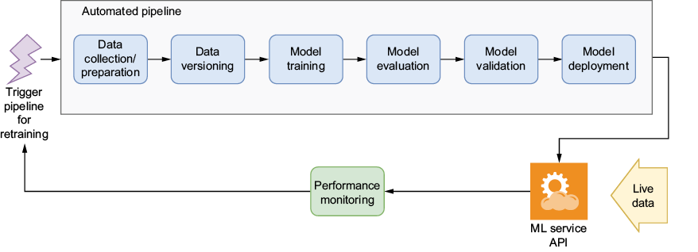

*출처: 원서 Figure 1.2. 재훈련 트리거가 자동화된 파이프라인을 시작하고, 배포된 ML 서비스 API가 실시간 데이터를 처리하며, 성능 모니터링 결과가 다시 트리거로 이어진다.*

실험 단계의 파이프라인을 **완전히 자동화**하고, 끝에 **모델 배포**가 추가된다는 것이 차이다. 트리거는 CI 또는 프로그래밍 방식 호출에서 발생하며, 정교한 사용 사례에서는 성능 지표가 임계값 아래로 떨어지면 트리거가 다시 발동해 전체 프로세스가 반복된다.

- **모델 배포**: 가장 간단한 방법은 모델 인퍼런스를 REST API로 감싸고 Docker로 컨테이너화해 클라우드에 배포하는 것이다. 이후 부하 테스트, 자동 스케일링, 모델 버전 관리, 롤백 전략까지 갖춰야 한다. 일부 조직은 이 시점에 IT·DevOps/MLOps 팀으로 업무를 넘기지만, 데이터 과학자도 참여시키는 편이 이점이 있다

- **모델 모니터링**: 모델은 실전 데이터를 만나면 평가 때만큼 성능을 내지 못하는 경우가 많다. 시스템 지표(RPS(Requests Per Second), HTTP 상태 코드), ML 지표(데이터·모델 드리프트), 비즈니스 지표(이탈률, 유지율)를 함께 본다

- **모델 재훈련**: 고정 일정(매월) 또는 임계값 충족(대출 승인 건수 급감 등)으로 트리거한다. 훈련 파이프라인뿐 아니라 배포까지 자동화해야 새 모델이 즉시 반영된다

### ML 엔지니어에게 필요한 역량

ML 엔지니어는 여러 도메인의 기술을 복합적으로 갖춰야 하지만, 처음부터 모든 것을 알 필요는 없다. 중요한 것은 이 기술들이 어떻게 맞물려 신뢰할 수 있는 ML 시스템을 만드는지 이해하는 것이다.


*출처: 원서 Figure 1.3. MLOps는 소프트웨어 엔지니어링, DevOps, 데이터 과학이 겹치는 영역에 위치한다.*

| 역량 | 설명 |
|------|------|
| 소프트웨어 엔지니어링 | 모바일 앱부터 엔터프라이즈 시스템까지 단순하지 않은 시스템을 배포해 본 경험, 디버깅과 성능 병목 분석 능력 |
| ML·데이터 과학 이해 | 알고리즘 전문가이거나 역전파 세부 내용을 알 필요는 없지만, TensorFlow, PyTorch, scikit-learn 같은 프레임워크를 능숙하게 다루고 낯선 프레임워크도 거리낌 없이 익힐 수 있어야 한다 |
| 데이터 엔지니어링 | 대부분의 실무자는 양질의 훈련 데이터를 충분히 확보하는 것이 가장 어렵다는 데 동의한다 |
| 자동화와 재현성 | 자동화는 실수를 줄이고 빠른 피드백을 가능하게 한다. 개발·스테이징·프로덕션에서 모델이 동일하게 동작하려면 실험 재현성이 필수이며, 규제·감사 대상일 때는 더욱 결정적이다 |

코끼리를 먹는 방법처럼, 복잡한 문제는 한 번에 조금씩 관리 가능한 단위로 쪼개 해결한다.

### ML 플랫폼 구축

잘 설계된 ML 플랫폼은 수명주기의 모든 단계를 처리하는 도구와 인프라를 제공하는, 신뢰할 수 있는 ML 시스템의 토대다. 책에서는 쿠버네티스 위에서 동작하는 오픈소스 ML 플랫폼인 **Kubeflow**를 설치하는 것으로 시작해, 부족한 부분을 다른 오픈소스 도구로 확장한다. 데이터 웨어하우스/레이크, Spark·Flink 같은 배치·스트리밍 프로세서는 ML 플랫폼 경계 바깥의 데이터 시스템으로 본다.

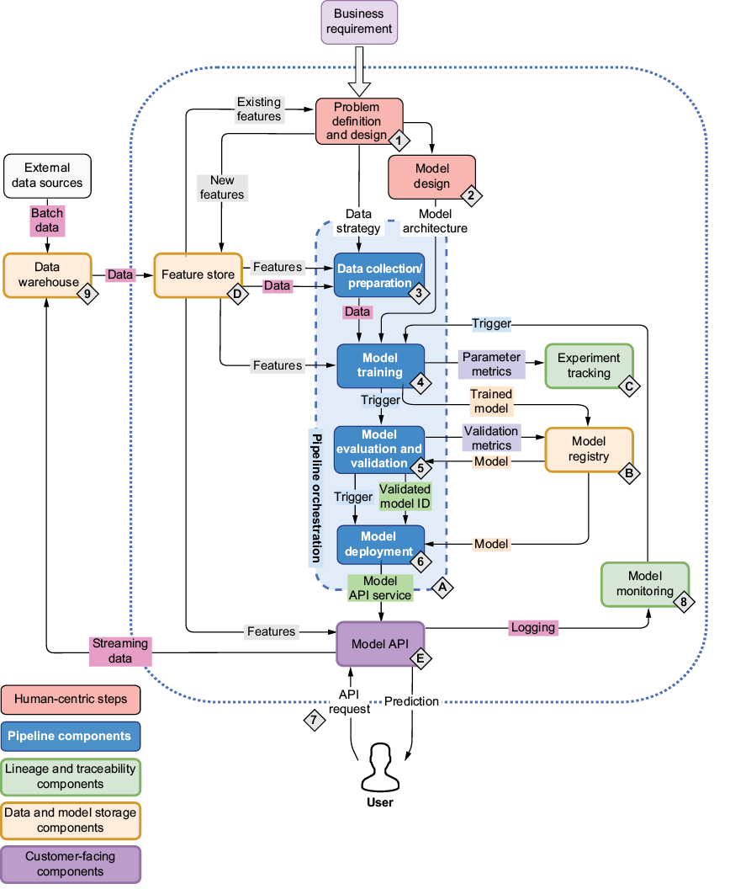

*출처: 원서 Figure 1.4. 점선 안이 ML 플랫폼이다. 인프라 컴포넌트에는 알파벳(A 파이프라인 오케스트레이션, B 모델 레지스트리, C 실험 추적, D 피처 스토어, E 모델 API), 데이터 흐름 단계에는 숫자(1 문제 정의 → 2 모델 설계 → 3 데이터 수집 → 4 훈련 → 5 평가·검증 → 6 배포 → 7 요청 → 8 모니터링 → 9 데이터 웨어하우스) 태그가 붙어 있다.*

책은 각 장에서 이 개념도를 반복해 사용하면서 현재 다루는 컴포넌트를 강조한다. 태그 순서는 책에서 컴포넌트가 소개되는 순서이자 파이프라인에서 데이터가 흐르는 일반적인 순서다. 플랫폼 내부는 Jupyter Notebook에서 시작해 Kubeflow Pipelines로 오케스트레이션하고, Kubeflow가 충분히 지원하지 못하는 영역은 Feast, MLflow, BentoML 같은 도구로 확장한다.

!!! note "모든 상황에 맞는 ML 플랫폼 아키텍처는 없다"
    책의 아키텍처는 저자들의 조직에서 검증된 것이지만 단일 정답은 아니다. ML 플랫폼은 점진적으로 발전시켜 나가는 방식을 권장한다.

**직접 구축 vs 벤더 플랫폼**:

Amazon SageMaker나 Vertex AI 같은 벤더 플랫폼을 이미 쓰고 있더라도, 오픈소스 라이브러리를 조합해 플랫폼을 직접 구축해 보는 경험은 가치가 있다. 도구들이 어떻게 함께 동작하는지 깊이 이해하게 되고, 한계에 부딪혔을 때 극복하는 방법을 익히게 된다.

**MLOps → LLMOps**:

전통적인 MLOps 컴포넌트는 LLM 시스템에서도 핵심 역할을 유지하고, 그 위에 시맨틱 검색용 벡터 데이터베이스, LLM 가드레일, 비용 최적화, 프롬프트 관리 같은 LLMOps 요소가 추가된다. 파이프라인 오케스트레이션, 모델 배포, 모니터링 기술은 LLMOps로 확장할 때도 그대로 적용된다.

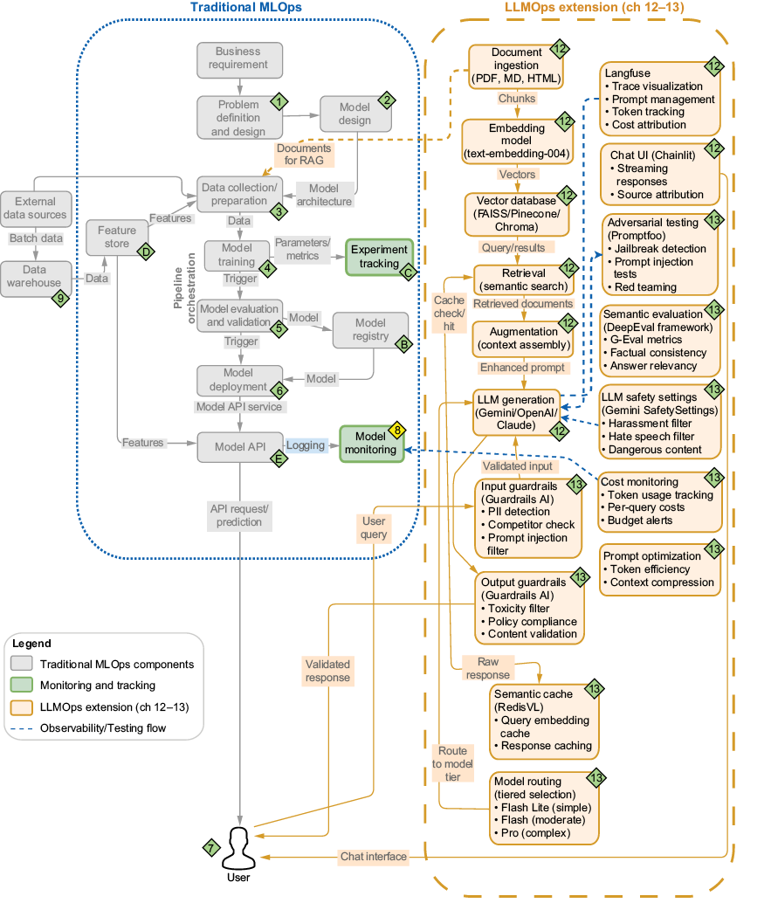

*출처: 원서 Figure 1.5. 왼쪽은 전통적인 MLOps 컴포넌트, 오른쪽은 문서 수집·임베딩·벡터 DB·가드레일·시맨틱 캐싱·모델 라우팅 등 LLMOps 확장 요소다. 책의 12~13장에서 다룬다.*

**도구 선택**:

책의 권장 도구는 정답이 아닌 출발점이다. 커뮤니티 지원이 탄탄하고 프로덕션에서 검증된 오픈소스 도구에 초점을 맞추며, 며칠간 PoC(Proof of Concept)로 직접 써 보고 요구에 맞는지 판단하는 것을 권장한다. 초기 실험은 나중에 치명적으로 불거질 한계를 미리 드러낸다.

### 책에서 사용하는 도구

#### 파이프라인 오케스트레이션: Kubeflow Pipelines

MLOps 수명주기를 구현하려면 모든 단계를 연결하는 파이프라인 자동화 도구가 필요하다. Kubeflow Pipelines에서는 수명주기의 각 단계가 **파이프라인 컴포넌트**로 표현되고, 각 컴포넌트는 이전 컴포넌트의 데이터를 받아 작업한 뒤 다음 컴포넌트로 전달한다.

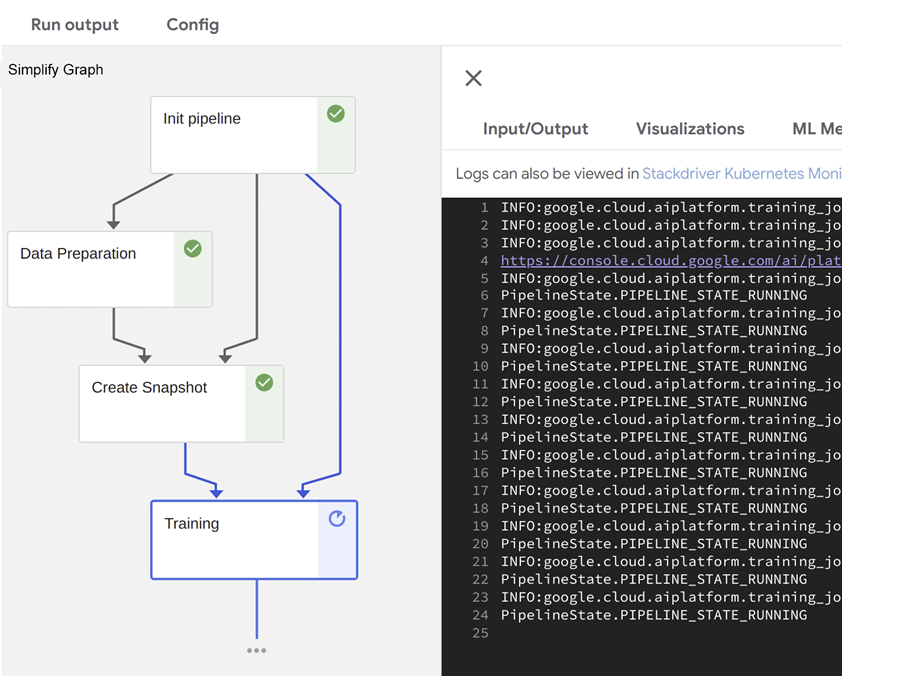

*출처: 원서 Figure 1.6. Kubeflow Pipelines UI에서 Init pipeline → Data Preparation → Create Snapshot → Training 컴포넌트가 연결되어 실행되는 모습이다. 오른쪽은 Training 단계 로그로, Google Cloud AI Platform 학습 작업을 호출해 상태를 확인하고 있다.*

#### 피처 스토어: Feast

피처는 모델이 입력으로 받는 가공된 값이다. "거래 내역 10만 건"이라는 원본에서 뽑은 "최근 7일 평균 결제액", "이번 달 해외 결제 횟수"가 피처다. 피처 스토어는 피처를 한 번 정의·계산해 저장한 뒤 **훈련과 서빙이 같은 곳에서 가져다 쓰게** 하는 소프트웨어다.

| 구분 | 피처 스토어 없음 | 피처 스토어 사용 |
|------|------------------|------------------|
| 피처 계산 코드 | 훈련용·서빙용을 따로 작성 | 한 번 정의해 양쪽에서 재사용 |
| 훈련-서빙 불일치 | 생기기 쉬움 | 줄어듦 |
| 팀 간 재사용 | 복붙, 중복 계산 | 카탈로그에서 찾아 공유 |
| 과거 시점 재현 | 직접 구현 | 시점 기준 조회 지원 |

데이터 과학자가 노트북에서 짠 피처 계산 로직을 엔지니어가 서빙용으로 다시 구현하다 미묘하게 달라지면, 훈련 때 본 값과 서빙 때 받는 값이 달라 성능이 떨어진다. 이것이 **훈련-서빙 불일치(training-serving skew)**이며, 피처 스토어가 해결하는 핵심 문제다.

피처 스토어는 REST·gRPC로 피처를 제공하는 **피처 서버**, 사용 가능한 피처를 목록화하는 **피처 레지스트리**, 영속성 계층인 **피처 스토리지**로 구성되며, 두 가지 모드로 피처를 제공한다.

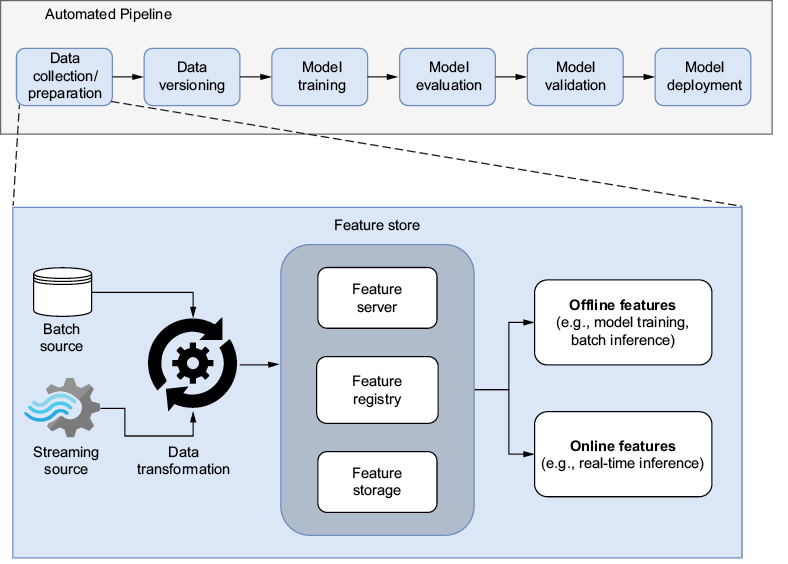

*출처: 원서 Figure 1.7. 피처 스토어는 변환된 데이터(피처)를 입력으로 받아 저장·카탈로그·제공 기능을 수행한다.*

| 구분 | 오프라인 스토어 | 온라인 스토어 |
|------|-----------------|---------------|
| 목적 | 모델 훈련·배치 추론 | 실시간 서빙 |
| 데이터 양 | 과거 전체 이력 | 엔티티별 최신 값 |
| 응답 속도 | 분~초 | 밀리초 |
| 저장소 예 | Parquet, S3, BigQuery | Redis, DynamoDB |
| 조회 방식 | 특정 시점 기준(point-in-time) | 엔티티 키로 최신 값 |

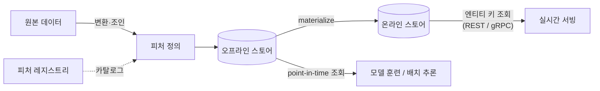

과거 데이터로 훈련할 때는 그 시점에 알 수 있었던 값만 써야 한다. 3월 1일의 사기 여부를 학습하는데 3월 5일에 계산된 "최근 7일 평균"을 쓰면 미래 정보가 새어 들어가는 **데이터 누수(leakage)**다. point-in-time 조회는 타임스탬프 기준으로 당시 값을 가져와 이를 막는다.

#### 실험 추적·모델 레지스트리: MLflow

훈련 실행의 출력물에는 모델뿐 아니라 여러 아티팩트가 포함된다. 재현성을 보장하려면 매 실행마다 이를 모두 기록해야 한다.

| 아티팩트 | 설명 | 예시 |
|----------|------|------|
| 모델(가중치) | 학습이 끝난 결과물 파일 | `model.pkl`, `best.pt` |
| 하이퍼파라미터 | 학습 전에 사람이 정한 설정값 | 학습률 0.01, 트리 깊이 6 |
| 플롯 이미지 | 학습 과정·결과 시각화 | 손실 곡선, 혼동 행렬, ROC 곡선 |
| 메타데이터 | 실행을 설명하는 부가 정보 | 데이터 버전, 코드 커밋, 실행 시각, 평가 지표 |

훈련 손실은 줄어드는데 검증 손실이 오르면 과적합 신호이며, 이런 상태는 숫자 한 줄보다 플롯으로 더 빨리 보인다. 모델 파일만으로는 "이 모델이 어디서 왔는가"에 답할 수 없으므로 메타데이터가 있어야 추적과 재현이 가능하다.

| 구분 | 가중치 | 파라미터 | 하이퍼파라미터 |
|------|--------|----------|----------------|
| 정하는 주체 | 학습 알고리즘 | 학습 알고리즘 | 사람(또는 탐색 도구) |
| 정해지는 시점 | 학습 중 갱신 | 학습 중 갱신 | 학습 시작 전 고정 |
| 의미 | 입력에 곱해지는 계수 | 모델 내부에서 학습되는 모든 값(가중치 + 편향) | 학습 방식·모델 구조를 정하는 설정 |
| 저장 위치 | 모델 파일 | 모델 파일 | 설정 파일·실행 기록 |

모델 레지스트리는 메타데이터·파라미터·아티팩트와 모델을 함께 관리하며, 모델을 스테이징에서 프로덕션으로 **승격**하는 사용 사례를 지원한다. ML 서비스가 레지스트리에서 모델을 직접 가져와 서빙하도록 구성할 수도 있다.

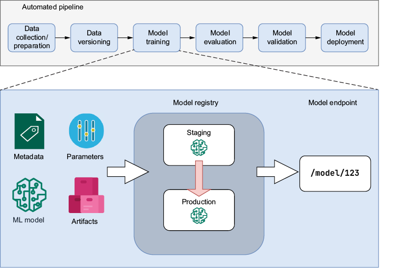

*출처: 원서 Figure 1.8. 모델 레지스트리는 메타데이터·파라미터·아티팩트와 ML 모델을 함께 기록하고, 모델 엔드포인트를 노출한다.*

#### 모델 배포

모델 배포는 모델을 프로덕션(또는 개발·스테이징)에 통합해 입력을 받고 출력을 반환하게 하는 것, 즉 다른 사람이 모델을 활용할 수 있게 하는 엔지니어링 작업이다. 이식성(컨테이너화), 확장성(쿠버네티스 복제본), 성능(GPU·CPU·RAM), 신뢰성을 고려하며 CI/CD로 최대한 자동화한다.

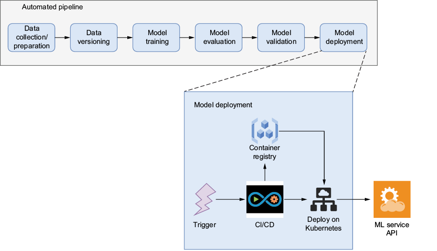

*출처: 원서 Figure 1.9. CI/CD 트리거가 발생하면 ML 서비스용 Docker 이미지를 빌드해 컨테이너 레지스트리에 푸시하고, 새 이미지를 참조하는 쿠버네티스 매니페스트를 적용해 서비스를 업데이트한다.*

### 실습 프로젝트

책은 수명주기 전체(데이터 준비 → 모니터링 → 모델 폐기)를 경험하도록 서로 다른 데이터 모달리티의 세 프로젝트를 진행한다. 일부 도구(Kubeflow Pipelines 등)는 여러 프로젝트에서 재사용하고, 앞서 쓴 도구의 한계를 짚고 대안을 제시하기도 한다.

| 프로젝트 | 데이터 | 주요 내용 |
|----------|--------|-----------|
| OCR 신분증 탐지 | 이미지 (MIDV-500, 합성 데이터) | 데이터셋 구축 → 오픈소스로 초기 구현 → YOLO 파인튜닝 → 서비스 배포 |
| 영화 추천 | 테이블 (MovieLens 1M) | 피처 스토어, 드리프트 탐지, 모델 테스트, 관측 가능성 |
| RAG 문서 도우미 (DakkaBot) | 텍스트 (사내 문서) | 문서 수집 → 벡터 임베딩 → RAG, 가드레일, 비용 최적화, 시맨틱 평가 |

이 프로젝트들은 다음을 확인시켜 주도록 구성되어 있다.

- ML 프로젝트는 선형적으로 진행되지 않는다. 훈련 중 성능이 안 나오면 데이터 준비로 돌아간다

- 요구사항은 시간에 따라 변하며, 그때마다 현재 솔루션을 재검토하고 다른 도구와 기법을 탐색한다

- MLOps 핵심 개념은 프로젝트의 유형·도메인·단계를 막론하고 적용되는 엔지니어링 프레임워크다

## CH 2. MLOps란 무엇인가

ML과 ML 모델은 대부분 조직의 최종 산출물이 아니라 목적을 위한 수단이다. 모델 하나를 만들 때도 다음 질문에 답해야 한다.

- 모델을 어떻게 훈련할 것인가?
- 데이터를 어떻게 모델에 전달할 것인가?
- 모델은 다른 서비스와 어떻게 상호작용할 것인가?
- 모델은 어디서 실행할 것인가?
- 시간이 지나도 정확도를 어떻게 유지할 것인가?

ML의 가치는 시간이 지남에 따라 지속적으로 개선되는 **폐쇄 루프(closed loop)**의 일부가 될 때 비로소 발현된다.

### 반복적인 MLOps 수명주기

모델, 데이터, 하이퍼파라미터는 일시적인 존재이며, 시간이 흐르며 진화하는 루프의 일부로 이해해야 한다. 중고차 가격 예측 모델은 시장 상황에 맞춰 진화하고, 상업용 차량을 위한 별도 버전이 생길 수도 있다. 모델을 빌드·테스트·배포하는 견고한 워크플로가 있으면 배포 자체보다 모델이 제공하는 비즈니스 가치에 집중할 수 있다.

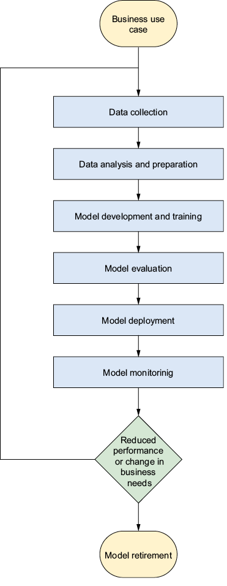

*출처: 원서 Figure 2.2. 비즈니스 사용 사례에서 시작해 데이터 수집, 데이터 분석·준비, 모델 개발·훈련, 평가, 배포, 모니터링을 거친다. 성능이 저하되거나 비즈니스 요구가 바뀌면 데이터 수집으로 돌아가 루프를 반복하고, 더 이상 가치가 없으면 모델을 폐기(retirement)한다.*

#### 문제 정의 및 설계

"고객 이탈률을 예측하라" 같은 문장만으로는 모델링하고 평가 기준을 도출하기에 부족하다. 프로젝트 착수 전에 이해관계자 그룹별로 핵심 질문에 답해야 한다.

- **비즈니스·제품**: 왜 ML이 필요한가? 성공을 측정할 핵심 지표는? 노력 대비 가치는? 일정은? 잘못된 예측의 영향과 허용 오차는?

- **기술 팀**: ML로 해결 가능한가? 데이터는 어디에 어떻게 저장되는가? 어떤 지표로 평가하는가? 필요한 컴퓨팅 리소스는? 업그레이드 가능한 배포 전략은? 재훈련을 촉발할 지표는?

- **법무·컴플라이언스**: 윤리·개인정보 보호 문제는? 민감 정보는 어떻게 처리하는가? 데이터 거버넌스 요건은?

이 과정으로 범위와 산출물을 정의하고, 비즈니스 목표와 기술 구현을 맞추고, 잠재적 과제를 조기에 식별하며, 데이터 과학자와 ML 엔지니어 간 소통을 원활하게 한다.

**모델과 코드는 별개의 개체다**:

모델(가중치 + 네트워크)과 코드(모델 아키텍처 + 지원 코드)는 버전이 따로 움직인다. 코드는 그대로인데 재학습으로 모델만 바뀌기도 하고, 모델은 그대로인데 전처리 코드만 고치기도 한다.

| 구분 | 모델 | 코드 |
|------|------|------|
| 정체 | 학습 결과로 만들어진 파일 | 사람이 작성한 소스코드 |
| 담긴 것 | 학습된 숫자 + 연산 구조 정보 | 층 구성 클래스, 전처리, 학습·추론 로직 |
| 저장 형태 | `model.pkl`, `best.pt`, `model.onnx` | `.py` 파일, Git 저장소 |
| 버전 관리 | 모델 레지스트리, 아티팩트 저장소 | Git |
| 변경 계기 | 재학습할 때마다 | 로직·구조를 고칠 때 |

```python
class SmallNet(nn.Module):           # 코드: 구조를 정의한다
    def __init__(self):
        super().__init__()
        self.fc1 = nn.Linear(784, 128)
        self.fc2 = nn.Linear(128, 10)

torch.save(model.state_dict(), "weights.pt")   # 가중치(숫자)만 저장

model = SmallNet()                              # 로드할 때는 코드가 필요
model.load_state_dict(torch.load("weights.pt"))
```

`state_dict`처럼 가중치만 저장하면 아키텍처 코드가 반드시 필요하고, TorchScript·ONNX·SavedModel은 연산 구조까지 담아 코드 없이 로드할 수 있다. 구조를 바꾼 코드로 예전 가중치를 불러오면 에러가 나거나, 더 나쁘게는 조용히 엉뚱한 결과가 나온다. 그래서 모델마다 짝이 되는 코드 커밋을 메타데이터로 기록한다. pickle 파일은 로드할 때 코드를 실행할 수 있으므로 출처를 모르는 모델 파일을 `pickle.load`하면 보안 위험이 있다.

**리니지(lineage)**는 "이 모델이 무엇으로부터 어떤 과정을 거쳐 만들어졌는가"를 잇는 계보다.


| 구분 | 리니지 유지 | 리니지 추적 |
|------|-------------|-------------|
| 하는 일 | 각 단계에서 연결 정보를 기록·보존 | 기록을 따라 연결을 거슬러 올라가거나 내려가며 조회 |
| 시점 | 훈련·배포 중 (쓰기) | 문제 발생·감사 시 (읽기) |
| 방법 | 실험 추적 도구, 모델 레지스트리, 데이터·코드 버전 관리 | 레지스트리·추적 UI에서 모델 → 실행 → 데이터 조회 |
| 실패하면 | 추적할 단서가 없음 | 원인 파악·재현 불가 |

추적에는 두 방향이 있다. 운영 모델 성능이 떨어지면 "어떤 데이터와 코드로 만들었나"를 **거슬러 올라가고**, 학습 데이터에 오류가 발견되면 "이 데이터로 만든 모델이 지금 어디에 배포돼 있나"를 **내려간다**. 리니지는 디버깅, 재현과 롤백, 감사·규정 준수, 팀 인수인계에 필수이며, 없으면 모델은 "아무도 어떻게 만들었는지 모르는 블랙박스 파일"이 된다.

#### 데이터 수집

문제가 정의되고 측정 가능한 KPI(Key Performance Indicator)가 식별되면 데이터를 수집한다. **이후의 모든 단계가 이 단계에서 생긴 편향을 그대로 이어받으므로** 수집과 큐레이션은 신중해야 한다.

| 구분 | 수집(collection) | 큐레이션(curation) |
|------|------------------|--------------------|
| 핵심 질문 | 데이터를 어디서 얼마나 가져올까 | 가져온 데이터가 쓸 만하고 균형 잡혔나 |
| 하는 일 | 로그, DB, API, 크롤링, 구매, 합성 생성 | 선별, 정제, 중복 제거, 균형 조정, 문서화 |
| 결과물 | 원시 데이터 | 모델링에 쓸 수 있는 데이터셋 |

이 단계는 연구와 기업 ML이 갈리는 지점이기도 하다.

| 구분 | 연구 | 기업 |
|------|------|------|
| 관심사 | 지표 최적화 | 배포 환경에서 동작하는 제품 |
| 데이터셋 | 검토·수정을 거친 대규모 오픈소스 데이터셋 | 대상 도메인용 오픈소스가 없는 경우가 많음 |
| 데이터 품질 | 충분하다고 가정 | 직접 확보·검증 |
| 파인튜닝 | 선택적 | 배포 환경 데이터로 필수 |

Hugging Face 같은 오픈소스 생태계 덕분에 대부분의 기업은 기성 모델을 재사용하지만, 결국 자기 환경의 데이터는 직접 마련해야 한다. 좋은 데이터셋은 다음 조건을 갖춘다.

- 문제 도메인과의 관련성, 문제 복잡도에 맞는 크기, 충분한 품질

- 유해한 편향과 데이터 누수 방지

- 배포 환경을 대표하는 데이터·피처 분포와 충분한 다양성

- 원시 데이터, 중간 버전, 증강·애노테이션된 데이터셋에 대한 리니지와 추적

**유해한 편향과 데이터 누수**:

| 종류 | 설명 | 예시 |
|------|------|------|
| 표본 편향 | 데이터가 세상을 골고루 담지 못함 | 밝은 실내 신분증만 학습 → 어두운 사진에서 실패 |
| 선택 편향 | 레이블이 특정 경우에 쏠림 | 신고된 사기만 사기로 표시 → 신고 안 된 사기를 놓침 |
| 과거 편향 | 과거의 불공정한 판단을 학습 | 과거 대출 심사의 차별이 모델에 복제 |
| 샘플 중복 누수 | 같은 데이터가 훈련과 테스트에 모두 존재 | 같은 신분증 사진이 두 번 수집되어 양쪽에 존재 |
| 미래 정보 누수 | 예측 시점에 알 수 없는 정보를 사용 | 3월 1일 판정에 3월 5일 평균 결제액 사용 |
| 정답 단서 누수 | 정답을 간접적으로 알려 주는 피처 포함 | 사기 확정 후 생기는 계정 정지 여부를 피처로 사용 |

편향은 데이터가 현실과 다른 문제이고, 누수는 평가가 현실과 다른 문제다. 누수가 있으면 평가 점수가 좋게 나와 문제가 있다는 사실 자체를 모르게 된다. 둘 다 학습 이후에는 고치기 어려우므로 데이터 단계에서 막는다.

- 균형 조정(오버/언더샘플링)은 **훈련 데이터에만** 적용한다. 검증·테스트에까지 하면 실제 운영 분포와 달라져 성능이 부풀려진다

- 분할하기 전에 중복을 먼저 제거하고, 시간 순서가 있는 데이터는 시간 순서로 나눈다

- 피처를 정할 때마다 "예측 시점에 이 값을 실제로 알 수 있나?"를 자문하고, 점수가 지나치게 좋으면 누수를 의심한다

- 큐레이션 기준을 데이터 카드(data card)로 기록해 리니지에서 데이터 단계를 추적할 수 있게 한다

데이터 리니지는 초기 개발 속도를 위해 종종 생략되는데, 이는 미래의 유지보수성을 희생하는 기술 부채와 같다. 리니지는 데이터셋 버전 관리를 v1 → v2 → v3의 **선형적인 흐름**으로 만들어 잘못된 데이터를 되돌아가 바로잡을 수 있게 한다. 첫 번째 데이터셋 버전이 최선인 경우는 드물다.

| 구분 | 리니지 없음 | 리니지 있음 |
|------|-------------|-------------|
| 오류 발견 시 | 어디서 틀렸는지 찾기 어려움 | 기록을 따라 해당 단계로 이동 |
| 데이터셋 재생성 | 추출 스크립트를 다시 짜고 재실행 | 해당 버전·조건으로 간단한 쿼리 실행 |
| 걸리는 시간 | 며칠 | 몇 분 |

**데이터 수집 캠페인 예시: 중고차 가격 추정기**:

이 지침을 중고차 가격 추정기에 적용하면 다음과 같다.

- 사용 사례에 맞는 데이터만 수집한다. 중고 시장의 승용차 데이터는 모두 모으되, 트럭이나 오토바이는 제외한다

- 데이터셋이 목표 도메인을 대표하고 편향이 생기지 않도록 샘플링 기법을 고려한다. 특히 특정 범주가 과대 또는 과소 대표되는 클래스 편향을 주의한다

- 리니지를 확립하기 위해 버전 관리되는 ETL(Extract, Transform, Load) 파이프라인으로 데이터셋을 생성한다

처음에는 이 조건 중 일부가 충족되지 않는 경우가 대부분이다. 전체 프로세스가 반복적이라는 점을 알고 있으므로, 조건을 최대한 많이 충족하는 데이터셋으로 시작하면 된다.

**프로젝트별 데이터**:

세 프로젝트는 데이터 모달리티가 서로 달라, 같은 원칙(품질, 편향 방지, 리니지)이 형태에 따라 어떻게 다르게 적용되는지 보여 준다.

| 구분 | 정형 데이터 | 이미지 | 텍스트(RAG) |
|------|-------------|--------|-------------|
| 저장 방식 | DB 테이블, CSV, Parquet | PNG, JPG | 문서 파일, 벡터 DB |
| 레이블 방식 | 컬럼 하나가 정답 | 박스 그리기, 분류 라벨 | 정답이 정해지지 않은 경우가 많음 |
| 전처리 | 결측 처리, 인코딩 | 크기 조정, 정규화, 증강 | 분할(chunking), 임베딩 |
| 평가 지표 | 정확도, F1, RMSE | mAP, IoU | 검색 정확도, 답변 충실도 |

| 데이터 | 설명 |
|--------|------|
| MIDV-500 (신분증 탐지) | 50종의 신분 문서(여러 나라의 신분증, 여권, 운전면허증)를 스마트폰으로 촬영한 영상 500편. 책상 위·손에 든 상태·손가락 가림·어수선한 배경 등 다양한 조건을 담는다. 실제 개인정보가 아닌 견본(specimen) 문서이며, 프레임마다 문서 네 모서리 위치가 레이블로 제공된다 |
| 사람 애노테이션 | 오픈소스 웹 기반 애노테이션 도구 CVAT(Computer Vision Annotation Tool)로 직접 레이블링하고, 이를 ML 루프의 일부로 만드는 과정을 다룬다 |
| 합성 데이터 | 신분증 템플릿을 배경 위에 임의의 위치·각도·크기로 붙여 이미지를 절차적으로 생성한다. 붙이는 순간 네 모서리 좌표를 알 수 있으므로 레이블이 함께 만들어져 전체 데이터셋을 애노테이션할 필요가 없다 |
| MovieLens 1M (영화 추천) | 2000년에 가입한 MovieLens 사용자 6,040명이 약 3,900편의 영화에 남긴 1,000,209건의 익명 평점. `users.dat`, `movies.dat`, `ratings.dat`로 구성된다 |

합성 데이터는 사람의 레이블 오류가 거의 없고 대량 생성이 쉽지만, 배경이 어색하거나 조명이 부자연스러워 현실과 달라 보이면 모델이 합성 이미지에만 맞춰질 수 있다. 합성 방식에 쏠림이 있으면 그것도 편향이 된다. 그래서 합성 데이터로 학습하더라도 실제 데이터로 평가하는 것이 일반적이며, 책에서 구체적으로 어떻게 합성하고 평가하는지는 해당 프로젝트 장에서 다룬다.


*출처: 원서 Figure 2.3. 서로 다른 신분 문서(중국 통행증, 오스트리아·독일 운전면허증, 에스토니아 ID 등)를 책상 위, 키보드 위, 손에 든 상태, 부분 가림, 어수선한 배경 조건에서 찍은 프레임이다. 빨간 박스가 문서 네 모서리 레이블이다.*

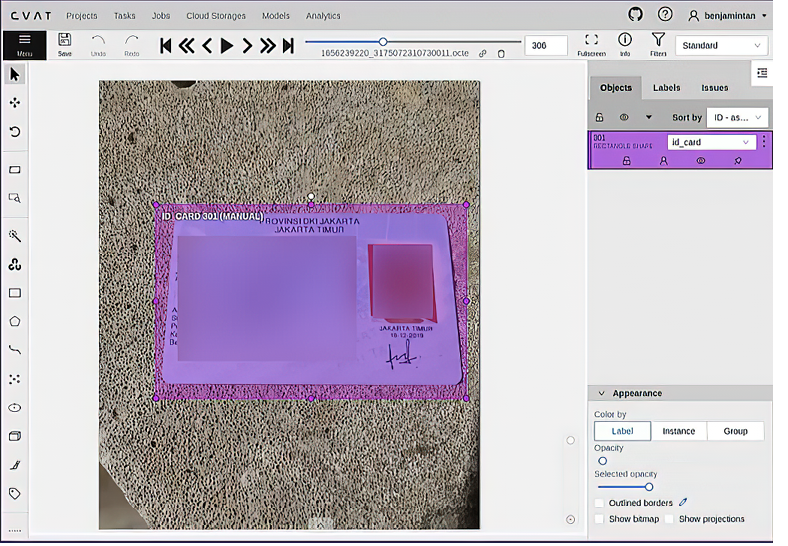

*출처: 원서 Figure 2.4. 이미지·영상 애노테이션용 웹 도구 CVAT에서 신분증 영역에 레이블을 표시한 화면이다.*

사람 애노테이션은 한 번 하고 끝나는 작업이 아니라, 모델과 사람이 번갈아 반복하는 human-in-the-loop 구조로 만든다.


모델이 어느 정도 학습되면 사람은 제안된 박스를 고치기만 하면 되어 작업이 빨라진다. 다만 시간·비용, 사람마다 다른 기준, 피로로 인한 실수, 레이블 병목, 레이블 버전 관리 문제가 따르며, 작업 지침서·교차 검수·레이블 버전 기록으로 대응한다.

준비 단계에서는 데이터셋을 더 작은 조각으로 나눠, 운영 중 사용자 데이터가 점점 유입되는 상황을 흉내 낸다. 조각을 더할 때마다 추출 파이프라인이 같은 절차로 처리하고 버전을 붙여 저장한다. 이 "조각 나누기"는 도착 시점 기준의 나누기로, 성능 평가를 위한 훈련·검증·테스트 분할과는 목적이 다르며 각 버전 안에서도 분할은 여전히 필요하다.

#### 탐색적 데이터 분석

EDA(Exploratory Data Analysis)는 데이터를 탐색하고 통계적 특성을 파악하는 과정으로, 명확히 정의되지 않은 데이터셋 문제에 대한 첫 번째 방어선이다. 다음 질문에 답한다.

- 데이터의 형태와 스키마는? 스키마가 바뀔 수 있는가? 유효하지 않은 값은 어떻게 방어하는가?

- 타깃이 균등하게 분포하는가, 클래스 균형 조정이 필요한가?

- 목표 작업에 적합한 피처가 있는가? 피처 계산 비용은 큰가?

- 입력 데이터가 주기적으로 변동하는가? 모델에 반영되지 않은 외부 요인과 상관관계가 있는가?

- 이상값(outlier)이 있는가? 프로덕션에서는 어떻게 처리할 것인가?

다변량 분석(multivariate analysis)은 여러 변수를 동시에 평가해 견고한 피처를 만들 단서를 준다. 키와 몸무게를 따로 보면 평범해도 함께 보면 "키에 비해 몸무게가 유난히 큰 사람"이 드러나고, 여기서 BMI 같은 새 피처를 만들 수 있다. 변수가 많으면 차원 축소로 2~3차원에 시각화한다.

| 구분 | PCA(Principal Component Analysis) | t-SNE(t-distributed Stochastic Neighbor Embedding) |
|------|-----|-------|
| 방식 | 가장 넓게 퍼진 방향으로 선형 투영 | 가까운 점끼리 가깝게 비선형 배치 |
| 강점 | 빠르고 결과가 일정, 피처 축소에도 사용 | 군집 구조 시각화에 유리 |
| 주의 | 비선형 구조는 못 잡음 | 느리고 실행마다 결과가 다름, 군집 간 거리·크기는 해석 불가 |

데이터에 대한 모든 가정은 검증되기 전까지 리스크로 간주하고, 데이터 파이프라인 초기에 검증 체계를 둔다. 스키마처럼 단순한 가정부터 샘플링에 숨은 편향, 특정 필드에 대한 오해까지 포함된다. ML 엔지니어도 이 관점을 갖추면 근본 원인 분석과 드리프트 같은 배포 문제에 중요한 맥락을 제공할 수 있다.

EDA는 한 번으로 끝나지 않는다. 루프를 돌면서 데이터셋에 대한 새로운 인사이트를 얻거나 실험이 실패할 때마다 가정을 다시 검토하는 반복 과정이다. 시간이 많이 드는 단계이므로, 모델에 대한 대안적 접근 방식과 문제 정의 자체를 바꾸는 것에도 열린 자세를 유지한다.

#### 모델링과 훈련

모델링은 (이론적) 성능, 입력 데이터 타입, 문제 유형을 고려해 적합한 모델을 고르는 것에서 시작한다.

| 유형 | 질문 | 출력 | 예시 |
|------|------|------|------|
| 분류 | 이게 무엇인가? | 정해진 범주 중 하나 | 스팸 여부, 고양이/개 |
| 탐지 | 무엇이 어디에 있는가? | 범주 + 위치(박스) | 사진 속 사람·자동차 위치 |
| 회귀 | 얼마인가? | 연속적인 숫자 | 집값, 기온, 영화 평점 |

이 단계에서 MLOps 도구상자의 중요한 컴포넌트가 등장한다.

| 컴포넌트 | 역할 |
|----------|------|
| 모델·데이터 버전 관리 | 모든 모델이 특정 데이터셋 버전과 연결되어 디버깅·컴플라이언스를 위해 처음부터 재현 가능 |
| 실험 추적 | 데이터, 모델 설정, 체크포인트를 모든 결과와 함께 기록해 실험이 유실되지 않음 |
| 모델 훈련 파이프라인 | 실수로 이어질 수 있는 수작업 단계를 제거 |
| 하이퍼파라미터 탐색 | 탐색 공간과 손실 함수만 주면 도구가 최적 조합을 탐색 |

공통 주제는 **리니지와 추적 가능성(traceability)**, 그리고 수작업 제거다. 이를 위해 코드베이스를 모듈식으로 구성하고, 훈련된 모델을 **코드 + 설정 + 데이터를 적용해 생성된 아티팩트**로 본다.

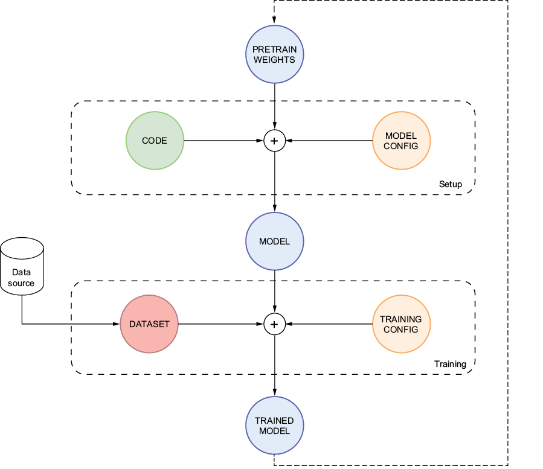

*출처: 원서 Figure 2.5. 모델, 코드, 설정 파일, 데이터를 각각 버전 관리되는 별개의 컴포넌트로 두고 리니지로 연결하면, 실험·디버깅·반복 개발을 하면서도 프로세스가 유연하고 빠르게 유지된다.*

모델 구조(층 수, 크기)와 학습 방식(학습률, 에폭)을 설정 파일에 두면 값만 고쳐 바로 재실행할 수 있다. 과적합이 의심되면 `num_layers`, `hidden_size`만 줄여 가설을 검증하고, 설정 변경은 Git 커밋으로 남아 두 모델의 설정을 diff로 비교할 수 있다. 설정과 리니지가 결합되면 모델을 블랙박스로 두지 않고 내부를 거슬러 확인하는 introspection이 가능해진다.

!!! warning "과도한 파라미터화 주의"
    팩토리 패턴으로 설정에 `model: resnet`만 적으면 해당 모델 객체를 만들어 주도록 구성하면 유연해진다. 하지만 층마다 활성화·초기화·드롭아웃까지 전부 설정으로 빼는 과도한 파라미터화(over-parametrization)는 조합이 폭발해 디버깅을 어렵게 한다. 단순한 설정에서 시작해 실제로 바꿔 보고 싶은 값이 생길 때 하나씩 설정으로 옮긴다.

**프로젝트별 모델**:

- **신분증 탐지**: YOLO(You Only Look Once)로 커스텀 객체 탐지기를 훈련한다. YOLO 사전 훈련 모델은 COCO(Common Objects in Context) 데이터셋으로 훈련되어 80종의 객체(COCO가 정의한 카테고리는 91종)를 탐지하지만 신분증·여권은 포함되지 않으므로, 레이블된 데이터셋으로 YOLOv8을 파인튜닝한다. 훈련 라이브러리에 평가 로직이 포함되어 있다

- **영화 추천**: 간단한 베이스라인 모델을 훈련 서브셋으로 노트북에서 시작한 뒤, 재훈련 파이프라인을 만들고 결과를 추적 서버에 기록한다. 모니터링 이후 더 복잡한 모델을 운영 모델과 비교 평가한다

- **RAG**: 임베딩 모델, 벡터 데이터베이스, 채팅 인터페이스가 추가되지만 MLOps 핵심 개념은 동일하게 재사용된다

#### 모델 평가

테스트 성능이 좋은 모델이 실제 목표 도메인에서도 잘 동작하는지 확인한다. 지표는 도메인에 따라 적합성이 다르고, 클래스 불균형이나 드리프트에 크게 영향받을 수 있다.

메일 100통 중 진짜 스팸이 10통이고, 모델이 8통을 스팸으로 판정해 그중 6통이 맞았다면(TP=6, FP=2, FN=4, TN=88):

| 지표 | 식 | 의미 | 값 |
|------|----|------|----|
| 정밀도(Precision) | TP / (TP+FP) | 스팸이라 한 것 중 진짜 스팸 비율 | 0.75 |
| 재현율(Recall) | TP / (TP+FN) | 진짜 스팸 중 찾아낸 비율 | 0.60 |
| F1 | 2·P·R / (P+R) | 정밀도와 재현율의 조화평균 | 0.667 |
| 정확도(Accuracy) | (TP+TN) / 전체 | 전체 중 맞힌 비율 | 0.94 |

스팸이 10%뿐이면 전부 정상이라고 찍어도 정확도가 90%이므로, 클래스가 불균형할 때는 F1이 소수 클래스를 잘 잡는지 더 잘 보여 준다. 정밀도와 재현율은 판정 임계값으로 맞바꾸는 관계로, 암 진단처럼 놓치면 안 되면 재현율을, 스팸 필터처럼 오탐이 싫으면 정밀도를 중시한다.

공식적인 환경에서 평가는 별도의 **홀드아웃(holdout) 데이터셋**으로 자동 수행한다.

- 프로덕션 데이터의 다양성·분포·특성을 반영하도록 구성하고 누수를 방지한다

- 평가를 자동화하면 사람의 실수로 인한 변동이 사라지고 결과의 반복성과 재현성이 보장된다

- 홀드아웃 데이터셋도 운영 데이터 경향에 맞춰 진화하므로 학습 데이터만큼 엄격하게 버전과 리니지를 관리한다

- 분할을 다시 해 예전 시험지 문제가 새 학습 데이터로 들어가면 이전 평가 점수를 믿을 수 없게 되므로, 분할 규칙(시드, 기준)을 고정하고 버전으로 관리한다

평가는 오류 정밀 분석 단계이기도 하다. 오분류 샘플의 패턴을 분석해 시스템적 문제와 편향을 찾고 데이터 수집 단계로 피드백하며, 적대적 테스트(adversarial test)와 에지 케이스 시뮬레이션으로 민감도와 견고성을 검증한다. 일부 조직은 피처 중요도, 결정 경계, 활성화 계층을 시각화하거나 LIME(Local Interpretable Model-agnostic Explanations), SHAP(SHapley Additive exPlanations) 같은 설명 가능한 AI 기법으로 해석 가능성을 필수 요건으로 둔다. 강력하지만 구현이 복잡하므로 요구사항과 비교해 도입 여부를 판단한다.

#### 배포

일반적인 배포 방식은 두 가지다.

- **마이크로서비스 엔드포인트**: 모델이 API 계층 아래에서 동작하고 API 계층이 요청을 처리한다

- **특정 하드웨어·에지 디바이스**: 자동차, 보안 장비, 로보틱스처럼 디바이스에서 인지(perception) 같은 작업을 수행해야 하는 분야에서 중요하다

두 방식 모두 성능과 지연 시간에 초점을 맞추므로, 원본 모델을 배포 환경에 맞게 최적화된 모델로 변환하는 단계를 거친다. GPU에서는 요구사항을 충족하던 모델도 임베디드 장치에서는 가속기나 툴체인의 양자화 처리 방식에 따라 성능이 크게 달라질 수 있으므로, **최적화된 최종 버전으로 성능 테스트**를 해야 한다.

배포는 보통 2단계다. 먼저 스테이징에 배포해 평가 모드로 프로덕션 모델과 비교하고, 평가가 끝나면 자동으로 프로덕션으로 승격한다. 견고한 버전 관리와 리니지가 있으면 롤백은 프로덕션 모델 포인터를 바꾸는 것만큼 간단해진다.

책에서는 BentoML로 HTTP 엔드포인트를 만들고 Docker로 패키징한 뒤, 같은 팀이 만든 배포 플랫폼 Yatai로 배포한다. RAG 애플리케이션에는 Chainlit으로 채팅 인터페이스를 제공한다. BentoML 서비스는 RPS와 HTTP 응답 코드 같은 Prometheus 지표를 기본으로 노출하며, 배칭(batching), 카나리 배포, A/B 테스트도 다룬다.

#### 모니터링

입력 데이터 변화, 개념 드리프트(concept drift), 하드웨어·소프트웨어 장애로 모델 성능은 시간이 지나며 달라질 수 있다.

- **데이터 모니터링**: 입력 데이터의 통계적 특성을 평가해 이상 징후와 데이터 드리프트를 식별한다

- **성능 모니터링**: 정확도 등 성능 지표를 시간에 걸쳐 추적해 문제를 조기에 파악한다

- **오류 모니터링**: 잘못된 예측을 식별·분석해 에지 케이스 동작을 이해하고 개선한다

모니터링은 모델 버전 관리(성능에 대한 맥락), 로깅(에지 케이스 재현, 코드 변경 추적)에 크게 의존하며, 둘을 함께 쓰면 규제 산업의 문서화 수단이 된다. 가장 중요한 것은 **신뢰할 수 있는 알림·통보 시스템**이다. 최고의 지표와 상세한 리니지를 갖춰도 알림이 담당자에게 전달되지 않으면 없는 것과 같다. 책에서는 드리프트를 탐지하고 재훈련을 트리거하는 도구로 Evidently를 사용한다.

#### 유지보수, 업데이트, 검토

모니터링 결과를 활용해 루프를 마무리한다.

- 프로덕션 모델에서 발견된 결함을 수정한다

- 특정 에지 케이스의 성능을 높이기 위한 데이터를 수집한다

- 데이터 드리프트에 대응해 데이터 수집 단계에 알리고 새 모델을 재훈련한다

이 컴포넌트는 루프 전체에 분산되어 있다고 보는 것이 맞다. 배포 컴포넌트는 프로덕션 모델을 최신 버전으로 교체하고, 데이터 수집 컴포넌트는 감지된 드리프트를 처리하기 위해 업데이트된다.

- **신분증 탐지**: 훈련 중 본 적 없는 신분증에 대한 동작과, 그 데이터가 모니터링·드리프트 탐지로 어떻게 잡히는지 살펴본다

- **영화 추천**: 사용자 데이터를 추가하고 드리프트 알림을 받으며, 새 모델 아키텍처를 운영 모델과 함께 평가해 최적 모델을 선정한다

- **RAG**: Langfuse로 LLM 관측 가능성을 다루고, 가드레일, 적대적 테스트, 입력 정제, 프롬프트 안정화, 환각(hallucination) 테스트를 논의한다

### MLOps가 어려운 이유

| 요인 | 설명 |
|------|------|
| 블록마다 쌓이는 복잡성 | 데이터 수집 하나만도 전문가가 필요하며, 각 블록이 솔루션에 복잡성을 더한다 |
| 데이터 관리 | 대규모 데이터의 프라이버시·보안·공정성 확보는 비용이 크고 법적 리스크를 동반한다 |
| 시스템 복잡도 | 풀 피처 시스템은 움직이는 부품이 너무 많아 구조적 결함을 진단하기 어렵다 |
| 역할 간 언어 차이 | 데이터 과학자는 정밀도·재현율·F1을, ML 엔지니어는 레지스트리·서빙 지연·스케일링을 이야기한다 |
| 최적화·스케일링 | 최적화 후 성능 특성이 달라지고, 수백만 요청 처리는 소규모 테스트와 전혀 다른 과제다 |
| 실세계 데이터 | 에지 케이스와 부적절한 데이터는 오류 없이 출력을 왜곡할 수 있다 |
| 거버넌스·컴플라이언스 | 설명 가능하고 해석 가능한 ML, 책임 있는 AI 관행이 요구된다 |
| 도구 파편화 | 모델 레지스트리만 해도 솔루션이 10가지 이상이고, 데이터 관리·리니지를 놓치는 경우가 많다 |

이런 이유로 소규모 팀은 MLOps 관행을 건너뛰고 빠르게 솔루션을 만드는 경우가 많다. 단기적·단일 모델에서는 통하지만 장기적으로는 막대한 기술 부채가 쌓여 모델을 유지할 수 없게 된다. 이 과제를 극복하려면 기술 역량, 부서 간 협업, 지속적 학습을 장려하는 문화에 투자해야 한다. MLOps는 어렵지만, 견고한 전략을 세우고 실행하면 장기적으로 개발 속도, 유지보수성, 그리고 비즈니스 가치라는 보상을 얻는다.

### 성숙한 조직에서 MLOps의 역할

| 이점 | 설명 |
|------|------|
| 혁신과 실험 가속 | 인프라를 추상화하고 버전 관리·리니지·A/B 테스트 환경을 제공해 데이터 과학자가 모델 개발에 집중 |
| 비용 최적화 | 팀별 사일로를 없애고 컴포넌트를 공유하며, 자동 스케일링과 비용 모니터링 가능 |
| 팀 간 협업 | 표준 도구와 가시성으로 도메인 경계를 넘는 협업 |
| 효율성 향상 | 데이터 마이닝, 전처리, 피처 엔지니어링, 훈련, 배포의 반복 작업을 자동화해 결정론적 출력 보장 |
| 반복성·추적성 | 변화를 가시화하고 모니터링·디버깅·롤백 수단 제공 |
| 스케일링 | 공통 워크플로와 최적화된 리소스 배분으로 대용량 처리 표준화 |

좋은 MLOps는 올바른 실천 방식을 도입하는 장벽을 낮춘다. 훈련 코드베이스에 모델 로깅이 미리 통합되어 있으면, 데이터 과학자는 수동 관리나 임시 보고서 대신 기본으로 버전 관리와 로깅을 쓰게 된다.

### DevOps vs MLOps

두 영역은 강력한 자동화 지향, CI/CD 철학, 다학제적 성격(제너럴리스트 필요)을 공유한다. 하지만 ML 워크플로의 특성이 MLOps를 별도 영역으로 만든다.

| 구분 | DevOps | MLOps |
|------|--------|-------|
| 대상 | 소프트웨어·인프라 수명주기 | 모델의 훈련, 배포, 모니터링, 최적화 |
| 데이터 | 동일한 수준의 엄격함을 적용하지 않음 | 모델과 프로세스의 필수 컴포넌트, 데이터 수명주기 관리에 큰 비중 |
| 변경 계기 | 코드 변경 | 코드 변경 없이도 데이터에 따라 모델이 진화 → CT(Continuous Training) 도입 |
| 품질 관점 | 기능 동작, 가용성 | 해석 가능성, 편향, 합의된 기준 준수 |
| 성능 저하 | 주로 코드·인프라 결함 | 입력 데이터 특성 변화로 더 다양한 방식으로 저하 |
| 추적 대상 | 빌드 | 빌드 + 실험 자체 |

### MLOps 성숙도 수준

Google에 따르면 ML 루프 각 단계의 자동화 수준이 조직의 MLOps 성숙도를 가늠하는 좋은 지표이며, 이는 새 모델 개발 속도와 변화 대응 속도에 직결된다.

| 레벨 | 특징 |
|------|------|
| Level 0: 기초 | 모델 구축·훈련·배포를 수동 스크립트로 처리한다. 모니터링이 없고 릴리스 주기가 매우 드물다. 대부분의 기업이 이 단계에서 출발한다 |
| Level 1: 중급 | 실험 속도와 프로덕션에서의 지속적 재훈련이 핵심이다. 배포 대상이 모델이 아니라 **재훈련 파이프라인 전체**다. 견고한 데이터·모델 검증, 피처 스토어(필요 시), 파이프라인 모니터링·리니지·메타데이터, 커스텀 트리거 기반 자동 실행을 갖춘다 |
| Level 2: 고급 | 파이프라인 자체의 빌드와 배포를 자동화한다. 데이터 분석과 모델 분석을 제외한 거의 모든 것이 자동화되며, 파이프라인은 ML 엔지니어만이 아닌 조직 전체가 관리하고 데이터 과학자도 새 컴포넌트를 제안한다 |

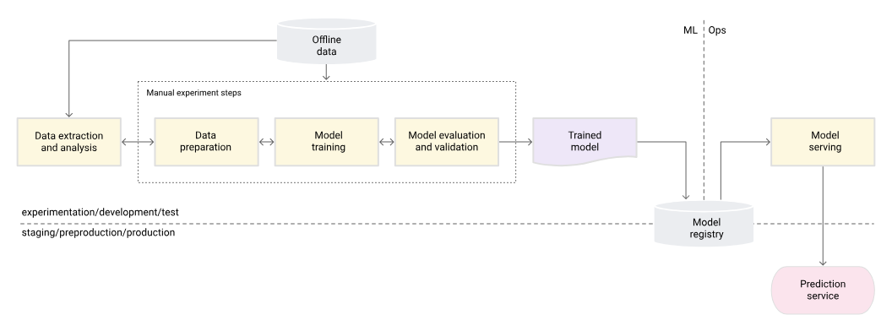

*출처: Google Cloud, MLOps: Continuous delivery and automation pipelines in machine learning. 데이터 준비부터 검증까지 수동 실험 단계로 진행하고, 훈련된 모델만 레지스트리를 거쳐 서빙한다. ML과 Ops 사이에 단절이 있다.*

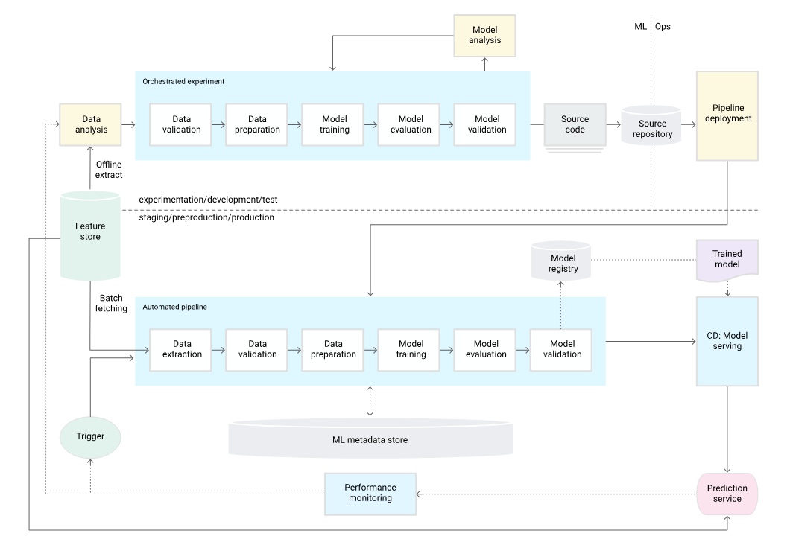

*출처: Google Cloud, 같은 문서. 실험 단계가 오케스트레이션되고, 프로덕션에는 파이프라인 자체가 배포된다. 피처 스토어와 ML 메타데이터 저장소가 추가되고, 트리거와 성능 모니터링이 자동화된 파이프라인을 다시 실행한다.*

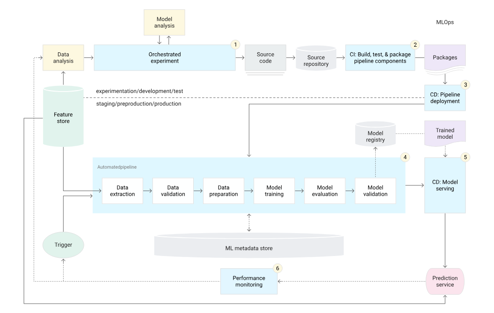

*출처: Google Cloud, 같은 문서. 파이프라인 컴포넌트를 CI로 빌드·테스트·패키징하고 CD로 파이프라인과 모델 서빙을 배포한다. 번호는 실험 → CI → 파이프라인 배포 → 자동 훈련 → 모델 서빙 → 모니터링 순서다.*

레벨은 대략적인 기준이며 단계 간 난이도가 선형적으로 증가하지도 않는다. 다만 현재 위치를 파악하면 MLOps 문화를 구축하며 발전하기 위한 다음 단계를 계획하는 데 도움이 된다.

## 마무리

- ML 수명주기는 실험 단계(문제 정의 → 데이터 → 버전 관리 → 훈련 → 평가 → 검증)와 프로덕션 단계(자동화된 파이프라인 + 배포 + 모니터링 + 재훈련)로 나뉘며, 거의 모든 단계에서 반복이 일어나므로 처음부터 오케스트레이션 파이프라인으로 자동화한다.

- ML을 쓰기 전에 휴리스틱 baseline으로 충분한지 먼저 측정하고, ML이 운영 비용을 정당화할 만큼 비즈니스 지표를 개선하는지 판단한다.

- ML 플랫폼은 쿠버네티스 위의 Kubeflow Pipelines, Feast, MLflow, BentoML/Yatai, Evidently 등으로 점진적으로 구축하며, 피처 스토어는 훈련-서빙 불일치와 미래 정보 누수를 막는다.

- ML은 문제 정의 → 데이터 수집 → EDA → 모델링 → 평가 → 배포 → 모니터링 → 유지보수의 폐쇄 루프이고, 모델·코드·설정·데이터를 별개의 버전 관리 대상으로 두고 리니지로 연결해야 재현·디버깅·롤백이 가능하다.

- 이후의 모든 단계는 데이터 단계의 편향을 이어받으므로, 편향과 누수는 수집·큐레이션 단계에서 막고 균형 조정은 훈련 데이터에만 적용한다.

- MLOps는 데이터 중심, 코드 변경 없는 모델 진화(CT), 실험 추적이라는 점에서 DevOps와 다르며, 성숙도는 Level 0(수동) → Level 1(재훈련 파이프라인 배포) → Level 2(파이프라인 CI/CD)로 발전한다.

## 참고

- [Kubeflow Pipelines](https://www.kubeflow.org/docs/components/pipelines/overview/)
- [Feast](https://feast.dev/)
- [MLflow](https://mlflow.org/)
- [BentoML](https://www.bentoml.com/)
- [Evidently AI](https://www.evidentlyai.com/)
- [CVAT](https://github.com/cvat-ai/cvat)
- [Ultralytics YOLO Docs](https://docs.ultralytics.com/)
- [MovieLens 1M Dataset](https://grouplens.org/datasets/movielens/1m/)
- [MLOps: Continuous delivery and automation pipelines in machine learning (Google Cloud)](https://cloud.google.com/architecture/mlops-continuous-delivery-and-automation-pipelines-in-machine-learning)
- [roadmap.sh - MLOps](https://roadmap.sh/mlops)
- [MIDV-500 데이터셋](https://arxiv.org/abs/1807.05786)
- [카카오뱅크의 MLOps - if(kakao)dev2022 (YouTube)](https://www.youtube.com/watch?v=Fj0MOkzCECA)
- [카카오페이 MLOps 적용기 (feat. AWS) - if(kakao)2022 (YouTube)](https://www.youtube.com/watch?v=5FvTXzDLPxI)
- [카카오 광고 AI 추천 MLOps 아키텍처 - Feature Store 편 - if(kakaoAI)2024 (YouTube)](https://www.youtube.com/watch?v=r1ELaD1DiU0)
