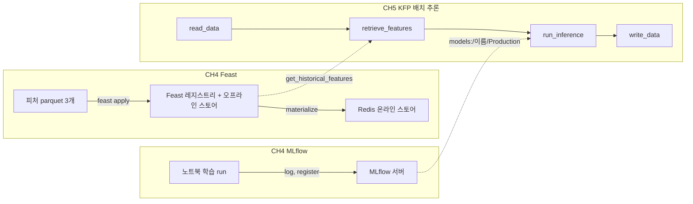
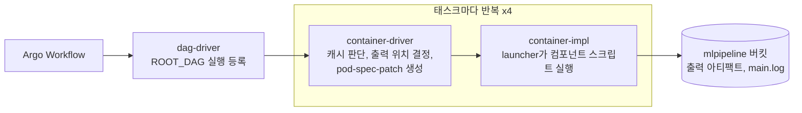

---
tags:
  - ML Platform
  - MLOps
  - MLflow
  - Feast
  - Feature Store
  - Model Registry
  - Kubeflow Pipelines
  - Argo Workflows
---

# 실험 추적, 피처 스토어, ML 파이프라인

> 소득 이진 분류기 하나를 MLflow로 실험 추적·모델 등록하고, Feast로 피처를 시점 기준으로 관리한 뒤, Kubeflow Pipelines로 배치 추론까지 이어 붙이는 과정을 정리한다.

## 개요

2주차는 『Machine Learning Platform Engineering』 2부의 시작인 4~5장을 다룬다. 1부에서 구축한 인프라만으로는 ML을 서비스에 적용하기 어렵고, 실험·모델·피처를 관리하는 ML 특화 컴포넌트가 함께 필요하다. 임시방편식 실험과 수작업 프로세스는 재현성과 확장성을 떨어뜨리기 때문이다. 2부 전체에서는 MLflow, Feast, Kubeflow Pipelines에 더해 BentoML과 Evidently로 서빙과 드리프트 모니터링까지 구성하며, 이번 주는 그중 앞의 세 도구를 다룬다.

| 챕터 | 주제 | 핵심 |
|------|------|------|
| CH 4 | Designing reliable ML systems | MLflow 실험 추적·모델 레지스트리, Feast 피처 등록·조회 |
| CH 5 | Orchestrating ML pipelines | KFP(Kubeflow Pipelines) 컴포넌트와 배치 추론 파이프라인 |

세 도구는 각자 다른 질문에 답한다.

| 도구 | 답하는 질문 | 플랫폼 개념도 블록 |
|------|-------------|---------------------|
| MLflow | 어떤 모델을 어떤 설정으로 만들었나 | B 모델 레지스트리, C 실험 추적 |
| Feast | 피처를 어디서, 어떤 시점 기준으로 가져오나 | D 피처 스토어 |
| Kubeflow Pipelines | 단계를 어떤 순서로, 누가 실행하나 | A 파이프라인 오케스트레이션 |



본문의 그림은 원서(영문판)에서 가져왔으며 각 캡션에 원서 그림 번호를 표시했다. 실습은 스터디원 김춘식 님의 [CH4 + CH5 실습 가이드](https://johklo.github.io/docs/tech/machine-learning-platform-engineering/04-experiments-features-pipelines/)를 따랐다. 본문의 실행 결과 수치는 그 가이드와 스터디 노트의 실행 기록이며, 데이터 분할이 무작위라 다시 실행하면 조금씩 달라진다.

## CH 4. 신뢰할 수 있는 ML 시스템 설계


*출처: 원서 Figure 4.1. 1장의 ML 플랫폼 개념도에서 이번 장은 피처 스토어(D), 실험 추적(C), 모델 레지스트리(B)에 집중한다.*

예제는 미국 성인 소득 데이터(Adult/Census Income)로 연소득이 50K 이하인지 초과인지 맞히는 이진 분류기(binary classifier)다. 데이터 과학자처럼 EDA(Exploratory Data Analysis)로 시작해 훈련·테스트 세트를 나누고, 모델 여러 개를 비교해 최고 모델을 고른다. 이 모델과 의존성을 MLflow 모델 레지스트리에 등록해 실험 재현, 협업, 배포 시점의 모델 로드에 쓰고, 모델이 쓰는 피처는 Feast에 등록한다. 예제는 단순하지만 교훈은 더 복잡한 프로젝트에도 그대로 적용된다.

### 실험 추적을 위한 MLflow

모델을 만드는 동안 훈련·테스트 데이터, 가중치, 정확도 지표 같은 파라미터가 계속 바뀐다. 이를 추적하는 이유는 세 가지다.

- **재현성(reproducibility)**: 동료와 결과를 공유할 때 같은 실험을 다시 만들고 결과를 그대로 복원할 수 있다.

- **모델 선택(model selection)**: 아키텍처와 지표가 다른 여러 후보 중 최적의 모델을 고를 수 있다.

- **성능 추적(performance tracking)**: 새 데이터로 재훈련한 모델을 이전 반복과 비교할 수 있다.

Git 커밋에 파라미터를 남기는 방법은 주기적으로 커밋하고 나중에 찾을 수 있게 태그를 붙여야 하는 번거로움이 있다. 파라미터를 파일로 저장하는 방법은 노트북과 함께 공유할 때 동료에게 파일 사용법까지 설명해야 한다. MLflow는 실험 파라미터를 체계적으로 관리하는 **추적 서버(tracking server)**를 제공해, ML 엔지니어가 자주 받는 다음 질문에 답하게 해 준다.

- 지금 프로덕션에 배포된 모델 버전은 무엇인가?

- 어떤 파라미터가 최고 결과를 냈나?

- 6개월 전 결과를 재현할 수 있나?

| 개념 | 역할 | 이번 실습 |
|------|------|-----------|
| Experiment | 관련 run을 묶는 프로젝트 단위 | `income-classifier` |
| Run | 실행 한 번의 기록, run ID로 식별 | EDA 1개, Decision Tree, Random Forest, XGBoost |
| Parameter | 실행 설정 | 트리 깊이 등 모델 설정 |
| Metric | 측정 결과 | `roc_auc_score_test`, 정확도 |
| Artifact | 실행이 남긴 파일 | 모델, 플롯, `column_list.pkl` |
| Model Registry | 관리할 모델의 이름과 버전 | `random-forest-classifier` v1 |

#### 데이터 탐색

데이터는 모두 범주형 변수(고정된 값의 집합을 갖는 변수)이고, 목표 변수 Target은 `<=50K` 또는 `>50K`의 이진값이다.

| 컬럼 | 의미 | 값 예시 |
|------|------|---------|
| Workclass | 고용 형태 | State-gov(주정부), Self-emp-not-inc(개인사업), Private(민간기업) |
| Education | 최종 학력 | Bachelors(학사), HS-grad(고졸), 11th(고등학교 11학년) |
| Marital-Status | 혼인 상태 | Never-married(미혼), Married-civ-spouse(기혼), Divorced(이혼) |
| Occupation | 직업 | Adm-clerical(사무직), Exec-managerial(경영·관리직), Prof-specialty(전문직) |
| Relationship | 가구 내 관계 | Not-in-family, Husband, Wife |
| Race | 인종 | White, Black |
| Sex | 성별 | Male, Female |
| Native_country | 출신 국가 | United-States, Cuba |
| Target | 정답(연소득) | `<=50K`, `>50K` |

`df.info()`로 30,162행 9열에 결측이 없음을 확인하고, `df.describe()`로 범주별 고유값 수와 최빈값(top)을 본다.

| 컬럼 | 고유값 수 | 최빈값 | 빈도 |
|------|-----------|--------|------|
| Workclass | 7 | Private | 22,286 |
| Education | 16 | HS-grad | 9,840 |
| Marital-Status | 7 | Married-civ-spouse | 14,065 |
| Occupation | 14 | Prof-specialty | 4,038 |
| Relationship | 6 | Husband | 12,463 |
| Race | 5 | White | 25,933 |
| Sex | 2 | Male | 20,380 |
| Native_country | 41 | United-States | 27,504 |
| Target | 2 | `<=50K` | 22,654 |

Target의 `<=50K`가 약 75%다. 전부 `<=50K`라고만 답해도 정확도가 75% 가까이 나온다는 뜻이며, 뒤에서 정확도 대신 AUC를 보는 이유가 된다.

다음은 Target을 뺀 범주형 컬럼 8개마다 값별 Target 비율을 막대그래프로 그려 `categorical_variable_plots/`에 저장하는 코드다(plotnine 사용).

```python
for i in df.iloc[:, :-1].select_dtypes(include="object").columns:
    print(df[i].value_counts())
    plot = (ggplot(df)
            + geom_bar(aes(x=df[i], fill=df.Target), position="fill")
            + theme_bw()
            + labs(title=f"Variable {i} ~ Target")
            + coord_flip())
    plot.save(f"categorical_variable_plots/Variable {i}")
```

`position="fill"`은 막대 높이를 모두 100%로 맞춰 건수가 아닌 비율을 비교하게 한다. 기본값인 `stack`으로 바꾸면 건수가 쌓여 범주 간 비율 비교가 어려워진다. `coord_flip()`은 Native_country처럼 값이 41개인 컬럼을 가로 막대로 읽기 쉽게 만든다.


*출처: 원서 Figure 4.2. 고용형태(Workclass) 범주별로 Target 비율을 비교한 플롯이다. 자영업자(Self-emp-inc)는 연소득이 50K를 초과할 가능성이 더 높다.*

#### MLflow 추적

`mlflow ui`(기본 포트 5000)는 노트북 밖에서 띄운다. 책 본문은 MLflow 2.6.0 기준이지만 실습 저장소는 3.0.0을 쓴다. 팀이 함께 쓰는 서버라면 메타데이터 백엔드와 아티팩트 저장소를 지정해 `mlflow server`로 띄운다.

```bash
mlflow server --host 0.0.0.0 --port 5000 \
  --backend-store-uri sqlite:////path/to/mlflow.db \
  --default-artifact-root s3://mlflow-artifacts/chapter-4
```

노트북에서는 추적 URI와 실험 이름을 한 번만 지정한다. 실험 이름은 파라미터를 추적할 프로젝트 이름이며, 없으면 새로 만든다.

```python
mlflow.set_tracking_uri("http://localhost:5000")
mlflow.set_experiment("income-classifier")
```

ML 실험이나 훈련 절차의 단일 실행을 **run**이라 하고, 각 run은 고유한 run ID를 가지며 지표·하이퍼파라미터·아티팩트를 기록한다. 앞의 플롯 코드를 `start_run` 블록 안에 넣고 두 줄을 더하면 플롯이 추적 서버에 기록된다.

```python
with mlflow.start_run(run_name=f"eda-{uuid.uuid4()}"):
    for i in df.iloc[:, :-1].select_dtypes(include="object").columns:
        ...  # 위와 같은 플롯 생성·저장
    mlflow.log_artifacts("categorical_variable_plots")
```

- `with`로 감싸면 블록이 끝날 때 run이 FINISHED로, 예외가 나면 FAILED로 닫힌다.

- `run_name`에 `uuid4()`를 붙여 EDA용 run과 모델 학습 run을 구분한다. 이름을 주지 않으면 MLflow가 `nervous-skunk-625` 같은 이름을 자동으로 붙인다.

- `log_artifacts`는 파일을 MLflow 서버로 보내지 않고 **노트북 클라이언트가 객체 저장소(MinIO)에 직접 업로드**한다. 그래서 노트북 환경에도 `AWS_ACCESS_KEY_ID`, `AWS_SECRET_ACCESS_KEY`, S3 엔드포인트 설정이 필요하다. 서버의 SQLite에는 run ID, 이름, 시간 같은 메타데이터만 저장된다.

- 저장 위치는 `s3://mlflow-artifacts/<root>/<실험ID>/<run ID>/artifacts/` 형태다. 업로드는 루프가 끝난 뒤에 일어나므로, 중간에 예외가 나면 아티팩트 없이 run만 FAILED로 남는다. 로컬 폴더에 예전 파일이 남아 있으면 그것도 함께 올라간다.


*출처: 원서 Figure 4.3. 왼쪽 실험 목록에 기본 실험과 새로 만든 `income-classifier`가 보이고, run을 시작해 플롯을 저장하면 Run Name 아래에 항목이 생긴다. 플롯은 해당 run의 Artifacts 탭에서 확인한다.*

#### 학습 데이터 준비

모델은 숫자만 다루므로 범주형 변수를 더미 변수로 바꾸고, 정답도 0/1로 인코딩한 뒤 훈련·테스트 세트로 나눈다.

```python
target = df.Target
feature_df = df.drop("Target", axis=1)

encoder = OneHotEncoder(sparse_output=False, drop="if_binary")
target = encoder.fit_transform(np.array(target).reshape(-1, 1))   # 0: <=50K, 1: >50K

dummyfied_df = pd.get_dummies(feature_df, drop_first=True, sparse=False, dtype=float)

col_list = dummyfied_df.columns.to_list()
with open("column_list.pkl", "wb") as f:
    pickle.dump(col_list, f)          # 추론 때 같은 열과 순서를 쓰기 위해 저장

X_train, X_test, y_train, y_test = train_test_split(
    dummyfied_df, target, train_size=0.80, shuffle=True)
```

| 단계 | 결과 | 설명 |
|------|------|------|
| 정답 인코딩 | (30162, 1) | `drop="if_binary"`로 값이 2개인 컬럼은 열 하나만 남긴다. `>50K`가 1이고 평균은 약 0.249다 |
| 더미 변환 | (30162, 90) | 8개 컬럼의 고유값 합 98개에서 `drop_first=True`로 컬럼마다 하나씩 빼 90개가 된다 |
| 열 목록 저장 | `column_list.pkl` | 추론 데이터도 같은 90개 열을 같은 순서로 만들어야 모델이 올바르게 읽는다 |
| 분할 | 24,129 / 6,033행 | 80%는 학습, 20%는 평가에 쓴다 |

몇 가지 세부 사항이 결과에 영향을 준다.

- **drop_first**: 각 변수의 첫 번째 값을 빼도 나머지가 모두 0이면 그 값임을 알 수 있어 정보가 중복되지 않는다(선형 모델의 다중공선성 회피). 예를 들어 Occupation이 Adm-clerical인 행은 `Occupation_` 컬럼이 하나도 1이 아니다.

- **컬럼 이름의 공백**: 원본 CSV 값 앞에 공백이 있어 컬럼 이름이 `Workclass_ State-gov`처럼 만들어진다. 동작에는 문제없지만 이름으로 찾을 때 공백을 맞춰야 한다.

- **random_state 없음**: 실행할 때마다 다르게 섞여 분할과 지표가 달라진다. MLflow로 실험을 비교하려면 `random_state=42`처럼 고정하는 편이 좋고, `stratify=y`를 주면 학습·평가의 `>50K` 비율을 같게 유지할 수 있다.

#### 모델 학습과 기록

비교할 모델은 세 가지이며, 셋 다 소득 `>50K` 여부를 예측한다.

| 모델 | 방식 | 특징 |
|------|------|------|
| Decision Tree | 데이터를 가장 잘 나누는 질문을 골라 계속 쪼개는 나무 한 그루 | 읽기 쉽지만 깊이 제한이 없으면 학습 데이터를 외우듯 과적합하기 쉽다 |
| Random Forest | 행과 특성을 무작위로 뽑아 만든 나무 여러 그루(기본 100)의 투표 | 나무마다 실수가 달라 서로 상쇄되므로 단일 트리보다 안정적이다 |
| XGBoost | 앞 나무가 틀린 부분에 집중해 다음 나무를 이어 만드는 부스팅 | 표 형태 데이터에서 정확도가 높은 편이다 |

Decision Tree와 Random Forest는 기록을 직접 남긴다. 먼저 훈련·테스트·참조(학습과 테스트에 쓰인 모든 사용자를 포함한 전체 피처) 데이터셋을 CSV로 MinIO의 `mlflow-datasets` 버킷에 올리고, 그 경로를 MLflow에 기록한다.

```python
with mlflow.start_run() as run:
    tree = DecisionTreeClassifier()
    run_id = run.info.run_id

    train_df = pd.concat([X_train, pd.Series(y_train.ravel())], axis=1)
    train_df_path = f"income-classifier-datasets/train-{run_id}.csv"
    save_df_to_minio(train_df, "mlflow-datasets", train_df_path)
    # test_df, feature_df도 같은 방식으로 저장

    mlflow.log_input(mlflow.data.from_pandas(
        train_df, source=f"mlflow-datasets/{train_df_path}"), context="training")
    # testing, reference 컨텍스트로 테스트·참조 데이터셋도 기록

    tree.fit(X_train, y_train.ravel())
    roc_auc_score_test = roc_auc_score(y_test == 1, tree.predict_proba(X_test)[:, 1])
    test_accuracy = tree.score(X_test, y_test)

    mlflow.log_metric("roc_auc_score_test", roc_auc_score_test)   # train 지표 포함 4개
    mlflow.log_metric("test_accuracy", test_accuracy)
    mlflow.sklearn.log_model(tree, "income-classifier")
    mlflow.log_params(tree.get_params())
```

| 메서드 | 기록하는 것 |
|--------|-------------|
| `mlflow.data.from_pandas` + `log_input` | 데이터셋의 컬럼 이름·타입과 행 수 같은 메타데이터, 외부 위치(source), 용도(context). 데이터 자체는 MinIO에 있다 |
| `log_metric` | 숫자 지표. 학습·평가 지표를 함께 남기면 두 값의 차이로 과적합을 볼 수 있다 |
| `sklearn.log_model` | 학습된 모델. scikit-learn, XGBoost, TensorFlow, PyTorch 등을 지원한다 |
| `log_params` | `max_depth` 같은 하이퍼파라미터 |

MLflow 3.0에서는 `log_model`이 run의 아티팩트 폴더가 아니라 별도의 **logged model**로 저장된다. 그래서 이후 모델 등록 때 `Run ... has no artifacts at artifact path 'income-classifier'` 경고가 나오지만, sklearn 모델은 MLflow가 `models:/m-...`로 대체해 등록에 성공한다.

!!! warning "훈련 CSV에 빈 행이 섞이는 문제"
    MinIO에 올라간 훈련 CSV는 24,129행이 아니라 헤더 포함 28,935줄이고, 뒷부분은 피처가 비어 있는 `,,,,...,0.0` 행이다. 테스트 CSV도 6,033행이 아니라 10,924줄이다. `pd.concat(axis=1)`은 인덱스로 행을 맞추는데, `X_train`의 인덱스는 섞인 원본 인덱스이고 `pd.Series(y_train.ravel())`의 인덱스는 0부터 시작하는 새 인덱스다. 그래서 두 인덱스의 합집합만큼 행이 생긴다(24,129 + 24,129 − 겹치는 약 80% ≈ 28,934). 학습 자체는 `X_train`과 `y_train`을 직접 쓰므로 영향이 없지만, MLflow에 기록된 데이터셋은 실제 학습 데이터와 다르다. `pd.Series(y_train.ravel(), index=X_train.index)`처럼 인덱스를 맞추면 해결된다.

XGBoost는 `mlflow.xgboost.autolog()` 한 줄로 **자동 로깅(autologging)**을 켠다. 자동 로깅은 파라미터, 학습 중 지표, 모델, 피처 중요도 플롯을 명시적 코드 없이 기록하지만, 직접 계산한 커스텀 지표는 기록하지 않으므로 `log_metric`으로 따로 남겨야 한다. 훈련 데이터셋도 데이터프레임이 아닌 배열로 기록된다.


*출처: 원서 Figure 4.6. 명시적인 로깅 코드 없이도 모델 파라미터와 데이터셋이 기록되고, 피처 중요도 플롯까지 자동으로 생긴다.*

책의 XGBoost 셀은 한 run 안에서 `xgb.train`을 두 번 호출한다. 먼저 `binary:logistic`(확률 출력)으로 30라운드 학습한 뒤, `binary:hinge`(0/1 클래스 출력)로 다시 학습하면서 `num_boost_round`를 주지 않아 기본값 10라운드로 학습한다. 이 때문에 세 가지 문제가 생긴다.

- 두 번째 호출 때 autolog가 이미 기록한 파라미터(objective, num_boost_round)를 다른 값으로 바꾸려다 `Changing param values is not allowed` 경고가 나고, 두 번째 학습의 파라미터와 모델은 기록되지 않는다. 지표는 첫 모델에 엉뚱하게 붙는다.

- 첫 번째(logistic) 예측을 두 번째가 덮어써서 logistic 모델의 성능은 기록되지 않는다.

- AUC를 hinge의 0/1 출력으로 계산해 기준값이 사실상 하나뿐이 되고, AUC가 0.72~0.73으로 낮게 나온다. 정확도는 약 0.82로 다른 모델과 비슷하다.

objective별로 run을 나누면 세 문제가 모두 해결된다.

```python
mlflow.xgboost.autolog()
base = {"colsample_bytree": 1, "learning_rate": 1, "max_depth": 10, "subsample": 1}

for objective in ["binary:logistic", "binary:hinge"]:
    with mlflow.start_run(run_name=f"xgboost-{objective.split(':')[1]}"):
        model = xgb.train({**base, "objective": objective}, dtrain, 30)
        pred_test = model.predict(dtest)            # logistic: 확률, hinge: 0/1
        label_test = (pred_test > 0.5).astype(int) if objective == "binary:logistic" else pred_test
        mlflow.log_metric("roc_auc_score_test", roc_auc_score(y_test == 1, pred_test))
        mlflow.log_metric("test_accuracy", accuracy_score(y_test.ravel(), label_test))
```

이렇게 나누면 `xgboost-logistic` run의 테스트 AUC는 0.8675(`random_state=42` 기준)로 Random Forest보다 약간 높고, `xgboost-hinge`는 0.73에 머문다. 같은 모델 계열이라도 지표에 어떤 출력을 넣느냐에 따라 결과가 크게 달라진다.

#### AUC를 보는 이유

AUC(Area Under the Curve)는 여기서 ROC(Receiver Operating Characteristic) 곡선 아래 면적을 뜻하며, `roc_auc_score`가 계산한다. **고소득자 한 명과 저소득자 한 명을 무작위로 뽑았을 때 모델이 고소득자에게 더 높은 확률을 줄 가능성**으로 이해하면 된다. 1.0은 완벽한 구분, 0.5는 동전 던지기 수준이다.

모델은 "고소득일 확률"을 내고, 몇 이상을 고소득으로 볼지(threshold)에 따라 결과가 달라진다. 기준을 낮추면 진짜 양성 비율(TPR)과 함께 가짜 양성 비율(FPR)도 오른다. 기준을 0에서 1까지 바꾸며 찍은 (FPR, TPR) 점을 이은 것이 ROC 곡선이다.

```python
from sklearn.metrics import roc_auc_score
roc_auc_score([0, 0, 1, 1], [0.1, 0.4, 0.35, 0.8])   # 0.75
```

양성 2 × 음성 2의 네 쌍 중 세 쌍에서 양성이 더 높은 점수를 받아 0.75가 된다(0.35점 양성이 0.4점 음성보다 낮은 쌍이 틀린 쌍이다). 이 데이터는 `>50K`가 약 25%라 정확도는 치우친 클래스에서 좋아 보이기 쉽지만, AUC는 기준값 하나에 의존하지 않고 확률을 얼마나 잘 순서 매기는지를 본다. 실제 서비스에서는 AUC로 모델을 고른 뒤, 비즈니스 요구에 맞는 기준값을 따로 정해야 한다.

#### MLflow 모델 레지스트리

관심 있는 지표를 모두 기록해 두었으므로 MLflow에 쿼리하는 것만으로 최적의 모델을 찾을 수 있다. 모델 레지스트리는 ML 모델의 수명주기를 관리하는 리포지터리로, 협업, 모델 버전 추적, 모델 거버넌스와 재현성을 지원한다. 최고 모델을 찾아 등록하는 방법은 UI와 클라이언트 두 가지다.

UI 검색창에 `metrics.roc_auc_score_test > 0.8`을 넣고 차트 보기로 전환하면 run별 지표를 바로 비교할 수 있다.


*출처: 원서 Figure 4.7. 테스트 AUC가 0.8을 넘는 run만 조회해 차트로 비교한다. 책의 예시에서는 Random Forest가 가장 높다.*

스터디 노트의 실행 기록은 다음과 같다.

| run | 모델 | 테스트 AUC | 테스트 정확도 |
|-----|------|------------|---------------|
| `nervous-skunk-625` | Decision Tree | 0.8200 | 0.8158 |
| `shivering-tern-287` | Random Forest | 0.8571 | 0.8221 |
| `melodic-stork-689` | 책 원본 XGBoost (hinge 지표) | 0.7248 | 0.8167 |
| `xgboost-logistic` | run을 분리한 XGBoost | 0.8633 | 0.8210 |
| `xgboost-hinge` | run을 분리한 XGBoost | 0.7213 | 0.8135 |

프로그램으로 등록할 때는 `MlflowClient`를 쓴다. `get_experiment_by_name`으로 실험 ID를 얻고, UI와 같은 필터 문자열로 `search_runs`를 실행해 `roc_auc_score_test` 내림차순으로 정렬한 뒤, 1등 run의 모델 URI로 `register_model`을 호출한다.

```python
from mlflow import MlflowClient

mlflow_client = MlflowClient()
experiment = mlflow_client.get_experiment_by_name("income-classifier")

run_object = mlflow_client.search_runs(
    experiment_ids=experiment.experiment_id,
    filter_string="metrics.roc_auc_score_test > 0.8",
    max_results=1,
    order_by=["metrics.roc_auc_score_test DESC"],
)[0]

model_uri = f"runs:/{run_object.info.run_id}/income-classifier"
mlflow.register_model(model_uri, "random-forest-classifier")
```

등록된 모델은 UI의 Models 탭에서 보이며, 코드처럼 스테이징에서 프로덕션으로 승격할 수 있다. 책 코드를 그대로 쓸 때는 주의할 점이 있다.

- **고정된 이름**: 1등이 무엇이든 `random-forest-classifier`로 등록한다. XGBoost run을 분리해 `xgboost-logistic`이 1등이 되면, 이름은 랜덤 포레스트인데 내용물은 XGBoost가 된다.

- **모델 URI**: `runs:/<run_id>/income-classifier`는 sklearn 모델을 `log_model(tree, "income-classifier")`로 저장했을 때만 맞다. XGBoost autolog는 모델 이름을 `model`로 저장하므로 `Unable to find a logged_model with artifact_path income-classifier` 오류로 등록이 실패한다.

- **stage 지정**: 5장의 추론 컴포넌트는 `model_stage`와 같은 stage의 버전을 찾는다. 책은 stage를 바꾸는 절차를 적지 않았으므로 `transition_model_version_stage(..., "Production")`으로 직접 지정한다. MLflow 3에서 stage는 deprecated지만 아직 동작한다.

모델 종류와 상관없이 등록하려면 1등 run에 연결된 logged model을 찾아 `models:/<model_id>`로 등록하고, 이름에 모델 종류를 넣지 않는다.

```python
logged_models = mlflow.search_logged_models(
    experiment_ids=[experiment.experiment_id],
    filter_string=f"source_run_id = '{run_object.info.run_id}'",
    order_by=[{"field_name": "creation_time", "ascending": False}],
    output_format="list",
)
mv = mlflow.register_model(f"models:/{logged_models[0].model_id}", "income-classifier-best")
```

같은 이름으로 다시 등록하면 새 버전(v2, v3...)이 쌓인다. 등록한 모델은 `mlflow.pyfunc.load_model("models:/income-classifier-best/1")`로 불러온다.

운영 관점에서 두 가지를 더 짚는다. 책은 테스트 점수로 모델을 고르지만, 운영에서는 검증셋으로 후보를 고르고 테스트셋은 마지막 확인에만 쓴다. 또 stage나 alias는 나중에 다른 버전을 가리킬 수 있으므로, 배치 실행 시작 시 `models:/이름/숫자`로 버전을 확정해 기록하는 편이 안전하다.

로컬 MLflow 인스턴스로는 협업할 수 없다. 팀이 함께 쓰려면 클라우드나 쿠버네티스처럼 모두가 접근할 수 있는 환경에 설치해야 한다(원서 부록 A). 가장 단순한 구성은 SQLite(메타데이터)와 PVC(아티팩트)를 쓰는 Deployment 하나다.

```yaml
containers:
  - name: mlflow
    image: python:3.11-slim
    command: ["sh", "-c"]
    args:
      - pip install --no-cache-dir "mlflow>=3,<4" &&
        mlflow server --host 0.0.0.0 --port 5000
        --backend-store-uri sqlite:////data/mlflow.db
        --artifacts-destination /data/artifacts --serve-artifacts
    volumeMounts: [{ name: data, mountPath: /data }]
    readinessProbe:
      httpGet: { path: /health, port: 5000 }
```

이 구성에서는 클러스터를 지우면 PVC의 실험 기록도 함께 사라지므로, 지우기 전에 `mlflow.db`를 `kubectl cp`로 백업한다. MLflow에는 LLM 프롬프트를 관리하는 Prompts 탭도 있지만 집필 시점 기준 기능이 제한적이라, 책은 12·13장에서 Langfuse를 대신 쓴다.

### 피처 스토어로서의 Feast

MLflow로 모델을 추적·등록해도, 훈련과 추론 전반에서 피처 엔지니어링을 일관되게 유지하는 문제가 남는다. 소득 분류기의 피처는 파일 하나에 모두 담겨 있지만, 현실에서는 여러 테이블에 흩어져 있어 복잡한 처리와 조인 로직이 필요하다. 이 상황을 흉내 내기 위해 단일 파일을 타임스탬프와 `user_id` 열이 붙은 세 파일로 나눈다.


*출처: 원서 Figure 4.9. 인구통계(Sex, Race, Native country), 관계(Marital status, Relationship), 직업(Workclass, Education, Occupation) 세 범주의 피처 파일로 나눈다.*

피처를 나눈 뒤에는 추론이나 재훈련 시점에 **적합한 피처**를 가져올 방법이 필요하다. 어떤 사용자의 피처가 1월 7일, 5월 21일, 12월 4일에 기록되어 있다면, 5월 22일 기준으로 적합한 피처는 그 직전인 5월 21일 값이다. 이 로직을 스크립트나 SQL로 직접 짜면 유지보수·디버깅할 대상이 하나 더 늘어나지만, Feast는 특정 시점 기준으로 정확한 피처 세트를 만드는 기능(point-in-time join)을 제공해 데이터 과학자가 조인이 아닌 피처 엔지니어링에 집중하게 해 준다.

실시간 서비스라면 피처 조회 지연도 짧아야 한다. Feast는 오프라인 스토어(MinIO)의 피처를 Redis 같은 저지연 데이터베이스로 푸시해, 실시간 추론 때 빠르게 조회하게 해 준다. Redis 외에 DynamoDB, Google Cloud Datastore 등도 온라인 스토어로 지원한다.


*출처: 원서 Figure 4.10. 피처 생성 파이프라인이 오프라인 스토어를 채우고, Feast가 주기적으로 오프라인 피처를 온라인 스토어로 구체화(materialize)한다. 피처 레지스트리는 피처 정의와 온·오프라인 스토어 정보를 보관하며, 훈련 데이터는 `get_historical_features`, 실시간 추론 데이터는 `get_online_features`로 가져온다.*

| 구성 요소 | 정의하는 것 | 이번 실습 |
|-----------|-------------|-----------|
| Entity | 피처를 수집하는 대상의 식별자(조인 키) | `user_id` (상품이면 `product_id`) |
| Data source | 원천 파일 위치, 시간 필드, S3 엔드포인트 | MinIO의 parquet |
| FeatureView | 피처의 논리적 그룹, 피처 목록, 엔티티, TTL | demographic, relationship, occupation |
| Registry | 엔티티·피처 정의의 메타데이터 | `s3://feature-registry/registry_local.db` |
| Offline store | 과거 피처 이력 (훈련, 배치 추론) | 파일 타입, MinIO의 parquet |
| Online store | 빠르게 읽을 최신 피처 (실시간 추론) | Redis |

#### 온라인 스토어 준비

원서 부록 A.2.1은 Feast 온라인 스토어로 쓸 Redis를 쿠버네티스에 설치한다. 비밀번호는 매니페스트에 쓰지 않고 Secret에서 환경 변수로 주입하며, 프로브는 `REDISCLI_AUTH` 환경 변수로 인증해 명령 인자에 비밀번호가 드러나지 않게 한다.

```yaml
containers:
  - name: redis
    image: redis:8.0.6
    args: ["redis-server", "--requirepass", "$(REDIS_PASSWORD)", "--appendonly", "yes"]
    env:
      - name: REDIS_PASSWORD
        valueFrom: { secretKeyRef: { name: redis-auth, key: redis-password } }
      - name: REDISCLI_AUTH          # redis-cli가 읽는 인증 환경 변수
        valueFrom: { secretKeyRef: { name: redis-auth, key: redis-password } }
    readinessProbe:
      exec: { command: ["redis-cli", "ping"] }
```

피처 원천 parquet 3개(`demographic_features.parquet`, `relationship_features.parquet`, `occupational_features.parquet`, 각 약 1.4MiB)는 `feature-data-sets` 버킷에, 레지스트리는 `feature-registry` 버킷에 둔다.

#### 피처 등록

엔티티는 피처를 수집하는 대상의 식별자다. `entity.py`에 `user_id` 엔티티를 정의한다.

```python
from feast import Entity
user = Entity(name="user_id", description="A user")
```

`features.py`에는 피처 범주마다 원천 파일 위치와 FeatureView를 정의한다. Feast가 MinIO의 파일을 읽을 수 있도록 S3 경로와 MinIO 엔드포인트 오버라이드를 함께 지정한다.

```python
demo_features_parquet_file_source = FileSource(
    file_format=ParquetFormat(),
    path="s3://feature-data-sets/demographic_features.parquet",
    s3_endpoint_override="http://localhost:9000",
)

demo_features = FeatureView(
    name="demographic",
    entities=[user],
    schema=[
        Field(name="Native_country", dtype=String),
        Field(name="Sex", dtype=String),
        Field(name="Race", dtype=String),
    ],
    ttl=timedelta(days=365),
    source=demo_features_parquet_file_source,
    tags={"description": "User Demographics", "used_by": "Income_Calculation_Team"},
)
```

FeatureView는 피처의 논리적 그룹이다. **TTL(Time To Live)**은 과거 데이터셋을 만들 때 얼마나 이전 데이터까지 참조할지 정하는 룩백 윈도다. 5월 22일 기준 조회에서 TTL이 이틀이면 5월 20일 이전 피처는 고려하지 않는다. 너무 짧은 TTL로 피처가 빠지는 일을 피하려고 책은 365일로 잡는다. 태그는 가독성을 위한 부가 정보이며 Feast UI에서 필터로 쓸 수 있다. relationship, occupation도 같은 방식으로 정의한다.

`feature_store.yaml`은 프로젝트 이름, 레지스트리 위치, 온·오프라인 스토어 설정을 담는다.

```yaml
project: my_feature_repo
registry: s3://feature-registry/registry_local.db
provider: local
offline_store:
  type: file
online_store:
  type: redis
  connection_string: "localhost:6379"
```

정의를 마치면 `feast apply`로 레지스트리에 푸시한다. 출력의 "Deploying infrastructure"는 Redis를 온라인 스토어로 준비했다는 뜻이다.

```text
$ feast apply
Created entity user_id
Created feature view relationship
Created feature view occupation
Created feature view demographic
Deploying infrastructure for relationship
Deploying infrastructure for occupation
Deploying infrastructure for demographic
```

#### 피처 조회

`get_historical_features`에는 엔티티 데이터프레임과 피처 목록을 넘긴다. 데이터프레임의 열 이름은 반드시 엔티티 이름(`user_id`)과 `event_timestamp`여야 하고, 피처는 `"피처뷰:피처"` 형식이다.

```python
entity_df = pd.DataFrame.from_dict({
    "user_id": ["9f2ac416-06e1-44a0-87bd-d4787c85bf66"],
    "event_timestamp": [datetime(2023, 1, 30, 10, 59, 42)],
})
store = FeatureStore(repo_path=".")
training_df = store.get_historical_features(
    entity_df=entity_df,
    features=["demographic:Sex"],
).to_df()
```

결과에는 `user_id`, `event_timestamp`와 함께 그 시점 기준의 `Sex` 값이 담긴다.

온라인 조회 전에는 `feast materialize <START_TS> <END_TS>`로 해당 기간의 오프라인 데이터를 온라인 스토어에 기록해야 한다. 실습에서는 2022-09-16부터 2023-09-17까지를 적재했고, 뷰 3개가 각각 30,162행을 처리한 뒤 Redis `DBSIZE`가 사용자 수와 같은 30,162가 되었다. 사용자 한 명당 키 하나이고 세 뷰의 피처가 같은 해시에 들어간다.

```python
online_features = store.get_online_features(
    features=["demographic:Sex"],
    entity_rows=[{"user_id": "9f2ac416-06e1-44a0-87bd-d4787c85bf66"}],
)
print(online_features.to_df())
```

온라인 조회는 레지스트리만 S3에서 읽고 값은 Redis에서 가져오며, 조회 중에 MinIO의 parquet는 읽지 않는다.

| 구분 | `get_historical_features` | `get_online_features` |
|------|---------------------------|-----------------------|
| 데이터 출처 | 오프라인 스토어 (MinIO parquet) | 온라인 스토어 (Redis) |
| 입력 | `user_id` + `event_timestamp` 데이터프레임 | 엔티티 딕셔너리 목록 |
| 반환 값 | 기준 시각 이전의 가장 최근 값 | materialize가 마지막으로 올린 현재 값 |
| 출력 열 | `event_timestamp` 포함 | `event_timestamp` 없음 |
| 용도 | 모델 훈련, 배치 추론 | 실시간 추론 |
| 사전 작업 | `feast apply` | `feast apply` + `feast materialize` |

`feast apply`와 `feast materialize`는 다른 작업이다. 레지스트리에 FeatureView가 보인다고 Redis에 값이 있다는 뜻은 아니며, materialize를 하지 않았거나 Redis가 비어 있으면 엔티티가 있어도 값이 `None`으로 나온다. 원천 파일이 갱신되면 materialize를 다시 해야 온라인 값에 반영된다.

SDK를 쓰지 않는 언어의 애플리케이션을 위해 `feast serve`로 피처 서버(기본 포트 6566)를 띄울 수 있다.

```bash
curl -s -X POST "http://localhost:6566/get-online-features" -d '{
  "features": ["demographic:Sex", "occupation:Occupation"],
  "entities": {"user_id": ["9f2ac416-06e1-44a0-87bd-d4787c85bf66"]}
}'
```

응답의 `metadata.feature_names`에 피처 이름이, `results`에 엔티티와 피처별 값·상태(`PRESENT`)·이벤트 시각이 담긴다. `feast ui -p 8889`로 띄우는 웹 UI에서는 레지스트리의 엔티티와 피처 뷰, 데이터 소스를 확인하고 태그로 필터링할 수 있다.

#### 시점 기준 조회의 함정

사용자 42의 근무 시간이 5월 21일에 36, 6월 4일에 52였다면 5월 22일 예측에는 36을 써야 한다. 최신값 52를 가져오면 미래 정보가 섞인다. TTL이 2일이면 5월 25일 조회에서는 21일 값이 너무 오래돼 제외된다.

시간 필드 하나로 모든 누설이 막히지는 않는다. 21일에 발생한 데이터가 23일에 도착했다면 22일에는 알 수 없었으므로, 지연 도착이나 보정 이력이 있는 원천은 실제 사용 가능 시점까지 고려해야 한다.

또 책의 학습 노트북은 CSV를 직접 읽고 Feast는 따로 준비하므로, 이 흐름만으로는 학습부터 추론까지 같은 피처를 쓴다는 계약이 고정되지 않는다. 연결을 강화하려면 필요한 FeatureView를 `income_model_v1` 같은 FeatureService로 묶어 학습에서도 그것으로 조회하고, MLflow run과 모델 버전에 서비스 이름, 피처 목록, 정의 파일 해시, 데이터 스냅샷을 함께 남긴다.

MLflow와 Feast로 신뢰할 수 있는 ML 시스템의 핵심 컴포넌트 두 가지를 갖췄지만, 새 데이터로 재훈련하거나 피처를 갱신하는 작업에는 여전히 사람이 개입해야 한다. 이 부분을 5장의 파이프라인이 맡는다.

## CH 5. ML 파이프라인 오케스트레이션

대부분의 ML 추론 파이프라인은 같은 구조다. 객체 스토어, 데이터 웨어하우스, 파일시스템 어딘가에서 데이터를 가져와 전처리하고, 모델을 조회·로드해 추론한 뒤, 결과를 데이터베이스나 클라우드 스토리지에 쓴다. 파이프라인은 주기적으로 실행되며 날짜, 피처 테이블 이름 같은 런타임 파라미터가 필요하다. KFP는 이를 파이썬 SDK(`kfp`)로 정의하게 해 주며, 각 단계를 깨끗하고 격리된 쿠버네티스 파드에서 실행한다.

ML 엔지니어는 다음 질문을 자주 받는다. 워크플로를 어떻게 반복 가능하게 만들 것인가, 서로 다른 모델에 걸쳐 단계를 어떻게 표준화할 것인가, 단계 간 데이터 흐름을 어떻게 안정적으로 보장할 것인가. KFP 컴포넌트는 ML 작업을 패키징하는 표준화된 방법으로 이 질문에 답한다.

### Kubeflow 컴포넌트

4장에서 훈련한 모델과 등록한 피처로 배치 추론을 하는 파이프라인은 네 단계다.

1. MinIO에서 예측 대상 사용자 ID 목록을 읽는다.

2. 사용자 ID에 해당하는 피처를 Feast에서 조회한다.

3. MLflow에서 모델을 불러와 추론한다.

4. 결과를 MinIO에 다시 쓴다.

각 작업은 **컴포넌트**, 즉 데이터 전처리·학습·평가·배포 같은 작업 하나를 캡슐화한 재사용·조합 가능한 단위가 된다. 컴포넌트는 각자 쿠버네티스 파드에서 실행되므로 컨테이너 이미지가 필요하고, 하나를 만드는 절차는 늘 같다.

1. 할 일을 파이썬 파일로 작성한다.

2. 도커 이미지로 빌드해 컨테이너 레지스트리에 푸시한다.

3. 입력·출력·이미지·명령어를 `component.yaml` 명세로 정의한다.

#### 데이터 읽기 컴포넌트

`src/read_data/read_data.py`는 일반 파이썬 파일이다. MinIO 클라이언트로 엔티티 parquet를 내려받아 데이터프레임으로 읽고, 다음 컴포넌트가 쓸 수 있도록 `data_output_path`에 저장한다.

```python
def get_data(minio_host, access_key, secret_key, bucket_name, file_name, data_output_path):
    client = Minio(endpoint=minio_host, access_key=access_key,
                   secret_key=secret_key, secure=False)
    local_temp_file = os.path.join("/tmp", file_name)
    client.fget_object(bucket_name, file_name, local_temp_file)
    df = pd.read_parquet(local_temp_file)

    Path(data_output_path).parent.mkdir(parents=True, exist_ok=True)
    df.to_parquet(data_output_path)
```

메인 블록은 `argparse`로 `--minio_host`, `--access_key`, `--secret_key`, `--bucket_name`, `--file_name`, `--data_output_path`를 받아 `get_data`에 넘긴다. 컨테이너화는 파이썬 베이스 이미지에 의존성을 설치하고 소스를 복사하는 단순한 Dockerfile로 한다.

```dockerfile
FROM python:3.10-slim-buster
WORKDIR /app
RUN apt-get update && apt-get install --no-install-recommends -y build-essential \
    && apt-get clean && rm -rf /tmp/* /var/tmp/*
COPY requirements.txt /app/requirements.txt
RUN pip3 install --upgrade pip && pip3 install --no-cache-dir -r requirements.txt
ENV PYTHONPATH "/app"
COPY . /app
```

```bash
docker build . -t <docker_id>/read-minio-data:latest
docker push <docker_id>/read-minio-data:latest
```

마지막으로 쿠버네티스 객체를 정의하듯 YAML로 컴포넌트 명세를 쓴다.

```yaml
name: Read Data From MinIO
description: Fetches data from MinIO and outputs as a Dataset.
inputs:
- {name: minio_host, type: String}
- {name: access_key, type: String}
- {name: secret_key, type: String}
- {name: bucket_name, type: String}
- {name: file_name, type: String}
outputs:
- {name: data_output, type: Dataset}
implementation:
  container:
    image: <docker_id>/read-minio-data:latest
    command:
    - python3
    - /app/src/read_data/read_data.py
    - --minio_host
    - {inputValue: minio_host}
    - --bucket_name
    - {inputValue: bucket_name}
    - --file_name
    - {inputValue: file_name}
    - --data_output_path
    - {outputPath: data_output}
```

`data_output`을 `outputs` 아래에 `Dataset` 타입으로 선언했기 때문에 KFP는 이것이 컴포넌트의 출력임을 안다. 모델 이름 같은 작은 값은 `inputValue` 파라미터로, 파일은 `inputPath`/`outputPath` 아티팩트로 넘긴다.

#### 피처 조회 컴포넌트

피처 조회 컴포넌트는 MinIO에서 `feature_store.yaml`을 내려받아 피처 스토어 객체를 초기화하고, 이전 단계의 엔티티 데이터프레임으로 과거 피처를 조회한다.

```python
def get_features(minio_host, access_key, secret_key, bucket_name, file_name,
                 entity_df, feature_list, data_output):
    store = init_feature_store(minio_host, access_key, secret_key, bucket_name, file_name)
    feature_list = feature_list.split(",")
    entity_df = pd.read_parquet(entity_df)        # 이전 단계 출력 파일 경로
    feature_df = store.get_historical_features(
        entity_df=entity_df, features=feature_list).to_df()
    Path(data_output).parent.mkdir(parents=True, exist_ok=True)
    feature_df.to_parquet(data_output)
```

Dockerfile은 그대로 두고 `requirements.txt`에 Feast 의존성만 추가한다. 명세에서 `entity_df`는 `inputs`, `data_output`은 `outputs`에 둘 다 `Dataset` 타입으로 선언한다.

이 컴포넌트를 쓰기 전에 Feast 등록을 한 번 더 해야 한다. 4장에서 PC로 `feast apply`한 레지스트리는 원천을 `localhost:9000`으로 가리키는데, 파드 안의 localhost는 PC가 아니라 그 파드 자신이다. MinIO는 LoadBalancer가 아닌 클러스터 서비스로만 노출되어 있으므로, 클러스터 주소를 쓰는 정의로 **쿠버네티스 Job 안에서 `feast apply`**를 실행해 별도 레지스트리(`registry.db`)를 만든다. Job은 명령이 끝나면 종료되는 점만 빼면 Deployment와 비슷하다.

```yaml
apiVersion: batch/v1
kind: Job
metadata:
  name: feast-job
  namespace: kubeflow
spec:
  template:
    spec:
      containers:
      - name: feast-container
        image: book-ch5/feast-job:0.1
        command: ["feast", "apply"]
        env:
        - name: FEAST_S3_ENDPOINT_URL
          value: "http://minio-service.kubeflow.svc.cluster.local:9000"
        - name: AWS_ENDPOINT_URL
          value: "http://minio-service.kubeflow.svc.cluster.local:9000"
        # AWS_ACCESS_KEY_ID, AWS_SECRET_ACCESS_KEY
      restartPolicy: Never
  backoffLimit: 4
```

이 Job이 쓰는 `feature_store.yaml`은 레지스트리를 `s3://feature-registry/registry.db`로, Redis 연결 문자열을 `redis-deployment-master.redis.svc.cluster.local:6379`로 지정한다. 로그에 "Deploying infrastructure for ..." 세 줄이 나오면 등록된 것이다.

#### 추론 컴포넌트

추론 컴포넌트는 MLflow 레지스트리에서 모델을 찾아 이전 단계의 피처로 예측한다.

```python
def perform_inference(minio_host, access_key, secret_key, model_name, model_type,
                      model_stage, mlflow_host, input_data, data_output):
    mlflow.set_tracking_uri(mlflow_host)
    mlflow_client = MlflowClient(mlflow_host)

    model_run_id = next((m.run_id for m in mlflow_client.search_model_versions(
        f"name='{model_name}'") if m.current_stage == model_stage), None)
    if not model_run_id:
        raise ValueError(f"No model found in stage {model_stage} for model {model_name}.")

    mlflow.artifacts.download_artifacts(
        f"runs:/{model_run_id}/column_list.pkl", dst_path="column_list")
    input_data_df = pd.read_parquet(input_data)
    input_data_df.drop(columns=["user_id", "event_timestamp"], inplace=True)

    with open("column_list/column_list.pkl", "rb") as f:
        col_list = pickle.load(f)
    input_data_df = pd.get_dummies(input_data_df, drop_first=True, sparse=False, dtype=float)
    input_data_df = input_data_df.reindex(columns=col_list, fill_value=0)

    if model_type == "sklearn":
        model = mlflow.sklearn.load_model(model_uri=f"models:/{model_name}/{model_stage}")
    # xgboost, tensorflow도 같은 방식으로 분기

    input_data_df["Predicted_Income_Class"] = [x[1] for x in model.predict_proba(input_data_df)]
    Path(data_output).parent.mkdir(parents=True, exist_ok=True)
    input_data_df.to_parquet(data_output)
```

| 단계 | 하는 일 |
|------|---------|
| 모델 찾기 | 모델 이름의 버전 중 `current_stage`가 `model_stage`(Production)인 버전의 run ID를 찾는다. 없으면 실패한다 |
| 열 목록 받기 | 그 run의 `column_list.pkl`을 내려받는다 |
| 입력 정리 | `user_id`, `event_timestamp`를 지우고 학습 때와 같은 방식으로 더미 변환한다 |
| 열 맞추기 | `reindex(columns=col_list, fill_value=0)`으로 학습 때의 90개 열 순서에 맞추고, 입력에 없는 범주 열은 0으로 채우며 모르는 열은 버린다 |
| 모델 로드 | `model_type`에 따라 sklearn, XGBoost, TensorFlow 로더를 고른다 |
| 예측 | `predict_proba`의 두 번째 열(`>50K` 확률)을 `Predicted_Income_Class`로 붙여 저장한다 |

`column_list.pkl`을 학습 때 함께 기록한 이유가 여기서 드러난다. 추론 입력에 어떤 범주가 등장하느냐에 따라 더미 열 구성이 달라지므로, 학습 때의 열 목록으로 다시 맞추지 않으면 모델은 같아도 다른 의미의 입력을 받게 된다.

#### 데이터 쓰기 컴포넌트

데이터 쓰기 컴포넌트는 추론 결과를 읽어 MinIO 버킷에 parquet로 올린다.

```python
def write_data(minio_host, access_key, secret_key, bucket_name, file_name, input_data_path):
    client = Minio(endpoint=minio_host, access_key=access_key,
                   secret_key=secret_key, secure=False)
    pd.read_parquet(input_data_path).to_parquet(file_name, index=False)
    client.fput_object(bucket_name, file_name, file_name)
```

컴포넌트 코드는 `src/`, 명세는 `components/` 아래에 둔다.

```text
├── Dockerfile
├── components
│   ├── read_data/component.yaml
│   ├── retrieve_features/component.yaml
│   ├── run_inference/component.yaml
│   └── write_data/component.yaml
├── inference_pipeline.py
├── requirements.txt
└── src
    ├── read_data/read_data.py
    ├── retrieve_features/retrieve_features.py
    ├── run_inference/run_inference.py
    └── write_data/write_data.py
```


*출처: 원서 Figure 5.2. 각 단계는 MinIO의 OutputPath에 중간 데이터셋을 쓰고, 다음 단계가 그것을 읽는다. 피처는 Feast에서, 모델은 MLflow에서 가져온다.*

단계 사이 데이터는 메모리가 아니라 파일로 넘어간다. 앞 컴포넌트가 출력 경로에 parquet를 쓰면 다음 컴포넌트가 자기 로컬 경로로 받는다. `Input[Dataset]`은 파일 전달 계약일 뿐 열 타입이나 결측 검사가 아니므로, 스키마 검증은 별도로 해야 한다.

#### 컴포넌트 설계 원칙

| 원칙 | 설명 |
|------|------|
| 모듈성 | 단일 책임 원칙. 예제는 추론과 데이터 쓰기를 별도 컴포넌트로 분리했다 |
| 입출력 명시 | 필요한 데이터와 생성하는 아티팩트를 `component.yaml`에 명시한다 |
| 파라미터화 | `mlflow_host`, `bucket_name`, `minio_host`를 하드코딩하지 않아 다른 환경에서 재사용한다 |
| 문서화 | 기능, 입출력, 사용법을 그림과 함께 남긴다 |

잘 설계된 컴포넌트는 한 번 정의해 여러 파이프라인에서 재사용할 수 있고(재사용성), 팀원마다 컴포넌트를 나눠 맡아 병렬로 개발할 수 있으며(협업), 문제를 컴포넌트 하나로 격리해 테스트·디버깅하기 쉽다(테스트).

### 소득 분류기 파이프라인

KFP 파이프라인은 컴포넌트를 노드로 하는 DAG(Directed Acyclic Graph)다. 에지에 방향이 있고 순환이 없어서, 어떤 작업은 의존하는 작업이 모두 끝난 뒤에야 실행된다. 의존 관계는 따로 선언하지 않고, 앞 태스크의 출력(`task.outputs["data_output"]`)을 다음 태스크의 입력으로 넘기면 KFP가 순서를 정한다.

```python
fetch_data_op = kfp.components.load_component_from_file("components/read_data/component.yaml")
retrieve_features_op = kfp.components.load_component_from_file("components/retrieve_features/component.yaml")
run_inference_op = kfp.components.load_component_from_file("components/run_inference/component.yaml")
write_data_op = kfp.components.load_component_from_file("components/write_data/component.yaml")

@dsl.pipeline(name="income-classifier-pipeline",
              description="A Kubeflow pipeline to classify income categories using KFP v2")
def income_classifier_pipeline(minio_host: str, access_key: str, secret_key: str,
                               entity_df_bucket: str, entity_df_filename: str,
                               feature_store_bucket_name: str, feature_store_config_file_name: str,
                               feature_list: str, model_name: str, model_type: str,
                               model_stage: str, mlflow_host: str,
                               output_bucket: str, output_file_name: str):
    fetch_data_task = fetch_data_op(minio_host=minio_host, access_key=access_key,
        secret_key=secret_key, bucket_name=entity_df_bucket, file_name=entity_df_filename)
    retrieve_features_task = retrieve_features_op(...,
        entity_df=fetch_data_task.outputs["data_output"], feature_list=feature_list)
    run_inference_task = run_inference_op(..., model_name=model_name, model_type=model_type,
        model_stage=model_stage, mlflow_host=mlflow_host,
        input_data=retrieve_features_task.outputs["data_output"])
    write_data_op(..., bucket_name=output_bucket, file_name=output_file_name,
        input_data=run_inference_task.outputs["data_output"])

compiler.Compiler().compile(income_classifier_pipeline, "income_classifier_pipeline.yaml")
```

파이프라인 함수의 인자 14개는 모두 `str`이고 기본값이 없어 실행할 때 전부 넘겨야 한다(기본값을 지정하는 것도 가능하다). 컴파일하면 실행 명세 YAML(IR)이 나온다.

- **dependentTasks**: 각 태스크의 의존 관계는 이전 태스크의 `data_output` 아티팩트를 입력으로 받는 데서 자동으로 만들어진다. 결과는 `read-data-from-minio → retrieve-features-from-feast → model-inference → write-data-to-minio`의 선형 4단계다.

- **실행 명령**: 컨테이너 안의 `/app/src/<단계>/<단계>.py`를 실행하며, 아티팩트 경로는 `{{$.inputs.artifacts['input_data'].path}}` 같은 템플릿으로 채워진다.

- **캐시**: 모든 태스크에 `cachingOptions.enableCache: true`가 붙는다.

컴파일은 정의를 YAML로 바꿀 뿐 파드를 만들거나 데이터를 읽지 않는다. 이미지, 서비스 주소, 권한이 맞는지는 실제 실행에서 드러난다.

컴파일된 YAML은 KFP UI의 Pipelines → Upload pipeline으로 올린다. 실행하려면 실험(experiment)을 만들고 그 아래 실행(run)을 만든다. KFP 실험은 파이프라인 실행을 정리·비교하는 단위이고, run은 파이프라인이 실제로 실행된 인스턴스다. MLflow의 실험과 이름이 같아도 별개 개념이다.

run을 만들 때 런타임 파라미터를 채운다. 서비스 주소는 PC가 아닌 파드에서 접근하므로 클러스터 주소를 쓴다.

```json
{
  "minio_host": "minio-service.kubeflow.svc.cluster.local:9000",
  "entity_df_bucket": "feature-data-sets",
  "entity_df_filename": "entity_df.parquet",
  "feature_store_bucket_name": "feature-registry",
  "feature_store_config_file_name": "feature_store_k8s.yaml",
  "feature_list": "demographic:Sex,demographic:Race,demographic:Native_country,relationship:Relationship,relationship:Marital-Status,occupation:Workclass,occupation:Education,occupation:Occupation",
  "model_name": "random-forest-classifier",
  "model_type": "sklearn",
  "model_stage": "Production",
  "mlflow_host": "http://mlflow-service.mlflow.svc.cluster.local:5000",
  "output_bucket": "inference-datasets",
  "output_file_name": "income_predictions.parquet"
}
```

`access_key`, `secret_key`도 파라미터로 넘기는데, 이 값은 KFP UI에 그대로 노출된다. 로컬 실습에서만 이렇게 쓰고, 운영에서는 Secret과 서비스 계정 권한으로 전달해야 한다.


*출처: 원서 Figure 5.5. 업로드한 파이프라인을 KFP UI가 시각화한 그래프로, 네 컴포넌트가 데이터 의존 관계대로 이어진다.*


*출처: 원서 Figure 5.8. 네 태스크가 모두 성공한 실행이다. 예측 결과는 MinIO의 `inference-datasets` 버킷에 저장된다.*

KFP는 워크플로를 코드로 정의해 데이터 전처리부터 배포까지 자동화하고, 실험 아래 여러 실행을 추적해 구성·하이퍼파라미터·데이터셋을 체계적으로 비교하게 해 준다. 배치 추론에 잘 맞는 도구이며, 실시간 추론과 서빙에는 BentoML을 쓴다.

### 실행 시 생성되는 파드

KFP 2.x는 Argo Workflows로 파이프라인을 실행한다. Run 하나가 `workflows.argoproj.io` 객체 하나가 되고, 4단계 파이프라인에서는 파드 9개가 순서대로 생성된다(실습 기준 약 2분).

```bash
kubectl get workflows.argoproj.io -n kubeflow
# NAME                               STATUS      AGE
# income-classifier-pipeline-65js8   Succeeded   4m44s

kubectl get pod -n kubeflow -l pipelines.kubeflow.org/v2_component=true \
  --sort-by=.metadata.creationTimestamp
# ...-system-dag-driver-...         Completed
# ...-system-container-driver-...   Completed   (태스크마다 driver, impl 한 쌍씩 4번)
# ...-system-container-impl-...     Completed
```



| 파드 | 이미지 | 역할 |
|------|--------|------|
| `system-dag-driver` × 1 | `kfp-driver:2.4.1` | ROOT_DAG 실행을 MLMD(ML Metadata)에 등록하고 하위 태스크 실행 방식을 정한다 |
| `system-container-driver` × 4 | `kfp-driver:2.4.1` | 태스크별 캐시 판단, 실행 기록 등록, 출력 위치 결정, 실행 파드에 덧씌울 `pod-spec-patch` 생성 |
| `system-container-impl` × 4 | 컴포넌트 이미지 + `kfp-launcher:2.4.1` | init에서 launcher를 공유 볼륨에 복사하고, main에서 launcher가 스크립트를 감싸 실행한 뒤 출력 업로드와 MLMD 기록 |

container-driver는 태스크 하나를 시작하기 위한 준비 파드다. 캐시를 판단하는데, 이전 실행 기록이 없으면 `cached-decision=false`로 실제 실행을 진행하고 같은 입력으로 다시 실행하면 생략될 수 있다. 이어서 실행 기록을 등록하고(부모 DAG의 execution ID 아래), 출력 아티팩트 위치를 정한 뒤, 실행 파드에 적용할 명령(`/kfp-launcher/launch ... -- python3 /app/src/read_data/read_data.py --minio_host ...`)을 만든다.

container-impl은 그 명령이 실제로 도는 파드다. 컴포넌트 스크립트는 KFP launcher로 감싸져 실행되며, launcher가 입력 파라미터와 출력 경로를 준비하고 스크립트가 끝나면 출력 아티팩트를 KFP 저장소에 올리고 MLMD에 결과를 기록한다. read-data 태스크의 main 컨테이너 로그는 다음과 같다.

```text
Downloading entity_df.parquet from bucket feature-data-sets...
Reading the downloaded file /tmp/entity_df.parquet...
Saving the processed data to /minio/mlpipeline/v2/artifacts/income-classifier-pipeline/<run-id>/read-data-from-minio/<uuid>/data_output...
Data saved successfully.
... object_store.go: uploadFile(...)
... launcher_v2.go: publish success.
```

모든 파드는 Argo 표준 구조(init `argoexec` → main → wait)이며, wait 컨테이너가 `main.log`를 `mlpipeline` 버킷의 `artifacts/<workflow>/<날짜>/<pod>/main.log`에 보관한다. 단계 간 데이터는 `v2/artifacts/<pipeline>/<run-id>/<task>/<uuid>/data_output`에 쌓인다. 실습 실행에서는 read-data 출력 1.4MiB, retrieve-features 출력 1.5MiB, model-inference 출력 277KiB가 남았다.

### 결과 해석

최종 결과 `income_predictions.parquet`(276.6KiB)를 읽어 보면 다음과 같다.

```text
rows, columns: (30162, 91)
user_id in output: False
count    30162.0000
mean         0.2478
std          0.2900
min          0.0000
25%          0.0000
50%          0.1119
75%          0.4289
max          1.0000
```

91열은 더미 피처 90개와 `Predicted_Income_Class`다. 평균 0.2478은 학습 데이터의 `>50K` 비율(약 0.249)과 비슷하다. 다만 파이프라인 실행 성공과 예측 품질은 별개로 봐야 한다.

- 결과에 `user_id`가 없다. 추론 코드가 인코딩 전에 이 열을 지우기 때문이다. 모델 입력에서 ID를 빼는 것과 결과에서 ID를 버리는 것은 다른 문제이므로, 실제 서비스라면 예측이 누구의 것인지 알 수 있게 결과에 다시 붙여야 한다.

- `predict_proba()`가 반환한 값은 클래스 확률 추정치이지 클래스 번호가 아니다. 열 순서는 `classes_`로 확인하고, 임계값은 오탐과 미탐의 업무 비용에 맞춰 정한다.

- 재실행을 추적하려면 대상 사용자, 기준 시각, 구체 모델 버전, 피처 정의, 코드와 데이터 스냅샷을 함께 남긴다. KFP run ID는 실행을 구분할 뿐, 같은 날 결과가 중복 저장되지 않게 하는 업무 키가 아니다.

- parquet 미리보기에 `PAR1`이나 깨진 문자가 보이는 것은 바이너리를 텍스트로 표시했기 때문이며, 그 화면만으로 내용이 잘못됐다고 판단하지 않는다.

## 실습 환경

책은 4장에서 PC의 `mlflow ui`를, 5장에서 파드가 접근할 수 있는 MLflow 서버를 전제로 한다. 실습 가이드는 처음부터 클러스터에 공용 MLflow 서버 하나를 두고 PC에서 `localhost:5000`으로 연결해, 노트북과 파이프라인이 같은 모델을 보도록 구성했다.

### 환경 구성

```bash
git clone https://github.com/johklo/ml-platform-book-env.git && cd ml-platform-book-env
python bookenv.py check     # docker, kind, kubectl, git 확인
python bookenv.py up        # 이미지 캐시가 있으면 약 8분, 처음에는 20분 이상
python bookenv.py forward   # 별도 터미널에서 실습이 끝날 때까지 켜 둔다
python bookenv.py buckets   # 실습용 버킷 생성
```

`bookenv.py up`은 다음 순서로 동작한다.

1. kind 클러스터(`book-env`, `kindest/node:v1.31.6` 단일 컨트롤 플레인)를 만든다. 이미 있으면 재사용한다.

2. Kubeflow Pipelines 저장소의 `manifests/kustomize`(태그 2.4.1)를 받아 `cluster-scoped-resources`를 적용하고 CRD가 준비되길 기다린 뒤, `env/platform-agnostic`을 적용한다.

3. minio Deployment와 workflow-controller에 패치를 적용한다. minio Deployment는 이름만 그대로이고 실제 이미지는 `chrislusf/seaweedfs:3.85`다.

4. PostgreSQL, Redis 매니페스트를 적용한다.

5. MLflow(`book-env/mlflow:3.0.0`)와 런타임(`book-env/runtime:0.1`) 이미지를 빌드해 `kind load`로 노드에 넣고, MLflow를 배포한다.

6. 각 롤아웃이 끝날 때까지 기다린다(각 최대 900초).

런타임 이미지에는 KFP 태스크 파드가 쓸 클러스터 주소가 환경 변수로 들어 있다.

```dockerfile
ENV AWS_ENDPOINT_URL=http://minio-service.kubeflow.svc.cluster.local:9000 \
    FEAST_S3_ENDPOINT_URL=http://minio-service.kubeflow.svc.cluster.local:9000 \
    MLFLOW_S3_ENDPOINT_URL=http://minio-service.kubeflow.svc.cluster.local:9000 \
    MLFLOW_TRACKING_URI=http://mlflow-service.mlflow.svc.cluster.local:5000 \
    REDIS_CONNECTION_STRING=redis-deployment-master.redis.svc.cluster.local:6379
```

| 구성 요소 | 책의 설치 방식 | 이 실습 |
|-----------|----------------|---------|
| Kubeflow | Argo CD로 전체 설치 (Istio, 인증, 대시보드, Notebooks 포함) | kind에 KFP standalone 2.4.1만 설치 |
| KFP 저장소·실행 기반 | MySQL, MinIO, Argo Workflows | 같은 구성에서 MinIO 이미지를 SeaweedFS로 교체 |
| PostgreSQL, Redis | 부록 A의 Bitnami Helm 차트 | 같은 서비스 이름의 매니페스트 |
| MLflow 서버 | 이미지 빌드 후 Deployment·Service 적용 | MLflow 3.0.0 이미지를 빌드해 설치 |
| 업무용 버킷 | MinIO에서 직접 생성 | 버킷 생성 Job으로 생성 |

Argo CD는 책이 Kubeflow 설치에 고른 GitOps 도구이고, Argo Workflows는 KFP가 파이프라인 작업을 파드로 실행하는 엔진이다. Kubeflow를 설치한다고 Argo CD가 생기지는 않는다.

| 포트 | 대상 |
|------|------|
| 9000 | S3 API (MinIO 호환, `minio / minio123`) |
| 8888 | 저장소 웹 UI (SeaweedFS Filer, 로그인 없음) |
| 5000 | MLflow |
| 6379 | Redis |
| 8080 | KFP UI |
| 8890 | JupyterLab (8888과 겹치지 않게) |

| 버킷 | 저장하는 것 | 사용 단계 |
|------|-------------|-----------|
| `mlflow-datasets` | 학습·테스트·참조 CSV (노트북이 직접 업로드, 이름이 코드에 고정) | 모델 학습 |
| `mlflow-artifacts` | 모델, 플롯, `column_list.pkl` | 학습, 추론 |
| `feature-data-sets` | 피처 원천 parquet 3개, 예측 대상 `entity_df.parquet` | Feast, 추론 |
| `feature-registry` | Feast 레지스트리(`registry_local.db`, `registry.db`)와 설정 파일 | Feast, 추론 |
| `inference-datasets` | 최종 예측 parquet | 추론 |
| `mlpipeline` | KFP 단계 사이 아티팩트와 로그 (KFP가 생성) | 파이프라인 |

노트북과 스크립트는 저자 저장소(`practical-mlops/chapter-4`, `chapter-5`)를 `upstream/`에 받아 쓴다. 가상환경은 `uv venv .venv-book --python 3.11`로 만들고, 버전은 `mlflow 3.0.0`, `feast 0.40.1`, `kfp 2.9.0`, `scikit-learn 1.5.2`다. JupyterLab은 `jupyter lab --notebook-dir book --port 8890`으로 띄운다.

### 실습 흐름

**B. MLflow로 학습과 모델 등록** (`ch04/01_mlflow_tracking.ipynb`)

1. 준비 셀 네 개로 데이터 경로와 S3 접속 정보를 준비한다.

2. 데이터 탐색 셀에서 `df.info()`가 30,162행 9열을 보여 주고, 변수별 그래프가 `categorical_variable_plots/`에 저장된다.

3. MLflow 연결 셀에서 `income-classifier` 실험이 만들어지고 `artifact_location='s3://mlflow-artifacts/1'`이 출력된다. UI의 `eda-` run Artifacts 탭에 PNG가 있는지 확인한다.

4. 분할과 버킷 확인 셀에서 `mlflow-datasets bucket found`를 확인한 뒤, Decision Tree, Random Forest, XGBoost 셀을 차례로 실행한다(각 약 1분). 버킷에는 run마다 `feature_df-`, `train-`, `test-` CSV가 쌓인다.

5. 가장 좋은 run을 모델 레지스트리에 등록하고 Production으로 지정한다.

**C. Feast로 피처 정의와 조회** (`ch04/02_feast_feature_store.ipynb`)

1. 피처 원천 parquet 3개를 `feature-data-sets` 버킷에 올린다.

2. 저자의 `entity.py`, `features.py`, `feature_store.yaml`을 `feature_repo/`로 복사하면서 Redis 비밀번호를 설정한다.

3. `feast apply`로 `s3://feature-registry/registry_local.db`에 정의를 기록한다.

4. 과거 시점 조회, `feast materialize`, 온라인 조회를 차례로 실행한다.

5. `feature_store.yaml`을 `feature-registry` 버킷에 올린다. 이 설정은 PC의 localhost용이므로 D 단계에서는 클러스터 주소용 설정을 따로 준비한다.

**D. Kubeflow Pipelines로 배치 추론**

1. `python book/ch05/prepare.py`로 저자 컴포넌트 명세의 이미지 이름을 `book-ch5/components:0.1`로 바꾸고 Redis 비밀번호를 설정한다.

2. 컴포넌트 이미지(`book-ch5/components:0.1`)와 Feast Job 이미지(`book-ch5/feast-job:0.1`)를 빌드해 `python bookenv.py load`로 kind 노드에 넣는다. 처음에는 두 이미지를 합쳐 10분 넘게 걸릴 수 있다.

3. Feast Job을 실행해 클러스터 주소용 레지스트리(`registry.db`)를 만든다.

4. `python book/ch05/upload_inputs.py`로 `feature_store_k8s.yaml`과 `entity_df.parquet`를 버킷에 올린다.

5. `inference_pipeline.py`로 파이프라인을 컴파일해 `image:`가 모두 `book-ch5/components:0.1`인지 확인한다.

6. KFP UI에서 파이프라인을 업로드하고, 실험과 run을 만들어 파라미터를 채운 뒤 Start를 누른다. `watch -d kubectl get pod,workflows -n kubeflow`로 파드가 뜨는 것을 지켜볼 수 있다.

7. `model-inference` 로그와 `write-data-to-minio`의 입출력 연결을 확인하고, `inference-datasets/income_predictions.parquet`를 읽어 본다.

실습을 끝낼 때 JupyterLab과 forward 창을 끄면 접속만 멈춘다. 다시 시작할 때는 `python bookenv.py status`로 상태를 확인하고 포트포워딩부터 진행한다. 모든 기록을 지우려면 `python bookenv.py down`으로 kind 클러스터를 삭제하고 빌드한 이미지 4개를 `docker rmi`로 정리한다.

### 걸리기 쉬운 지점

| 증상 | 원인과 대응 |
|------|-------------|
| 컴포넌트 이미지 빌드 중 apt 404 | 책의 `python:3.10-slim-buster` 저장소가 내려감 → `slim-bookworm`으로 교체 |
| 추론 단계에서 모델 로드 실패 | 모델은 scikit-learn 1.5.2로 pickle됨 → 컴포넌트 이미지도 1.5.2로 맞추고, MLflow 3.0.0에 맞춰 `sqlalchemy<2.1` |
| `ErrImageNeverPull` | Docker Hub에 푸시하지 않고 `kind load`로 노드에 넣는 구성 → 적재 여부부터 확인 |
| Feast Job 재실행 불가 | 완료된 Job이 남아 있음 → `kubectl -n kubeflow delete job feast-job` 후 재적용 |
| `entity_key_serialization_version` 경고 | 저자 설정에 값이 명시되지 않아 나오는 경고로, 동작에는 영향 없음 |
| 연결 오류, `NoSuchBucket` | `forward` 터널이 켜져 있는지, `mlflow-artifacts` 등 버킷이 있는지 확인 |
| 온라인 조회 결과가 `None` | materialize 여부와 해당 사용자의 원천 데이터 확인 |
| macOS에서 5000 포트 점유 | AirPlay 수신 모드가 사용 중 → 끄거나 포트 변경 |
| 책의 버킷 이름 `feature_data_sets` | 본문 오기. 밑줄은 버킷 이름에 쓸 수 없어 코드는 하이픈 |

`feature_store.yaml`을 `feature-registry` 버킷에 올리면 Redis 비밀번호가 평문으로 버킷에 들어간다는 점도 기억해 둔다.

## 마무리

- MLflow는 run 단위로 파라미터·지표·아티팩트·데이터셋 메타데이터를 기록하고, 쿼리로 최고 모델을 골라 모델 레지스트리에 이름과 버전으로 등록한다. 추론에 필요한 `column_list.pkl` 같은 부속 파일도 모델과 함께 남긴다.

- 기록 코드도 검증 대상이다. 한 run 안의 이중 학습, 인덱스가 어긋난 `pd.concat`, 모델 종류와 맞지 않는 등록 URI처럼, 실행은 성공해도 기록이 실제와 달라지는 경우가 있다.

- 불균형 데이터에서는 정확도보다 AUC로 모델을 비교하고, AUC에는 클래스가 아닌 확률을 넣는다.

- Feast는 엔티티와 FeatureView로 피처를 정의하고, `get_historical_features`로 기준 시각에 알 수 있었던 값을, `get_online_features`로 최신값을 돌려준다. `apply`(정의 등록)와 `materialize`(온라인 적재)는 다른 작업이다.

- 시점 기준 조회는 미래 정보 누수를 막지만, 지연 도착 데이터와 학습-추론 간 피처 계약까지 보장하지는 않는다.

- KFP 컴포넌트는 파이썬 코드 → 도커 이미지 → `component.yaml`로 만들고, 출력을 다음 입력으로 넘기면 DAG 의존 관계가 정해진다. 단계 간 데이터는 파일 아티팩트로 전달된다.

- KFP 2.x Run은 Argo Workflow 하나가 되어 driver와 launcher 파드로 실행되며, 파드 안의 localhost는 PC가 아니므로 클러스터 주소용 Feast 레지스트리를 따로 만든다.

- 파이프라인이 성공해도 결과에 ID가 빠지거나 확률을 클래스로 오해하는 문제가 남을 수 있으므로, 실행 성공과 예측 품질은 따로 검증한다.

## 참고

- [CH4 + CH5 실습 가이드 (김춘식)](https://johklo.github.io/docs/tech/machine-learning-platform-engineering/04-experiments-features-pipelines/)
- [ml-platform-book-env 실습 환경](https://github.com/johklo/ml-platform-book-env)
- [practical-mlops/chapter-4](https://github.com/practical-mlops/chapter-4)
- [practical-mlops/chapter-5](https://github.com/practical-mlops/chapter-5)
- [MLflow Tracking](https://mlflow.org/docs/latest/ml/tracking/)
- [MLflow Model Registry](https://mlflow.org/docs/latest/ml/model-registry/)
- [Feast Documentation](https://docs.feast.dev/)
- [Kubeflow Pipelines](https://www.kubeflow.org/docs/components/pipelines/overview/)
- [Kubeflow Pipelines manifests (kustomize)](https://github.com/kubeflow/pipelines/tree/master/manifests/kustomize)
- [Argo Workflows](https://argo-workflows.readthedocs.io/)
