---
tags:
  - ML Platform
  - MLOps
  - MLflow
  - Feast
  - Feature Store
  - Model Registry
  - Kubeflow Pipelines
  - Argo Workflows
---

# 실험 추적, 피처 스토어, ML 파이프라인

> 소득 이진 분류기 하나를 MLflow로 실험 추적·모델 등록하고, Feast로 피처를 시점 기준으로 관리한 뒤, Kubeflow Pipelines로 배치 추론까지 이어 붙이는 과정을 정리한다.

## 개요

2주차는 『Machine Learning Platform Engineering』 2부의 시작인 4~5장을 다룬다. 1부에서 구축한 인프라만으로는 ML을 서비스에 적용하기 어렵고, 실험·모델·피처를 관리하는 ML 특화 컴포넌트가 함께 필요하다. 임시방편식 실험과 수작업 프로세스는 재현성과 확장성을 떨어뜨리기 때문이다.

| 챕터 | 주제 | 핵심 |
|------|------|------|
| CH 4 | Designing reliable ML systems | MLflow 실험 추적·모델 레지스트리, Feast 피처 등록·조회 |
| CH 5 | Orchestrating ML pipelines | KFP(Kubeflow Pipelines) 컴포넌트와 배치 추론 파이프라인 |

세 도구는 각자 다른 질문에 답한다.

| 도구 | 답하는 질문 | 플랫폼 개념도 블록 |
|------|-------------|---------------------|
| MLflow | 어떤 모델을 어떤 설정으로 만들었나 | B 모델 레지스트리, C 실험 추적 |
| Feast | 피처를 어디서, 어떤 시점 기준으로 가져오나 | D 피처 스토어 |
| Kubeflow Pipelines | 단계를 어떤 순서로, 누가 실행하나 | A 파이프라인 오케스트레이션 |

본문의 그림은 원서(영문판)에서 가져왔으며 각 캡션에 원서 그림 번호를 표시했다. 실습은 스터디원 김춘식 님의 [CH4 + CH5 실습 가이드](https://johklo.github.io/docs/tech/machine-learning-platform-engineering/04-experiments-features-pipelines/)를 따랐고, 본문의 실행 결과 수치는 그 가이드의 실행 기록이다.

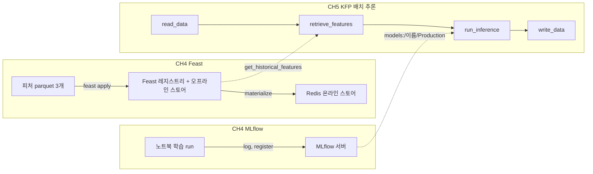

## CH 4. 신뢰할 수 있는 ML 시스템 설계

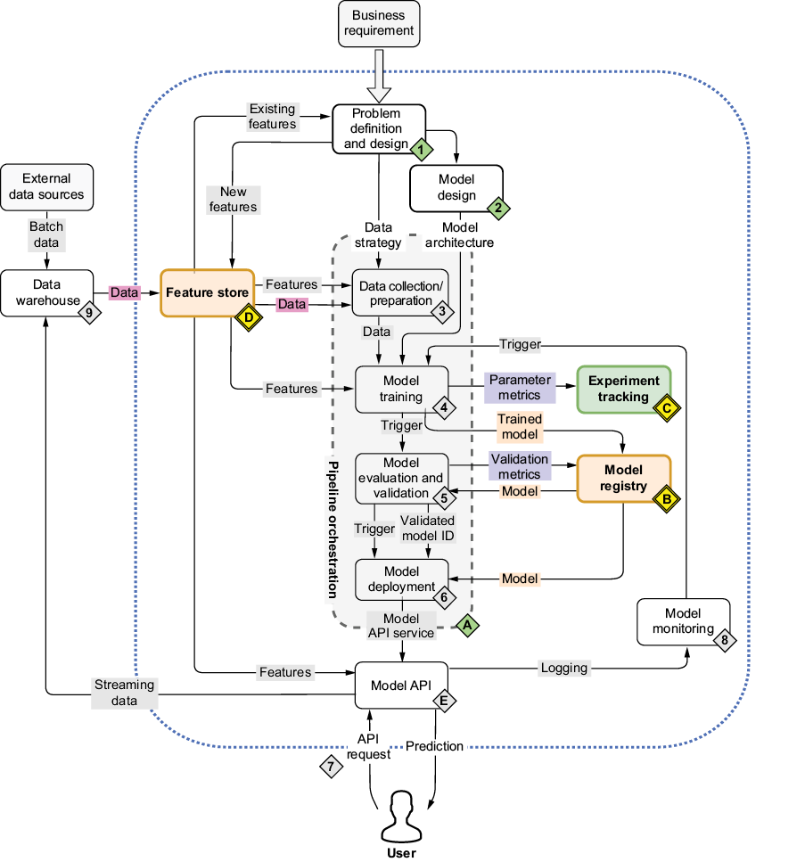

*출처: 원서 Figure 4.1. 1장의 ML 플랫폼 개념도에서 이번 장은 피처 스토어(D), 실험 추적(C), 모델 레지스트리(B)에 집중한다.*

예제는 미국 성인 소득 데이터(Adult/Census Income)로 연소득이 50K 이하인지 초과인지 맞히는 이진 분류기다. 데이터 과학자처럼 EDA(Exploratory Data Analysis)로 시작해 훈련·테스트 세트를 나누고, 모델 여러 개를 비교해 최고 모델을 고른다. 이 모델과 의존성을 MLflow 모델 레지스트리에 등록하고, 모델이 쓰는 피처는 Feast에 등록한다. 예제는 단순하지만 교훈은 더 복잡한 프로젝트에도 그대로 적용된다.

### 실험 추적을 위한 MLflow

모델을 만드는 동안 훈련·테스트 데이터, 가중치, 정확도 지표 같은 파라미터가 계속 바뀐다. 이를 추적하는 이유는 세 가지다.

- **재현성**: 동료와 결과를 공유할 때 같은 실험을 다시 만들고 결과를 그대로 복원할 수 있다.

- **모델 선택**: 아키텍처와 지표가 다른 여러 후보 중 최적의 모델을 고를 수 있다.

- **성능 추적**: 새 데이터로 재훈련한 모델을 이전 반복과 비교할 수 있다.

Git 커밋에 태그를 붙이거나 파라미터를 파일로 남기는 방법도 있지만, 커밋과 태그를 꾸준히 관리해야 하고 노트북과 파일을 공유할 때 사용법까지 따로 설명해야 한다. MLflow는 실험 파라미터를 체계적으로 관리하는 **추적 서버(tracking server)**를 제공해, ML 엔지니어가 자주 받는 다음 질문에 답하게 해 준다.

- 지금 프로덕션에 배포된 모델 버전은 무엇인가?

- 어떤 파라미터가 최고 결과를 냈나?

- 6개월 전 결과를 재현할 수 있나?

| 개념 | 역할 | 이번 실습 |
|------|------|-----------|
| Experiment | 관련 run을 묶는 프로젝트 단위 | `income-classifier` |
| Run | 실행 한 번의 기록, run ID로 식별 | EDA 1개, Decision Tree, Random Forest, XGBoost |
| Parameter | 실행 설정 | 트리 깊이 등 모델 설정 |
| Metric | 측정 결과 | `roc_auc_score_test`, 정확도 |
| Artifact | 실행이 남긴 파일 | 모델, 플롯, `column_list.pkl` |
| Model Registry | 관리할 모델의 이름과 버전 | `random-forest-classifier` v1 |

#### 데이터 탐색

데이터는 약 3만 행(30,162행)이며 범주형 변수 8개와 목표 변수로 이루어진다. 범주형 변수는 고용형태(Workclass), 최종학력(Education), 혼인 상태(Marital-Status), 직업(Occupation), 가구 내 관계(Relationship), 인종(Race), 성별(Sex), 출신 국가(Native_country)이고, 목표 변수 Target은 `<=50K` 또는 `>50K`의 이진값이다.

`df.info()`로 행 수를, `df.describe()`로 범주별 고유값 수와 최빈값(top)을 확인한 뒤, 범주형 변수마다 Target 분포를 비교하는 막대그래프를 그려 `categorical_variable_plots/`에 저장한다. `geom_bar(..., position='fill')`은 막대 높이를 모두 100%로 맞춰 건수가 아닌 비율을 비교하게 한다.

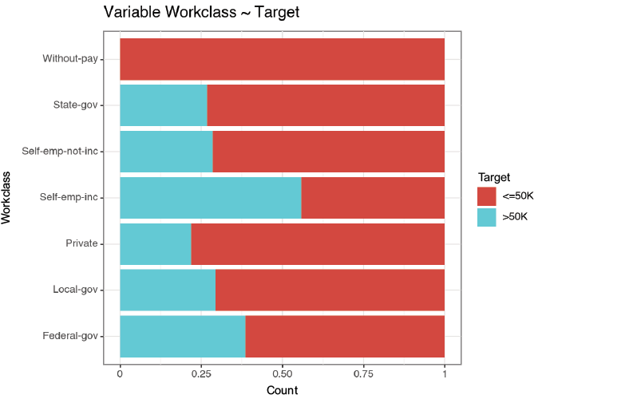

*출처: 원서 Figure 4.2. 고용형태(Workclass) 범주별로 Target 비율을 비교한 플롯이다. 자영업자(Self-emp-inc)는 연소득이 50K를 초과할 가능성이 더 높다.*

#### MLflow 추적

추적 서버는 노트북 밖에서 `mlflow ui`(기본 포트 5000)로 띄운다. 노트북에서는 추적 URI와 실험 이름을 한 번만 지정하고, 머신러닝 실행 한 번을 run으로 기록한다.

```python
mlflow.set_tracking_uri("http://localhost:5000")
mlflow.set_experiment("income-classifier")   # 없으면 생성

with mlflow.start_run(run_name=f"eda-{uuid.uuid4()}"):
    mlflow.log_artifacts("categorical_variable_plots")
```

`start_run`을 `with`로 감싸면 블록이 끝날 때 run이 FINISHED로 닫힌다. `run_name`에 `uuid4()`를 붙이는 것은 EDA용 run과 모델 학습 run을 구분하기 위해서다. 이때 `log_artifacts`는 파일을 MLflow 서버로 보내지 않고 **노트북 클라이언트가 객체 저장소(MinIO)에 직접 업로드**한다. 서버에는 run ID, 이름, 시간 같은 메타데이터만 기록된다.

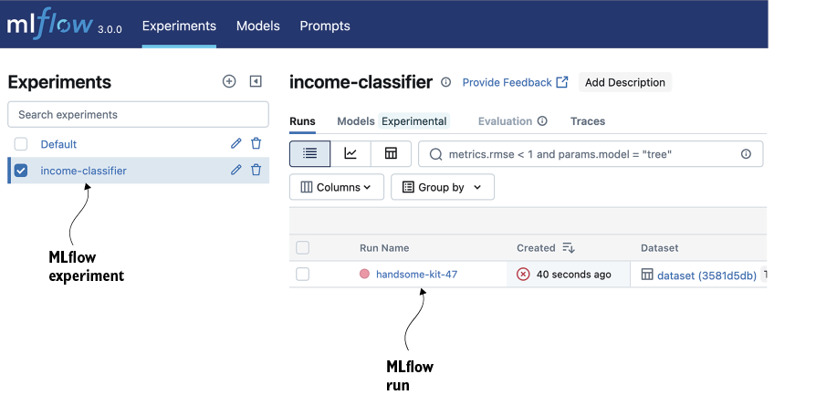

*출처: 원서 Figure 4.3. 왼쪽 실험 목록에 기본 실험과 새로 만든 `income-classifier`가 보이고, run을 시작해 플롯을 저장하면 Run Name 아래에 항목이 생긴다. 플롯은 해당 run의 Artifacts 탭에서 확인한다.*

다음은 학습용 데이터 준비다.

- **원-핫 인코딩**: `pd.get_dummies`로 범주형 변수를 더미 변수로 바꿔 입력 열 90개를 만들고, Target은 `>50K`를 1로 인코딩한다.

- **열 목록 저장**: 추론 때도 같은 열 순서를 써야 하므로 `column_list.pkl`을 모델과 함께 아티팩트로 남긴다. 5장의 추론 컴포넌트가 이 파일을 내려받는다. 새 입력마다 인코딩 열을 따로 만들면 모델은 같아도 다른 의미의 입력을 받게 된다.

- **분할**: scikit-learn의 `train_test_split(train_size=0.8)`로 훈련 24,129행, 테스트 6,033행으로 나눈다.

- **데이터셋 기록**: 훈련·테스트·참조(학습과 테스트에 쓰인 모든 사용자를 포함한 전체 피처) CSV를 `mlflow-datasets` 버킷에 저장하고, `mlflow.data.from_pandas`로 변환해 `log_input`으로 기록한다. MLflow는 열 이름·타입과 행 수 같은 메타데이터를 남길 뿐 원본을 복사하지 않는다.

모델은 Decision Tree, Random Forest, XGBoost 세 가지다. 앞의 두 모델은 `log_metric`(정확도, AUC(Area Under the Curve)), `log_params`, `sklearn.log_model`로 직접 기록하고, XGBoost는 `mlflow.xgboost.autolog()` 한 줄로 **자동 로깅**을 켠다. 자동 로깅은 파라미터, 모델, 피처 중요도 플롯을 알아서 남기지만 커스텀 지표는 기록하지 않으므로 직접 남겨야 한다.

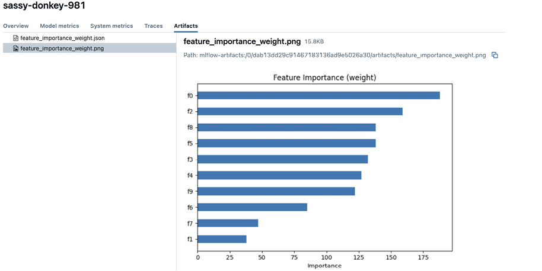

*출처: 원서 Figure 4.6. 명시적인 로깅 코드 없이도 모델 파라미터와 데이터셋이 기록되고, 피처 중요도 플롯까지 자동으로 생긴다.*

책의 XGBoost 셀은 한 run 안에서 `xgb.train`을 objective만 바꿔 두 번 호출한다. 두 번째 호출 때 autolog가 이미 기록한 파라미터를 다른 값으로 바꾸려다 `Changing param values is not allowed` 경고가 나고, 두 번째 학습의 파라미터와 모델은 기록되지 않으며 지표는 첫 모델에 붙는다. objective별로 `start_run`을 나누면 해결된다.

#### MLflow 모델 레지스트리

관심 있는 지표를 모두 기록해 두었으므로 MLflow에 쿼리하는 것만으로 최적의 모델을 찾을 수 있다. UI 검색창에 `metrics.roc_auc_score_test > 0.8`을 넣고 차트 보기로 전환하면 run별 지표를 바로 비교할 수 있다.

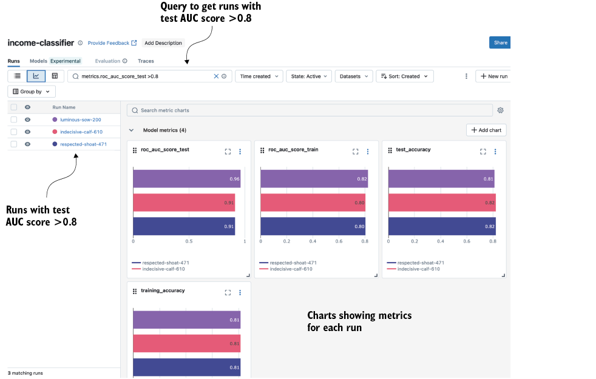

*출처: 원서 Figure 4.7. 테스트 AUC가 0.8을 넘는 run만 조회해 차트로 비교한다. 이 예시에서는 Random Forest가 가장 높다.*

| 모델 | 테스트 ROC AUC (실습 실행 1회) |
|------|-------------------------------|
| Random Forest | 0.855 |
| Decision Tree | 약 0.817 |
| XGBoost | 0.714 |

분할이 무작위라 실행마다 수치는 다르다. XGBoost 값은 위 경고의 영향을 받은 결과다.

프로그램으로 등록할 때는 `MlflowClient`를 쓴다. `get_experiment_by_name`으로 실험 ID를 얻고, 같은 필터 문자열로 `search_runs`를 실행해 `roc_auc_score_test` 내림차순으로 정렬한 뒤, 1등 run의 모델 URI(`runs:/<run_id>/income-classifier`)로 `register_model`을 호출한다. 등록된 모델은 UI의 Models 탭에서 보이며, 코드처럼 스테이징에서 프로덕션으로 승격할 수 있다.

책 코드를 그대로 쓸 때 주의할 점이 있다.

- **고정 이름 등록**: 1등을 항상 `random-forest-classifier`라는 이름으로 등록한다. 1등이 XGBoost면 모델 경로가 autolog 기본값(`model`)이라 URI가 맞지 않아 등록이 실패한다. 등록 전에 1등 run을 먼저 출력해 확인한다.

- **stage 지정**: 5장의 추론 컴포넌트는 `model_stage`와 같은 stage의 버전을 찾는다. 책은 stage를 바꾸는 절차를 적지 않았으므로 `transition_model_version_stage(..., "Production")`으로 직접 지정한다. MLflow 3에서 stage는 deprecated지만 아직 동작한다.

- **운영 기준과의 차이**: 책은 테스트 점수로 모델을 고르지만, 운영에서는 검증셋으로 후보를 고르고 테스트셋은 마지막 확인에만 쓴다. stage나 alias는 다른 버전을 가리킬 수 있으므로 실행 시작 시 `models:/이름/숫자`로 버전을 확정해 기록하는 편이 안전하다.

로컬 MLflow 인스턴스로는 협업할 수 없다. 팀이 함께 쓰려면 클라우드나 쿠버네티스처럼 모두가 접근할 수 있는 환경에 설치해야 한다(원서 부록 A). MLflow에는 LLM 프롬프트를 관리하는 Prompts 탭도 있지만 집필 시점 기준 기능이 제한적이라, 책은 12·13장에서 Langfuse를 대신 쓴다.

### 피처 스토어로서의 Feast

소득 분류기의 피처는 파일 하나에 모두 담겨 있지만, 현실에서는 여러 테이블에 흩어져 있어 복잡한 조인 로직이 필요하다. 이 상황을 흉내 내기 위해 단일 파일을 타임스탬프와 `user_id` 열이 붙은 세 파일로 나눈다.

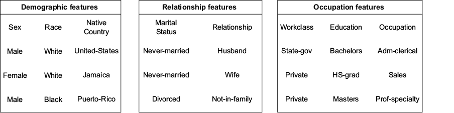

*출처: 원서 Figure 4.9. 인구통계(Sex, Race, Native country), 관계(Marital status, Relationship), 직업(Workclass, Education, Occupation) 세 범주의 피처 파일로 나눈다.*

피처를 나눈 뒤에는 추론이나 재훈련 시점에 **적합한 피처**를 가져올 방법이 필요하다. 어떤 사용자의 피처가 1월 7일, 5월 21일, 12월 4일에 기록되어 있다면, 5월 22일 기준으로 적합한 피처는 그 직전인 5월 21일 값이다. 이 로직을 스크립트나 SQL로 직접 짜면 유지보수할 대상이 하나 더 늘어나지만, Feast는 특정 시점 기준으로 정확한 피처 세트를 만드는 기능(point-in-time join)을 제공해 데이터 과학자가 조인이 아닌 피처 엔지니어링에 집중하게 해 준다.

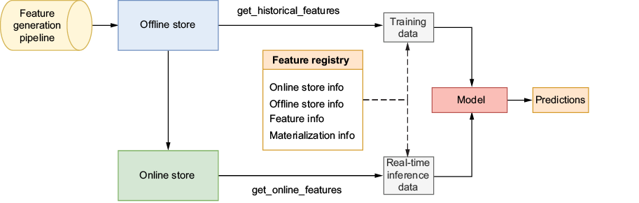

*출처: 원서 Figure 4.10. 피처 생성 파이프라인이 오프라인 스토어를 채우고, Feast가 주기적으로 오프라인 피처를 온라인 스토어로 구체화(materialize)한다. 피처 레지스트리는 피처 정의와 온·오프라인 스토어 정보를 보관하며, 훈련 데이터는 `get_historical_features`, 실시간 추론 데이터는 `get_online_features`로 가져온다.*

| 구성 요소 | 정의하는 것 | 이번 실습 |
|-----------|-------------|-----------|
| Entity | 피처를 수집하는 대상의 식별자(조인 키) | `user_id` (상품이면 `product_id`) |
| Data source | 원천 파일 위치, 시간 필드, S3 엔드포인트 | MinIO의 parquet |
| FeatureView | 피처의 논리적 그룹, 피처 목록, 엔티티, TTL | demographic, relationship, occupation |
| Registry | 엔티티·피처 정의의 메타데이터 | `s3://feature-registry/registry_local.db` |
| Offline store | 과거 피처 이력 (훈련, 배치 추론) | 파일 타입, MinIO의 parquet |
| Online store | 빠르게 읽을 최신 피처 (실시간 추론) | Redis (DynamoDB, Datastore 등도 지원) |

#### 피처 등록

`entity.py`에 `user_id` 엔티티를, `features.py`에 피처 그룹별 `FileSource`(S3 경로와 MinIO 엔드포인트 오버라이드)와 `FeatureView`를 정의한다. `feature_store.yaml`에는 프로젝트 이름, 레지스트리 위치, 오프라인 스토어(file), 온라인 스토어(Redis 연결 문자열)를 적는다.

```python
demo_features = FeatureView(
    name="demographic",
    entities=[user],
    ttl=timedelta(days=365),
    schema=[Field(name="Sex", dtype=String), Field(name="Race", dtype=String),
            Field(name="Native_country", dtype=String)],
    source=demographic_source,
)
```

TTL(Time To Live)은 과거 데이터셋을 만들 때 얼마나 이전 데이터까지 참조할지 정하는 한도다. 5월 22일 기준 조회에서 TTL이 이틀이면 5월 20일 이전 피처는 고려하지 않는다. 책은 필요한 피처를 모두 확보하기 위해 365일로 넉넉하게 잡는다.

정의를 마치면 `feast apply`로 레지스트리에 푸시한다. 출력에는 생성된 엔티티와 피처 뷰, 그리고 Redis를 온라인 스토어로 준비하는 인프라 배포 메시지가 나온다.

#### 피처 조회

`get_historical_features`에는 엔티티 데이터프레임과 피처 목록을 넘긴다. 데이터프레임의 열 이름은 반드시 엔티티 이름(`user_id`)과 `event_timestamp`여야 하고, 피처 목록은 `"demographic:Sex"`처럼 `피처뷰:피처` 형식이다.

```python
store = FeatureStore(repo_path=".")
entity_df = pd.DataFrame({"user_id": ["9f2ac416-..."],
                          "event_timestamp": [datetime(2023, 5, 22)]})
training_df = store.get_historical_features(
    entity_df=entity_df, features=["demographic:Sex"]).to_df()
```

온라인 조회 전에는 `feast materialize START_TS END_TS`로 해당 기간의 오프라인 데이터를 온라인 스토어에 기록해야 한다. 이후 `get_online_features`로 엔티티의 최신값만 읽는다.

| 구분 | `get_historical_features` | `get_online_features` |
|------|---------------------------|-----------------------|
| 데이터 출처 | 오프라인 스토어 (MinIO parquet) | 온라인 스토어 (Redis) |
| 반환 값 | 기준 시각에 알 수 있었던 값 | 지금의 최신값 |
| 용도 | 모델 훈련, 배치 추론 | 실시간 추론 |
| 사전 작업 | `feast apply` | `feast apply` + `feast materialize` |

`feast apply`와 `feast materialize`는 다른 작업이다. 레지스트리에 FeatureView가 보인다고 Redis에 값이 있다는 뜻은 아니다. 실습에서는 적재 후 Redis `DBSIZE`가 사용자 수와 같은 30,162였다.

그 밖에 SDK를 쓰지 않는 언어를 위해 `feast serve`로 피처 서버(기본 포트 6566, `POST /get-online-features`)를 띄울 수 있고, `feast ui`로 레지스트리의 엔티티·피처 뷰와 데이터 소스를 웹에서 확인할 수 있다.

#### 시점 기준 조회의 함정

사용자 42의 근무 시간이 5월 21일에 36, 6월 4일에 52였다면 5월 22일 예측에는 36을 써야 한다. 최신값 52를 가져오면 미래 정보가 섞인다. TTL이 2일이면 5월 25일 조회에서는 21일 값이 너무 오래돼 제외된다.

시간 필드 하나로 모든 누설이 막히지는 않는다. 21일에 발생한 데이터가 23일에 도착했다면 22일에는 알 수 없었으므로, 지연 도착이나 보정 이력이 있는 원천은 실제 사용 가능 시점까지 고려해야 한다.

또 책의 학습 노트북은 CSV를 직접 읽고 Feast는 따로 준비하므로, 이 흐름만으로는 학습부터 추론까지 같은 피처를 쓴다는 계약이 고정되지 않는다. 연결을 강화하려면 필요한 FeatureView를 `income_model_v1` 같은 FeatureService로 묶어 학습에서도 그것으로 조회하고, MLflow run과 모델 버전에 서비스 이름, 피처 목록, 정의 파일 해시, 데이터 스냅샷을 함께 남긴다.

## CH 5. ML 파이프라인 오케스트레이션

MLflow와 Feast만으로는 모델 훈련, 피처 업데이트, 추론을 여전히 사람이 이어 붙여야 한다. 대부분의 추론 파이프라인은 객체 스토어나 데이터 웨어하우스에서 데이터를 가져와 전처리하고, 모델을 로드해 추론한 뒤 결과를 저장하는 같은 구조이며, 주기적으로 실행되고 날짜나 피처 테이블 이름 같은 런타임 파라미터가 필요하다. KFP는 이를 파이썬 SDK(`kfp`)로 정의하게 해 준다.

### Kubeflow 컴포넌트

배치 추론 파이프라인은 네 단계다.

1. MinIO에서 예측 대상 사용자 ID 목록을 읽는다.

2. 사용자 ID에 해당하는 피처를 Feast에서 조회한다.

3. MLflow에서 모델을 불러와 추론한다.

4. 결과를 MinIO에 다시 쓴다.

각 작업은 **컴포넌트**, 즉 재사용하고 조합할 수 있는 작업 단위가 된다. 컴포넌트는 각자 쿠버네티스 파드에서 격리되어 실행되므로, 하나를 만드는 절차는 늘 같다.

1. 할 일을 파이썬 파일로 작성한다(`src/read_data/read_data.py`, 인자는 `argparse`).

2. 도커 이미지로 빌드해 컨테이너 레지스트리에 푸시한다.

3. 입력·출력·이미지·명령어를 `component.yaml` 명세로 정의한다.

```yaml
name: Read Data From MinIO
inputs:
- {name: minio_host, type: String}
- {name: bucket_name, type: String}
- {name: file_name, type: String}
outputs:
- {name: data_output, type: Dataset}
implementation:
  container:
    image: <docker_id>/read-minio-data:latest
    command: [python3, /app/src/read_data/read_data.py,
              --minio_host, {inputValue: minio_host},
              --bucket_name, {inputValue: bucket_name},
              --file_name, {inputValue: file_name},
              --data_output_path, {outputPath: data_output}]
```

| 컴포넌트 | 입력 | 출력·접속 대상 |
|----------|------|----------------|
| `read-data-from-minio` | `entity_df.parquet` 위치 | 예측 대상 사용자와 기준 시각 |
| `retrieve-features-from-feast` | 엔티티 데이터, Feast 설정, 피처 목록 | 레지스트리와 원천에서 조회한 과거 피처 |
| `model-inference` | 피처, 모델 이름·타입·stage | MLflow 모델의 `predict_proba` 예측값 |
| `write-data-to-minio` | 예측 결과, 목적지 | `inference-datasets`의 최종 parquet |

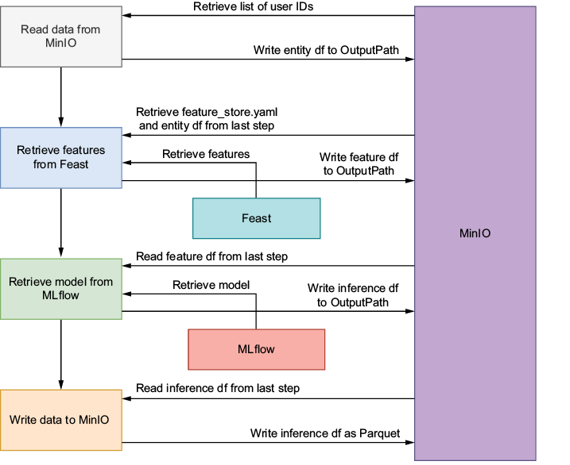

*출처: 원서 Figure 5.2. 각 단계는 MinIO의 OutputPath에 중간 데이터셋을 쓰고, 다음 단계가 그것을 읽는다. 피처는 Feast에서, 모델은 MLflow에서 가져온다.*

단계 사이 데이터는 메모리가 아니라 파일로 넘어간다. 앞 컴포넌트가 `data_output_path`에 parquet를 쓰면 다음 컴포넌트가 자기 로컬 경로로 받는다. 모델 이름 같은 작은 값은 `inputValue` 파라미터로, 대상 목록과 피처 테이블은 `Dataset` 타입 아티팩트(`inputPath`, `outputPath`)로 넘긴다. `Input[Dataset]`은 파일 전달 계약일 뿐 열 타입이나 결측 검사가 아니다.

피처 조회 컴포넌트를 쓰기 전에 Feast 등록을 한 번 더 해야 한다. 4장에서 PC로 `feast apply`한 레지스트리는 원천을 `localhost:9000`으로 가리키는데, 파드 안의 localhost는 PC가 아니라 그 파드 자신이다. MinIO는 클러스터 서비스로만 노출되어 있으므로, `minio-service.kubeflow.svc.cluster.local:9000`을 쓰는 정의로 **쿠버네티스 Job 안에서 `feast apply`**를 실행해 별도 레지스트리(`registry.db`)를 만든다.

컴포넌트를 설계할 때 염두에 둘 점은 다음과 같다.

| 원칙 | 설명 |
|------|------|
| 모듈성 | 단일 책임 원칙. 예제는 추론과 데이터 쓰기를 별도 컴포넌트로 분리했다 |
| 입출력 명시 | 필요한 데이터와 생성하는 아티팩트를 `component.yaml`에 명시한다 |
| 파라미터화 | `mlflow_host`, `bucket_name`, `minio_host`를 하드코딩하지 않아 다른 환경에서 재사용한다 |
| 문서화 | 기능, 입출력, 사용법을 그림과 함께 남긴다 |

잘 설계된 컴포넌트는 여러 파이프라인에서 재사용할 수 있고, 팀원마다 컴포넌트를 나눠 맡아 병렬로 개발할 수 있으며, 문제를 컴포넌트 하나로 격리해 테스트·디버깅하기 쉽다.

### 소득 분류기 파이프라인

KFP 파이프라인은 컴포넌트를 노드로 하는 DAG(Directed Acyclic Graph)다. 의존 관계는 따로 선언하지 않는다. 앞 태스크의 출력(`task.outputs["data_output"]`)을 다음 태스크의 입력으로 넘기면 KFP가 실행 순서를 정한다.

```python
fetch_data_op = kfp.components.load_component_from_file("components/read_data/component.yaml")
# retrieve_features_op, run_inference_op, write_data_op도 같은 방식

@dsl.pipeline(name="income-classifier-pipeline")
def income_classifier_pipeline(minio_host: str, model_name: str, model_stage: str, ...):
    fetch = fetch_data_op(minio_host=minio_host, bucket_name=entity_df_bucket, ...)
    features = retrieve_features_op(entity_df=fetch.outputs["data_output"], feature_list=feature_list, ...)
    inference = run_inference_op(input_data=features.outputs["data_output"], model_stage=model_stage, ...)
    write_data_op(input_data=inference.outputs["data_output"], bucket_name=output_bucket, ...)

compiler.Compiler().compile(income_classifier_pipeline, "income_classifier_pipeline.yaml")
```

파이프라인 함수의 인자(이 예제는 14개, 모두 `str`이고 기본값 없음)는 런타임에 바꿀 수 있는 파이프라인 파라미터다. 컴파일은 정의를 실행 명세 YAML로 바꿀 뿐 파드를 만들거나 데이터를 읽지 않는다. 이미지, 서비스 주소, 권한이 맞는지는 실제 실행에서 드러난다.

컴파일된 YAML은 KFP UI의 Pipelines → Upload pipeline으로 올리고, 실험(experiment)을 만든 뒤 런타임 파라미터를 채워 실행(run)을 시작한다. KFP의 실험은 파이프라인 실행을, MLflow의 실험은 학습 run을 묶는 별개 개념이다.

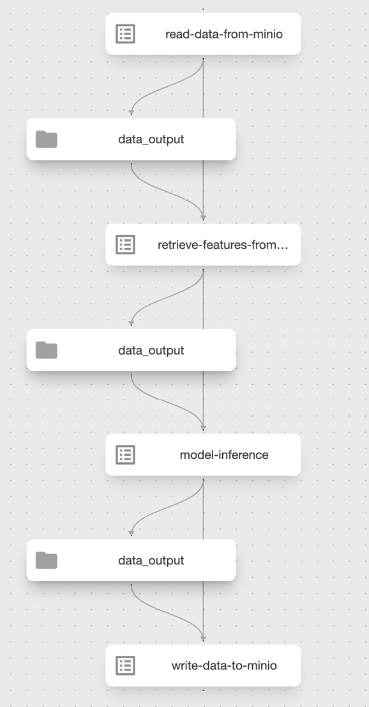

*출처: 원서 Figure 5.5. 업로드한 파이프라인을 KFP UI가 시각화한 그래프로, 네 컴포넌트가 데이터 의존 관계대로 이어진다.*

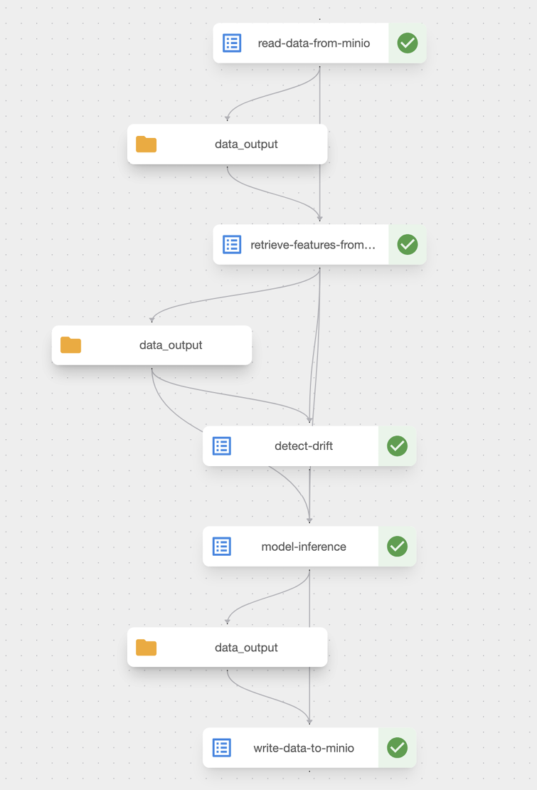

*출처: 원서 Figure 5.8. 네 태스크가 모두 성공한 실행이다. 예측 결과는 MinIO의 `inference-datasets` 버킷에 저장된다.*

KFP는 배치 추론에 잘 맞는 도구다. 실시간 추론과 서빙에는 BentoML을 쓴다.

### 실행 시 생성되는 파드

KFP 2.x는 Argo Workflows로 파이프라인을 실행한다. Run 하나가 `workflows.argoproj.io` 객체 하나가 되고, 4단계 파이프라인에서는 파드 9개가 순서대로 생성된다(실습 기준 약 2분).

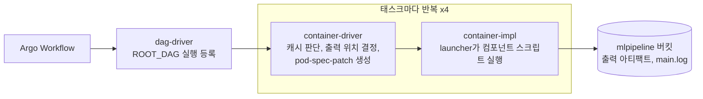

| 파드 | 이미지 | 역할 |
|------|--------|------|
| `system-dag-driver` × 1 | `kfp-driver:2.4.1` | ROOT_DAG 실행을 MLMD(ML Metadata)에 등록하고 하위 태스크 실행 방식을 정한다 |
| `system-container-driver` × 4 | `kfp-driver:2.4.1` | 태스크별 캐시 판단(`enableCache: true`), 실행 기록 등록, 출력 위치 결정, 실행 파드에 덧씌울 `pod-spec-patch` 생성 |
| `system-container-impl` × 4 | 컴포넌트 이미지 + `kfp-launcher:2.4.1` | init에서 launcher를 공유 볼륨에 복사하고, main에서 launcher가 스크립트를 감싸 실행한 뒤 출력 업로드와 MLMD 기록 |

모든 파드는 Argo 표준 구조(init `argoexec` → main → wait)이며, wait 컨테이너가 `main.log`를 `mlpipeline` 버킷에 보관한다. 단계 간 데이터는 `minio://mlpipeline/v2/artifacts/<pipeline>/<run-id>/<task>/<uuid>/data_output`에 쌓인다. 같은 입력으로 다시 실행하면 캐시 판단에서 실행이 생략될 수 있다.

### 결과 해석

최종 결과 `income_predictions.parquet`는 30,162행 × 91열이고, `Predicted_Income_Class`는 평균 0.2478, 중앙값 0.1119였다. 파이프라인 실행 성공과 예측 품질은 별개로 봐야 한다.

- 결과에 `user_id`가 없다. 추론 코드가 인코딩 전에 이 열을 지우기 때문이다. 모델 입력에서 ID를 빼는 것과 결과에서 ID를 버리는 것은 다른 문제이므로, 실제 서비스라면 결과에 다시 붙여야 한다.

- `predict_proba()`가 반환한 값은 클래스 확률 추정치이지 클래스 번호가 아니다. 열 순서는 `classes_`로 확인하고, 임계값은 오탐과 미탐의 업무 비용에 맞춰 정한다.

- 재실행을 추적하려면 대상 사용자, 기준 시각, 구체 모델 버전, 피처 정의, 코드와 데이터 스냅샷을 함께 남긴다. KFP run ID는 실행을 구분할 뿐, 같은 날 결과가 중복 저장되지 않게 하는 업무 키가 아니다.

- 책은 S3 키를 파이프라인 파라미터로 넘겨 UI에 그대로 노출된다. 로컬 실습에서만 쓰고, 운영에서는 Secret과 서비스 계정 권한으로 전달한다.

## 실습 환경

책은 4장에서 PC의 `mlflow ui`를, 5장에서 파드가 접근할 수 있는 MLflow 서버를 전제로 한다. 실습 가이드는 처음부터 클러스터에 공용 MLflow 서버 하나를 두고 PC에서 `localhost:5000`으로 연결해, 노트북과 파이프라인이 같은 모델을 보도록 구성했다.

```bash
git clone https://github.com/johklo/ml-platform-book-env.git && cd ml-platform-book-env
python bookenv.py check     # docker, kind, kubectl, git 확인
python bookenv.py up        # 이미지 캐시가 있으면 약 8분, 처음에는 20분 이상
python bookenv.py forward   # 별도 터미널에서 켜 둔다
python bookenv.py buckets   # 실습용 버킷 생성
```

| 구성 요소 | 책의 설치 방식 | 이 실습 |
|-----------|----------------|---------|
| Kubeflow | Argo CD로 전체 설치 (Istio, 인증, 대시보드, Notebooks 포함) | kind(K8s v1.31.6)에 KFP standalone 2.4.1만 설치 |
| KFP 저장소·실행 기반 | MySQL, MinIO, Argo Workflows | 같은 구성에서 MinIO 이미지를 SeaweedFS 3.85로 교체 |
| PostgreSQL, Redis | 부록 A의 Bitnami Helm 차트 | 같은 서비스 이름의 매니페스트 |
| MLflow 서버 | 이미지 빌드 후 Deployment·Service 적용 | MLflow 3.0.0 이미지를 빌드해 `kind load` |

Argo CD는 책이 Kubeflow 설치에 고른 GitOps 도구이고, Argo Workflows는 KFP가 파이프라인 작업을 파드로 실행하는 엔진이다. Kubeflow를 설치한다고 Argo CD가 생기지는 않는다.

| 버킷 | 저장하는 것 |
|------|-------------|
| `mlflow-datasets` | 학습·테스트·참조 CSV (노트북이 직접 업로드, 이름이 코드에 고정) |
| `mlflow-artifacts` | 모델, 플롯, `column_list.pkl` |
| `feature-data-sets` | 피처 원천 parquet 3개, 예측 대상 `entity_df.parquet` |
| `feature-registry` | Feast 레지스트리(`registry_local.db`, `registry.db`)와 설정 파일 |
| `inference-datasets` | 최종 예측 parquet |
| `mlpipeline` | KFP 단계 사이 아티팩트와 로그 (KFP가 생성) |

포트는 S3 API 9000, 저장소 웹 UI 8888, MLflow 5000, Redis 6379, KFP UI 8080이고 JupyterLab은 8888과 겹치지 않게 8890으로 띄운다. 파이썬 패키지는 `mlflow 3.0.0`, `feast 0.40.1`, `kfp 2.9.0`, `scikit-learn 1.5.2`다.

실습 중 걸리기 쉬운 지점은 다음과 같다.

| 증상 | 원인과 대응 |
|------|-------------|
| 컴포넌트 이미지 빌드 중 apt 404 | 책의 `python:3.10-slim-buster` 저장소가 내려감 → `slim-bookworm`으로 교체 |
| 추론 단계에서 모델 로드 실패 | 모델은 scikit-learn 1.5.2로 pickle됨 → 컴포넌트 이미지도 1.5.2로 맞추고, MLflow 3.0.0에 맞춰 `sqlalchemy<2.1` |
| `ErrImageNeverPull` | Docker Hub에 푸시하지 않고 `kind load`로 노드에 넣는 구성 → 적재 여부부터 확인 |
| Feast Job 재실행 불가 | 완료된 Job이 남아 있음 → `kubectl -n kubeflow delete job feast-job` 후 재적용 |
| `NoSuchBucket`, 연결 오류 | 버킷 생성 여부와 `forward` 터널 확인 |
| macOS에서 5000 포트 점유 | AirPlay 수신 모드가 사용 중 → 끄거나 포트 변경 |
| 책의 버킷 이름 `feature_data_sets` | 본문 오기. 밑줄은 버킷 이름에 쓸 수 없어 코드는 하이픈 |

`feature_store.yaml`을 `feature-registry` 버킷에 올리면 Redis 비밀번호가 평문으로 버킷에 들어간다는 점도 기억해 둔다. 실습을 끝낼 때는 `python bookenv.py down`으로 kind 클러스터를 지우고 빌드한 이미지를 `docker rmi`로 정리한다.

## 마무리

- MLflow는 run 단위로 파라미터·지표·아티팩트·데이터셋 메타데이터를 기록하고, 쿼리로 최고 모델을 골라 모델 레지스트리에 이름과 버전으로 등록한다. 추론에 필요한 `column_list.pkl` 같은 부속 파일도 모델과 함께 남긴다.

- Feast는 엔티티와 FeatureView로 피처를 정의하고, `get_historical_features`로 기준 시각에 알 수 있었던 값을, `get_online_features`로 최신값을 돌려준다. `apply`(정의 등록)와 `materialize`(온라인 적재)는 다른 작업이다.

- 시점 기준 조회는 미래 정보 누수를 막지만, 지연 도착 데이터와 학습-추론 간 피처 계약까지 보장하지는 않는다.

- KFP 컴포넌트는 파이썬 코드 → 도커 이미지 → `component.yaml`로 만들고, 출력을 다음 입력으로 넘기면 DAG 의존 관계가 정해진다. 단계 간 데이터는 파일 아티팩트로 전달된다.

- KFP 2.x Run은 Argo Workflow 하나가 되어 driver와 launcher 파드로 실행되며, 파드 안의 localhost는 PC가 아니므로 클러스터 주소용 Feast 레지스트리를 따로 만든다.

- 파이프라인이 성공해도 결과에 ID가 빠지거나 확률을 클래스로 오해하는 문제가 남을 수 있으므로, 실행 성공과 예측 품질은 따로 검증한다.

## 참고

- [CH4 + CH5 실습 가이드 (김춘식)](https://johklo.github.io/docs/tech/machine-learning-platform-engineering/04-experiments-features-pipelines/)
- [ml-platform-book-env 실습 환경](https://github.com/johklo/ml-platform-book-env)
- [practical-mlops/chapter-4](https://github.com/practical-mlops/chapter-4)
- [practical-mlops/chapter-5](https://github.com/practical-mlops/chapter-5)
- [MLflow Tracking](https://mlflow.org/docs/latest/ml/tracking/)
- [MLflow Model Registry](https://mlflow.org/docs/latest/ml/model-registry/)
- [Feast Documentation](https://docs.feast.dev/)
- [Kubeflow Pipelines](https://www.kubeflow.org/docs/components/pipelines/overview/)
- [Kubeflow Pipelines manifests (kustomize)](https://github.com/kubeflow/pipelines/tree/master/manifests/kustomize)
- [Argo Workflows](https://argo-workflows.readthedocs.io/)
