---
tags:
  - ML Platform
  - MLOps
  - BentoML
  - Yatai
  - Evidently
  - Data Drift
  - Kubeflow Notebooks
  - Kubeflow Pipelines
---

# 모델 서빙, 드리프트 모니터링, 데이터 준비

> 소득 분류기를 BentoML로 API 서비스로 만들어 Yatai로 쿠버네티스에 배포하고, Evidently로 배치·API 입력의 드리프트를 관측한 뒤, 캡스톤 프로젝트를 위한 Kubeflow 노트북과 KFP(Kubeflow Pipelines) 데이터 전달의 기초를 정리한다.

## 개요

3주차는 『Machine Learning Platform Engineering』 6장 전체와 7장 앞부분(7.1~7.2.1)을 다룬다. 6장은 2주차에 배치 추론으로 연결한 소득 분류기를 요청 기반 API로 바꾸고, 배포 뒤 들어오는 데이터가 학습 때와 달라지는지 감시한다. 7장은 3부 캡스톤 프로젝트(신분증 탐지, 영화 추천)의 출발점으로, 데이터 분석 환경인 Kubeflow 노트북과 파이프라인 컴포넌트 사이의 데이터 전달을 설명한다.

| 챕터 | 주제 | 핵심 |
|------|------|------|
| CH 6 | Productionizing ML models | BentoML·Yatai로 API 배포, Evidently로 데이터 드리프트 탐지 |
| CH 7 (7.1~7.2.1) | Data analysis and preparation | Kubeflow 노트북 구성, KFP 단순 값 전달과 코드 주입 |

두 도구는 서로 다른 질문에 답한다.

| 도구 | 답하는 질문 | 플랫폼 개념도 블록 |
|------|-------------|---------------------|
| BentoML + Yatai | 모델을 어떤 패키지로 묶어, 어디에 어떤 자원으로 띄우나 | E 모델 API |
| Evidently | 지금 들어오는 입력이 학습 때와 같은 분포인가 | 8 모델 모니터링 |

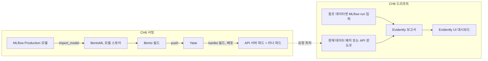

본문의 그림은 원서(영문판)에서 가져왔으며 각 캡션에 원서 그림 번호를 표시했다. 실습은 스터디 노션의 BentoML 1.1.10·Yatai 1.1.13·Evidently 0.5.0 실습 가이드를 따랐고, 2주차에서 만든 [ml-platform-book-env](https://github.com/johklo/ml-platform-book-env) 환경을 그대로 이어서 쓴다. 저자 코드와 책 설명이 어긋나는 부분은 스터디원 김춘식 님의 [6장 해설](https://johklo.github.io/docs/tech/machine-learning-platform-engineering/06-productionizing-models/)을 참고했다.

## CH 6. ML 모델의 프로덕션화

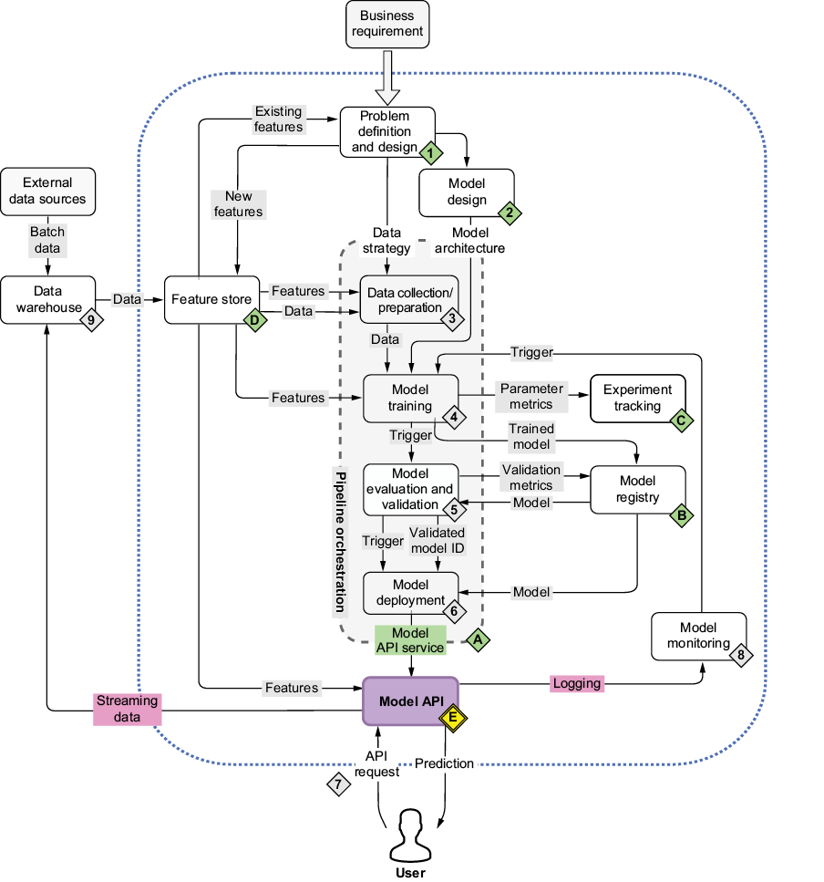

*출처: 원서 Figure 6.1. 이번 장은 모델을 API로 배포하는 블록(E)에 집중하고, 모델 모니터링(8)으로 이어진다.*

6장은 머신러닝 수명주기의 두 과제인 배포와 모니터링을 다룬다. 모델을 프로덕션에서 안정적으로 서빙하는 방법과, 시간이 지나도 모델이 좋은 성능을 유지하는지 확인하는 방법이다. 예제는 4~5장의 소득 분류기를 그대로 이어서 쓰며, 여기서 다루는 기법은 전통적인 ML 모델과 LLM(Large Language Model) 모두에 적용된다.

### 배치 추론에서 온라인 추론으로

5장의 배치 추론은 대상 사용자 목록과 기준 시각을 파일로 받아 결과 파일을 남겼다. 6장은 같은 모델을 사용자 ID가 들어올 때마다 예측하는 API로 바꾼다. 모델 자체는 그대로이고, 그 모델을 둘러싼 실행 조건과 실패 조건이 바뀐다.

| 구분 | 배치 추론 (5장) | 온라인 추론 (6장) |
|------|-----------------|-------------------|
| 실행 계기 | 일정이나 준비된 데이터 묶음 | 사용자와 애플리케이션의 요청 |
| 입력 | 대상 사용자 parquet, 과거 시점 피처 | 요청 본문의 `user_id`, 요청 시점의 온라인 피처 |
| 응답 | 작업이 끝난 뒤 결과 파일 | 기다리는 클라이언트에 즉시 응답 |
| 주요 운영 기준 | 완료 시간, 처리량, 재실행 | 지연, 동시성, 가용성, 오류 처리 |

온라인 추론이라고 요청마다 모델을 새로 학습하는 것은 아니다. 학습된 모델을 메모리에 올려 두고 요청마다 피처 조회, 전처리, 예측을 한다. 따라서 전체 지연에는 모델 계산 외에 Redis 조회 시간도 들어가며, 러너만 늘려서는 지연이 충분히 줄지 않을 수 있다.

### 배포 플랫폼으로서의 BentoML

3장에서 hello-joker 앱을 FastAPI 엔드포인트로 배포할 때는 도커 이미지 빌드, 쿠버네티스 매니페스트 작성, 모니터링 코드 추가, CI/CD 구성을 모두 직접 했다. 이 작업은 시간이 오래 걸리고, 팀의 모든 데이터 과학자가 해낼 수 있는 일도 아니다.

BentoML은 ML 애플리케이션에 필요한 모든 요소를 **Bento**라는 파일 아카이브로 패키징해 배포 과정을 단순화하는 엔드투엔드 솔루션이다. Bento는 ML 애플리케이션이 담긴 도시락 상자에 비유된다. Bento가 패키징 형식이라면, 쿠버네티스 위의 배포·확장·모니터링과 그 UI는 **Yatai**가 맡는다. 로컬에서 Bento를 빌드해 Yatai로 푸시하면, Yatai가 컨테이너 이미지를 빌드하고 배포한다.

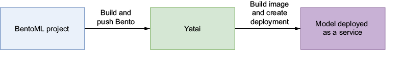

*출처: 원서 Figure 6.2. Bento를 빌드해 레지스트리로 푸시하면 Yatai가 이미지를 빌드하고 배포한다.*

| 구성 | 의미 | 소득 분류기에서의 역할 |
|------|------|------------------------|
| Model store | 이름과 태그로 모델을 보관하는 로컬 저장소 | MLflow에서 가져온 분류기 보관 |
| Service | API 입출력과 처리 흐름 정의 | 사용자 ID 검사, Feast 조회, 전처리, 응답 |
| Runner | 모델 연산을 별도 워커에서 실행하는 단위 | 분류기 로드와 예측 호출 |
| Bento | 서비스 코드, 모델, 의존성을 묶은 배포 산출물 | 같은 서비스를 다시 실행할 패키지 (tar 아카이브, 컨테이너 아님) |
| 컨테이너 이미지 | Bento를 런타임에서 실행할 이미지 | 클러스터에 전달할 실행 환경 |
| Yatai | 모델·Bento 레지스트리와 배포 관리 UI | 이미지 빌드, API 서버·러너 자원과 복제본 설정 |

세 도구의 역할을 한 줄씩 요약하면 다음과 같다.

- **MLflow**: 실험 기록과 어떤 버전이 승인됐는지의 기준이다.

- **Bento**: 승인된 버전을 서빙 코드와 함께 고정한 배포 단위다.

- **Yatai**: Bento를 이미지로 만들어 배포하는 도구다.

MLflow 레지스트리의 모델 버전과 BentoML의 모델 태그, Bento 태그는 서로 다른 식별자다. 모델 버전이 같아도 피처 조회나 전처리 코드가 바뀌면 다른 Bento가 되므로, 모델 버전만으로 배포를 재현할 수는 없다.

BentoML은 오픈소스 프레임워크이고, 같은 Bento를 관리형으로 운영하는 상용 서비스로 BentoCloud가 있다. 책 6장은 BentoML과 직접 설치한 Yatai를 쓴다.

#### 모델 등록

Bento를 만드는 절차는 네 단계다.

1. MLflow의 모델을 BentoML 로컬 스토어로 가져온다.

2. API 엔드포인트를 정의하는 서비스와 실제 추론을 맡는 러너를 초기화한다.

3. Bento의 요구사항과 환경 변수를 담은 `bentofile.yaml`을 작성한다.

4. BentoML 명령으로 Bento를 빌드하고 Yatai로 푸시한다.

BentoML은 MLflow와 기본 통합되어 있어 `bentoml.mlflow.import_model`로 MLflow 모델을 가져올 수 있다. 모델 이름과 함께 스테이지를 포함한 모델 URI를 넘긴다. 실행 전에 MLflow와 MinIO 포트포워딩이 열려 있어야 한다.

```python
# Listing 6.1 MLflow 모델을 로컬 BentoML 스토어로 가져오기
mlflow.set_tracking_uri("http://localhost:5000")
os.environ["AWS_ACCESS_KEY_ID"] = "minio"
os.environ["AWS_SECRET_ACCESS_KEY"] = "minio123"
os.environ["AWS_ENDPOINT_URL"] = "http://localhost:9000"

model_name = "random-forest-classifier"
model_stage = "Production"
bentoml.mlflow.import_model(
    "random-forest-classifier",
    model_uri=f"models:/{model_name}/{model_stage}",
)
```

```bash
bentoml models list
 Tag                                        Module          Size       Creation Time
 random-forest-classifier:wbpagnwu56ztkr6q  bentoml.mlflow  37.02 MiB  2026-10-31 14:55:34
```

Module 항목의 `bentoml.mlflow`가 모델의 출처를 나타낸다. 이 명령은 모델 파일을 BentoML 스토어로 한 번 복사하는 작업이며, 요청마다 MLflow에서 모델을 내려받는 구조가 아니다.

#### 서비스와 러너 초기화

**러너(runner)**는 원격 파이썬 워커에서 실행되며 독립적으로 확장할 수 있는 연산 단위다. API 서버가 시작되면 러너 워커 프로세스 그룹이 생성되고, 서비스에서 호출한 `run` 메서드는 러너 워커들 사이에서 스케줄링된다. 러너를 여러 개 지정하면 여러 모델을 백그라운드에서 함께 돌려 비교할 수도 있다.

API 처리와 모델 계산을 나누면 두 쪽의 자원과 복제본을 따로 조정할 수 있다. 러너가 항상 별도 파드인 것은 아니며, 로컬 실행에서는 워커 프로세스이고 Yatai 배포에서는 분리된 파드가 된다.

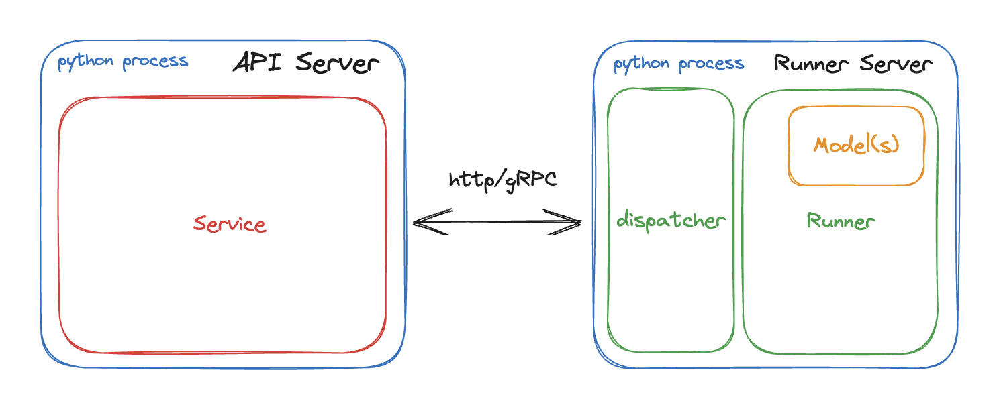

*출처: BentoML 1.1 공식 문서 (Apache-2.0). API 서버 프로세스의 Service와 러너 서버 프로세스의 Runner가 HTTP/gRPC로 통신한다.*

```python
# Listing 6.2 BentoML 서비스 초기화
income_clf_runner = bentoml.mlflow.get(
    "random-forest-classifier:latest"
).to_runner()                                   # MLflow 모델을 러너로 변환
full_input_spec = JSON(pydantic_model=IncomeClassifierUsers)
svc = bentoml.Service(
    "income_classifier_service",
    runners=[income_clf_runner],
)

@svc.on_startup
async def initialise(context: bentoml.Context):
    config = dotenv_values(ENV_FILE_NAME)       # .env 또는 production.env
    mlflow_client = MlflowClient(config["MLFLOW_HOST"])
    for model in mlflow_client.search_model_versions(
        f"name='{config['MLFLOW_MODEL_NAME']}'"
    ):
        if model.current_stage == config["MLFLOW_MODEL_STAGE"]:
            model_run_id = model.run_id
    mlflow.artifacts.download_artifacts(
        f"runs:/{model_run_id}/column_list.pkl", dst_path="column_list"
    )
    ...  # col_list, Feast 스토어 객체, 피처 목록을 context.state에 저장
```

초기화 함수는 `@svc.on_startup`으로 서비스 시작 시 한 번 실행되며, 다음 일을 한다.

- `python-dotenv`로 환경 파일을 읽는다. `ENV_NAME=production`이면 `production.env`, 그 외에는 `.env`를 읽는다.

- MLflow에서 Production 모델의 원천 run을 찾아 `column_list.pkl`을 내려받는다. 더미 변수 열의 순서를 학습 때와 맞추기 위해서다.

- MinIO의 액세스 키, 시크릿 키, 호스트, 레지스트리 버킷 이름, `feature_store.yaml`로 Feast 스토어 객체를 만든다.

- 열 목록과 스토어 객체를 `context.state`에 넣어 요청마다 재사용한다.

러너는 BentoML 스토어의 `latest` 태그로, 열 목록은 MLflow의 `Production` 스테이지로 각각 찾는다. 두 조회 사이에 어느 한쪽이 움직이면 서로 다른 학습의 모델과 전처리가 조합될 수 있으므로, 운영에서는 MLflow 모델 버전, 원천 run, BentoML 모델 태그를 한 묶음으로 고정하는 편이 안전하다.

#### 서비스 정의

서비스의 입력은 Feast 엔티티인 `user_id` 하나다. 피처 전체를 클라이언트가 보내지 않고, 서비스가 온라인 스토어에서 조회한다.

```python
# Listing 6.3 서비스 엔드포인트 정의
@svc.api(input=full_input_spec, output=JSON(), route="/predict")
def predict(inputs: IncomeClassifierUsers, ctx: bentoml.Context) -> Dict[str, Any]:
    input_dict = inputs.dict()
    feature_df = ctx.state["store"].get_online_features(
        features=ctx.state["feature_list"],
        entity_rows=[input_dict],
    ).to_df()                                   # Feast 온라인 피처 조회
    feature_df.drop(columns=["user_id"], inplace=True)
    data_mapper = InputMapper(feature_df, ctx.state["col_list"])
    input_df = data_mapper.generate_pandas_dataframe()
    output_mapper = OutputMapper(income_clf_runner.predict.run(input_df)[0])
    return {
        "income_category": output_mapper.map_prediction(),   # 0 → <=50K, 1 → >50K
        "user_id": input_dict["user_id"],
    }
```

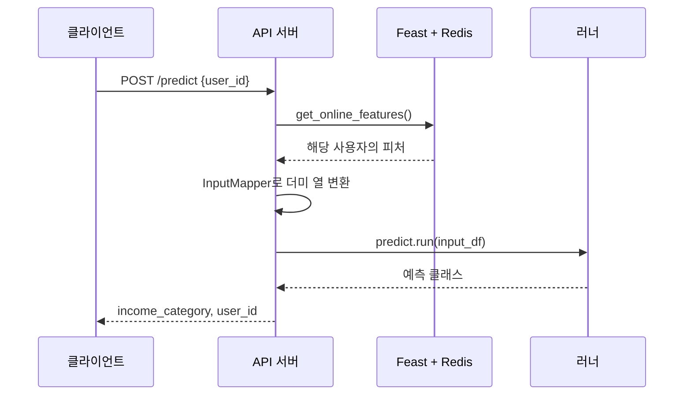

`InputMapper`에는 요청 단위 추론에서 드러나는 함정이 있다. 저자 코드는 요청 피처에 `get_dummies(drop_first=True)`를 적용한 뒤 학습 열 목록으로 재정렬하고 없는 열을 0으로 채운다.

- 배치에서는 한 컬럼에 여러 범주가 함께 있어 원-핫 열이 만들어진다.

- 요청 하나에는 컬럼마다 값이 하나뿐이므로 `drop_first=True`가 그 컬럼의 유일한 열을 지운다.

- 이후 학습 열 목록으로 맞춰도 모든 더미 열이 0이 되어, 어떤 사용자가 와도 모든 범주가 기준값인 같은 입력이 된다.

HTTP 200과 그럴듯한 응답이 나와도 학습과 같은 변환을 거쳤다는 보장은 없다. 같은 사용자의 배치 입력과 API 입력을 대조해 보고, 운영에서는 학습 때 fit한 인코더를 모델과 함께 저장해 추론에서 재사용해야 한다.

#### bentofile.yaml

`bentofile.yaml`은 Dockerfile과 비슷하지만 더 간결한 패키징 명세다.

```yaml
# Listing 6.4 애플리케이션을 패키징하는 bentofile.yaml
service: "service:svc"            # 파일명:서비스 객체명
labels:
  owner: ml-engineering-team
include:
  - "service.py"
  - "production.env"
  - "src/*.py"
  - "requirements.txt"
  - "*.env"
python:
  requirements_txt: requirements.txt
docker:
  env:
    - ENV_NAME=local
    - AWS_ACCESS_KEY_ID=minio
    - AWS_SECRET_ACCESS_KEY=minio123
```

| 키 | 역할 |
|----|------|
| `service` | `service.py`의 `svc` 객체를 진입점으로 지정 |
| `labels` | 키-값 메타데이터 (담당 팀 등) |
| `include` | Bento에 넣을 파일. 설정 파일과 파이썬 소스 |
| `python.requirements_txt` | 의존성 설치에 쓸 파일 |
| `docker.env` | `ENV_NAME`은 읽을 설정 파일 선택, AWS 변수는 Feast가 MinIO에서 레지스트리를 읽을 때 사용 |

`*.env`와 `production.env`가 Bento 안에 들어가고 자격 증명이 `docker.env`에 평문으로 박힌다. 실습에서는 편하지만, 실제 자격 증명을 담은 Bento를 원격 저장소로 올리면 그대로 노출된다. 운영 설정은 패키지와 분리해 런타임에 주입해야 한다.

#### 빌드, 컨테이너화, 푸시

```bash
bentoml build -f bento/bentofile.yaml
Successfully built Bento(tag="income_classifier_service:uikaqdwva2bujj2r").

bentoml list
 Tag                                         Size       Model Size  Creation Time
 income_classifier_service:uikaqdwva2bujj2r  22.09 KiB  37.02 MiB   2026-10-31 17:39:49
```

Size는 애플리케이션 코드의 크기, Model Size는 모델의 크기다. 빌드부터 배포까지는 서로 다른 상태를 만든다.

| 단계 | 명령 | 결과 |
|------|------|------|
| 빌드 | `bentoml build` | 로컬 Bento 스토어에 Bento 생성 |
| 컨테이너화 | `bentoml containerize <태그>` | 로컬 도커 이미지 생성 |
| 푸시 | `bentoml yatai login` 후 `bentoml push <이름>` | Yatai의 원격 모델·Bento 스토어로 업로드 |
| 배포 | Yatai UI 또는 CRD(Custom Resource Definition) | 쿠버네티스에서 요청을 받는 파드 실행 |

`bentoml push`는 최신 Bento와 그 안의 모델을 함께 올린다. 어느 단계도 다음 단계의 성공을 뜻하지 않으므로, 지금 확인한 상태가 어디까지인지 구분해야 한다.

#### Yatai로 배포

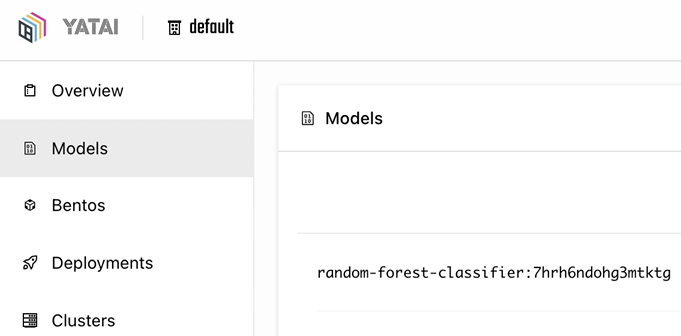

*출처: 원서 Figure 6.3. Models 탭에 BentoML 모델 레지스트리로 푸시된 `random-forest-classifier`가 보인다.*

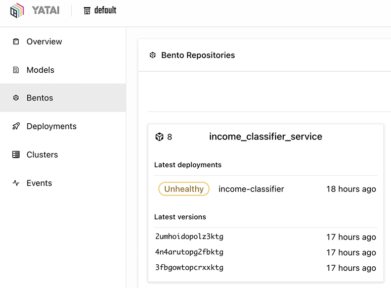

*출처: 원서 Figure 6.4. Bentos 탭에 푸시된 `income_classifier_service` Bento와 버전 목록이 보인다.*

Yatai UI의 Models 탭과 Bentos 탭에서 푸시된 모델과 Bento를 확인한 뒤, Deployments 탭에서 Create를 누르고 다음을 지정한다.

- 클러스터(`default`), 네임스페이스(`yatai`), 배포 이름(`income-classifier-service`)

- Bento 저장소와 태그

- API 서버와 러너 각각의 복제본 수, CPU·메모리 requests/limits

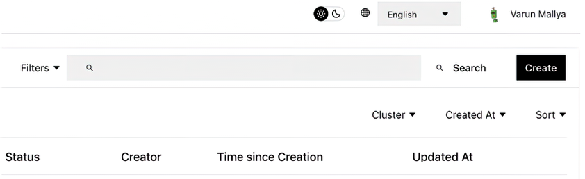

*출처: 원서 Figure 6.5. Deployments 탭의 Create 버튼으로 배포를 만든다.*

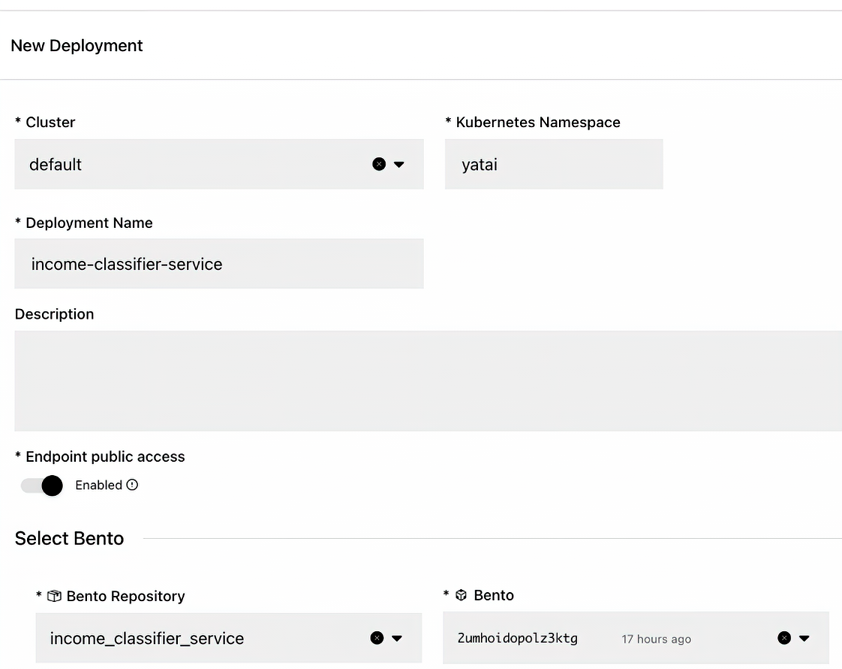

*출처: 원서 Figure 6.6. 클러스터, 네임스페이스, 배포 이름, Bento 저장소와 버전을 지정한다.*

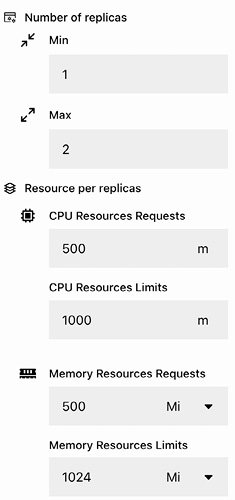

*출처: 원서 Figure 6.7. 같은 화면에서 복제본 수의 최소·최대와 복제본당 CPU·메모리 requests/limits를 정한다.*

Submit하면 Yatai가 쿠버네티스 Job으로 컨테이너 이미지를 빌드하고(`yatai-bento-image-builder-...`), 빌드가 끝나면 애플리케이션 파드를 띄운다. 파드는 두 종류다.

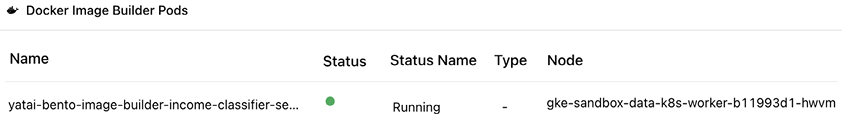

*출처: 원서 Figure 6.8. Yatai가 애플리케이션을 컨테이너화하는 이미지 빌더 파드를 실행 중이다.*

- **API 서버 파드**: 애플리케이션의 프론트엔드로, 사용자와 다른 애플리케이션의 요청을 받는다.

- **러너 파드**: 백엔드로, 모델을 들고 추론을 수행한다. API 서버 파드가 러너 파드와 통신해 예측 결과를 얻는다.

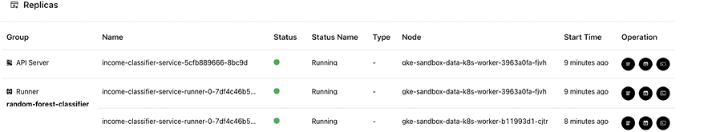

*출처: 원서 Figure 6.9. API 서버 파드 1개와 러너 파드 2개로 배포가 성공했다. 두 범주는 독립적으로 스케일을 설정할 수 있다.*

BentoML은 서비스 접근용 Ingress도 자동으로 만든다. 엔드포인트에 접속하면 Swagger 문서가 열리고, `/predict`에 `user_id`를 넣어 바로 테스트할 수 있다. 또 `/metrics` 엔드포인트로 초당 요청 수, 요청 지연 같은 표준 지표를 Prometheus 형식으로 노출한다.

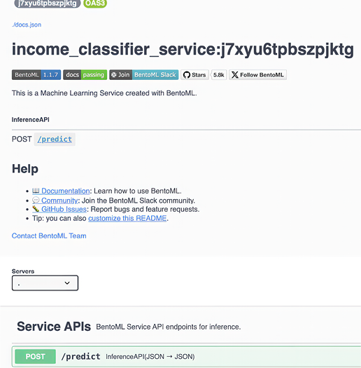

*출처: 원서 Figure 6.10. 배포된 서비스의 Swagger 문서에 `/predict` 엔드포인트가 보인다.*

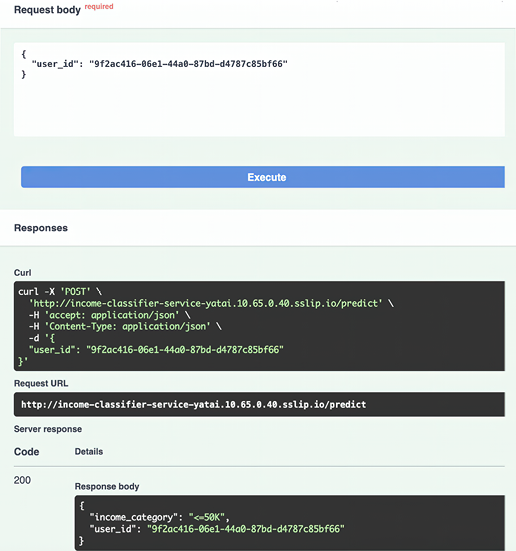

*출처: 원서 Figure 6.11. `user_id`로 요청하면 `income_category`와 `user_id`가 응답으로 돌아온다.*

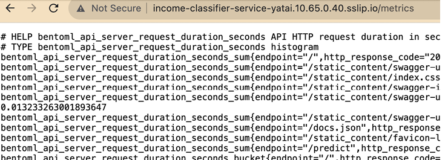

*출처: 원서 Figure 6.12. BentoML이 `/metrics`에 기본으로 노출하는 지표 일부다.*

Dockerfile, 쿠버네티스 매니페스트, 메트릭 코드를 직접 쓰지 않고 `bentofile.yaml`만으로 배포까지 이어졌다는 점이 BentoML의 장점이다. 다만 메트릭을 노출하는 것과 Prometheus가 수집하는 것, 대시보드와 알림을 만드는 것은 별도 구성이다. 또 요청이 빠르고 HTTP 200이 많아도 예측은 틀릴 수 있다. 서비스 관측과 모델 관측을 나눠야 하는 이유이며, 다음 절의 데이터 드리프트가 모델 관측에 해당한다.

### 데이터 드리프트 모니터링을 위한 Evidently

처음에는 성능이 좋던 모델이 몇 달 뒤부터 나빠졌고, 분석해 보니 일부 피처가 학습 때와 다른 값을 갖게 됐다고 가정한다. 이처럼 모델 학습에 쓴 데이터의 통계적 특성이 변해 모델 성능과 정확도가 시간이 지날수록 떨어지는 현상을 **데이터 드리프트(data drift)**라 한다. 대부분의 모델은 입력과 출력의 관계가 유지되고 입력 분포가 크게 변하지 않는다는 가정 아래 과거 데이터로 학습하는데, 현실에서는 시간이 지나면 이 가정이 깨진다.

#### 드리프트의 종류

| 유형 | 달라지는 것 | 예 |
|------|-------------|-----|
| 레이블 드리프트 (label drift) | 정답의 정의 | 제조 공정에서 '불량'으로 보는 기준이 바뀜 |
| 사전 확률 이동 (prior probability shift) | 클래스 비율 P(y) | 사기 탐지에서 양성·음성 비율이 달라짐 |
| 공변량 이동 (covariate shift) | 입력 분포 P(X) | 고객의 인구통계, 위치, 행동 양식이 바뀜 |
| 급격한 드리프트 (sudden drift) | 짧은 시간에 큰 변화 | 팬데믹 같은 외부 사건으로 고객 행동이 급변 |

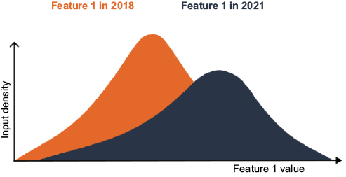

*출처: 원서 Figure 6.13. 한 피처의 2021년 분포가 2018년 분포와 달라진 공변량 이동의 예다.*

입력 X, 정답 y, 예측 ŷ로 나눠 보면 무엇이 바뀌었는지 구분하기 쉽다. 입력 분포 P(X)와 예측 분포 P(ŷ)는 정답 없이 관측할 수 있지만, 입력과 정답의 관계 P(y|X)가 바뀌는 concept drift는 정답이 있어야 확인할 수 있다. 입력 분포만 비교해서 모델 품질이 유지된다고 말할 수는 없다.

#### 통계 검정

Evidently는 과거 데이터(reference)와 추론 데이터(current)에 통계 검정을 실행해 드리프트를 탐지한다.

| 방법 | 대상 | 비교하는 것 | 드리프트 판정 |
|------|------|-------------|---------------|
| KS(Kolmogorov-Smirnov) 검정 | 수치형 | 두 데이터셋의 누적분포함수 | p-value가 임곗값(예: 0.05)보다 작음 |
| 카이제곱 검정 | 범주형 | 범주별 관측 빈도 | p-value가 임곗값보다 작음 |
| Wasserstein 거리 (Earth Mover's distance) | 수치형 | 한 분포를 다른 분포로 옮기는 비용 | 거리가 임곗값(기본 0.1)보다 큼 |
| Jensen-Shannon 거리 | 범주형 | 범주별 확률분포 차이 | 거리가 임곗값보다 큼 |
| PSI (Population Stability Index) | 수치·범주형 | 구간이나 범주별 비율 변화 | 지수가 임곗값보다 큼 |

Evidently는 열의 타입, 표본 수, 고유값 수를 보고 검정을 자동으로 고르며, 원하는 검정을 직접 지정하거나 새로 작성할 수도 있다. 선택 규칙은 버전별 [드리프트 알고리즘 문서](https://docs-old.evidentlyai.com/reference/data-drift-algorithm)에 정리되어 있다.

p-value 기반 검정과 거리 기반 검정은 점수의 방향이 반대다. p-value는 작을수록, 거리는 클수록 드리프트다. 서로 다른 검정의 drift score를 같은 단위처럼 비교하면 안 된다. 또 p-value는 "드리프트가 발생했을 확률"이 아니라, 같은 분포라는 가정 아래 관측 차이가 얼마나 이례적인지를 나타낸다. 표본이 매우 크면 작은 차이도 유의하게 나오고, 표본이 작으면 큰 변화를 놓치거나 우연한 쏠림을 변화로 판정할 수 있다.

#### 보고서와 지표

Evidently에서 드리프트 보고서를 만드는 데 필요한 것은 참조 데이터셋과 현재 데이터셋 두 개뿐이다.

| 구성 | 역할 | 그 자체로 하지 않는 것 |
|------|------|------------------------|
| Metric | 결측 비율, 분포 차이, 모델 오차 같은 값 계산. 데이터셋 수준과 열 수준이 있음 | 업무상 합격 기준 부여 |
| Metric Preset | 사용 사례별로 지표를 묶은 템플릿 (`DataDriftPreset`, `DataQualityPreset`, `RegressionPreset`) | - |
| Report | 선택한 지표와 시각화를 묶은 결과 | 파이프라인이나 API를 자동 차단 |
| Workspace / Project | 보고서 스냅샷을 모아 관리하는 디렉터리와 하위 디렉터리 | 참조 데이터의 적합성 판단 |
| Dashboard | 스냅샷의 지표를 시간 순으로 표시 | 원인 분석과 대응 결정 |

지표는 `DatasetMissingValuesMetric()`처럼 값 하나를 반환하기도 하고, `DatasetSummaryMetric()`처럼 여러 통계를 묶어 계산하기도 한다. 회귀 모델이라면 `RegressionQualityMetric`이 평균 오차(ME), 평균 절대 오차(MAE), 평균 절대 백분율 오차(MAPE)를 함께 보여 준다.

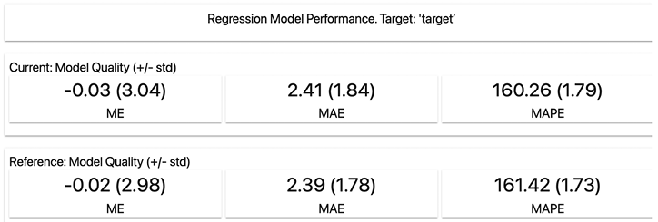

*출처: 원서 Figure 6.14. current와 reference 각각의 ME, MAE, MAPE와 괄호 안 표준편차로 성능의 안정성을 함께 본다.*

```python
# Listing 6.5 DataDriftPreset으로 데이터 드리프트 보고서 생성
report = Report(metrics=[DataDriftPreset()])
report.run(reference_data=reference_data, current_data=current_data)
report.save_html("drift_report.html")
```

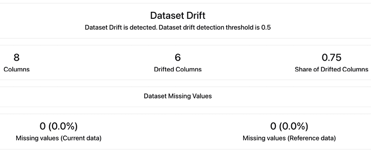

*출처: 원서 Figure 6.16. 검사한 8개 컬럼 중 6개에서 드리프트가 탐지되어 비율 0.75가 데이터셋 임곗값 0.5를 넘었으므로 "Dataset Drift is detected"가 표시된다. 두 데이터셋 모두 결측값은 없다.*

판정은 두 단계로 이루어진다.

1. **컬럼 단위**: 컬럼마다 선택된 검정의 점수를 컬럼 임곗값(예: Wasserstein 0.1)과 비교해 드리프트 여부를 정한다.

2. **데이터셋 단위**: 드리프트 컬럼의 비율(`share_of_drifted_columns`)이 데이터셋 임곗값(기본 0.5)을 넘으면 데이터셋 전체를 드리프트로 판정한다.

컬럼 임곗값 0.1과 데이터셋 임곗값 0.5는 서로 다른 값이다. 드리프트 컬럼 비율 0.75는 예측의 75%가 틀렸다는 뜻도 아니다. 변한 컬럼이 모델에 중요한지, 어느 사용자 집단에 변화가 몰렸는지는 따로 봐야 한다.

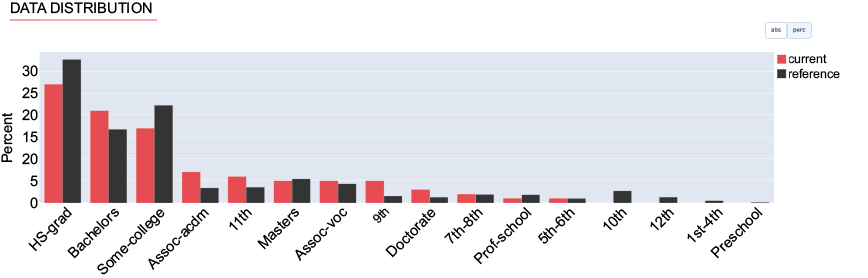

*출처: 원서 Figure 6.15. 열 수준 지표는 피처 하나의 드리프트 점수와 reference, current 분포를 나란히 보여 준다.*

#### 대시보드 구성

보고서는 한 시점의 스냅샷이므로, 시간에 따른 변화를 보려면 보고서를 여러 번 만들어 쌓아야 한다. `evidently ui`는 포트 8000에서 이를 보여 주는 웹 대시보드를 띄운다. 대시보드를 만들려면 워크스페이스와 프로젝트가 필요하다.

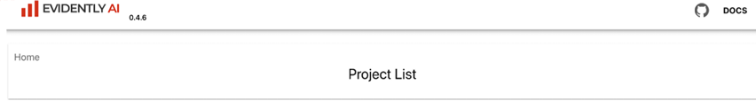

*출처: 원서 Figure 6.17. 프로젝트가 하나도 없는 Evidently UI다.*

```text
workspace
├── project_1
│   ├── snapshot_1.json
│   └── snapshot_2.json
└── project_2
    ├── snapshot_1.json
    └── snapshot_2.json
```

```python
# Listing 6.6 원격 워크스페이스에 프로젝트 생성
ws = RemoteWorkspace("http://localhost:8000")
project = ws.create_project(
    name="income-classifier",
    description="Used to classify users into multiple income bands",
)
```

대시보드는 보고서 지표를 시각화한 **패널(panel)**로 구성한다. `DashboardPanelCounter`는 값 하나를 카드로, `DashboardPanelPlot`은 꺾은선·막대·산점도·히스토그램으로 표시한다.

```python
# Listing 6.7 제목 패널 (값 없이 제목만 표시)
DashboardPanelCounter(
    filter=ReportFilter(metadata_values={}, tag_values=[]),
    agg=CounterAgg.NONE,
    title="Income Classifier Batch Data Drift Dashboard",
)

# Listing 6.8 드리프트 컬럼 비율 패널
DashboardPanelCounter(
    title="Share of Drifted Features",
    filter=ReportFilter(metadata_values={}, tag_values=[]),
    value=PanelValue(
        metric_id="DatasetDriftMetric",
        field_path="share_of_drifted_columns",
        legend="share",
    ),
    text="share",
    agg=CounterAgg.LAST,
    size=1,
)
```

| 파라미터 | 의미 |
|----------|------|
| `filter` | 집계에 포함할 스냅샷을 거르는 조건. 비우면 전부 사용 |
| `agg` | 여러 스냅샷 값을 요약하는 방법. 제목 패널은 `NONE`, 현재 상태 카드는 가장 최근 값인 `LAST` |
| `PanelValue.metric_id` | 값을 꺼낼 지표. 보고서에 그 지표가 들어 있어야 한다 |
| `PanelValue.field_path` | 지표 결과 안의 필드. 그림 6.16의 Share of Drifted Columns가 `share_of_drifted_columns`다 |
| `size` | 패널 너비. 1은 절반, 2는 전체 |

패널은 `project.dashboard.add_panel()`로 추가하고 반드시 `project.save()`로 저장해야 UI에 반영된다.

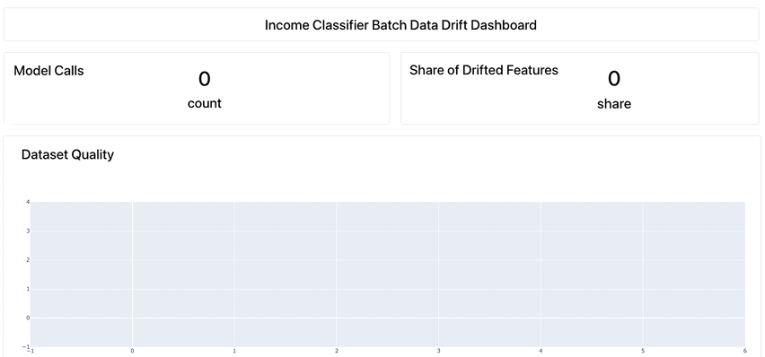

*출처: 원서 Figure 6.18. 패널만 구성하고 보고서가 아직 없는 대시보드다. 제목, 모델 호출 수, 드리프트 피처 비율, 데이터 품질 패널이 보인다.*

#### 배치 파이프라인에 드리프트 검사 넣기

배치 사용 사례에서는 5장의 추론 파이프라인에 드리프트 검사 컴포넌트를 추가한다. 위치는 피처 조회 컴포넌트와 추론 컴포넌트 사이다. 책은 새 피처 데이터와 학습(참조) 데이터 사이에 드리프트가 탐지되면 파이프라인을 중단한다는 의도를 설명한다.

```python
# Listing 6.9 데이터 드리프트 탐지 KFP 컴포넌트 (요약)
def detect_drift(model_name, model_stage, mlflow_host, minio_host, access_key,
                 secret_key, reference_dataset_name, feature_dataset_path,
                 evidently_workspace_url, evidently_ui_project_name):
    mlflow_client = MlflowClient(mlflow_host)
    evidently_workspace = RemoteWorkspace(evidently_workspace_url)

    # 1. Production 모델의 원천 run에서 참조 데이터셋 위치를 찾는다
    run = mlflow.get_run(model_run_id)
    for dataset_input in run.inputs.dataset_inputs:
        for tag in dataset_input.tags:
            if tag.value == reference_dataset_name:
                dataset_source = json.loads(dataset_input.dataset.source)["uri"]

    # 2. MinIO에서 참조 CSV를, 이전 단계에서 현재 피처 parquet를 읽는다
    reference_df = pd.read_csv(file_path)
    feature_df = pd.read_parquet(feature_dataset_path)

    # 3. 대시보드와 같은 지표로 보고서를 만들어 워크스페이스에 추가한다
    report = Report(metrics=[
        DatasetDriftMetric(), DatasetMissingValuesMetric(),
        ColumnDriftMetric(column_name="Education"),
        ColumnSummaryMetric(column_name="Education"),
        ...  # Marital-Status, Native_country, Occupation, Race, Relationship, Sex, Workclass
    ])
    report.run(reference_data=reference_df, current_data=feature_df)
    evidently_workspace.add_report(project.id, report)
```

참조 데이터는 아무 학습 CSV가 아니라, 서빙 중인 모델이 실제로 학습한 데이터다. 4장에서 `mlflow.log_input`으로 run에 남긴 데이터셋 출처가 여기서 다시 쓰인다. 모델을 고르는 단계와 배포 뒤 감시하는 단계가 같은 원천 run으로 이어지는 셈이다. 보고서의 지표는 대시보드 패널이 참조하는 지표와 일치해야 한다.

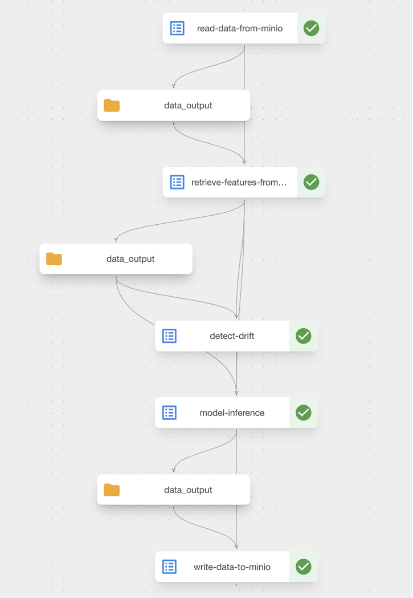

*출처: 원서 Figure 6.19. 피처 조회와 모델 추론 사이에 `detect-drift` 컴포넌트가 들어간 추론 파이프라인이 성공했다.*

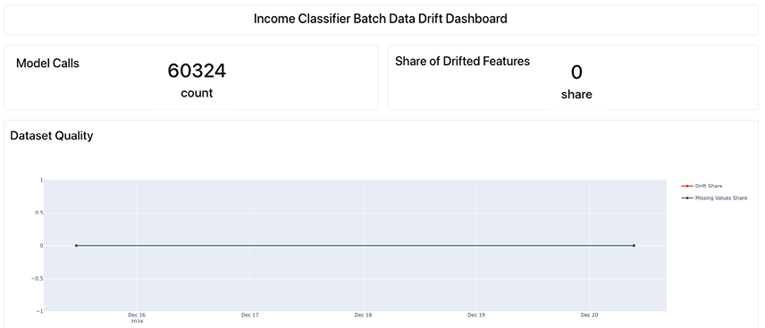

*출처: 원서 Figure 6.20. 파이프라인이 실행될 때마다 대시보드가 갱신된다. 이번 배치에서는 드리프트 피처 비율이 0이고 결측도 없다.*

책의 의도와 저자 코드의 실제 동작은 다르다.

- 추론 태스크의 `.after(detect_drift_task)`는 실행 순서만 정하는 완료 의존성이다.

- `detect_drift.py`는 보고서를 만들어 워크스페이스에 올리고 끝나며, 드리프트 판정을 읽어 실패시키는 분기가 없다.

- 따라서 드리프트가 탐지되어도 추론은 계속된다. 검사 프로세스가 오류로 죽어서 후속 단계가 멈추는 것과 데이터 변화 때문에 의도적으로 차단하는 것은 다르다.

품질 게이트로 쓰려면 판정 결과를 컴포넌트 출력으로 내보내고 조건 분기나 명시적 실패 정책을 추가해야 한다. 경고만 남길지, 추론을 보류할지, 사람의 확인을 기다릴지도 함께 정해야 한다.

#### API 서비스의 마이크로배치 드리프트 탐지

사기 탐지나 추천 시스템처럼 실시간 의사결정이 중요한 애플리케이션은 드리프트도 실시간에 가깝게 봐야 한다. 그렇다고 `/predict` 요청마다 검정을 돌리면 참조 데이터셋을 표본 하나와 비교하게 되어 결과가 의미 없다. 분포를 비교하려면 표본이 여럿 필요하므로, 최근 요청 N개를 모은 **마이크로배치(microbatch)**를 참조 데이터와 비교한다.

```python
# Listing 6.10 드리프트 보고서를 주기적으로 실행하는 MonitoringService
class MonitoringService:
    def iterate(self, new_rows: pandas.DataFrame):
        self.current = pandas.concat([self.current, new_rows], ignore_index=True)
        current_size = self.current.shape[0]
        if current_size > self.window_size:              # 가장 최근 N개만 유지
            self.current = self.current.iloc[-self.window_size:]
            self.current.reset_index(drop=True, inplace=True)
        if current_size < self.window_size:              # 윈도가 차기 전에는 대기
            logger.info(f"Not enough data for measurement: {current_size} "
                        f"of {self.window_size}. Waiting more data")
            return
        self.report.timestamp = datetime.datetime.now()
        self.report.run(reference_data=self.reference, current_data=self.current)
        self.workspace.add_report(project_id=self.project_id, report=self.report)
```

최근 N개만 담는 컨베이어 벨트처럼 동작한다. 새 요청이 올라오면 가장 오래된 행이 떨어지고, 벨트가 가득 찬 뒤부터는 요청마다 보고서를 다시 만든다.

- 초기화 함수에서 MLflow 원천 run의 참조 데이터셋을 내려받아 `MonitoringService`에 넘기고(Listing 6.11), 프로젝트 ID와 윈도 크기는 `.env`의 `EVIDENTLY_PROJECT_ID`, `EVIDENTLY_REPORT_WINDOW_SIZE`에서 읽는다. 책은 테스트용으로 50을 쓴다.

- `predict` 함수 안에서 피처 조회 직후 `ctx.state["monitoring_service"].iterate(feature_df)`를 호출한다.

- `bentofile_with_drift.yaml`로 빌드·배포하고 `generate_mock_request.py`로 서로 다른 `user_id` 요청을 수백 건 보내면, 윈도가 찬 시점부터 스냅샷이 쌓인다.

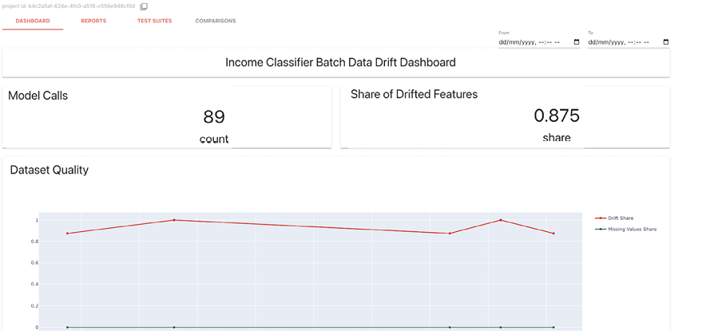

*출처: 원서 Figure 6.21. 실시간 사용 사례의 대시보드로, 윈도 크기 50에서 Share of Drifted Features가 0.875 근처를 오간다.*

요청한 사용자들이 학습 데이터에서 온 사람들인데도 컬럼의 87.5%가 드리프트로 판정됐다. 책은 이를 작은 윈도 크기 탓으로 보고 더 큰 윈도로 시도해 보라고 권한다. 50개 표본은 41개 국가처럼 범주가 많은 컬럼의 분포를 대표하지 못하고, 우연한 쏠림만으로도 분포가 달라 보인다. 이 화면은 운영 데이터가 실제로 변했다는 증거보다 윈도 크기와 비교 조건을 다시 검토하라는 신호로 읽어야 한다.

| 대응 | 내용 | 대가 |
|------|------|------|
| 윈도 키우기 | 200, 500처럼 표본을 늘린다 | 변화 발견이 늦어지고 메모리와 계산이 는다 |
| 임곗값 조정 | 컬럼 임곗값이나 데이터셋 비율 임곗값을 올린다 | 경고를 없애려고 임곗값만 올리면 실제 변화도 놓친다 |
| 지속 조건 | 연속 몇 회 초과할 때만 알린다 | 겹치는 윈도의 연속 경고는 독립 사건이 아니다 |

이 예제는 원리를 보여 주지만 운영 구조로는 한계가 있다.

- 윈도는 프로세스 메모리의 DataFrame이라 API 워커가 여러 개면 워커마다 따로 쌓이고, 재시작하면 사라진다.

- 보고서 계산과 워크스페이스 전송이 요청 경로 안에서 일어나 응답 지연에 직접 영향을 준다.

- 운영에서는 예측 경로와 관측 경로를 나눠, 실제 사용한 피처·예측·모델 버전·시각을 별도 저장소로 보내고 정해진 주기에 모니터링 작업이 평가하는 구성을 검토한다.

#### 드리프트를 발견한 뒤

드리프트 경고는 조사할 근거이지 새 모델을 배포하라는 신호가 아니다.

| 단계 | 내용 |
|------|------|
| 드리프트 조사 | 유형과 심각도를 파악하고, 공정성이나 예측 정확도에 실제 영향이 있는지 추가 검정과 분석으로 확인한다 |
| 업스트림 수정 | 원인이 데이터 처리 파이프라인 변경이라면 파이프라인을 고치거나 정제 절차를 보강한다 |
| 모델 재학습 | 성능에 상당한 영향을 준다면 최신 데이터로 재학습한다 |
| 피처 선택 갱신 | 피처 중요도 변화와 관련 있다면 피처를 추가, 제거, 수정한다 |

예를 들어 수집 시스템이 바뀌어 직업 값이 대량으로 결측 처리됐다면 재학습보다 수집 경로 복구가 먼저다. 반면 같은 직업과 학력에서도 소득과의 관계가 지속적으로 달라졌다면 모델과 피처를 다시 봐야 한다.

## CH 7. 데이터 분석과 준비

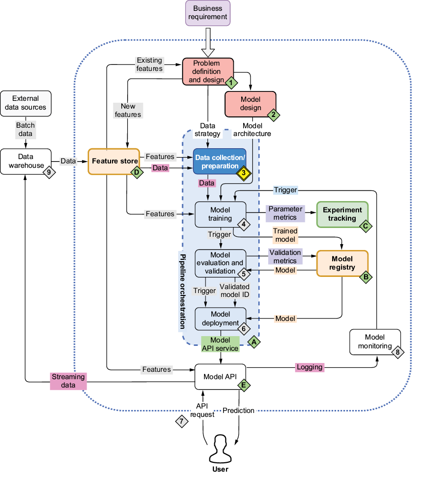

*출처: 원서 Figure 7.1. 이번 장은 파이프라인의 첫 단계인 데이터 수집·준비(3)에 집중한다.*

7장부터 3부로, 앞에서 쌓은 원칙과 플랫폼 구성 요소를 실제 프로젝트에 적용한다. 세 캡스톤 프로젝트 중 처음 두 개를 다루며, 둘 다 이 장에서는 데이터 준비 단계에 집중한다.

| 프로젝트 | 내용 | 데이터 준비 |
|----------|------|-------------|
| 캡스톤 1. 신분증 탐지 | YOLO(You Only Look Once) 변형 모델로 이미지 속 신분증을 탐지하고 분류 | 다운로드 → 분할 → 확인 파이프라인 |
| 캡스톤 2. 영화 추천 | MovieLens 데이터셋으로 추천 시스템 구축 | 표 형식 데이터용 컴포넌트 6개를 하나의 파이프라인으로 결합 |

LLM과 VLM(Vision Language Model)이 주목받는 시대에도 모델의 성패는 가장 화려하지 않은 단계인 데이터 준비에 달려 있다. 캡스톤에 들어가기 전에 농담 생성 파이프라인이라는 단순한 예제로 노트북 기반 분석과 파이프라인 데이터 전달을 먼저 익힌다.

### Kubeflow 노트북

데이터 분석은 인프라에 까다로운 요구를 한다.

- 데이터셋이 아무리 커도 처리할 수 있게, 분석 환경이 데이터에 가까이 있어야 한다.

- GPU나 대용량 메모리처럼 비싼 자원을 필요할 때 대화식으로 쓰고 바로 반납할 수 있어야 한다. 예를 들어 학습 데이터에 대한 객체 탐지 결과를 노트북에서 직접 추론해 보며 검사하는 경우다.

- 실험 환경이 배포 환경과 최대한 같아야 하고, 버전 관리와 CI/CD를 적용할 수 있어야 한다.

Kubeflow 노트북은 이 요구를 쿠버네티스 위에서 해결하면서, 웹 브라우저에서 Jupyter, VS Code(code-server), RStudio 같은 익숙한 인터페이스를 제공한다. 노트북 이미지를 파이프라인과 같은 베이스 이미지로, 같은 CI 파이프라인에서 빌드하면 실험 환경과 배포 환경의 차이를 줄일 수 있다.

#### 노트북 서버 실행과 볼륨

Kubeflow UI의 Notebooks에서 NEW NOTEBOOK을 누르고 이름, 네임스페이스, 이미지, CPU·메모리를 고른다. 네임스페이스는 리소스 쿼터, 볼륨 마운트, 시크릿에 영향을 주므로 신중히 고른다. 리소스 메뉴는 쿠버네티스의 requests/limits와 같다.


*출처: 원서 Figure 7.2. Notebooks 화면의 NEW NOTEBOOK으로 노트북 서버를 만든다.*

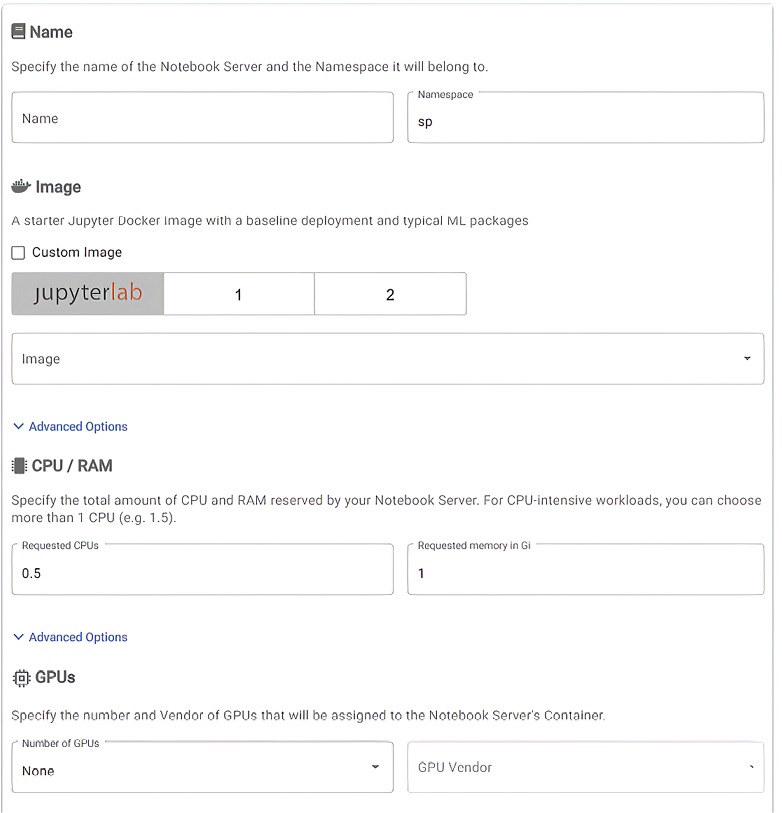

*출처: 원서 Figure 7.3. 이름, 네임스페이스, 이미지, CPU·메모리, GPU 설정 화면이다.*

GPU나 TPU(Tensor Processing Unit) 같은 가속기를 할당한 노트북은 오버프로비저닝이 없는 한 그 자원을 다른 파드가 쓰지 못하게 붙잡는다. 유휴 상태일 때 노트북을 정리하는 수명주기 규칙을 반드시 두어야 한다.

| 볼륨 | 생성 방식 | 용도 |
|------|-----------|------|
| 워크스페이스 볼륨 | 노트북 생성 시 기본 스토리지 클래스로 프로비저닝, `/home/jovyan`에 마운트 | 환경 파일, 설정, 작업 파일. 컨테이너를 바꿔도 유지하려면 기존 볼륨 선택 |
| 데이터 볼륨 | 런타임에 기존 PVC(PersistentVolumeClaim)를 마운트 | 공용 데이터셋 |

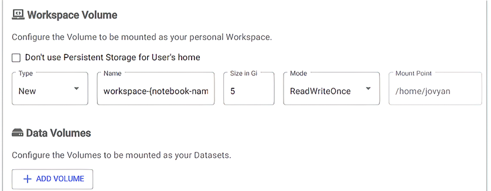

*출처: 원서 Figure 7.4. 워크스페이스 볼륨은 기본값으로 `/home/jovyan`에 5Gi ReadWriteOnce로 만들어지고, 데이터 볼륨은 ADD VOLUME으로 추가한다.*

#### PodDefault와 어피니티·톨러레이션

UI의 Configurations 항목은 네임스페이스의 **PodDefault**를 가리킨다. PodDefault는 셀렉터 레이블이 맞는 파드에 환경 변수, 볼륨 등을 런타임에 주입한다.

```yaml
# Listing 7.1 PodDefault 예시
apiVersion: kubeflow.org/v1alpha1
kind: PodDefault
metadata:
  name: add-proxy-vars
  namespace: kubeflow
spec:
  desc: add proxy variables
  env:
    - name: http_proxy
      value: http://192.168.1.1:3128
    - name: https_proxy
      value: http://192.168.1.1:3128
    - name: no_proxy
      value: .svc,.local,127.0.0.0/8
    - name: MLFLOW_TRACKING_URI
      value: http://mlflow.kubeflow.svc.cluster.local:5000
  selector:
    matchLabels:
      add-proxy-vars: 'true'
```

노트북을 만들 때 이 설정을 고르면 `MLFLOW_TRACKING_URI`가 자동으로 들어가, 노트북 코드에서 추적 서버 주소를 따로 지정하지 않아도 된다. 같은 방식으로 자격 증명, 특수 설정, 볼륨 마운트를 클러스터 관리자가 한곳에서 제어할 수 있다.

어피니티와 톨러레이션은 쿠버네티스의 같은 기능 그대로다. 어피니티는 파드를 특정 레이블의 노드로 끌어당기고, 톨러레이션은 테인트가 걸린 노드에 파드가 들어갈 수 있게 한다. 주된 용도는 GPU 같은 특수 자원이 있는 노드의 접근 제어다. 필요하면 공유 메모리도 켤 수 있는데, 분산 학습이나 메모리 캐시 데이터 로더에 유리하다.

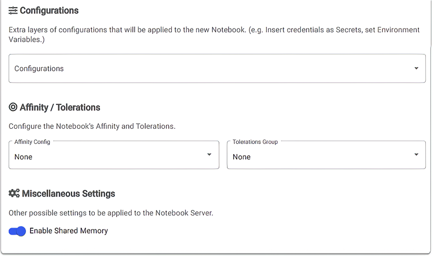

*출처: 원서 Figure 7.5. Configurations에서 PodDefault를, Affinity Config와 Tolerations Group에서 스케줄링 선택지를 고르고, 공유 메모리를 켤 수 있다.*

노트북 역시 `notebooks.kubeflow.org` CRD의 리소스이며, 컨트롤러가 이를 보고 StatefulSet과 파드를 만든다. Kubeflow 전체 설치 환경에서는 파드 안에 메인 컨테이너, 초기화 컨테이너와 함께 Istio 사이드카도 들어간다.

#### 메뉴 커스터마이징

사용자에게 보이는 노트북 옵션은 `kubeflow` 네임스페이스의 `jupyter-web-app-config` 컨피그맵으로 바꾼다. 옵션마다 기본값과 `readOnly` 태그가 있고, `readOnly`인 항목은 사용자가 수정할 수 없다.

```yaml
# Listing 7.2 Jupyter 웹 앱 컨피그맵 (이미지 목록)
spawner_ui_config.yaml: >
  spawnerFormDefaults:
    image:
      value: kubeflownotebookswg/jupyter-scipy:v1.6.1
      options:
        - asia.gcr.io/kubeflow-notebook-servers/jupyter-tensorflow:2.6.0
        - asia.gcr.io/kubeflow-notebook-servers/jupyter-pytorch:1.9.0
    imageGroupOne:
      - kubeflownotebookswg/codeserver-python:v1.6.1
    imageGroupTwo:
      - kubeflownotebookswg/rstudio-tidyverse:v1.6.1
```

- `image`는 Jupyter, `imageGroupOne`은 code-server, `imageGroupTwo`는 RStudio 이미지 그룹이다.

- `value`는 기본 선택, `options`는 드롭다운 목록이다. 배포 워크플로가 이 목록을 갱신하게 하면 CD 파이프라인과 노트북 이미지를 연결할 수 있다.

- 이미지 필드를 편집 불가로 설정하면 사용자가 목록의 이미지만 고르게 제한할 수 있다.

같은 컨피그맵의 `affinityConfig`에는 사용자에게 보여 줄 어피니티 선택지를 정의한다(Listing 7.3). 예를 들어 `compute=small`, `compute=xl` 레이블이 붙은 노드에 대응하는 `small-cpu-node`, `xl-cpu-node` 두 선택지를 두고 기본값을 작은 노드로 하면, 고성능 노드는 필요한 노트북에 남겨 둘 수 있다. 어피니티만으로는 작은 노드가 꽉 찼을 때 다른 파드가 고성능 노드로 들어오는 것을 막지 못하므로, 접근을 제한하려면 테인트와 톨러레이션을 함께 쓴다.

#### 커스텀 노트북 이미지


*출처: 원서 Figure 7.6. 커스텀 이미지 위에 Kubeflow 베이스 계층(kubectl, s6 오버레이, 사용자 생성)과 런타임 계층(code-server 또는 Jupyter, 설정 파일 생성)을 쌓는다.*

커스텀 이미지가 Kubeflow 노트북으로 동작하려면 런타임에 필요한 의존성, code-server나 Jupyter 런타임 자체, 노트북 서버를 Kubeflow와 호환되게 띄우는 설정 파일이 필요하다. 프로젝트 저장소의 멀티스테이지 Dockerfile은 베이스 이미지를 인수로 받아 code-server 또는 Jupyter 이미지를 빌드한다. 조직에 적용할 때는 Dockerfile을 검토해 이미지 크기를 줄이는 편이 좋다.

### KFP 데이터 전달: 단순 값

KFP의 각 컴포넌트는 별도 파드에서 격리되어 실행되므로, 컴포넌트 사이에 데이터를 주고받는 메커니즘이 반드시 필요하다. KFP를 처음 쓰는 사람과 경험자 모두 자주 헷갈리는 부분이다. 첫 번째 시나리오는 작은 값을 다음 컴포넌트에 넘기는 경우다.

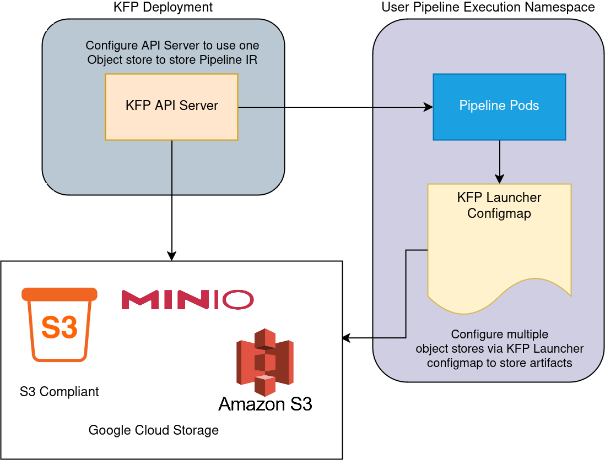

*출처: 스터디 노트. KFP API 서버는 파이프라인 정의를, 파이프라인 파드는 런처 컨피그맵에 지정한 S3 호환 객체 저장소에 작업 아티팩트를 저장한다.*

```python
# Listing 7.5 Kubeflow 컴포넌트와 파이프라인 정의 (이름 오류를 고친 버전)
import kfp.dsl as dsl

@dsl.component(packages_to_install=["pyjokes"], base_image="python:3.11")
def generate_joke() -> str:
    import pyjokes                      # import는 함수 안에서
    return pyjokes.get_joke()

@dsl.component
def count_words(input: str) -> int:
    return len(input.split())

@dsl.component
def output_result(count: int) -> str:
    return f"Word count: {count}"

@dsl.pipeline(name="joke_pipeline", description="simple pipeline to demo data passing")
def pipeline():
    generate_joke_op = generate_joke()
    count_word_op = count_words(input=generate_joke_op.output)
    output_result_op = output_result(count=count_word_op.output)
```

`generate_joke`가 농담을 만들고, `count_words`가 단어 수를 세고, `output_result`가 결과를 출력한다. 반환값은 각 태스크의 `.output`으로 표현되며, 이를 다음 컴포넌트의 인자로 넘기면 DAG(Directed Acyclic Graph) 의존 관계가 생긴다.

책의 Listing 7.5는 그대로 실행되지 않는다. `count_word = count_words(...)`로 받고 `count_word_op.output`으로 참조해 `NameError`가 나고, `output_result = output_result(...)`가 함수 이름을 같은 이름의 변수로 덮어쓴다. 위 코드는 변수 이름을 맞춘 버전이다.

#### 패키지 관리 규칙

컴포넌트 함수 안의 모든 import는 함수 정의 내부에 써야 한다. 함수 본문만 컨테이너로 옮겨져 실행되기 때문이다. 표준 라이브러리 밖의 패키지를 쓰려면 다음 중 하나가 필요하다.

| 방법 | 내용 | 권장 |
|------|------|------|
| `base_image` | 패키지가 설치된 이미지를 지정. 경량 컴포넌트는 Python 3.5 이상 필요 | 권장 |
| `packages_to_install` | 실행 시 pip로 설치할 패키지 목록. requirements.txt와 비슷 | 권장 |
| 함수 안에서 설치 | `subprocess`로 `pip install` 실행 | 명시성이 떨어져 비권장 |

#### 컴파일된 YAML과 코드 주입

컴파일한 파이프라인 YAML은 세 부분으로 나뉜다.

| 섹션 | 역할 | `count-words`의 예 |
|------|------|---------------------|
| `components` | 입출력 인터페이스 선언 | `input: STRING` → `Output: NUMBER_INTEGER` |
| `deploymentSpec.executors` | 런타임 환경과 구현 | 컨테이너 이미지, 명령, 주입된 함수 코드 |
| `root.dag.tasks` | 태스크 연결과 데이터 전달 | `producerTask: generate-joke`의 `outputParameterKey: Output`을 입력으로 받음 |

```yaml
# Listing 7.6 코드 주입 방식으로 파일을 생성하는 KFP SDK (요약)
exec-count-words:
  container:
    args: [--executor_input, '{{$}}', --function_to_execute, count_words]
    command:
    - sh
    - -c
    - |                     # 1) pip 확인 후 kfp 런타임 설치
      if ! [ -x "$(command -v pip)" ]; then python3 -m ensurepip ...; fi
      python3 -m pip install --quiet --no-warn-script-location 'kfp==2.11.0' '--no-deps' ...
      && "$0" "$@"
    - sh
    - -ec
    - |                     # 2) 함수 코드를 임시 파일로 쓰고 실행기로 실행
      program_path=$(mktemp -d)
      printf "%s" "$0" > "$program_path/ephemeral_component.py"
      _KFP_RUNTIME=true python3 -m kfp.dsl.executor_main \
        --component_module_path "$program_path/ephemeral_component.py" "$@"
    - |                     # 3) 주입된 파이썬 코드
      import kfp
      from kfp import dsl
      ...
      def count_words(input: str) -> int:
          return len(input.split())
    image: python:3.9
```

KFP가 데이터를 넘기는 방식은 일종의 **코드 주입(code injection)**이다. SDK가 함수 본문을 명령 인자에 문자열로 넣고, 컨테이너가 시작되면 이를 `ephemeral_component.py`로 기록해 `kfp.dsl.executor_main`이 실행한다. 실행기는 `--executor_input`으로 받은 입력값을 함수 인자로 바꾸고, 반환값을 출력 파라미터로 기록한다. 직렬화와 전달은 KFP가 처리하므로 사용자는 타입 힌트만 정확히 쓰면 된다. 기본 베이스 이미지는 SDK 버전에 따라 다르며, 책 출력은 `python:3.9`, 실습 환경의 kfp 2.9.0은 `python:3.8`이었다.

#### 값 전달의 한계

이 방식은 작은 값에 맞춰져 있다. 실습에서 문자열 크기를 키워 가며 값으로 넘겨 본 결과는 다음과 같다(kfp 2.9.0, KFP 백엔드 2.4.1).

| 크기 | 결과 | 원인 |
|------|------|------|
| 10KB, 60KB | 성공 | - |
| 100KB | 실패 | `argument list too long`. 값이 다음 파드의 명령 인자로 들어감 |
| 1MB | 실패 | 파드 annotations 262,144바이트 한도 초과로 다음 파드가 생성되지 않음 |
| 10MB | 실패 | MLMD(ML Metadata) gRPC 메시지 4MB 한도 초과 |

같은 크기를 파일 경로(아티팩트)로 넘기면 10MB와 200MB 모두 문제없었다. 단순 값 전달은 숫자, 짧은 문자열, 설정값처럼 작은 데이터에만 쓰고, 데이터셋은 경로로 넘겨야 한다.

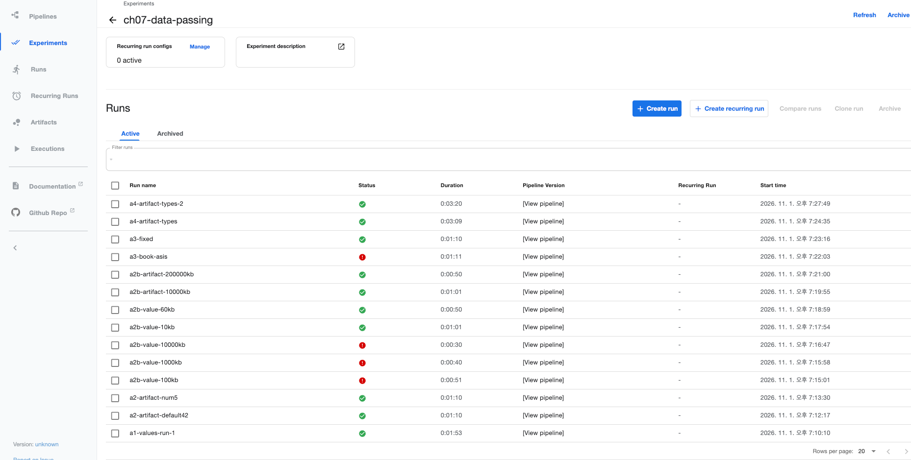

*출처: 스터디 실습 화면. 실험 `ch07-data-passing`의 run 목록으로, 큰 값을 파라미터로 넘긴 run이 실패(빨간색)로 남았다.*

## 실습 환경

실습은 2주차 환경(kind `book-env` + KFP 2.4.1 + MLflow 3.0.0 + Feast + Redis)이 끝난 상태에서 시작한다. 스터디 가이드는 원격 서버에서 실행하고, 모든 서비스를 `127.0.0.1`에만 열어 SSH 터널로 접속한다.

| 포트 | 대상 |
|------|------|
| 8080 | KFP UI |
| 5000 | MLflow |
| 8081 | Yatai |
| 8000 | Evidently UI |
| 3000 | BentoML 기본 서비스 Swagger |
| 3001 | BentoML 드리프트 서비스 Swagger |
| 3002 | Yatai로 배포한 서비스 (port-forward) |

### 저자 코드와 가상환경

저자 코드는 BentoML 1.1.10(2023-11-20)과 Python 3.10 기준이고, Yatai의 마지막 릴리스는 1.1.13(2023-10-09)이다. 지금 설치하려면 몇 가지를 맞춰야 한다.

```bash
git clone https://github.com/practical-mlops/chapter-6.git && cd chapter-6

# MLflow 클라이언트를 서버(3.0.0)와 맞추고 bentoml 주석 해제
sed -i 's/^mlflow==2.7.0/mlflow==3.0.0/' bentoml/requirements_with_drift.txt evidently/kubeflow-pipeline/requirements.txt
sed -i 's/^#bentoml==1.1.10/bentoml==1.1.10/' bentoml/requirements.txt
printf 'litestar==2.12.1\nsniffio\n' >> bentoml/requirements_with_drift.txt

# 드리프트 컴포넌트 이미지: buster(apt 404) → bookworm, 로컬 이미지 이름으로
sed -i 's/python:3.10-slim-buster/python:3.10-slim-bookworm/' evidently/kubeflow-pipeline/Dockerfile
sed -i -E "s#image: 'varunmallya/[a-z-]+:latest'#image: 'book-ch6/drift-components:0.1'#" \
  evidently/kubeflow-pipeline/components/*/component.yaml

uv venv .venv --python 3.10 && source .venv/bin/activate
uv pip install -r bentoml/requirements.txt -r bentoml/requirements_with_drift.txt "setuptools<81"
python -W ignore -c "import bentoml, mlflow, evidently, feast; print(bentoml.__version__, mlflow.__version__, evidently.__version__, feast.__version__)"
# 1.1.10 3.0.0 0.5.0 0.40.1
```

| 조정 | 이유 |
|------|------|
| `mlflow==3.0.0` | 저자 파일은 2.7.0이지만 2주차 서버가 3.0.0 |
| `litestar==2.12.1`, `sniffio` | Evidently 0.5.0 UI의 multipart 패키지 충돌과 누락 의존성 |
| `setuptools<81` | BentoML 1.1.10이 의존하는 `fs` 패키지가 `pkg_resources`를 import하며, setuptools 81부터 제거 예정 |
| `slim-bookworm` | `slim-buster` 저장소가 내려가 apt 404 |

`bentoml` 명령마다 `pkg_resources is deprecated` 경고가 나오지만 동작에는 영향이 없다. `setuptools<81` 고정은 모듈을 남겨 두기 위한 것이고 경고를 없애 주지는 않는다.

### BentoML 기본 서비스

`.env`와 `production.env`의 Redis 비밀번호를 2주차 값으로 바꾼 뒤 모델을 가져오고 Bento를 빌드한다.

```bash
cd bentoml
python -W ignore scripts/download_model.py     # MLflow Production → BentoML 스토어
bentoml build -f bento/bentofile.yaml
```

이 환경에서는 `bentoml containerize`가 `NotImplementedError`로 실패한다. Bento 디렉터리에서 `docker build`를 직접 돌리면 모델이 빠진 이미지가 만들어지므로, BentoML 내부의 빌드 함수를 직접 호출한다.

```python
# build_bento_image.py
import sys
from bentoml._internal.container import build
bento_tag, image_tag = sys.argv[1], sys.argv[2]
build(bento_tag, backend="docker", tag=(image_tag,))
```

```bash
python -W ignore build_bento_image.py $TAG $TAG          # 3~10분, 이미지 약 2.57GB

# 포트포워딩이 127.0.0.1에만 열려 있으므로 호스트 네트워크 사용
docker run -d --name income-clf --network host \
  --add-host host.docker.internal:127.0.0.1 $TAG

curl -s -X POST localhost:3000/predict -H "Content-Type: application/json" \
  -d '{"user_id":"9f2ac416-06e1-44a0-87bd-d4787c85bf66"}'
{"income_category": "<=50K", "user_id": "9f2ac416-06e1-44a0-87bd-d4787c85bf66"}
```

### Yatai 스택

Yatai 1.1.x는 세 차트로 나뉘며 버전을 모두 1.1.13으로 맞춘다. ingress-nginx는 설치하지 않고 접속은 port-forward로 한다.

| 구성 요소 | 네임스페이스 | 역할 | 준비 사항 |
|-----------|--------------|------|-----------|
| yatai | `yatai-system` | 모델·Bento 레지스트리, 대시보드 | 2주차 PostgreSQL에 `yatai` 롤과 DB, S3 버킷 `yatai`, Secret 2개 |
| yatai-image-builder | `yatai-image-builder` | Bento를 kaniko로 이미지 빌드 | cert-manager v1.16.2, 클러스터 내부 레지스트리 |
| yatai-deployment | `yatai-deployment` | BentoDeployment를 파드로 배포 | cert-manager, 배포 대상 네임스페이스 `yatai` |

```bash
# 설치 후 초기 관리자 토큰
kubectl -n yatai-system get secret yatai-env \
  -o jsonpath='{.data.YATAI_INITIALIZATION_TOKEN}' | base64 --decode

# http://localhost:8081/setup?token=<토큰> 에서 관리자 생성 → API 토큰 발급(API 권한)
bentoml yatai login --api-token <API 토큰> --endpoint http://localhost:8081
bentoml push income_classifier_service:<Bento 태그>
```

이미지 레지스트리는 클러스터 안에 `registry:2` Deployment로 두고, 노드마다 `alpine/socat` DaemonSet 프록시를 둔다. 노드의 containerd는 클러스터 DNS 이름을 풀 수 없으므로 이미지 pull은 노드의 `127.0.0.1:5000`으로, kaniko push는 클러스터 내부 이름으로 한다.

```yaml
# image-builder-values.yaml
dockerRegistry:
  server: 127.0.0.1:5000
  inClusterServer: docker-registry.yatai-image-builder.svc.cluster.local:5000
  secure: false
  bentoRepositoryName: yatai-bentos
bentoImageBuildEngine: kaniko

# deployment-values.yaml
layers:
  network:
    ingressClass: nginx
    domainSuffix: yatai.local
    automaticDomainSuffixGeneration: false
bentoDeploymentNamespaces: ["yatai"]
```

`automaticDomainSuffixGeneration`의 기본값(true)은 ingress-nginx의 외부 IP로 `*.sslip.io` 도메인을 만든다. kind에는 외부 IP도 ingress-nginx도 없으므로 고정값을 준다. 컴포넌트는 설치 직후 Yatai의 `default` 클러스터에 스스로 등록되며, PostgreSQL의 `yatai_component` 테이블에 `image-builder`, `deployment` 두 행이 생기면 UI의 배포 메뉴가 활성화된다.

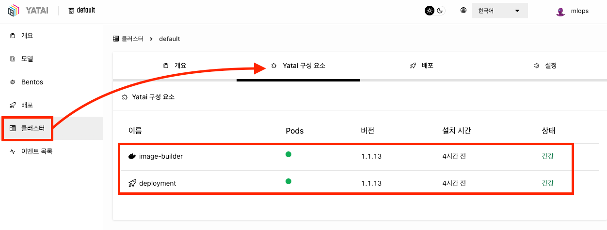

*출처: 스터디 실습 화면. 클러스터 메뉴의 Yatai 구성 요소에 image-builder와 deployment 1.1.13이 정상으로 등록됐다.*

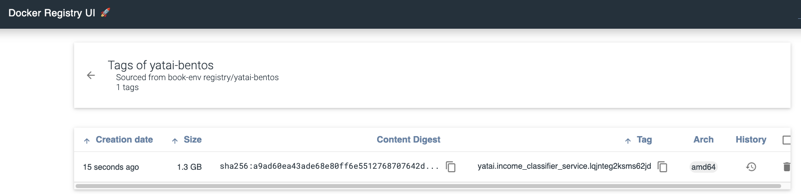

*출처: 스터디 실습 화면. 클러스터 내부 레지스트리의 `yatai-bentos` 저장소에 빌드된 Bento 이미지 태그(1.3GB)가 올라와 있다.*

### Yatai 배포와 kaniko OOM

UI에서 배포를 만들면 Yatai가 두 CRD를 만든다.

| CRD | 역할 | 확인 포인트 |
|-----|------|-------------|
| `BentoRequest` (resources.yatai.ai) | Bento를 이미지로 빌드하라는 요청 | `IMAGE-EXISTS`, `IMAGE-BUILDER-POD-PHASE` |
| `Bento` | 빌드 완료된 이미지 정보 | `127.0.0.1:5000/yatai-bentos:yatai.income_classifier_service.<태그>` |
| `BentoDeployment` (serving.yatai.ai) | API 서버·러너의 자원, 오토스케일링, Ingress | `AVAILABLE` |

첫 빌드에서 kaniko 빌더 컨테이너가 OOM(Out Of Memory)으로 `OOMKilled`된다. 빌더 기본 limit이 메모리 3Gi인데, 모델과 파이썬 의존성을 담은 이미지(노드에서 약 1.41GB)를 빌드하기에 부족하다. UI의 리소스 설정은 `BentoDeployment`에만 반영되므로 빌더 자원은 `BentoRequest`를 직접 패치한다.

```bash
kubectl -n yatai patch bentorequest <bentorequest 이름> --type merge \
  -p '{"spec":{"imageBuilderContainerResources":{"requests":{"cpu":"500m","memory":"2Gi"},"limits":{"cpu":"2","memory":"6Gi"}}}}'

kubectl get bentorequest,bentodeployment -n yatai
# IMAGE-EXISTS True, IMAGE-BUILDER-POD-PHASE Succeeded, AVAILABLE True
```

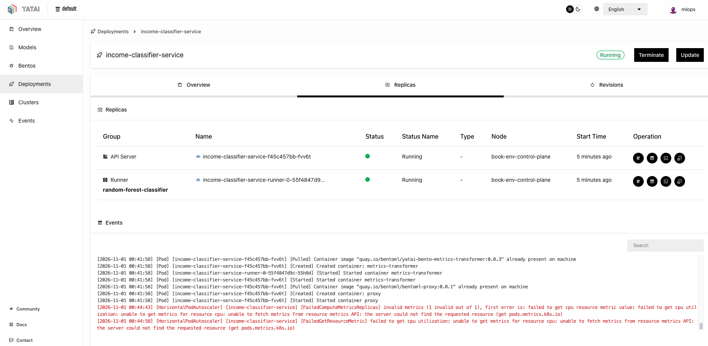

*출처: 스터디 실습 화면. kind 클러스터에 API 서버 파드와 러너 파드가 Running이다. 이벤트에는 metrics-server가 없어 HPA가 CPU 지표를 못 읽는다는 경고가 남는다.*

배포가 끝나면 `kubectl -n yatai port-forward svc/income-classifier-service 3002:3000`으로 Swagger에 접속한다. 이 Bento는 MLflow, MinIO, Redis 주소를 로컬 포트포워딩 기준으로 갖고 있어, 파드 안에서는 `/predict`가 연결 오류를 낼 수 있다. 그 경우 `production.env`를 클러스터 내부 서비스 이름으로 바꿔 Bento를 다시 빌드해야 한다.

### Evidently UI와 드리프트 파이프라인

Evidently UI는 `evidently==0.5.0`, `litestar==2.12.1`, `sniffio`를 설치하고 `ENTRYPOINT ["evidently", "ui"]`로 실행하는 이미지를 만들어 `evidently` 네임스페이스에 배포한다. `create_remote_project.py`로 프로젝트를 만들고 `build_evidently_dashboard.py`로 패널을 구성한 뒤, 출력된 프로젝트 ID와 `http://evidently-ui.evidently.svc.cluster.local:8000`을 `production.env`에 넣는다. 두 스크립트는 서버를 설치하지 않으며 기본 접속 주소는 로컬 8000이다.

드리프트 파이프라인은 컴포넌트 이미지를 빌드해 kind 노드에 넣고, 5장 실행 파라미터에 드리프트용 값을 더해 실행한다.

```bash
docker build -t book-ch6/drift-components:0.1 -f Dockerfile .   # 약 2.22GB
kind load docker-image book-ch6/drift-components:0.1 --name book-env
```

```python
p = json.load(open("book/ch05/run-parameters.json"))
p.update({
    "reference_dataset_name": "reference_features",
    "evidently_workspace_url": "http://evidently-ui.evidently.svc.cluster.local:8000",
    "evidently_ui_project_name": "income-classifier",
    "output_file_name": "income_predictions_with_drift.parquet",
})
c.create_run_from_pipeline_package("income_classifier_pipeline_with_drift.yaml",
                                   arguments=p, enable_caching=False)
```

성공하면 MinIO에 `income_predictions_with_drift.parquet`가 생기고 Evidently UI의 프로젝트에 보고서 스냅샷이 쌓인다. 같은 입력으로 다시 실행하면 KFP 캐시 때문에 단계가 건너뛰어져 보고서가 새로 쌓이지 않으므로 `enable_caching=False`로 실행한다.

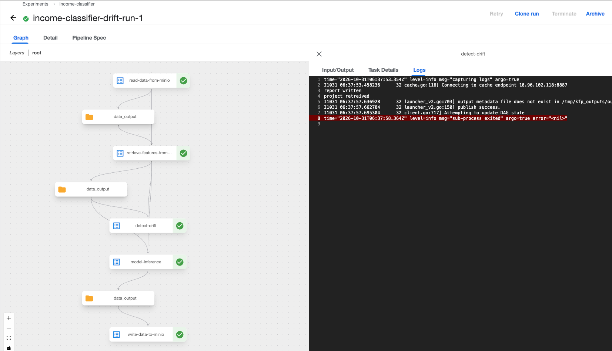

*출처: 스터디 실습 화면. `income-classifier-drift-run-1`의 detect-drift 단계 로그에 `report written`, `project retreived`가 찍혔다.*

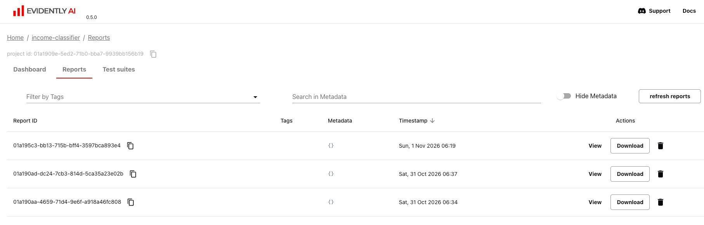

*출처: 스터디 실습 화면. 파이프라인을 실행할 때마다 `income-classifier` 프로젝트에 보고서가 하나씩 쌓인다.*

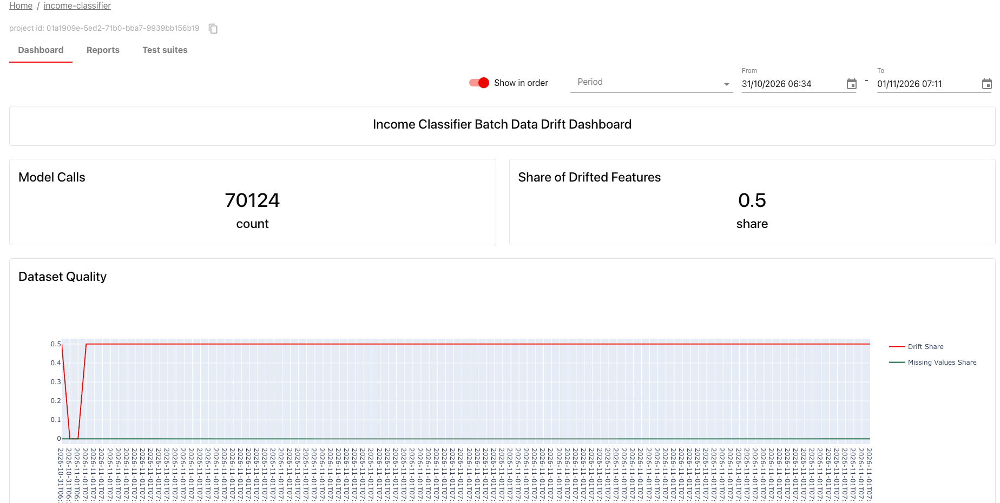

*출처: 스터디 실습 화면. 여러 번 실행한 뒤의 대시보드로, 이 실습에서는 드리프트 피처 비율이 0.5로 나왔다.*

### 드리프트 BentoML 서비스

```bash
bentoml build -f bento/bentofile_with_drift.yaml
python -W ignore build_bento_image.py $DT income-classifier-drift:${DT#*:}

docker run -d --name income-clf-drift --network host \
  --add-host host.docker.internal:127.0.0.1 \
  -e BENTOML_PORT=3001 -e BENTOML_CONFIG_OPTIONS="api_server.workers=1" \
  income-classifier-drift:${DT#*:}

# mock_request_data.csv의 사용자 100명으로 요청
tail -n +2 bentoml/scripts/mock_request_data.csv | awk -F, '{print $4}' | while read u; do
  curl -s -o /dev/null -w "%{http_code}\n" -X POST localhost:3001/predict \
    -H "Content-Type: application/json" -d "{\"user_id\":\"$u\"}"; done | sort | uniq -c

docker logs income-clf-drift 2>&1 | grep "Running report"
```

`api_server.workers=1`이 핵심이다. 워커가 여러 개면 시작 시 같은 디렉터리에 참조 파일을 동시에 받다가 오류가 나고, 워커마다 윈도를 따로 쌓아 어느 워커도 윈도를 채우지 못해 보고서가 생기지 않는다. 앞에서 본 메모리 윈도의 한계가 그대로 드러나는 지점이다.

### Kubeflow 노트북 경량 설치

2주차 환경은 KFP standalone이라 Central Dashboard, Jupyter 웹 앱, Istio, Profile이 없다. 7.1.1~7.1.3을 따라 하려면 notebook-controller와 PodDefault 웹훅만 설치하고 Notebook, PodDefault CR을 직접 만든다. 필수 실습은 아니다.

| 구성 | 값 |
|------|-----|
| notebook-controller | `ghcr.io/kubeflow/notebooks/notebook-controller:v1.11.0`, `USE_ISTIO=false` |
| PodDefault 웹훅 | `ghcr.io/kubeflow/dashboard/poddefaults-webhook:v2.0.0` (Kubeflow 26.03.1에서는 dashboard 쪽에 있음) |
| 노트북 이미지 | `ghcr.io/kubeflow/kubeflow/notebook-servers/jupyter-scipy:v1.11.0` |

```yaml
apiVersion: v1
kind: Namespace
metadata:
  name: kubeflow-user
  labels:
    app.kubernetes.io/part-of: kubeflow-profile   # 웹훅은 이 레이블의 네임스페이스에만 동작
---
apiVersion: kubeflow.org/v1alpha1
kind: PodDefault
metadata: {name: add-ml-env, namespace: kubeflow-user}
spec:
  desc: add MLflow and KFP endpoints
  selector:
    matchLabels: {add-ml-env: "true"}
  env:
    - name: MLFLOW_TRACKING_URI
      value: http://mlflow-service.mlflow.svc.cluster.local:5000
    - name: KF_PIPELINES_ENDPOINT
      value: http://ml-pipeline.kubeflow.svc.cluster.local:8888
---
apiVersion: kubeflow.org/v1
kind: Notebook
metadata:
  name: test-nb
  namespace: kubeflow-user
  labels: {add-ml-env: "true"}        # 파드로 전파되어 PodDefault 셀렉터와 매칭
spec:
  template:
    spec:
      containers:
        - name: test-nb
          image: ghcr.io/kubeflow/kubeflow/notebook-servers/jupyter-scipy:v1.11.0
          resources:
            requests: {cpu: "500m", memory: 1Gi}
            limits: {cpu: "2", memory: 4Gi}
          volumeMounts: [{name: workspace, mountPath: /home/jovyan}]
      volumes:
        - name: workspace
          persistentVolumeClaim: {claimName: test-nb-workspace}
```

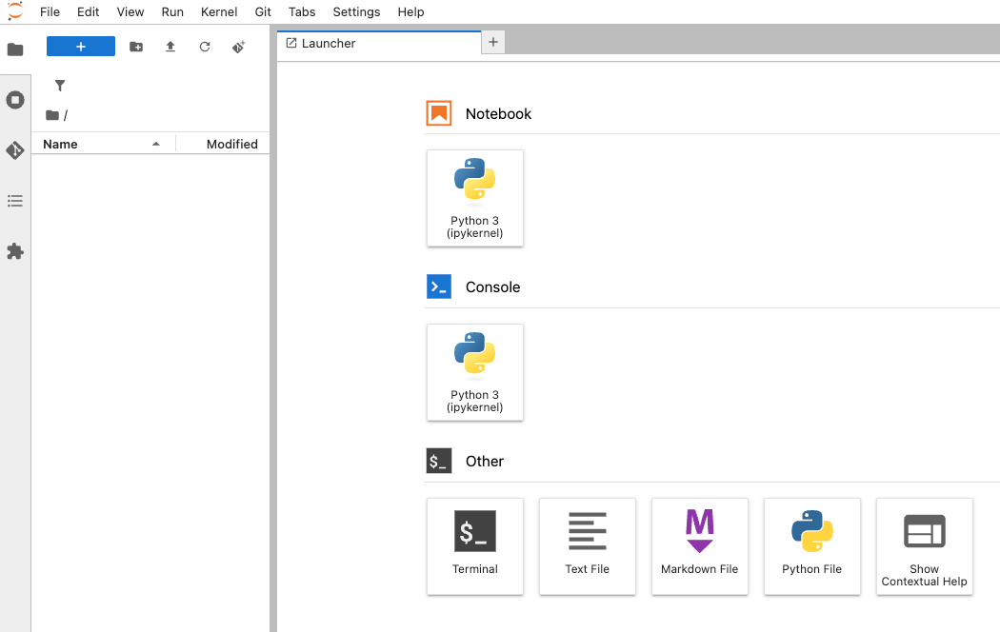

*출처: 스터디 실습 화면. `/notebook/kubeflow-user/test-nb/lab` 경로로 접속한 JupyterLab이다.*

컨트롤러가 `test-nb` StatefulSet과 `test-nb-0` 파드를 만들고, 파드에는 `NB_PREFIX=/notebook/kubeflow-user/test-nb`와 PodDefault의 두 환경 변수가 주입된다. 노트북 안에서 `kfp.Client()`를 인자 없이 호출하면 주입된 `KF_PIPELINES_ENDPOINT`로 접속한다. 접속 URL에는 `/notebook/kubeflow-user/test-nb/` 접두사가 반드시 붙어야 하며, 없으면 404가 난다. PodDefault를 바꾼 뒤에는 파드를 다시 만들어야 반영된다.

### 걸리기 쉬운 지점

| 증상 | 원인과 대응 |
|------|-------------|
| `bentoml containerize`가 `NotImplementedError` | `bentoml._internal.container.build`를 직접 호출. Bento 디렉터리에서 `docker build`하면 모델이 빠짐 |
| `No module named 'pkg_resources'` | setuptools 81 이상 → `setuptools<81` 고정 |
| Evidently UI 실행 시 multipart 오류 | `litestar==2.12.1`, `sniffio` 추가, `python-multipart`만 남았는지 확인 |
| 드리프트 컴포넌트 빌드 중 apt 404 | `slim-buster` → `slim-bookworm` |
| kaniko 빌더 `OOMKilled` | 기본 limit 3Gi → `BentoRequest.spec.imageBuilderContainerResources` 패치 |
| Yatai 배포 파드가 이미지를 못 받음 | 노드 containerd는 클러스터 DNS를 못 풂 → 노드 `127.0.0.1:5000` 프록시로 pull |
| 컨테이너 안에서 MLflow, Redis 연결 실패 | 컨테이너의 localhost는 PC가 아님 → `--network host` 또는 클러스터 서비스 주소 |
| API 예측이 사용자와 무관하게 같음 | 단일 행 `get_dummies(drop_first=True)`가 모든 더미 열을 지움 → 학습 인코더 재사용 |
| 드리프트가 탐지돼도 추론이 계속됨 | `detect_drift.py`에 차단 분기 없음. `.after()`는 순서만 정함 |
| 드리프트 서비스에서 보고서가 안 생김 | 워커별 메모리 윈도 → `api_server.workers=1` |
| 재실행해도 Evidently 보고서가 안 쌓임 | KFP 캐시 적중 → `enable_caching=False` |
| 노트북에 PodDefault 환경 변수가 없음 | 네임스페이스에 `app.kubernetes.io/part-of=kubeflow-profile` 레이블 필요 |
| 책 Listing 7.5 `NameError` | `count_word`와 `count_word_op` 이름 불일치, 함수 이름 덮어쓰기 |

책의 Yatai는 2023년 이후 릴리스가 없다. 스터디에서는 대안으로 Yatai 없이 Bento 이미지를 KServe InferenceService의 사용자 컨테이너로 띄우는 구성과, 처음부터 KServe의 MLflow 런타임으로 레지스트리 모델을 서빙하는 구성도 함께 다뤘다.

| 구분 | 책 (부록 A) | 2026년 대체 구성 예 |
|------|-------------|---------------------|
| 모델 서빙 | BentoML + Yatai | KServe (Kubeflow 배포판 포함) |
| 이미지 빌드 | yatai-image-builder (kaniko) | CI 또는 KFP 단계에서 빌드 |
| 모델 패키징·저장 | Yatai 레지스트리 | MLflow 레지스트리, KitOps(OCI 아티팩트) |

## 마무리

- BentoML은 MLflow 모델을 로컬 스토어로 가져와 서비스 코드, 의존성과 함께 Bento로 묶는다. 서비스는 요청 해석과 피처 조회를, 러너는 모델 계산을 맡아 두 쪽을 따로 확장할 수 있다.

- 빌드, 컨테이너화, 푸시, 배포는 서로 다른 상태를 만든다. Yatai는 `BentoRequest`로 이미지를 빌드하고 `BentoDeployment`로 API 서버 파드와 러너 파드를 띄운다.

- 서비스가 HTTP 200을 돌려줘도 학습과 같은 입력 변환을 거쳤다는 보장은 없다. 단일 요청의 원-핫 인코딩처럼 배치와 온라인에서 다르게 동작하는 전처리를 따로 검증한다.

- 데이터 드리프트는 학습 데이터와 현재 데이터의 분포 차이다. Evidently는 컬럼마다 검정을 골라 드리프트를 판정하고, 드리프트 컬럼 비율이 데이터셋 임곗값을 넘으면 데이터셋 전체를 드리프트로 본다.

- p-value와 거리 점수는 방향이 반대이고, 드리프트 컬럼 비율은 오답률이 아니다. 작은 윈도에서는 같은 분포에서 뽑은 표본도 드리프트로 판정될 수 있다.

- 배치에서는 처리할 묶음이 current가 되고, API에서는 최근 요청을 윈도로 모아 current로 쓴다. 저자 코드의 배치 검사는 보고서만 남기고 차단하지 않으며, API 검사는 요청 경로 안의 메모리 윈도라 워커 분리와 재시작에 취약하다.

- 드리프트 경고는 조사의 시작이다. 수집 장애, 업스트림 변경, 실제 관계 변화를 구분한 뒤 수정, 재학습, 피처 재선택 중 대응을 고른다.

- Kubeflow 노트북은 데이터 가까이에서 배포 환경과 같은 이미지로 분석하게 해 주며, PodDefault로 환경 변수와 볼륨을, 컨피그맵으로 이미지와 어피니티 선택지를 관리한다.

- KFP는 컴포넌트 함수 본문을 명령 인자에 주입해 별도 파드에서 실행한다. 반환값 전달은 작은 값에만 쓸 수 있으며, 100KB부터 명령 인자, 파드 annotations, MLMD 메시지 한도에 걸린다.

## 참고

- [CH6 해설: 모델을 프로덕션으로 (김춘식)](https://johklo.github.io/docs/tech/machine-learning-platform-engineering/06-productionizing-models/)
- [ml-platform-book-env 실습 환경](https://github.com/johklo/ml-platform-book-env)
- [practical-mlops/chapter-6](https://github.com/practical-mlops/chapter-6)
- [practical-mlops/object-detection-project (chapter_7)](https://github.com/practical-mlops/object-detection-project)
- [ML Platform Engineering Part 2 핸즈온 (악분)](https://github.com/choisungwook/portfolio/tree/master/mlops/ml-platform-engineering-part2)
- [MLflow → BentoML → KServe 서빙과 드리프트 (윤창섭)](https://blog.somnitor.dev/posts/94/kserve-evidently-drift)
- [BentoML Documentation](https://docs.bentoml.com/)
- [Yatai](https://github.com/bentoml/Yatai)
- [Evidently 데이터 드리프트 알고리즘](https://docs-old.evidentlyai.com/reference/data-drift-algorithm)
- [Kubeflow Notebooks](https://www.kubeflow.org/docs/components/notebooks/overview/)
- [Kubeflow Pipelines: Pass data between components](https://www.kubeflow.org/docs/components/pipelines/user-guides/data-handling/)
- [KServe: Deploying MLflow Models](https://kserve.github.io/website/docs/model-serving/predictive-inference/frameworks/mlflow)
