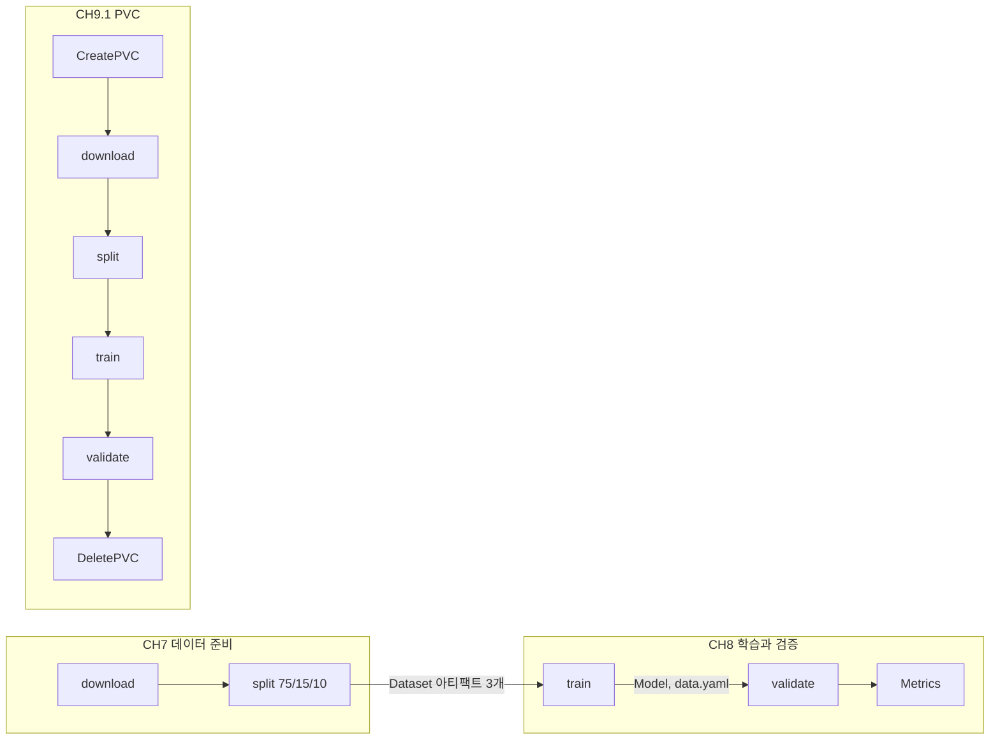
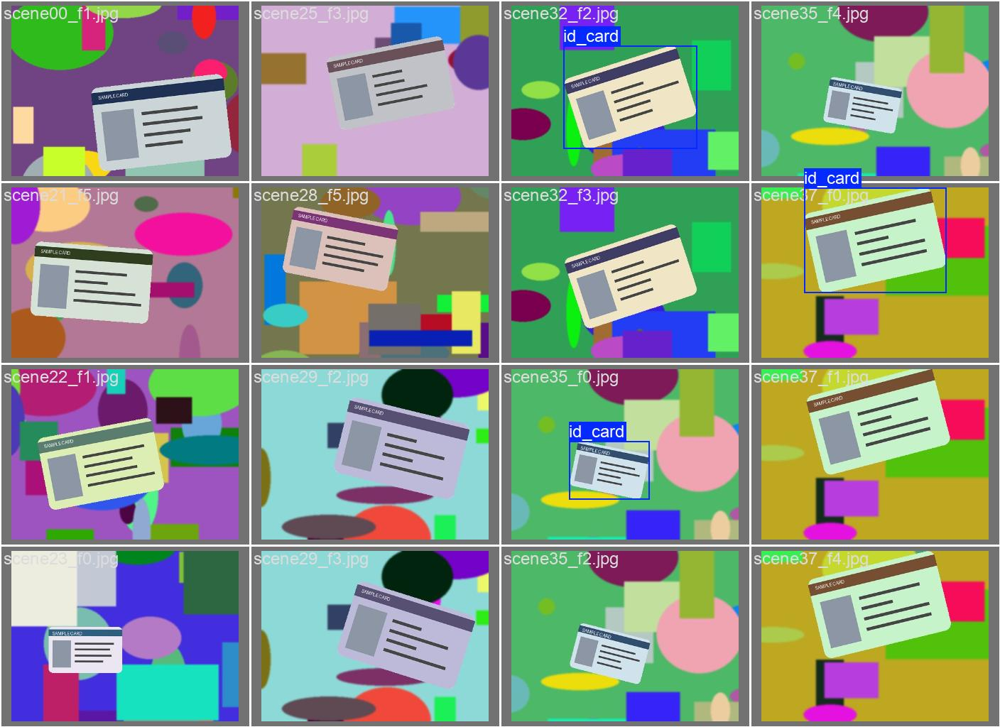
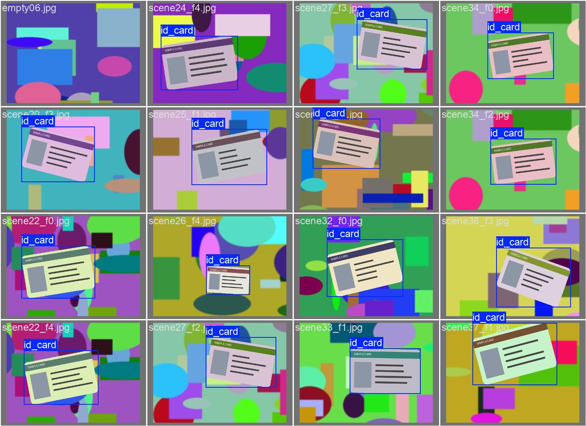
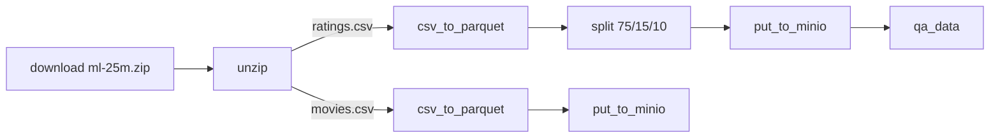
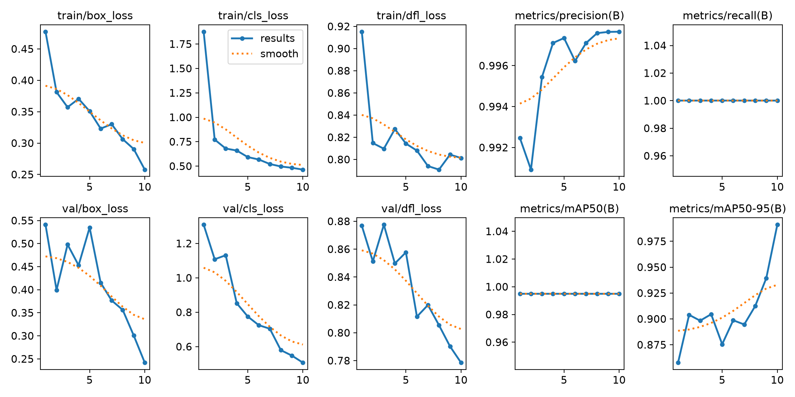
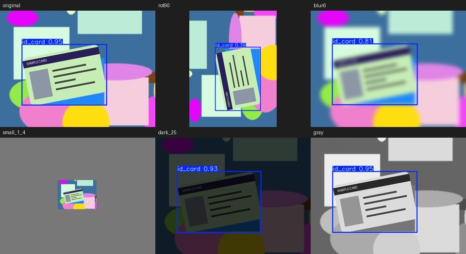
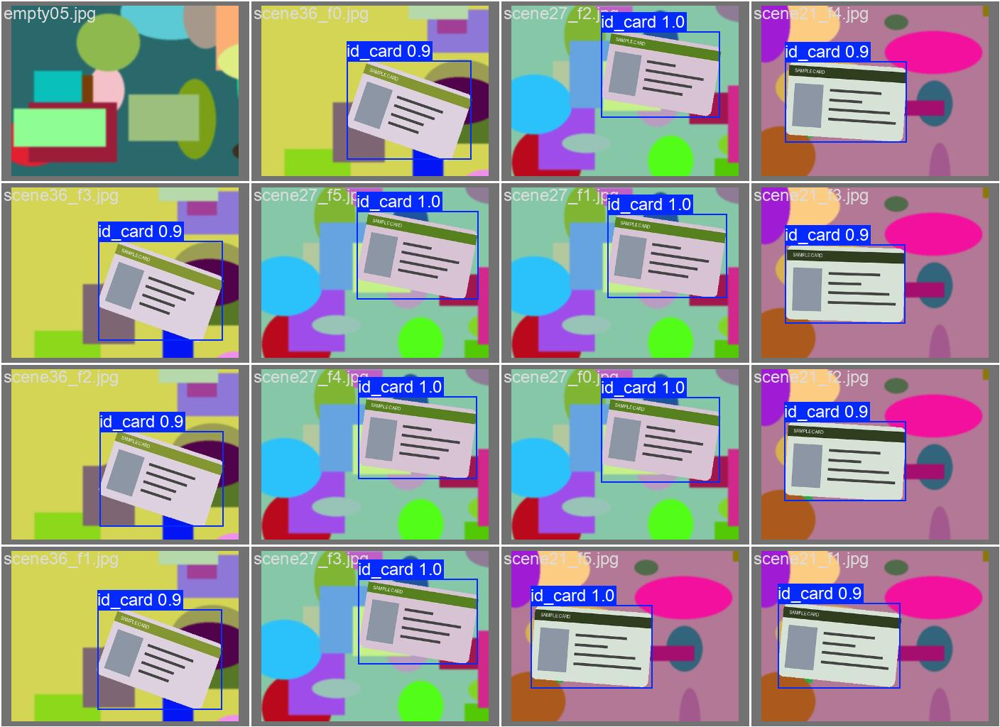

---
tags:
  - ML Platform
  - MLOps
  - Kubeflow Pipelines
  - YOLO
  - MovieLens
  - PVC
---

# 모델 학습과 검증, PVC 데이터 공유

> KFP 아티팩트로 캡스톤 데이터를 준비하고, YOLO 학습과 검증을 컨테이너 컴포넌트로 옮긴 뒤, 단계마다 반복되던 다운로드를 PVC 하나로 묶는 과정을 정리한다.

## 개요

4주차는 『Machine Learning Platform Engineering』 7장의 나머지(7.2.2~7.3), 8장 전체, 9장 9.1절을 다룬다. 7장 후반은 3주차에 본 단순 값 전달의 한계를 아티팩트 전달로 넘고, 두 캡스톤 프로젝트(신분증 탐지, 영화 추천)의 데이터 준비 파이프라인을 만든다. 8장은 준비된 데이터로 YOLO를 파인튜닝하고 검증하는 컴포넌트를 붙인다. 9.1절은 컴포넌트마다 오브젝트 스토리지에서 같은 데이터를 다시 받던 구조를 PVC(PersistentVolumeClaim) 공유로 바꾼다.

| 챕터 | 주제 | 핵심 |
|------|------|------|
| CH 7 (7.2.2~7.3) | 데이터 분석과 준비 (이어서) | 아티팩트 전달과 타입, MIDV-500·MovieLens 준비 파이프라인 |
| CH 8 | Model training and validation: Part 1 | 학습 컴포넌트, 컨테이너 컴포넌트, Metrics 검증, 수동 검토 |
| CH 9 (9.1) | Model training and validation: Part 2 | `kfp-kubernetes`로 PVC 생성·마운트, 실행 순서 명시 |

세 부분은 하나의 파이프라인이 자라는 과정이다.



강의 내용은 스터디 녹화(4주차 1~3편)를 기준으로 정리했다. 실습은 KFP 클러스터 대신 x86 리눅스 서버(CPU 16스레드로 제한)에서 저자 컴포넌트의 로직을 그대로 실행해, 책 코드가 만드는 데이터와 지표를 직접 확인하는 방식으로 했다. 책 본문과 저자 코드가 어긋나는 부분은 스터디원 김춘식 님의 [8장](https://johklo.github.io/docs/tech/machine-learning-platform-engineering/08-training-and-validation-1/)·[9장](https://johklo.github.io/docs/tech/machine-learning-platform-engineering/09-training-and-validation-2/) 해설과 대조했다.

## CH 7. 데이터 분석과 준비 (이어서)

### KFP 데이터 전달: 아티팩트

3주차에 본 단순 값 전달은 반환값이 다음 파드의 명령 인자와 메타데이터로 들어가기 때문에 100KB만 넘어도 깨졌다. 데이터셋처럼 큰 데이터는 값이 아니라 위치를 넘겨야 한다. 각 컴포넌트는 메모리 한도가 있는 별도 파드에서 돌기 때문에, 큰 데이터를 통째로 메모리에 올려 넘기는 방식은 OOM(Out Of Memory)으로 이어진다. 강의에서는 이것을 "대용량 데이터를 어떻게 넘길지 먼저 설계해야 하는 이유"로 설명했다.

KFP v2의 아티팩트는 이 위치 전달을 타입으로 감싼다. 컴포넌트가 `Output[Dataset]`을 선언하면 KFP가 실행 시점에 `.path`를 정해 주고, 컴포넌트는 그 경로에 파일을 쓰기만 하면 된다. 파드가 끝나면 런처가 그 파일을 파이프라인 루트(MinIO의 `mlpipeline` 버킷 아래 `v2/artifacts/...`)로 올리고, 다음 컴포넌트가 `Input[Dataset]`으로 받으면 같은 파일이 그 파드의 `.path`로 내려온다.

```python
from kfp import dsl
from kfp.dsl import Input, Output, Dataset

@dsl.component(base_image="python:3.11")
def make_text(out: Output[Dataset]):
    with open(out.path, "w") as f:      # 경로에 쓰기만 한다
        f.write("lorem ipsum " * 10000)

@dsl.component(base_image="python:3.11")
def count_words(src: Input[Dataset]) -> int:
    with open(src.path) as f:           # 같은 파일이 이 파드에 내려온다
        return len(f.read().split())

@dsl.pipeline(name="artifact-passing")
def pipeline():
    count_words(src=make_text().outputs["out"])
```

반환값 `int` 하나는 여전히 단순 값으로 전달되고, 문서 본문은 아티팩트로 전달된다. 컴포넌트 코드에는 MinIO 주소나 키가 없다. 업로드와 다운로드는 KFP 런처가 맡는다.

| 타입 | 용도 | UI 표시 |
|------|------|---------|
| `Artifact` | 다른 타입에 맞지 않는 범용 파일·디렉터리 | 파일 링크 |
| `Dataset` | 학습·검증·테스트 데이터, 피처 세트, 전처리 결과 | 파일 링크 |
| `Model` | 학습된 가중치, 체크포인트, 사전학습 모델 | 파일 링크 |
| `Metrics` | 스칼라 지표 (`log_metric`) | Scalar metrics 표 |
| `ClassificationMetrics` | 혼동 행렬, ROC 곡선 | 차트 |
| `SlicedClassificationMetrics` | 데이터 조각별 분류 지표 | 차트 |
| `HTML` | 보고서 페이지 | 렌더링된 HTML |
| `Markdown` | 텍스트 보고서 | 렌더링된 Markdown |

강의에서는 타입을 모르겠으면 일단 `Artifact`를 쓰라고 했다. 다만 `Dataset`, `Model`로 구분해 두면 UI와 메타데이터(MLMD)에서 계보를 읽기 쉬워진다. `Metrics`와 `Markdown`은 사람이 확인할 결과를 남기는 데 쓸모가 있어, 강사는 데이터 QA 단계에 행 수와 분할 비율을 Metrics·Markdown으로 남기는 예를 보여 줬다.

### 캡스톤 1. 신분증 탐지 데이터 준비 (7.3.1)

데이터셋은 MIDV-500에서 신분증만 남겨 YOLO 형식으로 바꾼 것이다. 기본 YOLOv8은 COCO 80개 클래스로 사전학습돼 신분증이라는 클래스를 모르므로, 이 데이터로 파인튜닝한다. YOLO는 데이터 위치를 `data.yaml` 하나로 받는다.

```yaml
path: /data
train: train/images
val: val/images
test: test/images
names:
  0: id_card
```

라벨은 이미지 경로의 `images`를 `labels`로 바꾼 자리에서 같은 이름의 `.txt`로 찾는다. 라벨 한 줄은 `클래스 중심x 중심y 너비 높이`이고 좌표는 이미지 크기로 나눈 0~1 값이다. 이미지와 라벨을 잇는 것은 파일 이름뿐이다.

파이프라인은 세 컴포넌트다.

1. `download_dataset`: Manning이 공유한 tar.gz를 받아 출력 아티팩트 경로에 푼다. 진행 확인을 위해 `tqdm` 진행바를 붙였다.

2. `split_dataset`: `train_test_split`을 두 번 써서 75:15:10으로 나눈다. 먼저 75:25로 자르고, 남은 25%를 다시 15:10으로 자른다(`test_size=0.10/0.25`). `random_state=42`로 같은 입력이면 같은 분할이 나온다. 결과는 `Output[Dataset]` 세 개(train, validation, test)이고, 각 아래에 `images/`, `labels/`가 생긴다.

3. `output_file_contents`: 분할 결과 일부를 출력해 보는 확인용 컴포넌트다.

강의 환경 기준으로 원본이 10GB를 넘어 다운로드와 분할에만 30분 넘게 걸렸고, 분할 결과(train 12GB, val 2.4GB, test 1.6GB)가 원본과 별도로 복제되면서 오브젝트 스토리지 사용량이 30GB를 넘었다. 강의 환경의 오브젝트 스토리지는 볼륨 개수 상한이 기본 100이라 이 용량에서 쓰기가 막혔고, 상한을 1000으로 올려 해결했다. 아티팩트 전달은 편하지만 단계마다 사본이 쌓인다는 점이 9.1절의 출발점이 된다.

#### 이미지와 라벨의 짝

저자 `split_dataset`의 핵심 부분이다.

```python
images = list(glob.glob(os.path.join(input_dataset.path, "DATASET", BASE_PATH, "images", "**")))
labels = list(glob.glob(os.path.join(input_dataset.path, "DATASET", BASE_PATH, "labels", "**")))

x_train, x_test, y_train, y_test = train_test_split(images, labels, test_size=0.25, random_state=42)
```

두 목록을 따로 만든 뒤 같은 위치끼리 짝지어 나눈다. `glob` 순서는 파일시스템의 디렉터리 순서를 따르고 이름순이 보장되지 않는다. 실습에서 같은 구조의 데이터 256장(40개 장면 × 6프레임 + 빈 이미지 16장)으로 저자 방식을 돌리자, 위치로 짝지은 256쌍 중 리눅스(ext4)에서 255쌍, macOS(APFS)에서 256쌍 전부가 서로 다른 파일이었다.

YOLO가 이 결과로 학습할 때 일어나는 일은 "남의 라벨을 학습한다"가 아니다. 분할 뒤에도 파일 이름은 그대로 복사되므로 YOLO는 이름으로 라벨을 찾는데, 짝이 틀린 라벨은 다른 분할 폴더로 가 버린다. 그래서 라벨이 없는 이미지, 즉 "카드가 없는 사진"으로 취급되는 이미지가 생긴다.

| 분할 | 이미지 | 같은 폴더에 라벨이 있는 이미지 (저자 방식) | (이름으로 짝지은 뒤) |
|------|--------|-------------------------------------------|----------------------|
| train | 192 | 150 | 192 |
| val | 38 | 6 | 38 |
| test | 26 | 2 | 26 |

카드가 있는 train 이미지 41장이 라벨 파일 없이 "카드 없음"으로 학습되고, val에서는 카드가 있는 이미지 32장이 정답 상자 없이 평가된다. 이 상태로 학습한 모델의 val mAP50은 0.203이었고, 이름으로 짝지은 뒤 같은 조건으로 학습하면 0.995였다. 코드는 오류 없이 끝나고 KFP 실행도 초록색이라, 지표를 보기 전에는 알아차리기 어렵다.



*출처: 스터디 실습 화면. 저자 방식으로 나눈 val의 정답 라벨. 16장 중 3장에만 상자가 있고 나머지는 카드가 보이는데도 라벨이 없다.*



*출처: 스터디 실습 화면. 파일 이름으로 짝지은 뒤 나눈 val. 카드마다 정답 상자가 있다.*

고치는 방법은 라벨을 이름으로 찾는 것이다.

```python
stem = lambda p: os.path.splitext(os.path.basename(p))[0]
by_stem = {stem(l): l for l in labels}
images = sorted(i for i in images if stem(i) in by_stem)
labels = [by_stem[stem(i)] for i in images]
```

### 캡스톤 2. 영화 추천 데이터 준비 (7.3.2)

데이터셋은 GroupLens의 MovieLens 25M(2019년 12월 공개)이다. 사용자 16만 명, 영화 6만 2천 편, 평점 2,500만 건, 태그 100만 건이고 연구·학습 목적으로 쓸 수 있다. 표 형식 데이터라 CSV 대신 Parquet으로 바꿔 저장한다. Parquet은 열 단위로 압축해 크기가 작고, 필요한 열만 읽을 수 있어 조회가 빠르다.



- `csv_to_parquet`, `put_to_minio`는 같은 컴포넌트를 입력만 바꿔 두 번 쓴다. 두 변환은 서로 의존하지 않으므로 KFP가 병렬로 실행한다.

- `qa_data`는 아티팩트를 받지 않고 MinIO의 결과를 직접 읽으므로, 데이터 의존이 없는 대신 `.after(u2)`로 업로드 뒤에 돌게 한다. 아티팩트로 이어지지 않은 순서는 KFP가 모르기 때문에 직접 적어야 한다.

- 강의 실습 기준으로 262MB zip을 받아 Parquet 3개를 올리기까지 약 3분이 걸렸다.

`qa_data`는 열이 4개인지, train이 전체의 75% 이상(`0.75 * 25 * 1e6`행)인지 확인한다. 기준 행 수가 ml-25m에 고정돼 있어서, 실습처럼 같은 계열의 작은 데이터(ml-latest-small, 평점 100,836건)로 바꾸면 분할은 정상이어도 QA가 실패한다. 실습에서 train 75,627행으로 확인한 결과는 다음과 같다.

```text
qa: columns == 4 -> True
qa: rows >= 0.75 * 25M -> False
metadata {'n_users': 610, 'n_items': 193609}  실제 영화 수 9724
```

두 번째 줄은 데이터셋 이름과 최소 행 수를 파라미터로 빼야 한다는 뜻이다. 세 번째 줄은 9장 학습 컴포넌트가 쓰는 메타데이터인데, 영화 수가 아니라 최대 영화 ID다. 임베딩 테이블이 실제 영화 수의 20배 크기로 만들어지므로 ID를 0부터 다시 매기는 편이 메모리에 유리하다.

#### 컴포넌트를 만드는 세 가지 방식

이 절에서는 저자가 `target_image`를 쓰는데, 컴포넌트 패키징 방식이 여기서 처음 갈린다.

| 방식 | 선언 | 실행 시 동작 | 장단점 |
|------|------|--------------|--------|
| 경량 Python 컴포넌트 | `@dsl.component(base_image=..., packages_to_install=[...])` | 파드마다 `pip install` 후 주입된 함수 실행 | 쓰기 쉽다. 매번 설치해 느리고, 시간이 지나 의존성이 바뀌면 깨진다 |
| 컨테이너화 Python 컴포넌트 | `@dsl.component(target_image=...)` + `kfp component build` | 의존성과 코드가 든 이미지를 실행 | 설치 시간이 없다. 이미지 빌드와 레지스트리가 필요하다 |
| 컨테이너 컴포넌트 | `@dsl.container_component` + `ContainerSpec` | 지정한 이미지와 명령을 그대로 실행 | 시스템 패키지와 셸까지 다룬다. 가독성이 떨어진다 |

저자의 `target_image`는 저자 개인 Docker Hub 계정 이미지라 지금은 받을 수 없다. `kfp component build <디렉터리> --no-push-image`로 로컬에서 빌드해 사내 레지스트리에 올려 써야 한다. 강의에서 pip 설치 방식(A)과 target image 방식(B)을 비교했는데 B가 오히려 느렸다. 파드 시작 시간은 이미지 크기와 노드 캐시에 좌우되므로, 큰 이미지를 처음 받는 시간이 pip 설치 시간보다 길 수 있다. 강사는 내부 레지스트리가 없으면 경로 문제로 번거로우니 개념만 알고 넘어가도 된다고 했다.

## CH 8. 모델 학습과 검증

8장은 7장에서 나눈 신분증 데이터로 YOLOv8을 파인튜닝하고, 그 결과를 검증하는 컴포넌트를 파이프라인에 붙인다. 강의에서 가장 강조한 부분은 검증이었다. 검증 없이 넘긴 모델이 서빙 단계에서 쓸모없다고 밝혀지면 그때까지 쓴 학습 자원과 배포 작업이 모두 낭비다.

### 학습 컴포넌트

Ultralytics로 학습하는 코드 자체는 짧다.

```python
from ultralytics import YOLO

model = YOLO("yolov8n.pt")          # 사전학습 가중치를 받아 초기화
model.train(data="data.yaml", imgsz=640, epochs=1, batch=8,
            project="/tmp/runs", name="yolov8n_custom")
```

| 인자 | 의미 | 고를 때 고려할 것 |
|------|------|-------------------|
| `data` | `data.yaml` 경로 | 경로가 파드 안에서 유효해야 한다 |
| `imgsz` | 입력 해상도. YOLOv8 기본 640 | 학습과 서빙 해상도를 맞춘다. 줄이면 작은 물체를 놓친다 |
| `epochs` | 데이터 반복 횟수 | CPU에서는 epoch 하나에도 수십 분이 걸린다 |
| `batch` | 반복당 샘플 수 | 메모리·GPU 한도 안에서 고른다 |
| `project`, `name` | 가중치, 곡선, 혼동 행렬 등 산출물이 쌓일 위치 | 아티팩트 경로 밖이면 파드와 함께 사라진다 |

모델 크기는 가장 작은 nano(파라미터 약 300만 개)로 시작한다. 크기가 커질수록 필요한 연산량이 늘어나므로, CPU 실습에서는 nano를 쓰고 품질이 부족할 때 같은 파이프라인에서 크기만 바꿔 다시 돌린다. 학습 시간은 GPU 자원, 하이퍼파라미터, 모델 크기 사이의 절충이고, 이 값들이 결과 모델을 바꾸므로 실행마다 기록해 둬야 한다.

실습 로그에서 확인한 한 가지는 `optimizer` 기본값 `auto`의 동작이다.

```text
optimizer: 'optimizer=auto' found, ignoring 'lr0=0.01' and 'momentum=0.937' and determining best 'optimizer', 'lr0' and 'momentum' automatically...
optimizer: AdamW(lr=0.002, momentum=0.9)
```

`auto`는 반복 수를 보고 최적화기와 학습률을 스스로 고르므로, `lr0`를 바꿔 가며 실험해도 값이 적용되지 않는다. 학습률을 실험 변수로 쓰려면 `optimizer`를 명시해야 한다.

### 컨테이너 컴포넌트

YOLO는 OpenCV를 쓰고, OpenCV는 `libGL.so.1` 같은 시스템 라이브러리가 필요하다. `@dsl.component`의 `packages_to_install`은 pip 패키지만 설치하므로 이 문제를 풀 수 없다. 책은 `@dsl.container_component`로 이미지, 명령, 인자를 직접 정한다.

```python
@dsl.container_component
def train_model(epochs: int, batch: int, yolo_model_name: str,
                train_dataset: dsl.Input[dsl.Dataset],
                validation_dataset: dsl.Input[dsl.Dataset],
                test_dataset: dsl.Input[dsl.Dataset],
                model_output: dsl.Output[dsl.Model],
                data_yaml: dsl.Output[dsl.Artifact]):
    return dsl.ContainerSpec(
        image="python:3.11-slim",
        command=["bash", "-c"],
        args=[f"""
            apt-get update && apt-get install -y --no-install-recommends libgl1-mesa-glx libglib2.0-0 && \
            pip install --no-cache-dir ultralytics torch opencv-python-headless==4.8.1.78 pyyaml && \
            cat << 'EOF' > /train.py
{TRAINING_SCRIPT}
EOF
            python3 /train.py --train-path "$0" --val-path "$1" --test-path "$2" \
                --epochs "$3" --batch "$4" --model-name "$5" \
                --model-output "$6" --data-yaml "$7"
            """,
            train_dataset.path, validation_dataset.path, test_dataset.path,
            epochs, batch, yolo_model_name, model_output.path, data_yaml.path],
    )
```

동작 순서는 이렇다.

1. 학습 스크립트(`TRAINING_SCRIPT`)는 파이썬 문자열로 따로 작성돼 있다. `argparse`로 경로와 하이퍼파라미터를 받고, `data.yaml`을 만들고, 학습한 뒤 `best.pt`를 출력 경로로 복사한다.

2. 컨테이너가 시작되면 `bash -c`가 첫 인자(긴 셸 문자열)를 실행한다. 그 안에서 heredoc(`cat << 'EOF'`)으로 스크립트를 `/train.py`에 쓴다.

3. `bash -c '<문자열>' a b c ...` 형태에서 뒤따르는 인자는 `$0`, `$1`, ... 로 들어간다. KFP는 `.path` 플레이스홀더를 실제 경로로 바꿔 넘기고, 셸이 이를 `--train-path "$0"` 같은 스크립트 인자로 옮긴다.

책은 이 방식을 "가독성을 희생해 유연성을 얻는 동적 스크립트 주입"이라고 설명한다. Dockerfile 없이 시스템 패키지까지 다룰 수 있지만, 인자 목록 순서와 `$0`~`$7` 번호가 하나만 어긋나도 엉뚱한 값이 엉뚱한 옵션에 들어가고, KFP는 이를 검사하지 않는다. 강사는 루트 권한으로 시스템 패키지를 설치하는 구조이므로 보안 면에서 신중해야 한다는 점도 덧붙였다.

이 컴포넌트는 지금 그대로는 돌지 않는다. 버전을 고정하지 않은 설치가 시간이 지나며 바뀌었기 때문이다.

```bash
$ nerdctl run --rm --net host python:3.11-slim bash -c \
    "cat /etc/debian_version; apt-get update -qq; apt-get install -y --no-install-recommends libgl1-mesa-glx | tail -1"
13.7
E: Package 'libgl1-mesa-glx' has no installation candidate
```

`python:3.11-slim`의 기반이 Debian 13(trixie)으로 바뀌면서 `libgl1-mesa-glx`가 사라졌다. `libgl1`로 바꿔야 한다. 버전 없는 `torch`는 CUDA용 대형 휠을 받고, NumPy 2.x는 Ultralytics 8.3.40의 `np.trapz` 호출을 깨뜨린다. 실습에서는 `ultralytics==8.3.40`, `torch==2.5.1+cpu`, `numpy==1.26.4`로 고정했다. 같은 이유로 책의 검증 컴포넌트처럼 의존성이 든 고정 이미지(`ultralytics/ultralytics:<태그>-cpu`, 약 3.3GB)를 쓰는 편이 재현에 유리하다. 강의 실습에서도 파드마다 패키지를 설치하느라 epoch 3회 학습 단계에만 1시간 15분이 걸렸다.

저자 스크립트는 `best.pt`만 출력 아티팩트로 복사한다. 학습 폴더(`project`)는 출력 경로 밖에 있어서 `results.csv`, 손실 곡선, 혼동 행렬, 예측 샘플은 파드와 함께 사라진다. 나중에 볼 파일은 출력 아티팩트 경로 아래에 써야 한다.



*출처: 스터디 실습 화면. 장면 단위로 나눈 데이터로 10 epoch 학습한 `results.png`. 저자 코드 그대로라면 이 파일은 아티팩트로 남지 않는다.*

### 검증 컴포넌트

검증은 학습과 다른 파드에서 `best.pt`를 다시 읽어 `model.val()`로 지표를 계산하고 `Output[Metrics]`에 남긴다.

```python
@dsl.component(base_image="ultralytics/ultralytics:8.0.194-cpu")
def validate_model(data_yaml: Input[Artifact], model: Input[Model],
                   validation_dataset: Input[Dataset], metrics: Output[Metrics]):
    from ultralytics import YOLO
    import os
    m = YOLO(os.path.join(model.path, "best.pt"))
    r = m.val(data=os.path.join(data_yaml.path, "data.yaml"), imgsz=640, batch=1)
    metrics.log_metric("map50-95", r.box.map)
    metrics.log_metric("map50", r.box.map50)
    metrics.log_metric("map75", r.box.map75)
```

`validation_dataset`은 함수 안에서 쓰지 않는데도 입력으로 받는다. `data.yaml`에는 학습 파드에서의 절대 경로가 적혀 있고, KFP는 같은 아티팩트를 같은 경로(`/minio/mlpipeline/v2/artifacts/...`)에 내려받으므로 이 입력이 있어야 그 경로가 검증 파드에도 생긴다. 지울 수 있어 보이는 입력이 실제로는 경로를 맞추는 역할을 한다.

| 지표 | 의미 |
|------|------|
| `map50` | 예측 상자와 정답 상자의 IoU(Intersection over Union)가 0.5 이상이면 맞은 것으로 칠 때의 평균 정밀도(AP) |
| `map75` | IoU 기준 0.75에서의 AP |
| `map50-95` | IoU 기준을 0.5부터 0.95까지 0.05씩 올리며 구한 AP의 평균. COCO 기본 지표 |

`map50`이 높고 `map50-95`가 낮으면 카드는 찾지만 상자 경계가 덜 정확하다는 뜻이다. AP는 정밀도-재현율 곡선 아래 넓이라서, 서비스에서 쓸 신뢰도 임계값 하나에서의 오탐과 미탐은 따로 봐야 한다.

#### 검증 지표가 증명하는 범위

YOLO는 학습 중 매 epoch마다 `val` 분할로 지표를 재고 가장 좋은 가중치를 `best.pt`로 남긴다. 저자의 검증 컴포넌트도 같은 `val`로 다시 잰다. 실습에서 학습 마지막 줄과 검증 결과가 똑같았다.

```text
# 학습 종료 시 val (28장)
                 all         28         24      0.998          1      0.995      0.991
# 검증 컴포넌트와 같은 방식으로 best.pt를 다시 읽어 val 평가
val  {"map50": 0.995, "map50_95": 0.991}
test {"map50": 0.995, "map50_95": 0.995}
```

가중치를 다시 읽어도 같은 값이 나온다는 것은 저장과 로드가 정상이라는 확인이지, 독립적인 평가는 아니다. `best.pt`를 고르는 데 이미 쓴 데이터이기 때문이다. `data.yaml`에 `test`가 적혀 있지만 저자 파이프라인 어디에서도 평가하지 않는다. 출시 판단에 쓸 수치는 선택에 쓰지 않은 분할에서 한 번만 계산해야 한다.

분할 방식도 지표를 후하게 만들 수 있다. MIDV-500은 영상에서 뽑은 프레임이라 인접 프레임이 거의 같다. 프레임 단위로 무작위로 나누면 같은 카드와 배경이 train과 val에 함께 들어간다. 실습 데이터도 장면당 6프레임으로 만들었고, 저자 방식의 분할에서 val 장면 25개가 모두 train에도 있었다.

| 분할 | train | val | train에도 있는 val 장면 | val mAP50-95 | test mAP50-95 |
|------|-------|-----|-------------------------|--------------|---------------|
| 저자 방식 (짝 어긋남) | 192 | 38 | 25/25 | 0.203 | 0.095 |
| 프레임 단위 무작위 (짝 수정) | 192 | 38 | 27/27 | 0.990 | 0.991 |
| 장면 단위 (짝 수정) | 207 | 28 | 0/4 | 0.991 | 0.995 |

프레임 분할과 장면 분할의 차이는 이 데이터에서 드러나지 않았다. 도형 배경에 카드 한 장을 붙인 합성 데이터가 너무 쉬워서 처음 보는 장면도 거의 완벽하게 찾기 때문이다. 이 결과로 누수가 무해하다고 결론 낼 수는 없고, 실제 촬영 데이터라면 장면이나 촬영 단위로 나눠 비교해야 한다.

### 수동 검토

책 8.1.7은 사전학습 모델과 학습한 모델로 같은 이미지를 추론해 결과를 눈으로 비교한다. 강의 시연에서 사전학습 YOLOv8n은 신분증을 `book` 0.28로 잡았고, 파인튜닝한 가중치는 `id_card` 0.94로 찾았다.

실습에서도 학습에 쓰지 않은 새 장면 6장과 빈 이미지 2장으로 같은 비교를 했다.

```text
처음 보는 장면      pretrained | trained
empty00.jpg      -          | -
scene00_f0.jpg   -          | id_card:0.95
scene02_f0.jpg   -          | id_card:0.84
scene05_f0.jpg   -          | id_card:0.92
```

수동 검토가 지표보다 쓸모 있는 지점은 학습 분포 밖의 조건을 넣어 볼 때다. 같은 장면을 회전, 흐림, 축소, 어둡게, 흑백으로 바꿔 학습한 가중치로 추론했다.



*출처: 스터디 실습 화면. 원본 0.95, 90도 회전 0.39, 흐림 0.81, 1/4 축소 미탐, 밝기 25% 0.93, 흑백 0.95.*

| 조건 | 결과 | 학습 데이터에 있던 조건 |
|------|------|-------------------------|
| 원본 | 0.95 | - |
| 90도 회전 | 0.39 | 회전은 ±23도까지만 있었다 |
| 흐림 (반경 6) | 0.81 | 배경에만 약한 흐림이 있었다 |
| 1/4 축소 | 미탐 | 카드 폭이 150~300px였다 |
| 밝기 25% | 0.93 | - |
| 흑백 | 0.95 | - |

val mAP50이 0.995인 모델이 작게 찍힌 카드를 놓치고, 세로로 찍힌 카드는 임계값 0.5를 쓰면 놓친다. 지표가 틀린 것이 아니라 그 조건이 평가 분할에 없었다. 수동 검토의 산출물은 "잘 된다"는 확인이 아니라 이런 실패 조건 목록이고, 이 목록이 다음 데이터 수집과 세부 집단 평가의 근거가 된다.

| 상태 | 증명하는 것 |
|------|-------------|
| 파이프라인 실행 성공 | 각 파드가 종료 코드 0으로 끝나고 가중치와 지표가 저장됨 |
| 검증 지표 통과 | 저장한 가중치를 다시 읽을 수 있고, 정해진 분할에서 기준 이상 |
| 출시 결정 | 선택에 쓰지 않은 데이터, 실패 조건 검토, 승인한 사람과 버전 기록까지 갖춤 |

## CH 9.1 PVC로 데이터 공유

8장 파이프라인은 컴포넌트마다 MinIO에서 데이터를 받고 결과를 다시 올린다. 다운로드, 분할, 학습, 검증이 같은 이미지를 각각 내려받고, 분할 결과는 원본과 별도로 저장된다. 강의 환경에서는 재실행할 때마다 다운로드에만 약 16분이 더 들었다.

9.1절은 파이프라인 맨 앞에서 PVC를 만들고 모든 단계가 같은 경로에 마운트하게 한다. 오브젝트 스토리지는 POSIX 파일시스템이 아니라서 파일을 쓰려면 받아서 풀고 다시 올리는 변환이 필요하다. 반면 PVC는 파드에 일반 디렉터리로 붙으므로, YOLO처럼 `images/`와 `labels/` 폴더 구조를 경로로 기대하는 코드와 잘 맞는다.

```python
from kfp import dsl, kubernetes

@dsl.pipeline(name="yolo-pvc-pipeline")
def pipeline(epochs: int = 1, batch: int = 8, random_state: int = 42):
    pvc = kubernetes.CreatePVC(
        pvc_name_suffix="-yolo",            # 실행마다 다른 이름
        access_modes=["ReadWriteOnce"],
        size="10Gi",
        storage_class_name="standard",      # 책은 local-path, kind는 standard
    )
    pvc_name = pvc.outputs["name"]

    download_op = download_dataset().set_caching_options(False)
    split_op = split_dataset(random_state=random_state).after(download_op).set_caching_options(False)
    train_op = train_model(epochs=epochs, batch=batch).after(split_op).set_caching_options(False)
    validate_op = validate_model().after(train_op).set_caching_options(False)

    for task in (download_op, split_op, train_op, validate_op):
        kubernetes.mount_pvc(task, pvc_name=pvc_name, mount_path="/data")

    kubernetes.DeletePVC(pvc_name=pvc_name).after(validate_op)
```

`kfp-kubernetes`(`pip install kfp[kubernetes]`)는 KFP 컴포넌트에 쿠버네티스 리소스를 붙이는 확장이다. 책에 따르면 이 변경으로 MinIO 접속 코드와 입출력 경로 인자 6개가 사라지고, 각 컴포넌트는 `/data/train/images` 같은 고정 경로만 다룬다. 강의 시연에서는 10Gi PVC로 생성부터 검증까지 약 7분이 걸렸고, KFP UI의 각 단계 Volume mounts 항목에 PVC가 표시됐다. 7·8장 파이프라인에서는 이 항목이 비어 있다.

대신 KFP가 알던 것을 사람이 챙겨야 한다.

| 항목 | 아티팩트 전달 | PVC 공유 |
|------|---------------|----------|
| 실행 순서 | 입출력 연결로 KFP가 추론 | 데이터 흐름이 보이지 않으므로 `.after()`로 직접 지정 |
| 캐시 | 입력이 같으면 이전 출력 재사용 | 캐시는 PVC 안의 파일을 모른다. 앞 단계가 캐시로 건너뛰면 새 PVC가 빈 채로 학습이 실패 |
| 데이터 보존 | 아티팩트가 실행 기록과 함께 남음 | 실행이 끝나면 `DeletePVC`로 사라짐. 남길 결과는 오브젝트 스토리지로 |
| 스케줄링 | 노드 제약 없음 | `ReadWriteOnce`는 한 노드에만 붙음. 다음 단계가 다른 노드에 배치되면 대기 |
| 실패 시 정리 | 해당 없음 | `DeletePVC`는 앞 단계가 성공해야 실행돼 실패한 실행의 PVC가 남음 |

저자 저장소의 `pipeline_with_pvc.py`는 책 리스팅과 거의 같고, 그대로 쓰면 세 곳에서 막힌다.

- PVC 이름을 `'yolo-pipeline-pvc'` 고정 문자열로 넘긴다. 실패한 실행의 PVC가 남아 있으면 다음 실행이 같은 이름으로 만들다 충돌한다. `pvc_name_suffix`로 실행마다 이름을 바꾸고 `pvc.outputs["name"]`을 넘긴다.

- 크기가 `1Gi`, 스토리지 클래스가 `local-path`다. 전체 데이터에는 크기가 부족하고, kind의 기본 클래스 이름은 `standard`다.

- 캐시를 검증 단계에서만 끈다. 같은 파라미터로 다시 돌리면 다운로드와 분할이 캐시로 처리되고, 새로 만든 빈 PVC에서 학습이 시작된다. PVC에 결과를 쓰는 단계는 모두 캐시를 꺼야 한다.

PVC가 오브젝트 스토리지를 대체하는 것은 아니다. PVC는 한 실행 동안 여러 단계가 같은 파일을 나눠 쓰는 작업 공간이고, 실행 뒤에도 남아야 할 데이터셋 버전과 모델, 평가 결과는 오브젝트 스토리지에 둔다. PVC가 지워지면 무엇으로 학습했는지 알 수 없으므로, 원본 URI와 분할 시드는 실행 기록에 따로 남긴다.

## 실습 환경

| 항목 | 값 |
|------|-----|
| 서버 | x86_64 리눅스(Ubuntu 24.04.4), CPU 학습 16스레드로 제한(`taskset -c 0-15`) |
| Python | 3.11 (uv 가상환경) |
| 패키지 | ultralytics 8.3.40, torch 2.5.1+cpu, numpy 1.26.4, scikit-learn, pandas |
| 저자 코드 | practical-mlops/object-detection-project `c6afb11`, movie-recommender-project `4e0a808` |

KFP 클러스터 대신 저자 컴포넌트의 함수 본문(분할, 학습, 검증, QA)을 같은 순서로 직접 실행했다. 파드 사이 아티팩트 전달과 PVC 마운트는 재현하지 않았으므로, 캐시와 PVC 정리에 관한 내용은 저자 코드와 강의 시연을 근거로 했다.

### 데이터

책의 MIDV-500 주소(`manning.box.com/shared/static/coiv3n2t5t0v42xgfhlsfi8bhvd7b441.gz`)는 2026-11-13 확인 시 HTTP 404였다. 저자 코드가 기대하는 `DATASET/MINIDATA/{images,labels}` 구조를 그대로 갖춘 합성 데이터를 만들었다. 실제 인물이나 문서 정보는 넣지 않았다.

```python
# make_cards.py 핵심: 장면마다 배경과 카드를 고정하고 위치·각도만 조금씩 바꾼 프레임을 만든다
for s in range(scenes):                       # 40개 장면
    bg0, card = make_background(rng), make_card(rng, rng.randint(150, 300))
    cx, cy, ang = ...
    for f in range(frames):                   # 장면당 6프레임
        x0, y0, x1, y1 = paste(bg, card, cx + jitter, cy + jitter, ang + jitter)
        # 라벨: 0 중심x 중심y 너비 높이 (0~1)
for i in range(empty):                        # 카드 없는 이미지 16장, 빈 라벨 파일
    ...
```

```text
images=256 scenes=40 frames=6 empty=16
```

추천 쪽은 MovieLens 25M 대신 같은 GroupLens의 ml-latest-small(평점 100,836건, 사용자 610명, 영화 9,724편)을 7장과 같은 방식(75:15:10, `random_state=42`)으로 나눴다.

### 분할과 학습

```bash
python split_like_author.py                                      # 저자 방식 그대로
python split_like_author.py --pair-by-name --dst split_frame     # 이름으로 짝짓기
python split_like_author.py --pair-by-name --split-by-scene --dst split_scene

for s in split_author split_frame split_scene; do
  taskset -c 0-15 python train_eval.py $s --device cpu --epochs 10   # imgsz 320, batch 16
done
```

```text
== split author
zip(images, labels) 중 이름이 다른 쌍: 255/256
split sizes {'train': 192, 'val': 38, 'test': 26}
val 장면 중 train에도 있는 장면: 25/25

RESULT split_author {"val": {"map50": 0.203, "map50_95": 0.203}, "test": {"map50": 0.095, "map50_95": 0.095}}
RESULT split_frame  {"val": {"map50": 0.995, "map50_95": 0.990}, "test": {"map50": 0.995, "map50_95": 0.991}}
RESULT split_scene  {"val": {"map50": 0.995, "map50_95": 0.991}, "test": {"map50": 0.995, "map50_95": 0.995}}
```

10 epoch 학습과 val·test 평가까지 분할당 약 80초가 걸렸다(320px, CPU 16스레드). 강의 환경의 전체 데이터, 640px, 파드 내 패키지 설치 조건과는 비교할 수 없는 값이다.



*출처: 스터디 실습 화면. 장면 단위 분할로 학습한 모델의 val 예측 샘플.*

### 걸리기 쉬운 지점

| 증상 | 원인과 대응 |
|------|-------------|
| 다운로드 단계 404 | 책의 Manning 데이터 주소 공유 종료. 같은 폴더 구조의 데이터를 오브젝트 스토리지에 올려 읽기 |
| 학습은 끝나는데 mAP가 낮음 | `glob` 두 목록을 위치로 짝지음. 파일 이름으로 짝지은 뒤 분할 |
| `Package 'libgl1-mesa-glx' has no installation candidate` | `python:3.11-slim`이 Debian 13 기반. `libgl1`로 교체 |
| `module 'numpy' has no attribute 'trapz'` | NumPy 2.x. `numpy==1.26.4` 고정 |
| 학습 파드가 설치에 수십 분 | 버전 없는 `torch`가 CUDA 휠을 받음. CPU 휠 고정 또는 Ultralytics 이미지 사용 |
| `lr0`를 바꿔도 결과가 같음 | `optimizer=auto`가 학습률을 무시. 최적화기 명시 |
| 학습 곡선, 혼동 행렬이 남지 않음 | `project`가 출력 아티팩트 밖. 학습 폴더를 `model_output` 아래로 복사 |
| 검증 단계 경로 오류 | `validation_dataset` 입력을 지움. `data.yaml`의 절대 경로를 맞추는 입력이라 남겨야 함 |
| 강의 환경 오브젝트 스토리지 쓰기 실패 | 볼륨 개수 상한 기본 100. 1000으로 상향 |
| 7.3.2 QA 단계 `AssertionError` | 최소 행 수가 ml-25m 기준 고정. 데이터셋 이름과 최소 행 수를 파라미터로 |
| `target_image` pull 실패 | 저자 개인 이미지 삭제. `kfp component build`로 직접 빌드 |
| PVC가 `Pending` | 스토리지 클래스 이름 `local-path`. kind는 `standard` |
| 두 번째 PVC 실행에서 경로 없음 | 다운로드·분할이 캐시로 건너뜀. PVC를 쓰는 단계 모두 `set_caching_options(False)` |
| 같은 이름 PVC 충돌 | 고정 `pvc_name`. `pvc_name_suffix`와 `pvc.outputs["name"]` 사용 |
| 로그에 MinIO 키 노출 | 컴포넌트 코드에 키를 하드코딩. Secret을 환경 변수로 주입(`kubernetes.use_secret_as_env`) |

## 마무리

- KFP v2 아티팩트는 데이터 대신 경로를 넘기고, 업로드와 다운로드는 런처가 맡는다. `Dataset`, `Model`, `Metrics`, `Markdown` 같은 타입은 UI 표시와 계보 추적을 위한 구분이다.

- 아티팩트 전달은 단계마다 사본을 남긴다. 신분증 데이터처럼 큰 데이터에서는 오브젝트 스토리지 용량과 반복 다운로드 시간이 바로 문제가 된다.

- 저자의 분할 코드는 이미지와 라벨 목록을 위치로 짝지어, 실습에서 256쌍 중 255쌍이 어긋났다. YOLO는 이름으로 라벨을 찾으므로 많은 이미지가 "카드 없음"으로 학습되고, val mAP50은 0.203에 그쳤다. 이름으로 짝지으면 0.995였다.

- 컨테이너 컴포넌트는 시스템 패키지까지 다룰 수 있지만, 실행 환경이 그날의 패키지 저장소 상태를 따라간다. 버전을 고정하거나 의존성이 든 이미지를 써야 같은 학습을 다시 돌릴 수 있다.

- 검증 컴포넌트는 학습이 `best.pt`를 고를 때 쓴 val을 다시 재므로, 저장·로드 확인일 뿐 독립 평가가 아니다. 출시 판단에는 선택에 쓰지 않은 분할과 학습 분포 밖 조건의 수동 검토가 필요하다.

- 실습 모델은 val mAP50 0.995였지만 1/4 크기로 작게 찍힌 카드를 놓쳤고, 세로로 찍힌 카드는 0.39에 그쳤다. 수동 검토의 결과물은 이런 실패 조건 목록이다.

- PVC는 단계 사이 데이터를 POSIX 디렉터리로 공유해 다운로드를 한 번으로 줄인다. 대신 실행 순서(`.after()`), 캐시, 실패한 실행의 PVC 정리, RWO 노드 제약을 직접 관리해야 한다.

## 참고

- [CH8 해설: 모델 학습과 검증 I (김춘식)](https://johklo.github.io/docs/tech/machine-learning-platform-engineering/08-training-and-validation-1/)
- [CH9 해설: 모델 학습과 검증 II (김춘식)](https://johklo.github.io/docs/tech/machine-learning-platform-engineering/09-training-and-validation-2/)
- [practical-mlops/object-detection-project](https://github.com/practical-mlops/object-detection-project)
- [practical-mlops/movie-recommender-project](https://github.com/practical-mlops/movie-recommender-project)
- [Kubeflow Pipelines: Artifacts](https://www.kubeflow.org/docs/components/pipelines/user-guides/data-handling/artifacts/)
- [Kubeflow Pipelines: Container Components](https://www.kubeflow.org/docs/components/pipelines/user-guides/components/container-components/)
- [Kubeflow Pipelines: Platform-specific features (kfp-kubernetes)](https://www.kubeflow.org/docs/components/pipelines/user-guides/core-functions/platform-specific-features/)
- [Ultralytics YOLOv8 Train](https://docs.ultralytics.com/modes/train/)
- [Ultralytics YOLO 데이터셋 형식](https://docs.ultralytics.com/datasets/detect/)
- [MovieLens 25M](https://grouplens.org/datasets/movielens/25m/)
