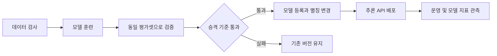

# 모델 추론과 서빙, 모니터링과 설명 가능성

> CH10–11 학습 정리. 모델 서빙 방식과 운영 중 품질 저하를 확인하는 방법을 살펴본다.

온라인 추론은 모델 파일을 HTTP 뒤에 두는 것으로 끝나지 않는다. 어떤 학습 실행에서 나온 파일인지, 어떤 입력 형식을 받는지, 이전 모델로 어떻게 돌아갈지 확인할 수 있어야 한다. 이번 강의에서는 앞 회차의 두 예제를 이어 쓴다. YOLO는 이미지 입력과 객체 검출 응답을 보여주고, 영화 추천 예제는 데이터 검사부터 실험 추적, 모델 등록, 점수 반환까지 연결한다. Iris 예제는 Kubernetes에서 추론 엔드포인트의 준비 상태와 프로토콜을 확인하는 데 쓴다.



## CH9 보충. 훈련 추적에서 모델 등록까지

강의 첫 영상은 지난 회차의 YOLO 훈련과 영화 추천 파이프라인을 이어서 다룬다. YOLO 예제에서는 Kubeflow 파이프라인이 만든 PVC(PersistentVolumeClaim)에 훈련 결과를 남기고, TensorBoard가 같은 PVC를 로그 경로로 읽는다. TensorBoard는 한 실행의 손실 곡선과 훈련 과정을 살피는 데 쓰고, MLflow는 실행별 파라미터, 지표, 모델 아티팩트를 기록하고 비교하는 데 쓴다. (영상 1, 00:05–00:10)

영화 추천 예제의 데이터 품질 검사는 MinIO에 저장한 학습용 Parquet를 읽어 `user_id`, `item_id`, `rating`이 모두 있는지 확인한다. 이 검사는 입력 스키마 누락을 조기에 잡는다. 결측률과 값 범위까지 검증하려면 별도 조건이 필요하다. (영상 1, 00:20)

학습이 끝나면 MLflow의 `staging` 별칭이 가리키는 모델과 후보 모델을 비교한다. 오차와 Precision@50, Recall@50의 변화량을 허용 기준에 대조하고, 통과한 후보를 등록한 뒤 별칭을 옮긴다. 지표마다 좋은 방향이 다르므로 오차의 증가와 정밀도·재현율의 감소를 구분해서 판단해야 한다. 파이프라인 실행 성공은 작업이 끝났다는 신호이고, 모델 승격 여부는 품질 검증 결과로 따로 확인한다. (영상 1, 00:35, 01:00)

### TensorBoard가 뜨는데 그래프가 없을 때

Kubeflow 화면에서 TensorBoard 인스턴스가 실행 중이어도 이벤트 파일을 읽고 있다는 뜻은 아니다. 훈련 프로세스가 이벤트를 실제로 기록했는지, 이벤트가 컨테이너 내부 임시 경로에 남지 않았는지, TensorBoard가 같은 네임스페이스의 PVC와 올바른 하위 경로를 읽는지 순서대로 본다. 훈련 Pod가 종료된 뒤에도 로그를 보려면 훈련 프로세스와 뷰어가 공유하는 저장 경로가 필요하다.

### 영화 추천 모델에 검증 게이트를 두는 이유

행렬 분해 예제에서는 사용자와 영화 ID의 임베딩으로 선호 점수를 예측한다. 평점 오차는 관측된 평점에 얼마나 가까운지 나타내고, Precision@50과 Recall@50은 추천 목록 앞쪽에 관련 영화가 얼마나 잘 들어가는지 본다. 평점 오차가 줄어도 상위 목록의 품질은 떨어질 수 있다. 따라서 세 지표를 함께 비교한다.

| 지표 | 비교할 값 | 허용 기준 예시 |
| --- | --- | --- |
| 평점 오차 | 후보 오차 − 현재 오차 | 증가 폭이 허용치 이내 |
| Precision@50 | 후보 정밀도 − 현재 정밀도 | 감소 폭이 허용치 이내 |
| Recall@50 | 후보 재현율 − 현재 재현율 | 감소 폭이 허용치 이내 |

운영에서 이 비교를 적용하려면 두 버전을 같은 데이터 분할과 같은 지표 구현으로 평가하고, 비교에 쓴 실행 ID와 모델 버전을 남긴다. 검증이 실패하면 기존 별칭을 유지한다. 동시에 여러 후보를 평가하는 경우에는 결과를 반영하기 직전에 비교 대상 버전이 바뀌었는지도 확인한다. 첫 등록처럼 비교할 버전이 없는 경우에는 별도의 초기 등록 기준을 둔다.

## CH10. 모델 추론과 서빙

온라인 추론은 요청마다 응답을 반환한다. 전처리와 후처리까지 전체 응답 시간에 포함해야 한다. 배치 추론은 입력을 모아서 처리하므로 처리량과 실패한 작업의 재시도, 중복 처리 방지가 중요하다.

| 도구 | 역할 | 점검 항목 |
| --- | --- | --- |
| MLflow | 모델과 버전을 등록하고 표준 모델 형식으로 추론 서버를 띄운다. | 입력 스키마와 패키지 버전 |
| BentoML | 모델과 전후처리를 API 서비스로 묶는다. | 동시 요청과 배치 크기에 따른 응답 시간 |
| KServe | Kubernetes에서 모델 서빙을 선언하고 운영한다. | 런타임과 배포 모드별 확장 및 트래픽 기능 |

### 강의에서 비교한 세 가지 서빙 경로

- **YOLO와 BentoML**. 이미지 한 장을 받아 YOLOv8을 실행하고 검출 결과를 JSON으로 반환한다. 시연 속 Runner 메서드는 배치를 비활성화했다. 서비스 코드와 가중치, 의존성을 Bento로 묶고 컨테이너 이미지까지 빌드하는 흐름을 보여준다. 강의의 Runner 코드는 당시 API이므로 재현할 때는 강의 버전을 고정하거나 현재 SDK에 맞게 수정한다. (영상 2, 00:20, 00:35)
- **영화 추천과 MLflow**. 추천 모델을 PyFunc 형식으로 감싸고 `mlflow models serve`로 기동한다. `/invocations`에 `dataframe_split` 형식으로 사용자와 영화 쌍을 보내 두 예측값이 돌아오는지 확인했다. 이 호출은 입력 스키마와 응답 계약을 검증하는 스모크 테스트이고, 추천 품질은 정답이 있는 평가셋에서 따로 검증한다. (영상 2, 00:50)
- **KServe와 Iris 분류**. Kubernetes에서 InferenceService의 Ready 상태와 예측 Pod의 상태를 확인하고, 포트 포워딩으로 V1과 V2 추론 API를 호출한다. V1은 `instances` 배열을, V2는 입력 이름, 모양, 자료형을 포함한 `inputs` 배열을 사용한다. 리소스 생성, 준비 상태, 실제 요청 성공을 나눠 확인하면 어디에서 문제가 생겼는지 좁힐 수 있다. (영상 2, 00:55)

### BentoML에서 이미지 한 장이 응답이 되기까지

강의의 객체 검출 서비스에서는 시작 시 가중치를 로드하고, 요청마다 이미지를 모델에 넘긴 뒤 결과를 JSON으로 바꾼다. 모델을 시작 시점에 읽으면 요청마다 가중치를 다시 여는 비용을 피할 수 있다. 대신 초기 로딩이 끝날 때까지 준비 상태를 기다려야 한다. 이미지 형식과 크기 제한을 API 경계에서 검증하고, 검출 결과가 없는 정상 응답과 입력 오류를 구분하면 클라이언트가 두 상황을 다르게 처리할 수 있다.

로컬 서빙으로 API가 열리는지 확인한 다음 Bento 빌드와 컨테이너화로 넘어간다. 컨테이너에서는 가중치가 패키지에 포함됐는지, CPU/GPU에 맞는 런타임인지, 내보낸 포트에서 같은 입력으로 결과가 돌아오는지 확인한다. 자동 배치를 도입한다면 처리량뿐 아니라 배치가 채워질 때까지 기다리는 시간도 p95 지연에 포함한다.

### MLflow 추천 API 요청 형식

아래는 강의 화면의 MLflow 요청을 축약한 예시다. 한 행이 사용자와 영화 한 쌍이다. 모델과 API가 기대하는 컬럼명은 모델 서명과 맞춰야 한다.

```bash
curl -fsS http://localhost:5200/invocations \
  -H 'Content-Type: application/json' \
  -d '{"dataframe_split":{"columns":["user","movie"],"data":[[49,99],[49,199]]}}'
```

응답의 `predictions`에는 두 입력 행에 대응하는 점수가 들어간다. 이 호출은 점수 반환을 확인한다. 후보 영화 검색, 이미 본 영화 제거, 점수 정렬과 상위 K개 선택은 API가 점수만 반환한다면 별도의 추천 흐름에서 처리해야 한다. PyFunc 래퍼에 전처리가 들어 있다면 학습과 서빙에서 ID 인코딩이 동일한지도 확인한다.

### KServe의 준비 상태와 V1·V2 호출

```bash
kubectl -n "$NS" get inferenceservice,pod,hpa
kubectl -n "$NS" port-forward svc/sklearn-iris-predictor 8081:80
```

강의의 Iris 예제는 꽃 한 개당 네 개의 수치를 받는다. V1의 요청 바디는 `{"instances":[[6.8,2.8,4.8,1.4]]}`처럼 행 배열로 표현한다. V2는 같은 값을 텐서로 표현하며 입력 이름은 런타임 메타데이터와 일치시킨다. 예제 런타임은 `input-0`, `FP32`, `shape:[1,4]`를 사용한다. 같은 모델을 두 프로토콜로 테스트할 때는 반환 구조가 달라도 분류 결과가 일치하는지 본다.

Ready가 false이면 InferenceService 조건과 Pod 이벤트를 먼저 읽는다. 모델 저장소에서 아티팩트를 받지 못했다면 초기화 컨테이너와 저장소 설정을 확인한다. Pod가 준비됐는데 호출이 실패하면 엔드포인트 경로, 프로토콜, 데이터 타입과 텐서 모양을 확인한다. 포트 포워딩 성공 자체는 추론 성공의 증거가 아니므로 정상 입력으로 응답까지 확인한다.

새 모델은 동일한 평가 데이터로 기존 모델과 비교한다. 운영에서는 일부 요청부터 새 버전에 보내고 오류율과 p95 지연 시간을 비교한다. 정답이 나중에 수집되는 서비스는 초기에는 운영 지표로 이상을 감지하고, 정답이 쌓인 뒤 예측 품질을 평가한다.

## CH11. 모니터링과 설명 가능성

서빙 상태는 요청량, 오류율, 지연 시간으로 확인한다. 입력 품질은 결측률, 범위 위반, 학습 데이터 대비 분포 변화로 확인한다. 예측 품질은 예측과 실제 결과를 연결해 평가하고 주요 집단별 지표도 비교한다.

입력 분포의 변화는 데이터 드리프트다. 입력과 정답의 관계가 바뀌는 개념 드리프트는 실제 결과를 확보해 확인해야 한다. 드리프트 경보가 울리면 먼저 파이프라인 변경과 계절 효과를 점검하고, 품질 저하가 확인되면 재학습이나 롤백을 검토한다.

SHAP은 각 특성이 기준 출력 대비 개별 예측값을 어느 방향으로 움직였는지 보여준다. 예를 들어 점수가 갑자기 높아진 요청에서 결측값 표시 특성의 기여도가 커졌다면 전처리 경로를 조사할 수 있다. 이 기여도만으로 인과관계를 판단할 수는 없다.

### 장애 신호에서 원인까지 좁히기

| 신호 | 먼저 확인할 항목 | 다음 확인 |
| --- | --- | --- |
| 4xx 급증 | 요청 스키마 변경과 필수 필드 누락 | 영향받은 클라이언트 버전과 실패 요청의 구조 |
| 5xx·p95 동반 상승 | 최근 모델 배포, Pod 재시작, CPU/GPU 포화 | 배치 대기, 큐 길이, 모델 로딩과 의존 서비스 |
| 입력 분포 변화 | 누락률, 계절 효과, 특정 집단의 유입 변화 | 정답을 조인한 뒤 품질이 실제로 떨어졌는지 |
| 상위 추천 품질 저하 | 버전별 Precision@K·Recall@K | 후보군 변화, 피처 제공 시점, 평가 분모와 표본 수 |

요청 시간은 전처리, 모델 계산, 후처리로 나눠 계측하면 느려진 위치를 찾기 쉽다. 모델 버전과 경로처럼 값의 개수가 제한적인 항목은 지표 라벨로 사용한다. 사용자 ID와 요청 ID처럼 값이 많은 항목은 지표 라벨에 넣으면 시계열 수가 폭증한다. 개별 호출은 접근을 제한한 로그나 트레이스에서 확인한다.

모니터링은 평균 하나로 끝내기 어렵다. 예를 들어 입력 누락률이 증가했지만 오늘 정답은 아직 없다면 데이터 파이프라인 문제인지 먼저 조사한다. 정답이 도착하면 변경 전후 기간을 같은 기준으로 비교한다. 전체 지표가 안정적이어도 신규 사용자 집단에서만 추천 품질이 나빠질 수 있으므로, 집단별 표본 수와 함께 판단한다.

### 설명 가능성을 정기 분석에 연결하기

개별 SHAP 설명은 이상 사례를 조사할 때 사용한다. 전체 특성 중요도는 여러 사례의 절대 기여도를 집계해 반복되는 패턴을 본다. 비교 기간마다 기준 데이터가 달라지면 기여도 차이를 해석하기 어려우므로 비교 기준을 기록한다. 비슷한 특성이 여럿이면 기여도가 나뉠 수 있다. 설명이 예상과 다를 때는 입력 품질과 데이터 누수를 점검하고 실제 오류 사례와 함께 판단한다.

## 직접 재현할 때 확인할 항목

1. 정상 입력과 필수 필드가 빠진 입력을 보내 예측 결과와 오류 응답을 비교한다.
2. 기존 모델과 새 모델에 동일한 부하를 주고 오류율과 p95 지연 시간을 비교한다.
3. 특성 하나의 분포를 바꾼 데이터로 드리프트 경보를 확인하고, 실제 정답을 이용해 모델 품질도 따로 평가한다.

## 참고

- 머신러닝 플랫폼 엔지니어링 CH9–11
- 11월 15일 스터디 강의 녹화 1·2편. 시연 내용과 위치를 확인했으며, 위 실행 결과는 강의 화면 기준이다.
- [MLflow](https://mlflow.org/docs/latest/)
- [BentoML](https://docs.bentoml.com/)
- [KServe](https://kserve.github.io/website/)
- [SHAP](https://shap.readthedocs.io/)
