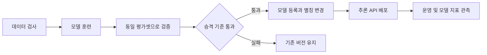
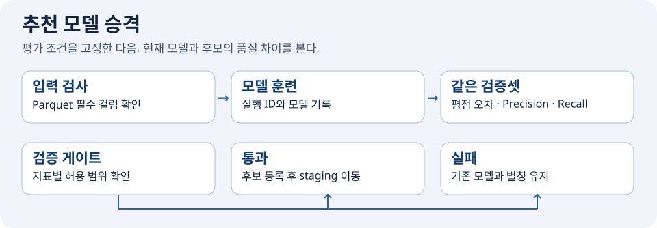
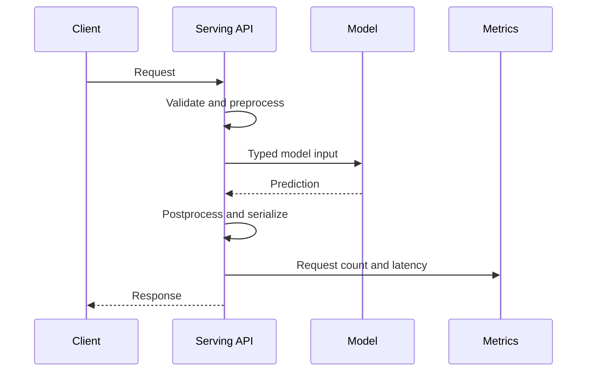
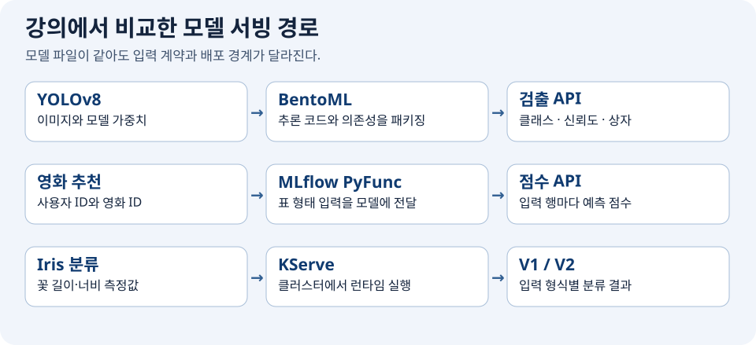
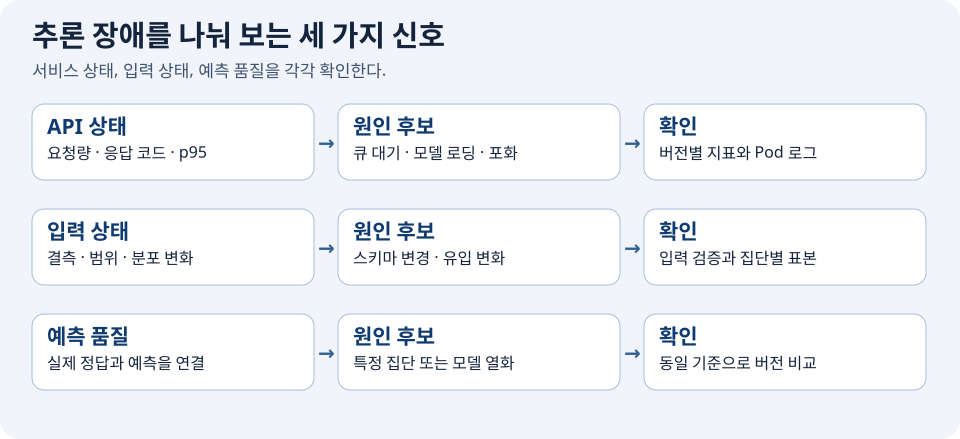
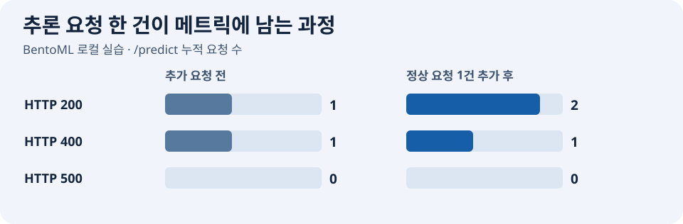

# 모델 추론과 서빙, 모니터링과 설명 가능성

> CH10–11 학습 정리. 모델 서빙 방식과 운영 중 품질 저하를 확인하는 방법을 살펴본다.

온라인 추론은 모델 파일을 HTTP 뒤에 두는 것으로 끝나지 않는다. 어떤 학습 실행에서 나온 파일인지, 어떤 입력 형식을 받는지, 이전 모델로 어떻게 돌아갈지 확인할 수 있어야 한다. 이번 강의에서는 앞 회차의 두 예제를 이어 쓴다. YOLO는 이미지 입력과 객체 검출 응답을 보여주고, 영화 추천 예제는 데이터 검사부터 실험 추적, 모델 등록, 점수 반환까지 연결한다. Iris 예제는 Kubernetes에서 추론 엔드포인트의 준비 상태와 프로토콜을 확인하는 데 쓴다.



## 개요

| 범위 | 강의에서 확인한 것 | 본문에서 이어서 검증할 것 |
| --- | --- | --- |
| CH9 보충 | PVC의 TensorBoard 이벤트, 영화 추천 모델 학습과 등록 | 데이터 품질 검사와 후보 모델 승격을 분리하는 이유 |
| CH10 | YOLO Bento, 영화 추천 PyFunc, Iris InferenceService | 이미지·표·텐서의 입력 계약과 버전별 배포 판단 |
| CH11 | 모니터링과 설명 가능성의 구성 | 모델 서비스 지표, 입력 변화, 정답 기반 품질을 따로 측정하는 방법 |
| 로컬 실습 | 강의의 요청·프로브·메트릭 관찰을 작은 예제로 재현 | 정상 응답, 입력 오류, 서버 준비와 요청 계측 확인 |

4주차에서는 데이터 준비, 훈련과 검증, PVC를 이용한 파일 전달을 따라갔다. 그 작업의 산출물은 가중치와 지표다. 5주차에서는 가중치를 선택한 근거를 남기고, 요청을 받을 수 있는 API로 감싼 뒤, 배포 후에도 같은 품질이 유지되는지 검증한다. 실습은 로컬에서 재현한 것과 강의 클러스터 시연을 구분해 기록했다.

### 두 예제에서 전달되는 데이터

- **YOLO 경로.** 학습에는 이미지와 바운딩 박스 라벨을 사용한다. 추론에는 이미지가 들어오고, 응답에는 검출 클래스, 신뢰도, 상자 좌표가 들어간다. 훈련 파일의 위치는 배포 시 모델 아티팩트 위치로 이어져야 한다.
- **영화 추천 경로.** 학습에는 사용자·영화·평점의 상호작용을 사용한다. 온라인 모델 호출은 사용자와 영화 쌍의 점수를 반환한다. 모델 점수와 최종 추천 목록을 구분하면 후보 검색, 필터링, 점수 계산 중 어느 단계가 느리거나 부정확한지 분석할 수 있다.
- **Iris 경로.** 같은 분류 문제라도 BentoML 입력은 API 메서드의 인자이고, KServe V2 입력은 이름·자료형·모양을 가진 텐서다. 모델 코드가 같은 경우에도 호출 방법과 HTTP 오류 처리는 달라질 수 있다.

## CH9 보충. 훈련 추적에서 모델 등록까지

강의 첫 영상은 지난 회차의 YOLO 훈련과 영화 추천 파이프라인을 이어서 다룬다. YOLO 예제에서는 Kubeflow 파이프라인이 만든 PVC(PersistentVolumeClaim)에 훈련 결과를 남기고, TensorBoard가 같은 PVC를 로그 경로로 읽는다. TensorBoard는 한 실행의 손실 곡선과 훈련 과정을 살피는 데 쓰고, MLflow는 실행별 파라미터, 지표, 모델 아티팩트를 기록하고 비교하는 데 쓴다. (영상 1, 00:05–00:10)

영화 추천 예제의 데이터 품질 검사는 MinIO에 저장한 학습용 Parquet를 읽어 `user_id`, `item_id`, `rating`이 모두 있는지 확인한다. 이 검사는 입력 스키마 누락을 조기에 잡는다. 결측률과 값 범위까지 검증하려면 별도 조건이 필요하다. (영상 1, 00:20)

학습이 끝나면 MLflow의 `staging` 별칭이 가리키는 모델과 후보 모델을 비교한다. 오차와 Precision@50, Recall@50의 변화량을 허용 기준에 대조하고, 통과한 후보를 등록한 뒤 별칭을 옮긴다. 지표마다 좋은 방향이 다르므로 오차의 증가와 정밀도·재현율의 감소를 구분해서 판단해야 한다. 파이프라인 실행 성공은 작업이 끝났다는 신호이고, 모델 승격 여부는 품질 검증 결과로 따로 확인한다. (영상 1, 00:35, 01:00)

### TensorBoard가 뜨는데 그래프가 없을 때

Kubeflow 화면에서 TensorBoard 인스턴스가 실행 중이어도 이벤트 파일을 읽고 있다는 뜻은 아니다. 훈련 프로세스가 이벤트를 실제로 기록했는지, 이벤트가 컨테이너 내부 임시 경로에 남지 않았는지, TensorBoard가 같은 네임스페이스의 PVC와 올바른 하위 경로를 읽는지 순서대로 본다. 훈련 Pod가 종료된 뒤에도 로그를 보려면 훈련 프로세스와 뷰어가 공유하는 저장 경로가 필요하다.

### 이벤트 파일과 추적 서버를 분리해서 확인하기

| 확인 단계 | 기대 상태 | 화면에 그래프가 없을 때 |
| --- | --- | --- |
| 학습 코드가 쓰는 경로 | 실행별 하위 폴더에 이벤트 파일이 존재 | 훈련 설정의 로그 경로와 쓰기 권한을 확인한다. |
| PVC 연결 | 훈련 Pod와 TensorBoard가 같은 볼륨을 참조 | PVC 이름·네임스페이스·마운트 경로를 비교한다. |
| TensorBoard 탐색 | 올바른 run과 scalar가 보인다 | 예전 실행의 하위 경로를 읽고 있지 않은지 확인한다. |
| MLflow 실행 기록 | 실행 ID로 파라미터와 아티팩트를 찾을 수 있다 | 추적 URI와 모델 등록에 넘긴 실행 ID를 대조한다. |

PVC의 파일과 MLflow 실행은 서로 다른 수명주기를 갖는다. 파이프라인 실행 후 Pod를 지워도 PVC의 로그가 남을 수 있고, PVC를 삭제하면 레지스트리의 실행 기록이 남아 있어도 원본 이벤트 파일을 다시 읽을 수 없다. 훈련 재시도를 분석할 때는 기존 로그를 덮어쓰는 고정 경로 대신 실행마다 구분되는 경로가 유용하다.

### 검증용 데이터가 갖춰야 하는 조건

강의의 Parquet 검사는 필요한 컬럼 존재를 확인하는 작은 품질 게이트다. 운영 파이프라인에서 확장한다면 컬럼명만 맞는 경우와 데이터가 실제로 쓸 수 있는 경우를 구분한다. 예를 들어 평점 열이 문자열이거나, 한 사용자·영화 쌍이 여러 번 들어오거나, 온라인 서빙이 모르는 ID가 검증셋에 섞이면 단순 컬럼 검사를 통과한 뒤에도 지표가 흔들린다.

| 검사 | 실패 예 | 처리 기준 |
| --- | --- | --- |
| 스키마 | 평점 열 누락, ID 자료형 변경 | 학습 시작 전에 실패시킨다. |
| 값의 범위 | 평점의 허용 구간 벗어남 | 데이터 버전과 오류 행 수를 남긴다. |
| 키와 중복 | 같은 사용자·영화의 행이 중복 | 최신 상호작용을 쓸지, 집계할지 명시한다. |
| 학습과 검증 분리 | 동일 상호작용이 양쪽에 존재 | 모델 비교 전에 분할 기준과 누수를 점검한다. |
| 미등록 ID | 검증에만 등장하는 신규 사용자 | 신규 집단을 분리하고 폴백 정책도 평가한다. |

### 영화 추천 모델에 검증 게이트를 두는 이유

행렬 분해 예제에서는 사용자와 영화 ID의 임베딩으로 선호 점수를 예측한다. 평점 오차는 관측된 평점에 얼마나 가까운지 나타내고, Precision@50과 Recall@50은 추천 목록 앞쪽에 관련 영화가 얼마나 잘 들어가는지 본다. 평점 오차가 줄어도 상위 목록의 품질은 떨어질 수 있다. 따라서 세 지표를 함께 비교한다.

| 지표 | 비교할 값 | 허용 기준 예시 |
| --- | --- | --- |
| 평점 오차 | 후보 오차 − 현재 오차 | 증가 폭이 허용치 이내 |
| Precision@50 | 후보 정밀도 − 현재 정밀도 | 감소 폭이 허용치 이내 |
| Recall@50 | 후보 재현율 − 현재 재현율 | 감소 폭이 허용치 이내 |

운영에서 이 비교를 적용하려면 두 버전을 같은 데이터 분할과 같은 지표 구현으로 평가하고, 비교에 쓴 실행 ID와 모델 버전을 남긴다. 검증이 실패하면 기존 별칭을 유지한다. 동시에 여러 후보를 평가하는 경우에는 결과를 반영하기 직전에 비교 대상 버전이 바뀌었는지도 확인한다. 첫 등록처럼 비교할 버전이 없는 경우에는 별도의 초기 등록 기준을 둔다.



*후보가 기준을 통과하면 staging 별칭을 옮기고, 실패하면 기존 버전을 유지한다.*

## CH10. 모델 추론과 서빙

온라인 추론은 요청마다 응답을 반환한다. 전처리와 후처리까지 전체 응답 시간에 포함해야 한다. 배치 추론은 입력을 모아서 처리하므로 처리량과 실패한 작업의 재시도, 중복 처리 방지가 중요하다.

| 도구 | 역할 | 점검 항목 |
| --- | --- | --- |
| MLflow | 모델과 버전을 등록하고 표준 모델 형식으로 추론 서버를 띄운다. | 입력 스키마와 패키지 버전 |
| BentoML | 모델과 전후처리를 API 서비스로 묶는다. | 동시 요청과 배치 크기에 따른 응답 시간 |
| KServe | Kubernetes에서 모델 서빙을 선언하고 운영한다. | 런타임과 배포 모드별 확장 및 트래픽 기능 |

### 추론 경로의 시간 예산

온라인 API에서 지연 시간은 모델 계산 시간보다 넓은 개념이다. 요청이 대기하는 시간, 이미지나 JSON을 변환하는 시간, 모델 계산 시간, 응답을 직렬화하는 시간이 모두 포함된다. 예를 들어 120ms짜리 요청에서 모델이 30ms만 쓴다면 모델 최적화만으로는 이미지를 읽고 변환하는 비용을 줄일 수 없다. 요청 전체와 단계별 시간을 함께 본다.



### 배치가 유리한 조건과 피해야 할 조건

오프라인 배치 추론은 입력에 처리 시각과 모델 버전을 기록하고, 같은 데이터의 재시도가 결과를 중복 생성하지 않게 해야 한다. 반대로 온라인 동적 배치는 처리량을 높일 수 있지만 첫 요청이 다음 요청을 기다리는 비용이 생긴다. 요청이 드물거나 응답 시간 제한이 짧으면 최대 대기 시간을 제한하고, 입력 크기가 제각각이면 하나의 큰 요청이 다른 요청의 지연에 주는 영향을 확인한다.

| 관측 항목 | 배치가 작을 때 | 배치가 커질 때 |
| --- | --- | --- |
| 처리량 | 장치 활용이 낮을 수 있다. | 입력이 충분할 때 동시 처리량이 개선될 수 있다. |
| 대기 시간 | 요청이 빠르게 실행된다. | 배치가 채워지는 시간이 추가된다. |
| 메모리 | 동시 입력 크기가 제한된다. | 큰 입력이 겹치면 메모리 사용량이 급증할 수 있다. |
| 검증 방법 | 단건 요청의 기준 시간을 측정한다. | 같은 입력 분포에서 처리량·p95·실패율을 비교한다. |

### 강의에서 비교한 세 가지 서빙 경로

- **YOLO와 BentoML**. 이미지 한 장을 받아 YOLOv8을 실행하고 검출 결과를 JSON으로 반환한다. 시연 속 Runner 메서드는 배치를 비활성화했다. 서비스 코드와 가중치, 의존성을 Bento로 묶고 컨테이너 이미지까지 빌드하는 흐름을 보여준다. 강의의 Runner 코드는 당시 API이므로 재현할 때는 강의 버전을 고정하거나 현재 SDK에 맞게 수정한다. (영상 2, 00:20, 00:35)
- **영화 추천과 MLflow**. 추천 모델을 PyFunc 형식으로 감싸고 `mlflow models serve`로 기동한다. `/invocations`에 `dataframe_split` 형식으로 사용자와 영화 쌍을 보내 두 예측값이 돌아오는지 확인했다. 이 호출은 입력 스키마와 응답 계약을 검증하는 스모크 테스트이고, 추천 품질은 정답이 있는 평가셋에서 따로 검증한다. (영상 2, 00:50)
- **KServe와 Iris 분류**. Kubernetes에서 InferenceService의 Ready 상태와 예측 Pod의 상태를 확인하고, 포트 포워딩으로 V1과 V2 추론 API를 호출한다. V1은 `instances` 배열을, V2는 입력 이름, 모양, 자료형을 포함한 `inputs` 배열을 사용한다. 리소스 생성, 준비 상태, 실제 요청 성공을 나눠 확인하면 어디에서 문제가 생겼는지 좁힐 수 있다. (영상 2, 00:55)



*실습별로 입력에서 응답까지 어디를 검증하는지 비교한다.*

### 언제 어느 경로를 쓰는가

| 상황 | 시작점 | 선택한 뒤 남는 일 |
| --- | --- | --- |
| 레지스트리에 이미 모델이 있고 입력이 표로 표현된다 | MLflow PyFunc | 모델 서명과 실행 환경을 고정하고 API 계약을 검증한다. |
| 이미지 디코딩, 여러 모델 호출, JSON 변환이 한 API에 들어간다 | BentoML | API 계약, 배포 이미지, 동시성 설정을 함께 관리한다. |
| Kubernetes에 여러 모델을 같은 방식으로 배포한다 | KServe | 클러스터의 런타임, 스토리지 권한과 트래픽 정책을 확인한다. |

영화 추천에서는 MLflow에 등록된 모델을 BentoML이 읽어서 서비스로 감쌀 수도 있다. 등록된 모델을 어떤 도구로 실행할지는 별개의 결정이다. 강의에서는 레지스트리의 모델 별칭을 조회한 뒤 서빙하는 흐름과 PyFunc만으로 호출하는 흐름이 모두 나온다. 배포 기록에는 이동 가능한 별칭과 함께 당시의 실제 버전을 남겨야 한다. 별칭만 저장하면 나중에 같은 설정으로 재시작해도 다른 모델을 읽을 수 있다. (영상 2, 00:09–00:11, 00:40–00:50)

### BentoML에서 이미지 한 장이 응답이 되기까지

강의의 객체 검출 서비스에서는 시작 시 가중치를 로드하고, 요청마다 이미지를 모델에 넘긴 뒤 결과를 JSON으로 바꾼다. 모델을 시작 시점에 읽으면 요청마다 가중치를 다시 여는 비용을 피할 수 있다. 대신 초기 로딩이 끝날 때까지 준비 상태를 기다려야 한다. 이미지 형식과 크기 제한을 API 경계에서 검증하고, 검출 결과가 없는 정상 응답과 입력 오류를 구분하면 클라이언트가 두 상황을 다르게 처리할 수 있다.

로컬 서빙으로 API가 열리는지 확인한 다음 Bento 빌드와 컨테이너화로 넘어간다. 컨테이너에서는 가중치가 패키지에 포함됐는지, CPU/GPU에 맞는 런타임인지, 내보낸 포트에서 같은 입력으로 결과가 돌아오는지 확인한다. 자동 배치를 도입한다면 처리량뿐 아니라 배치가 채워질 때까지 기다리는 시간도 p95 지연에 포함한다.

### Bento 파일에서 컨테이너까지

강의에서는 로컬 실행 이후 서비스를 Bento로 빌드하고 다시 컨테이너 이미지로 만든다. 서비스 코드 외에 모델 가중치, 파이썬 의존성, API 정의가 패키지에 포함되는지 확인하는 흐름이다. 이미지가 빌드됐다는 사실만으로 엔트리포인트의 모델 경로가 올바르다는 보장은 없다. 새 환경에서 서버를 기동하고 로컬에서 성공한 요청을 같은 입력으로 보내 일치하는 응답을 확인한다.

```bash
bentoml build
bentoml list
bentoml containerize <bento-tag>
```

명령의 태그는 직전 빌드가 출력한 값을 사용한다. 강의의 YOLO 예제는 당시 Runner 기반 API를 사용한다. 아래 로컬 분류 실습은 클래스 기반 서비스로 작성했으며, 버전을 섞어서 코드를 그대로 재사용할 수 있다고 가정하지 않는다.

| 증상 | 먼저 점검할 곳 | 확인 기준 |
| --- | --- | --- |
| 개발 환경에서만 성공 | 서비스의 상대 경로와 빌드 포함 목록 | 컨테이너 안에서 모델 파일이 보인다. |
| 새 환경에서 import 실패 | Python과 라이브러리 버전, CPU/GPU 빌드 | 설치 환경을 다시 만들 수 있다. |
| 로컬 서버는 열리지만 컨테이너 호출 실패 | 포트 매핑과 리슨 주소 | 외부 테스트 클라이언트가 준비 상태와 예측을 확인한다. |
| 응답 구조가 달라짐 | 전후처리와 모델 아티팩트 버전 | 고정한 샘플 입력에서 응답 스키마가 유지된다. |

### 모델이 살아 있는지와 요청을 받을 수 있는지

강의는 로컬 BentoML 서버의 프로브와 Prometheus 메트릭 엔드포인트를 호출한 뒤, 이미지 추론을 보내 카운터가 달라지는 것을 확인한다. (영상 2, 00:24–00:30)

| 신호 | 답하는 질문 | 실패했을 때 |
| --- | --- | --- |
| Liveness | 프로세스가 응답하는가 | 멈춘 프로세스의 재시작 여부를 판단한다. |
| Readiness | 지금 새 요청을 받아도 되는가 | 준비가 끝날 때까지 트래픽에서 제외한다. |
| Startup probe | 초기 모델 로딩이 끝났는가 | 느린 시작을 허용하는 별도의 시간 예산을 둔다. |
| 추론 스모크 테스트 | 계약에 맞는 입력이 실제 예측을 반환하는가 | 모델 파일, 요청 스키마, 전후처리를 점검한다. |

모델 다운로드에 시간이 걸리는 환경에서 초기 로딩 실패를 곧바로 liveness 실패로 다루면, 모델을 가져오기 전에 재시작하는 문제가 생길 수 있다. 반대로 프로브가 응답해도 잘못된 버전의 모델을 띄웠을 수 있다. 배포 직후에 정상 입력 하나와 잘못된 입력 하나를 호출하고 각각 예측과 명시적 입력 오류를 확인한다.

### MLflow 추천 API 요청 형식

아래는 강의 화면의 MLflow 요청을 축약한 예시다. 한 행이 사용자와 영화 한 쌍이다. 모델과 API가 기대하는 컬럼명은 모델 서명과 맞춰야 한다.

```bash
curl -fsS http://localhost:5200/invocations \
  -H 'Content-Type: application/json' \
  -d '{"dataframe_split":{"columns":["user","movie"],"data":[[49,99],[49,199]]}}'
```

응답의 `predictions`에는 두 입력 행에 대응하는 점수가 들어간다. 이 호출은 점수 반환을 확인한다. 후보 영화 검색, 이미 본 영화 제거, 점수 정렬과 상위 K개 선택은 API가 점수만 반환한다면 별도의 추천 흐름에서 처리해야 한다. PyFunc 래퍼에 전처리가 들어 있다면 학습과 서빙에서 ID 인코딩이 동일한지도 확인한다.

### KServe의 준비 상태와 V1·V2 호출

```bash
kubectl -n "$NS" get inferenceservice,pod,hpa
kubectl -n "$NS" port-forward svc/sklearn-iris-predictor 8081:80
```

강의의 Iris 예제는 꽃 한 개당 네 개의 수치를 받는다. V1의 요청 바디는 `{"instances":[[6.8,2.8,4.8,1.4]]}`처럼 행 배열로 표현한다. V2는 같은 값을 텐서로 표현하며 입력 이름은 런타임 메타데이터와 일치시킨다. 예제 런타임은 `input-0`, `FP32`, `shape:[1,4]`를 사용한다. 같은 모델을 두 프로토콜로 테스트할 때는 반환 구조가 달라도 분류 결과가 일치하는지 본다.

Ready가 false이면 InferenceService 조건과 Pod 이벤트를 먼저 읽는다. 모델 저장소에서 아티팩트를 받지 못했다면 초기화 컨테이너와 저장소 설정을 확인한다. Pod가 준비됐는데 호출이 실패하면 엔드포인트 경로, 프로토콜, 데이터 타입과 텐서 모양을 확인한다. 포트 포워딩 성공 자체는 추론 성공의 증거가 아니므로 정상 입력으로 응답까지 확인한다.

새 모델은 동일한 평가 데이터로 기존 모델과 비교한다. 운영에서는 일부 요청부터 새 버전에 보내고 오류율과 p95 지연 시간을 비교한다. 정답이 나중에 수집되는 서비스는 초기에는 운영 지표로 이상을 감지하고, 정답이 쌓인 뒤 예측 품질을 평가한다.

### 같은 꽃을 두 프로토콜로 호출

강의 화면의 Iris 요청을 입력 한 건으로 줄인 예시다. 아래 명령은 앞서 포트 포워딩한 환경을 전제로 한다. 강의에서는 두 프로토콜 모두 예측을 반환했다. 이 명령을 로컬 Kubernetes에서 다시 실행하지는 않았다.

```bash
BASE=http://127.0.0.1:8081
curl -fsS "$BASE/v1/models/sklearn-iris:predict" \
  -H 'Content-Type: application/json' \
  -d '{"instances":[[6.8,2.8,4.8,1.4]]}'

curl -fsS "$BASE/v2/models/sklearn-iris/infer" \
  -H 'Content-Type: application/json' \
  -d '{"inputs":[{"name":"input-0","shape":[1,4],"datatype":"FP32","data":[6.8,2.8,4.8,1.4]}]}'
```

V2 요청에서 첫 번째 차원은 행 수이고 두 번째 차원은 행마다 들어가는 특성 수다. 두 꽃을 보내려면 모양은 `[2,4]`이고 값은 총 여덟 개다. 입력 이름과 자료형은 대상 런타임 모델의 메타데이터를 확인해 사용한다. 응답을 비교할 때는 JSON 전체의 동일성을 검사하기보다 각 형식에서 분류 결과를 꺼내 입력 순서와 맞춘다.

### Kubernetes에서 배포 결과를 읽는 순서

```bash
kubectl -n "$NS" describe inferenceservice sklearn-iris
kubectl -n "$NS" get pods
kubectl -n "$NS" describe pod "$POD"
kubectl -n "$NS" logs "$POD" -c "$CONTAINER"
```

`$POD`와 `$CONTAINER`는 실제 생성된 리소스에서 확인한다. 모델을 받아오는 컨테이너가 실패한 경우와 모델 서버에서 로딩에 실패한 경우의 로그가 다르다. 파드가 Pending이면 리소스 요청, 노드 배치와 볼륨 상태를 먼저 본다. Running인데 Ready가 아니면 프로브 실패와 모델 초기화를 확인한다. 준비가 끝났는데 특정 클라이언트만 실패하면 V1과 V2의 경로, 입력 이름, 자료형, 행 수를 맞춰 본다.

| 단계 | 확인 증거 | 아직 검증하지 못한 것 |
| --- | --- | --- |
| 리소스 적용 | InferenceService가 조회된다. | 모델 로딩 또는 요청 응답 |
| 런타임 준비 | Ready 조건이 True이고 Pod가 준비된다. | API 계약과 모델 버전 |
| 샘플 호출 | 계약에 맞는 예측을 반환한다. | 용량, 평가 품질, 오류 시 대응 |
| 운영 전환 | 버전별 오류율과 지연 시간을 관찰한다. | 정답이 지연되는 서비스의 실제 장기 품질 |

## CH11. 모니터링과 설명 가능성

서빙 상태는 요청량, 오류율, 지연 시간으로 확인한다. 입력 품질은 결측률, 범위 위반, 학습 데이터 대비 분포 변화로 확인한다. 예측 품질은 예측과 실제 결과를 연결해 평가하고 주요 집단별 지표도 비교한다.

입력 분포의 변화는 데이터 드리프트다. 입력과 정답의 관계가 바뀌는 개념 드리프트는 실제 결과를 확보해 확인해야 한다. 드리프트 경보가 울리면 먼저 파이프라인 변경과 계절 효과를 점검하고, 품질 저하가 확인되면 재학습이나 롤백을 검토한다.

SHAP은 각 특성이 기준 출력 대비 개별 예측값을 어느 방향으로 움직였는지 보여준다. 예를 들어 점수가 갑자기 높아진 요청에서 결측값 표시 특성의 기여도가 커졌다면 전처리 경로를 조사할 수 있다. 이 기여도만으로 인과관계를 판단할 수는 없다.

### 장애 신호에서 원인까지 좁히기

| 신호 | 먼저 확인할 항목 | 다음 확인 |
| --- | --- | --- |
| 4xx 급증 | 요청 스키마 변경과 필수 필드 누락 | 영향받은 클라이언트 버전과 실패 요청의 구조 |
| 5xx·p95 동반 상승 | 최근 모델 배포, Pod 재시작, CPU/GPU 포화 | 배치 대기, 큐 길이, 모델 로딩과 의존 서비스 |
| 입력 분포 변화 | 누락률, 계절 효과, 특정 집단의 유입 변화 | 정답을 조인한 뒤 품질이 실제로 떨어졌는지 |
| 상위 추천 품질 저하 | 버전별 Precision@K·Recall@K | 후보군 변화, 피처 제공 시점, 평가 분모와 표본 수 |

요청 시간은 전처리, 모델 계산, 후처리로 나눠 계측하면 느려진 위치를 찾기 쉽다. 모델 버전과 경로처럼 값의 개수가 제한적인 항목은 지표 라벨로 사용한다. 사용자 ID와 요청 ID처럼 값이 많은 항목은 지표 라벨에 넣으면 시계열 수가 폭증한다. 개별 호출은 접근을 제한한 로그나 트레이스에서 확인한다.

모니터링은 평균 하나로 끝내기 어렵다. 예를 들어 입력 누락률이 증가했지만 오늘 정답은 아직 없다면 데이터 파이프라인 문제인지 먼저 조사한다. 정답이 도착하면 변경 전후 기간을 같은 기준으로 비교한다. 전체 지표가 안정적이어도 신규 사용자 집단에서만 추천 품질이 나빠질 수 있으므로, 집단별 표본 수와 함께 판단한다.



*같은 장애 조사를 하더라도 세 신호에서 확인하는 증거가 다르다.*

### 메트릭, 로그, 알림을 연결하기

추론 경로에서 상태 코드별 요청 수와 처리 시간 히스토그램을 수집한다. 요청 총량 없이 오류 건수만 보면 트래픽 증가와 장애를 구분하기 어렵다. 오류율은 같은 시간 창의 전체 요청을 분모로 쓰고, p95는 인스턴스별 백분위수를 평균 내기보다 호환되는 히스토그램 버킷을 합산해 계산한다. 임계값을 넘은 상태가 일정 시간 지속되는지와 최소 요청량을 함께 확인하면 작은 표본에 덜 흔들린다.

알림이 울리면 먼저 배포 시각, 모델 버전, 환경을 대조한다. 이어 로그에서 요청 식별자와 실패 위치를 찾아 같은 호출의 전처리·추론·후처리 시간을 비교한다. 이미지나 추천 입력 원문은 기본 로그에 남기지 않고, 조사에 필요한 범위에서 접근 제어와 보존 기간을 적용한다. 신호를 모을 때는 응답에 걸린 시간과 모델 계산에 걸린 시간을 분리한다. 모델 계산이 그대로라면 이미지 디코딩, 배치 대기, 큐잉을 확인할 수 있다.

### 알림을 만들기 전에 정할 기준

5xx의 비율에는 전체 요청 수가 필요하다. 예를 들어 10건 중 1건의 실패와 10만 건 중 1만 건의 실패는 모두 10%다. 사용자 영향과 조사 우선순위는 다르다. 알림에는 실패율뿐 아니라 호출량, 지속 시간, 환경을 함께 넣는다. 작은 서비스에서는 절대 오류 건수를 같이 보면 유용하다.

```promql
sum(rate(bentoml_service_request_total{endpoint="/predict",http_response_code=~"5.."}[5m]))
/
sum(rate(bentoml_service_request_total{endpoint="/predict"}[5m]))
```

이 식은 로컬에서 이름을 확인한 카운터의 사용 예다. Prometheus 수집을 실제로 연결한 실습은 아니다. 운영에서는 트래픽이 0인 구간과 재시작, 같은 엔드포인트를 제공하는 여러 버전을 고려해 그룹과 최소 표본 조건을 결정한다. 지연 시간은 필요하면 서비스와 모델 버전별로 히스토그램을 집계한다.

### 드리프트와 품질 저하의 조사 순서

1. 비교할 기간, 모델 버전, 입력 스키마를 맞춘다.
2. 결측·범위 위반을 확인해 수집 장애와 실제 고객 분포 변화를 구분한다.
3. 분포가 바뀐 특성과 영향을 받는 집단을 찾고, 표본 수를 함께 본다.
4. 정답이 들어오는 시점에 예측과 조인하고 같은 기간 안에서 모델 품질을 계산한다.
5. 롤백, 전처리 수정, 재학습 중 어떤 조치가 맞는지 원인에 따라 결정한다.

예를 들어 신규 사용자가 늘면 영화 추천 입력의 사용자 ID 분포는 바뀐다. 그러나 신규 사용자의 추천 지표를 별도로 보면, 전체 지표 하락이 모델 변경 때문인지 구성 비율 변화 때문인지 좁힐 수 있다. 정답이 아직 없다면 분포 경보를 조사 근거로 사용하고 품질 하락 여부는 미확인으로 남긴다.

### 설명 가능성을 정기 분석에 연결하기

개별 SHAP 설명은 이상 사례를 조사할 때 사용한다. 전체 특성 중요도는 여러 사례의 절대 기여도를 집계해 반복되는 패턴을 본다. 비교 기간마다 기준 데이터가 달라지면 기여도 차이를 해석하기 어려우므로 비교 기준을 기록한다. 비슷한 특성이 여럿이면 기여도가 나뉠 수 있다. 설명이 예상과 다를 때는 입력 품질과 데이터 누수를 점검하고 실제 오류 사례와 함께 판단한다.

### 예시로 보는 전역 설명과 개별 설명

한 요청의 추천 점수가 낮아졌을 때는 개별 설명을 열어 어떤 특성이 점수를 아래로 움직였는지 본다. 여러 요청에서 같은 현상이 반복되는지 확인할 때는 전체 표본의 절대 기여도를 집계한다. 전역 집계에서는 방향이 사라지므로, 값이 큰 특성이 점수를 항상 높이는지 여부는 집계만으로 알 수 없다. 필요하면 개별 설명과 특성 값의 분포를 함께 확인한다.

설명은 운영상 원인을 찾기 위한 가설이다. 예를 들어 알 수 없는 사용자에서 특정 기여도가 반복적으로 튄다면, 그 특성이 원인임을 단정하기 전에 입력이 어느 값으로 대체되는지와 학습 당시에도 같은 처리를 했는지 확인한다. 해석 기준 데이터와 모델 버전이 바뀌면 기여도 역시 달라지므로 비교에 쓴 기준을 기록한다.

## 로컬 실습. 추론 요청에서 Prometheus 지표까지

강의의 BentoML 프로브와 메트릭 시연을 재현하기 위해, YOLO 대신 작은 Iris 분류 모델을 사용했다. Python 3.10, BentoML 1.4.40, scikit-learn 1.7.2 환경에서 API 계약과 요청 계측을 확인했다. 모델은 서버 시작 시 내장 Iris 데이터로 학습한다. 이 실습의 검증 대상은 API이며, 모델 정확도나 운영 부하 성능은 평가하지 않았다.

### 서비스 작성

서로 다른 필드를 배열로 받는 API에서는 값의 순서도 계약의 일부다. 예제는 꽃받침 길이·너비, 꽃잎 길이·너비 순서로 실수 네 개를 받는다. Pydantic의 길이 제약을 적용해 모델 호출 전에 잘못된 모양을 걸러낸다.

```python title="service.py"
from typing import Annotated

import bentoml
from pydantic import Field
from sklearn.datasets import load_iris
from sklearn.tree import DecisionTreeClassifier

Features = Annotated[list[float], Field(min_length=4, max_length=4)]


@bentoml.service
class IrisService:
    def __init__(self):
        iris = load_iris()
        self.model = DecisionTreeClassifier(max_depth=3, random_state=42)
        self.model.fit(iris.data, iris.target)
        self.classes = iris.target_names.tolist()

    @bentoml.api
    def predict(self, features: Features) -> dict[str, str]:
        class_id = int(self.model.predict([features])[0])
        return {"species": self.classes[class_id]}
```

### 서버 시작과 프로브 확인

```bash
python -m pip install 'bentoml==1.4.40' 'scikit-learn==1.7.2'
BENTOML_DO_NOT_TRACK=True bentoml serve service:IrisService --host 127.0.0.1 --port 39125
```

다른 터미널에서 다음 명령을 실행한다. 이번 로컬 실습에서는 두 프로브 모두 HTTP 200을 반환했다.

```bash
BASE=http://127.0.0.1:39125
for probe in livez readyz; do
  curl -sS -o /dev/null -w "$probe %{http_code}\n" "$BASE/$probe"
done
```

### 정상 입력과 잘못된 입력 비교

```bash
curl -sS -w '\nHTTP %{http_code}\n' "$BASE/predict" \
  -H 'Content-Type: application/json' \
  -d '{"features":[5.1,3.5,1.4,0.2]}'

curl -sS -w '\nHTTP %{http_code}\n' "$BASE/predict" \
  -H 'Content-Type: application/json' \
  -d '{"features":[5.1,3.5,1.4]}'
```

| 확인 항목 | 관측 결과 |
| --- | --- |
| 값 4개를 넣은 정상 요청 | HTTP 200, `{"species":"setosa"}` |
| 값 3개를 넣은 요청 | HTTP 400, `features`에 대한 `too_short` 검증 오류 |
| 정상 요청 한 건 추가 | `/predict`의 200 카운터가 1에서 2로 증가 |
| 같은 시간 창의 실패 요청 | 400 카운터가 1로 유지되고 500 카운터는 0 |



*직접 실행한 실습에서 정상 요청 한 건을 더 보내자 200 카운터만 1 증가했다.*

### 요청 카운터 확인

```bash
curl -fsS "$BASE/metrics" |
  grep '^bentoml_service_request_total{' |
  grep 'endpoint="/predict"'
```

실습에서 400은 서버가 살아 있고 입력 계약을 검사한다는 증거다. 이 호출을 가용성 경보의 5xx에 포함하면 클라이언트의 잘못된 입력을 서비스 장애로 집계하게 된다. 400과 500을 분리하되, 400이 배포 직후 급증한다면 API 호환성 변경을 의심할 수 있다. 카운터의 절댓값은 프로세스 재시작 시 바뀌므로, 운영에서는 지정 시간 창의 증가율을 비교한다.

## 로컬 실습 2. MLflow PyFunc의 입력 계약

강의의 영화 추천 호출은 사용자·영화 쌍을 표로 받아 행마다 점수를 반환한다. 로컬에서는 영화 데이터셋과 훈련 환경 없이도 이 계약을 검증할 수 있도록, 사용자와 영화에 정해진 편향값을 부여한 작은 모델을 사용했다. 아래 수치는 로컬 점수 함수의 결과다. 강의의 실제 추천 모델 성능을 나타내지 않는다.

### 모델을 내보내고 서명을 기록하기

모델 파일만 따로 전달하면 배포 담당자는 어떤 이름과 타입의 입력을 보내야 하는지 알 수 없다. 모델과 함께 저장하는 서명은 이 정보를 서빙 런타임에서 검사할 수 있게 한다. 예제는 열 두 개를 정수로 받고, 입력 행마다 점수를 하나씩 돌려준다.

```python title="export_model.py"
import mlflow.pyfunc
import pandas as pd
from mlflow.models import infer_signature


class Recommender(mlflow.pyfunc.PythonModel):
    def predict(self, context, model_input):
        users = {49: 0.3, 50: -0.2}
        movies = {99: 0.5, 199: -0.1}
        return (
            3.0
            + model_input["user"].map(users).fillna(0.0)
            + model_input["movie"].map(movies).fillna(0.0)
        ).round(1).tolist()


example = pd.DataFrame({"user": [49, 49], "movie": [99, 199]})
mlflow.pyfunc.save_model(
    path="reco_pyfunc",
    python_model=Recommender(),
    signature=infer_signature(example, [3.8, 3.2]),
    input_example=example,
    pip_requirements=["mlflow-skinny==3.10.1", "pandas==2.3.3"],
)
```

이 데이터에서는 사용자 49의 편향이 +0.3이고 영화 99와 199의 편향이 각각 +0.5, −0.1이다. 기준값 3.0에 더하면 3.8과 3.2가 된다. `fillna(0.0)`은 알려지지 않은 **정수 ID**에 적용하는 폴백이다. 열이 없거나 문자열을 정수로 읽지 못하는 호출은 점수 함수에 전달되기 전에 서명 검사에서 거절된다.

### 환경을 고정하고 로컬 서버 기동

다음은 별도의 가상환경에 설치한 조합이다. 가상환경을 활성화해야 서빙 명령이 그 환경의 Uvicorn을 실행한다.

```bash
python3 -m venv .venv
source .venv/bin/activate
python -m pip install 'mlflow-skinny==3.10.1' 'pandas==2.3.3' \
  'fastapi==0.115.14' uvicorn
export MLFLOW_TRACKING_URI="file:$PWD/mlruns"
python export_model.py
mlflow models serve -m reco_pyfunc --env-manager local \
  --host 127.0.0.1 --port 39126
```

실행 중 최신 FastAPI와의 조합에서 MLflow 서버가 `app.route`를 찾지 못해 시작되지 않았다. 위 버전으로 고정한 뒤 같은 모델 폴더를 다시 로드해 `/ping`에서 200을 확인했다. 로컬 파일 추적 URI를 사용했으므로 이 실습은 외부 레지스트리 연결을 요구하지 않는다.

### 정상·누락·타입 오류 호출

```bash
BASE=http://127.0.0.1:39126
curl -sS -o /dev/null -w 'health %{http_code}\n' "$BASE/ping"

for body in \
  '{"dataframe_split":{"columns":["user","movie"],"data":[[49,99],[49,199]]}}' \
  '{"dataframe_split":{"columns":["user"],"data":[[49]]}}' \
  '{"dataframe_split":{"columns":["user","movie"],"data":[["oops",99]]}}'
do
  curl -sS -w '\nHTTP %{http_code}\n' "$BASE/invocations" \
    -H 'Content-Type: application/json' -d "$body"
done
```

| 입력 | 관측 결과 | 검증한 것 |
| --- | --- | --- |
| 사용자 49와 영화 99·199 | 200, `[3.8, 3.2]` | 한 요청에서 입력 두 행의 점수가 같은 순서로 돌아온다. |
| 영화 컬럼 누락 | 400, 필수 입력 `movie` 누락 | 입력이 없는 상태로 점수를 내지 않는다. |
| 사용자를 `"oops"`로 전달 | 400, `int64` 변환 실패 | 컬럼명이 있어도 값의 자료형을 검사한다. |

### 두 로컬 실습을 비교하면

| 비교 | BentoML Iris | MLflow PyFunc 추천 |
| --- | --- | --- |
| 계약을 정의하는 곳 | API 메서드의 타입과 Pydantic 제약 | 모델에 저장한 MLflow 서명 |
| 정상 입력 | 실수 네 개 | 정수 ID 두 열 |
| 의도적으로 깨뜨린 입력 | 특성 길이가 3개 | 필수 컬럼 누락 또는 타입 변환 실패 |
| 준비 상태 | `/livez`, `/readyz` | `/ping` |
| 검증 범위 | 요청 수와 오류 코드가 메트릭에 남음 | 모델 아티팩트 로드와 입력 계약을 확인 |

YOLO나 실제 추천 모델로 바꾸어도 API에서 모델 호출과 오류 검증을 분리하는 방식은 이어진다. 단, 로컬 모델의 결과를 가지고 실제 서비스가 정확하거나 빠르다고 판단할 수는 없다. 실제 전환 전에는 아티팩트 버전과 운영 입력 분포를 고정한 별도 검증이 필요하다.

### 처음 재현할 때 자주 놓치는 지점

- **모델 내보내기가 실패한다.** `save_model`의 출력 디렉터리가 이미 있으면 새 경로를 사용한다. 기존 폴더에 덮어쓰면 비교할 이전 실험 결과를 잃기 쉽다.
- **CLI는 찾았지만 Uvicorn에서 import가 실패한다.** 가상환경을 활성화한 뒤 `command -v mlflow`와 `command -v uvicorn`이 같은 환경을 가리키는지 확인한다.
- **서버는 살아 있는데 호출이 400이다.** `/ping`과 `/invocations`는 다른 신호다. 서명을 읽고 열 이름, 열 개수, 자료형부터 맞춘다.
- **호출 결과가 나왔지만 추천 목록이 없다.** 여기서 반환하는 값은 전달받은 후보의 점수다. 어떤 영화가 후보인지와 상위 K 목록은 호출 측의 요구 사항에 맞게 별도 정의한다.

## 승격과 롤백 판단 예시

아래 값은 강의 자체의 측정값이 아니라, 모델 게이트를 리뷰하기 위한 예시다. 오차는 낮을수록, Precision@50과 Recall@50은 높을수록 좋다. 허용치는 각 지표에 대해 팀이 정한 값이며, 단위가 다른 지표의 차이를 더하지 않는다.

| 지표 | 기존 | 후보 A | 후보 B | 허용되는 악화 |
| --- | --- | --- | --- | --- |
| 평점 오차 | 0.90 | 0.88 | 0.86 | 최대 +0.02 |
| Precision@50 | 0.22 | 0.23 | 0.20 | 최대 −0.01 |
| Recall@50 | 0.40 | 0.39 | 0.41 | 최대 −0.02 |

후보 A는 오차와 정밀도가 개선됐고 재현율 감소가 허용 범위 안에 있다. 후보 B는 오차와 재현율이 좋아졌지만 정밀도가 0.02 낮아져 기준을 넘는다. 고친 모델이 한 지표를 개선했다는 이유만으로 다른 지표에서 허용한 손실을 넘겨서는 안 된다.

### 배포 전 점검

1. 평가셋 버전과 평가 코드 버전을 기록하고 기존 모델과 후보에 동일하게 사용한다.
2. 모델의 실제 버전, 학습 실행 ID, 아티팩트 위치를 기록한다.
3. 후보와 현재 버전의 API 입력 및 응답 필드를 비교한다.
4. 정상 입력, 빈 결과가 예상되는 입력, 잘못된 입력을 각각 준비한다.
5. 새 버전을 배포할 때 이전 버전의 모델 아티팩트가 여전히 사용 가능한지 확인한다.

### 전환 이후 점검

| 시점 | 확인할 것 | 판단 |
| --- | --- | --- |
| 준비 완료 직후 | 버전, 포트, 정상 요청 1건 | 동일한 서비스 주소에서 실제 예측이 돌아온다. |
| 일부 트래픽 전환 | 요청 수, 4xx·5xx, p95 | 기존 버전과 같은 시간 창에서 비교한다. |
| 첫 정답 수집 이후 | 지표·집단별 품질, 표본 수 | 지연됐던 품질 판정을 갱신한다. |
| 이상 발견 시 | 최근 모델 전환과 입력·의존성 변화 | 지표에 맞는 원인을 찾고 이전 버전 복구 여부를 결정한다. |

예측 결과를 재검증하려면 어느 버전이 어떤 요청을 처리했는지 나중에 알 수 있어야 한다. 별칭을 되돌리는 동작과 이미 떠 있는 서빙 프로세스를 이전 아티팩트로 되돌리는 동작도 구분한다. 운영 환경의 로딩 방식에 따라 프로세스 재시작이나 배포 갱신이 필요할 수 있다.

### 어떤 문제를 어디까지 확인했는가

- **로컬에서 실행 확인:** MLflow의 정상·누락·타입 오류 응답과 BentoML의 프로브·입력 검증·메트릭 변화.
- **강의 영상에서 확인:** KServe V1·V2 호출, YOLO Bento 패키징, 영화 추천 후보와 staging 비교 흐름.
- **이 글의 예시:** 승격 허용치 표, 운영 경보식, 배포 점검 순서. 운영 트래픽이나 실제 평가 데이터에서 측정한 결과는 포함하지 않았다.

## 문제를 재현할 때 확인할 순서

1. 학습 실행과 현재 배포가 가리키는 모델 버전을 맞춘다. 별칭과 함께 실제 모델 버전을 기록한다.
2. 로컬 서버에서 정상 입력과 실패 입력을 각각 보낸다. 프로브 응답, 추론 응답, 입력 검증 결과를 따로 본다.
3. 컨테이너나 Kubernetes로 옮긴 뒤 같은 입력을 다시 보낸다. 로컬에서만 성공하면 가중치 복사, 모델 저장소 접근, 서비스 포트와 런타임 종류를 확인한다.
4. 요청이 정상적으로 돌아오면 관측 경로를 검증한다. 테스트 요청이 카운터에 반영되고, 성공과 실패가 상태 코드로 분리되는지 확인한다.
5. 실제 품질을 평가할 때는 검증셋과 사용자 집단을 명시하고, 정답이 늦게 들어오는 경우 품질 판정을 보류한다.

## 마무리

같은 모델을 서빙하는 데도 모델의 출처, API 형식, 배포 환경에 따라 필요한 구성이 달라진다. 모델 등록에서는 같은 평가셋으로 후보와 현재 모델을 비교하고, 배포에서는 정상 요청이 실제로 예측값을 반환하는지 확인한다. 운영 지표는 장애 위치를 찾는 데 쓰고, 모델 품질은 정답과 연결해 별도로 평가한다.

## 참고

- 머신러닝 플랫폼 엔지니어링 CH9–11
- 11월 15일 스터디 강의 녹화 1·2편. 시연 내용과 위치를 확인했으며, 위 실행 결과는 강의 화면 기준이다.
- [MLflow](https://mlflow.org/docs/latest/)
- [BentoML](https://docs.bentoml.com/)
- [KServe](https://kserve.github.io/website/)
- [SHAP](https://shap.readthedocs.io/)
