---
tags:
  - vLLM
  - Envoy
  - Agent Router
  - llm-d
  - InferencePool
  - KV Cache
  - Kubernetes
---

# Envoy Agent Router와 llm-d

> Envoy 기반 AI 게이트웨이의 요청 처리 구조와 llm-d의 캐시·부하 인지 라우팅을 살펴보고, 두 vLLM 파드를 대상으로 라우팅 효과를 검증하는 과정을 정리한다.

## 개요

모델 서버 하나를 최적화한 다음에는 요청을 **어느 서버에 보낼 것인가**라는 문제가 남는다. 같은 모델을 실행하는 파드라도 대기 중인 요청 수, 처리 중인 토큰 수, 보유한 프리픽스 캐시가 다르다. 요청을 고르게 나눠 보내는 것만으로는 이러한 차이를 활용할 수 없다.

이번 주차는 라우팅을 두 층으로 나눠 이해한다. 애플리케이션 앞에서는 인증·공급자 선택·사용량 정책을 처리하고, 추론 클러스터 안에서는 모델 서버의 상태를 보고 실제 요청을 처리할 파드를 선택한다.

6주차에서 다룬 GPU 스케줄러는 **파드를 어느 GPU에 배치할지** 결정했다. 이번에 다루는 추론 스케줄러는 이미 실행 중인 파드들을 대상으로 **개별 요청을 어디에 보낼지** 결정한다. GPU 할당이 끝나도 요청의 비용과 캐시 위치까지 자동으로 해결되지는 않는다.

본문의 그림과 대시보드는 7주차 PDF에서 추출한 원본이다. 각 캡션에 자료와 페이지를 표시했다. 대시보드의 숫자는 자료에 기록된 관찰값이며, 이 글을 작성하면서 새로 측정한 값은 아니다. llm-d 연결은 자료의 설치 계획과 확인된 단계까지 구분해서 정리한다.

## 일반 로드 밸런싱만으로 부족한 이유

짧은 질문 하나와 긴 문서 분석 하나는 HTTP 요청 수로는 모두 1건이다. 하지만 입력을 처리하는 프리필 비용과 출력을 생성하는 디코드 시간이 크게 다르다. 연결 수나 요청 수가 같아도 실제 추론 부하는 같지 않다.

캐시도 차이를 만든다. 파드 A가 공통 시스템 프롬프트의 KV(Key-Value) 캐시를 가지고 있는데 같은 프롬프트를 파드 B로 보내면, B는 해당 부분을 다시 계산해야 할 수 있다. 파드를 늘리면서 캐시가 분산되면 단일 서버에서 얻었던 프리픽스 캐싱의 이점이 줄어든다.

| 판단 기준 | 일반적인 로드 밸런싱 | 추론 인지 라우팅 |
|---|---|---|
| 요청 비용 | 연결 수·요청 수 등의 네트워크 신호 | 입력 길이·대기열 등 추론 작업량 신호 |
| 캐시 | 모델 내부 캐시 상태를 보통 알지 못함 | 해당 프리픽스를 보유한 파드와 친화성 평가 |
| 분산 목표 | 트래픽을 엔드포인트에 분배 | 재계산과 대기 시간을 함께 줄임 |
| 검증 지표 | 요청량·오류율·응답시간 | 첫 토큰 지연·토큰 간 지연·캐시 적중률까지 확인 |

Kubernetes Service를 통하는 일반적인 연결 단위 분산과 Envoy의 HTTP 요청 단위 분산도 구분해야 한다. 연결 재사용 때문에 한 파드로 요청이 몰리는 현상과, 요청마다 분산하더라도 캐시 위치를 고려하지 못하는 문제는 서로 다르다.

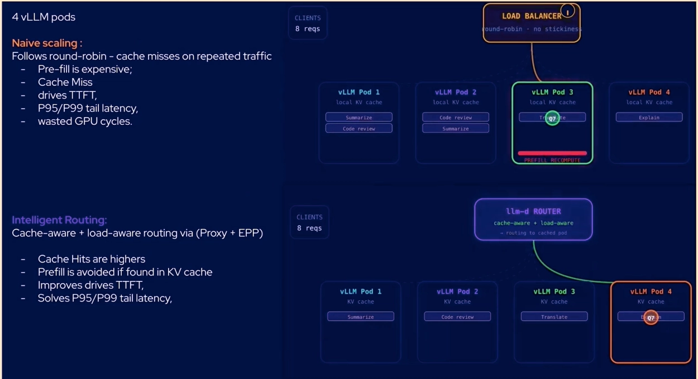

*출처: [7W-2] llm-d, 9쪽. 동일한 요청이 캐시가 없는 파드에 배치되는 경우와 캐시가 있는 파드로 이동하는 경우를 비교한다.*

그림 위쪽에서는 파드가 네 개여도 반복 요청이 기존 캐시와 연결되지 않는다. 아래쪽에서는 라우터가 프리픽스와 파드의 관계를 알고 있어 이미 계산된 상태를 활용한다. 핵심은 GPU를 더 배치하는 것과 **이미 계산한 것을 덜 반복하는 것**이 별개의 최적화라는 점이다.

## Envoy 요청 처리 구조

### Listener, Route, Cluster, Endpoint

Envoy에서 요청을 따라가면 네 개의 개념이 연결된다.

1. **Listener**가 다운스트림의 연결을 수신한다.
2. **Route**가 호스트·경로·헤더 등의 조건으로 목적지 규칙을 정한다.
3. **Cluster**가 업스트림 서비스의 논리적 집합을 나타낸다.
4. **Endpoint**가 실제 연결할 서버 주소가 된다.

여기서 Cluster는 Envoy 설정상의 업스트림 집합이다. Kubernetes 클러스터 전체를 뜻하지 않는다.

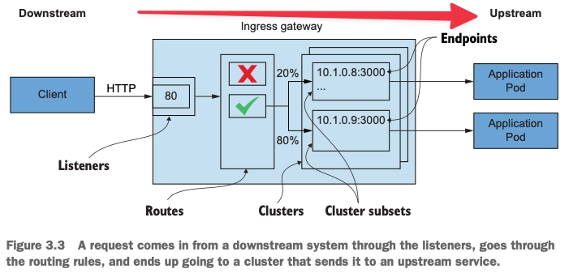

*출처: [7W-1] Envoy: Agent Router, 4쪽. 다운스트림에서 업스트림으로 흐르는 요청과 클러스터·엔드포인트 선택을 보여준다.*

그림의 20%·80%는 트래픽 분할 규칙이다. 여기서 버전별 트래픽 비율을 정하는 판단과, 선택된 집합 안에서 실제 서버를 고르는 판단을 구분할 수 있다. AI 요청도 먼저 모델·공급자를 정하고, 자체 호스팅 모델이라면 다시 특정 추론 파드를 선택하는 구조로 확장된다.

Envoy는 이 경로에 서비스 디스커버리, 헬스 체크, 타임아웃, 재시도, 부하 분산, 메트릭을 제공한다. Istio나 Envoy Gateway 같은 컨트롤 플레인은 상위 리소스를 해석해 Envoy가 사용할 설정을 전달한다.

LLM 요청에서는 스트리밍이 길게 유지될 수 있으므로 요청 전체 타임아웃과 스트림 유휴 타임아웃을 구별한다. 이미 사용자에게 토큰을 전달한 뒤에는 일반적인 재시도로 응답을 처음부터 다시 시작하기 어렵다.

### ext_proc: 외부 서비스로 처리 로직 확장

`envoy.filters.http.ext_proc`는 Envoy가 HTTP 요청·응답의 일부 처리를 외부 gRPC 서비스에 맡기는 필터다. 외부 프로세서는 헤더·본문·트레일러를 확인하고 수정하거나 즉시 응답을 반환할 수 있다. 전달할 데이터와 처리 시점은 `processing_mode`에 따라 달라진다.

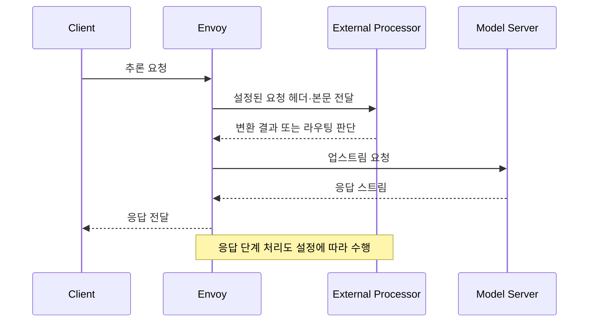

AI 게이트웨이는 이를 이용해 모델명을 읽거나 공급자별 요청 형식을 변환할 수 있다. llm-d의 엔드포인트 선택도 프록시와 외부 처리 프로토콜을 연결하는 구조로 이해할 수 있다.

외부 호출과 본문 처리에는 비용이 있다. 전체 응답을 버퍼링하면 스트리밍 전달이 늦어질 수 있으므로 필요한 단계만 처리하도록 구성한다. 자료의 독립 실행 Envoy 예제에 등장하는 긴 타임아웃이나 큰 연결 한도는 해당 예제의 설정이며, 모든 환경의 기본값으로 옮길 값은 아니다.

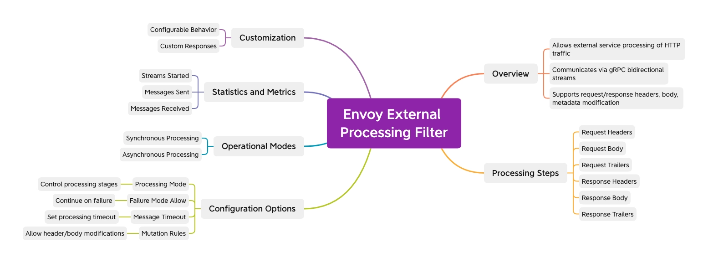

*출처: [7W-1] Envoy: Agent Router, 37쪽. 요청·응답 단계별 처리와 실패·타임아웃 정책의 관계다.*

이 그림에서 실무 설정으로 이어지는 부분은 `Processing Mode`, `Failure Mode Allow`, `Message Timeout`이다. 어느 데이터를 외부에 보낼지, 외부 처리기가 실패하면 통과시킬지, 얼마나 기다릴지를 각각 결정한다. 본문 기반 모델 선택이 필요한데 헤더만 전달하면 판단 재료가 없고, 사용량 집계가 필요한데 응답 정보를 보지 않으면 실제 출력 토큰을 알 수 없다.

### 정적 설정과 동적 설정

고정된 서버 두 개를 대상으로 동작을 이해할 때는 정적 Envoy 설정만으로도 요청 흐름을 설명할 수 있다. Kubernetes에서는 파드가 재시작하면서 IP가 바뀌고 모델 배포가 증감하므로, 컨트롤 플레인이 리소스 변화를 반영하는 동적 설정이 필요하다.

이때 분리되는 것은 **설정 갱신 경로**와 **요청 처리 경로**다. 컨트롤러가 매 요청의 목적지를 직접 정하는 것이 아니라, 컨트롤러가 전달한 설정에 따라 Envoy가 요청을 처리한다. EPP 호출은 그 요청 처리 경로에 추가되는 판단 단계다.

헬스 체크와 이상 엔드포인트 제외도 역할이 다르다. 준비되지 않은 서버를 후보에서 빼는 것은 기본 가용성 판단이고, 정상 서버 중 어느 곳이 캐시와 부하 측면에서 유리한지 고르는 것은 추론 스케줄링이다. HTTP `/health`가 성공하는 파드라도 대기열이 길면 이번 요청의 좋은 목적지는 아닐 수 있다.

## Agent Router: 모델과 공급자 앞의 정책 계층

Agent Router는 기존 Envoy AI Gateway의 새 이름이다. 프로젝트 이름이 바뀌어도 `AIGatewayRoute`, `AIServiceBackend`, `BackendSecurityPolicy`와 `aigateway.envoyproxy.io` API 그룹, `aigw` 명령, 기존 Helm 차트 이름은 유지된다. 따라서 자료에 두 이름이 함께 등장한다.

애플리케이션이 여러 모델 공급자를 직접 연동하면 인증 방식, 요청 형식, 재시도, 사용량 집계를 각각 구현해야 한다. Agent Router는 이 기능을 공통 진입점으로 모은다.

- 클라이언트에 일관된 API를 제공하고 공급자별 요청·응답 차이를 처리한다.
- 공급자 자격증명과 애플리케이션 접근 정책을 중앙에서 관리한다.
- 모델·팀 등의 기준으로 토큰 사용량을 관찰하고 제한한다.
- 공급자 장애 시 정책에 따라 다른 백엔드를 선택한다.

### 컨트롤 플레인과 데이터 플레인

Agent Router 컨트롤러는 AI 관련 리소스를 해석하고, Envoy Gateway 컨트롤러는 게이트웨이 리소스를 Envoy 설정으로 반영한다. 실제 추론 요청은 컨트롤러를 통과하는 것이 아니라 Envoy와 필요한 외부 프로세서를 통과한다.

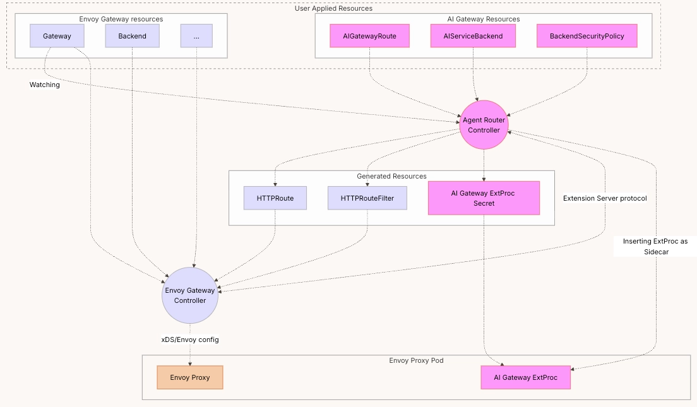

*출처: [7W-1] Envoy: Agent Router, 13쪽. 위쪽은 사용자가 선언한 리소스, 아래쪽은 실제 트래픽을 처리하는 Envoy Proxy Pod다.*

그림의 오른쪽 컨트롤러는 AI 리소스를 보고 HTTPRoute와 외부 프로세서 구성을 만든다. 왼쪽 Envoy Gateway 컨트롤러는 이 설정을 Envoy 데이터 플레인에 반영한다. 따라서 장애를 볼 때도 리소스 변환이 잘못됐는지, 생성된 Envoy 설정이 잘못됐는지, 외부 프로세서 호출이 실패했는지를 나눠 확인할 수 있다.

### AI 리소스 세 개의 관계

`AIGatewayRoute`는 어떤 요청을 어떤 AI 백엔드로 보낼지 정의한다. `AIServiceBackend`는 공급자와 모델 서비스에 대한 연결 정보를 나타내고, `BackendSecurityPolicy`는 해당 백엔드 호출에 필요한 인증 구성을 연결한다.

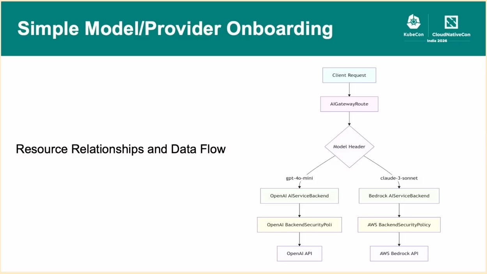

*출처: [7W-1] Envoy: Agent Router, 26쪽. 모델 선택 이후 백엔드별 인증 정책이 연결되는 예시다.*

그림을 요청 순서로 읽으면 **모델 식별 → 백엔드 선택 → 백엔드 인증 적용 → 공급자 API 호출**이다. 클라이언트가 보내는 모델명이 실제 공급자 모델명과 반드시 같을 필요는 없지만, 매핑은 명확해야 한다. 클라이언트가 게이트웨이에 인증하는 것과 게이트웨이가 공급자에 인증하는 것도 서로 다른 관계다.

자체 호스팅 vLLM에 연결할 때는 공급자 API 대신 InferencePool과 EPP가 목적지 선택에 참여한다. AI 백엔드 등록만으로 vLLM 파드의 캐시 상태가 자동 수집되는 것은 아니다.

### 토큰 제한과 장애 조치

요청 수 제한만으로는 모델 사용 비용을 제어하기 어렵다. 입력과 출력 토큰 사용량을 함께 봐야 한다. 특히 출력 토큰 수는 생성 완료 전에는 확정되지 않으므로, 요청 진입 시 허용 여부를 판단하는 과정과 완료 후 실제 사용량을 반영하는 과정이 구분된다.

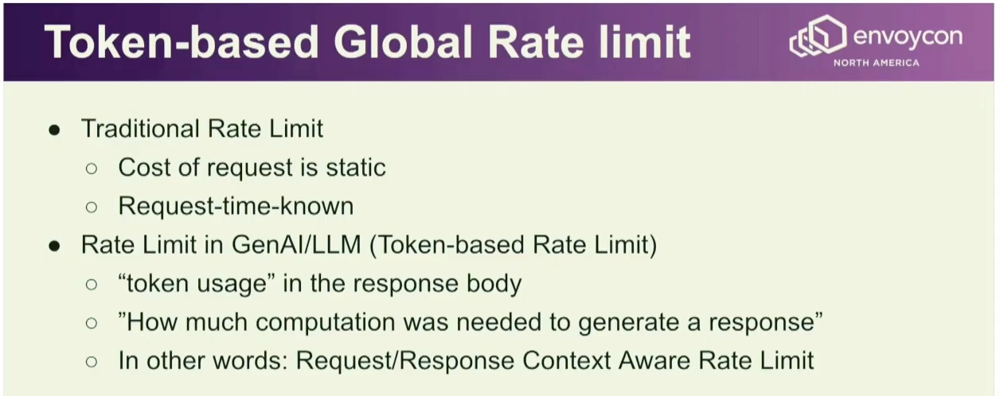

*출처: [7W-1] Envoy: Agent Router, 14쪽. 요청 비용을 응답의 실제 토큰 사용량과 연결하는 이유를 설명한다.*

예를 들어 입력 100토큰·출력 50토큰 요청과 입력 20,000토큰·출력 2,000토큰 요청을 모두 1건으로 차감하면 자원 사용량 차이를 반영하지 못한다. 자료는 응답 사용량을 메타데이터로 전달하고 스트림 종료 시 제한 서비스에 반영하는 흐름을 소개한다. 이 방식에서는 동시에 처리 중인 요청의 사용량이 아직 확정되지 않았다는 점도 고려해야 한다.

공급자 간 장애 조치도 주소만 바꾸는 문제로 끝나지 않는다. 공급자마다 인증과 API 스키마가 다를 수 있고, 다른 모델로 전환하면 출력 품질이나 도구 호출 동작도 달라질 수 있다. 허용할 대체 모델과 재시도 조건을 라우팅 정책에 포함해야 한다.

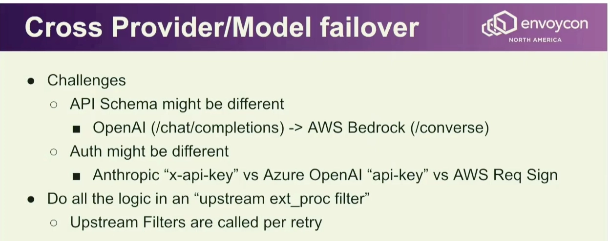

*출처: [7W-1] Envoy: Agent Router, 16쪽. 업스트림 재시도마다 공급자별 변환을 적용해야 하는 이유다.*

자료의 `upstream ext_proc` 설명은 이 지점과 연결된다. 첫 번째 공급자에 맞춰 변환한 본문과 인증을 두 번째 공급자에 그대로 보내면 실패할 수 있다. 새 업스트림에 맞는 변환을 각 시도에 적용해야 한다. 다만 모든 오류가 재시도 대상은 아니며, 스트리밍이 시작된 뒤의 복구는 일반적인 요청 재시도와 다르게 설계해야 한다.

## llm-d: 모델 서버 상태를 반영하는 라우팅

llm-d는 vLLM 같은 추론 엔진과 결합해 분산 추론을 구성하는 스택이다. 이번 범위에서는 **동일 모델을 서빙하는 여러 파드 중 어디로 보낼지 결정하는 기능**에 집중한다.

### Proxy, InferencePool, EPP

Proxy는 요청과 응답을 전달한다. `InferencePool`은 라벨 선택자로 추론 서버 집합을 정의하고, 추론 포트와 엔드포인트 선택 확장 연결을 표현한다. EPP(Endpoint Picker)는 후보 서버의 상태와 정책을 평가해 목적지를 선택한다.

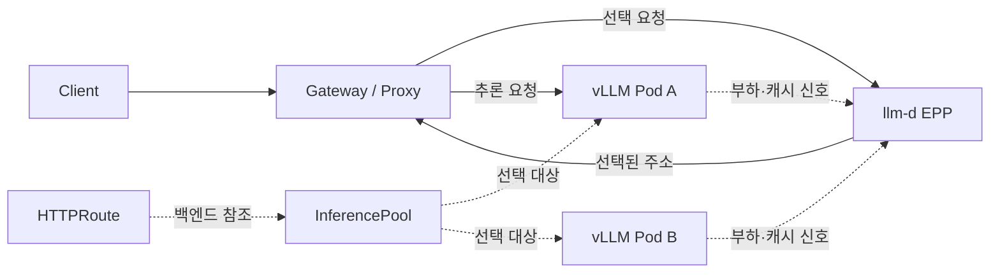

이 그림에서 `InferencePool`은 트래픽이 통과하는 프록시가 아니라 선언적 리소스다. EPP 역시 모델 추론을 대신 수행하지 않는다. 목적지 결정 이후 실제 요청은 Proxy가 모델 서버에 전달한다.

### 필터링, 점수 계산, 선택

엔드포인트 선택은 다음 흐름으로 이해할 수 있다.

1. **상태 수집**: 서버의 대기열, 실행 중 요청, 캐시 사용량 등의 신호를 수집한다.
2. **필터링**: 요청을 처리할 수 없는 후보를 제외한다.
3. **점수 계산**: 남은 후보의 부하와 캐시 친화성을 평가한다.
4. **선택**: 설정된 정책으로 목적지를 정해 Proxy에 반환한다.

사용하는 메트릭과 플러그인은 구성에 따라 달라진다. 모든 EPP가 GPU 사용률이나 정확한 캐시 블록 위치를 기본으로 알고 있다고 가정하면 안 된다. 상태 수집은 비동기적으로 이루어질 수 있으므로 매 요청마다 모든 파드를 직접 조회하는 구조로 이해할 필요도 없다.

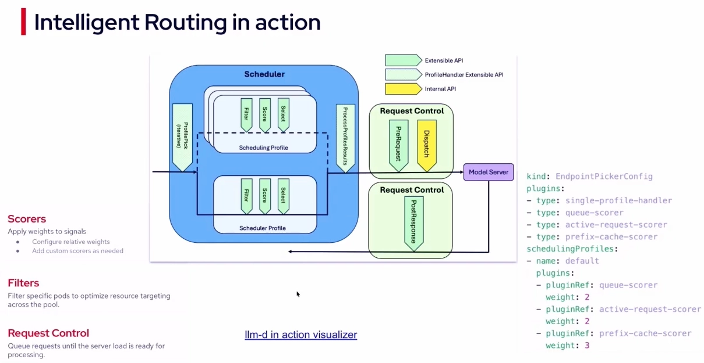

*출처: [7W-2] llm-d, 10쪽. 플러그인별 점수와 스케줄링 프로파일이 최종 선택에 연결되는 구조다.*

그림 오른쪽 예제는 큐, 실행 중 요청, 프리픽스 캐시 관련 scorer를 서로 다른 가중치로 결합한다. 이 숫자 자체가 정답은 아니다. 대기열 점수는 얼마나 기다릴지를, 캐시 점수는 얼마나 재계산을 피할지를 서로 다른 관점에서 평가한다. 점수의 정규화와 가중치에 따라 같은 파드 집합에서도 선택이 달라질 수 있다.

이를 설명하기 위해 가상의 후보 세 개를 비교하면 다음과 같다.

| 후보 | 재사용 가능한 프리픽스 | 대기 상태 | 판단 |
|---|---|---|---|
| A | 긴 공통 프리픽스 보유 | 대기 요청이 많음 | 재계산은 적지만 대기 비용이 클 수 있음 |
| B | 캐시 없음 | 비어 있음 | 새로 계산하더라도 빨리 시작할 수 있음 |
| C | 일부 프리픽스 보유 | 대기 요청이 적음 | 캐시와 부하를 함께 고려할 후보 |

여기서 EPP가 반드시 C를 고른다는 뜻은 아니다. 입력 길이, 각 서버 처리 성능, 정책에 따라 결과가 달라진다. 중요한 것은 단순한 캐시 유무나 GPU 사용률 하나만으로 판단하지 않는다는 점이다.

## Tier 1·Tier 2: 두 계층의 게이트웨이

**Tier 1**은 애플리케이션의 공통 진입점이다. 인증, 토큰 한도, 사용량 집계, 공급자·모델 선택을 처리한다. **Tier 2**는 자체 호스팅 추론 클러스터의 진입점이다. 선택한 모델을 실행하는 파드들의 상태를 보고 요청을 배치한다.

이 글에서는 Tier 1 역할을 Agent Router로, Tier 2의 추론 스케줄링을 llm-d Router로 설명한다. Tier는 제품명이나 API 종류가 아니라 **배치 위치와 책임의 구분**이다. Agent Router 역시 Inference Extension과 연결해 Tier 2에 사용될 수 있다.

| 구분 | Agent Router | llm-d Router |
|---|---|---|
| 주된 질문 | 어떤 공급자·모델에 요청을 보낼 것인가 | 선택한 모델의 어느 서버에 보낼 것인가 |
| 주요 입력 | 인증, 모델명, 사용량 정책, 공급자 상태 | 서버 부하, 캐시 친화성, 풀 상태 |
| 주요 역할 | API 통합, 자격증명, 사용량 제한, 장애 조치 | 추론 엔드포인트 선택과 스케줄링 |
| 연동 지점 | 자체 호스팅 모델 경로 | Gateway API Inference Extension 및 EPP |

논리적으로는 앞단 정책 게이트웨이와 내부 추론 라우팅을 함께 사용할 수 있다. 다만 반드시 프록시 두 개를 직렬로 배포해야 한다는 뜻은 아니다. 지원되는 게이트웨이에서 EPP를 연결해 책임을 결합할 수도 있다.

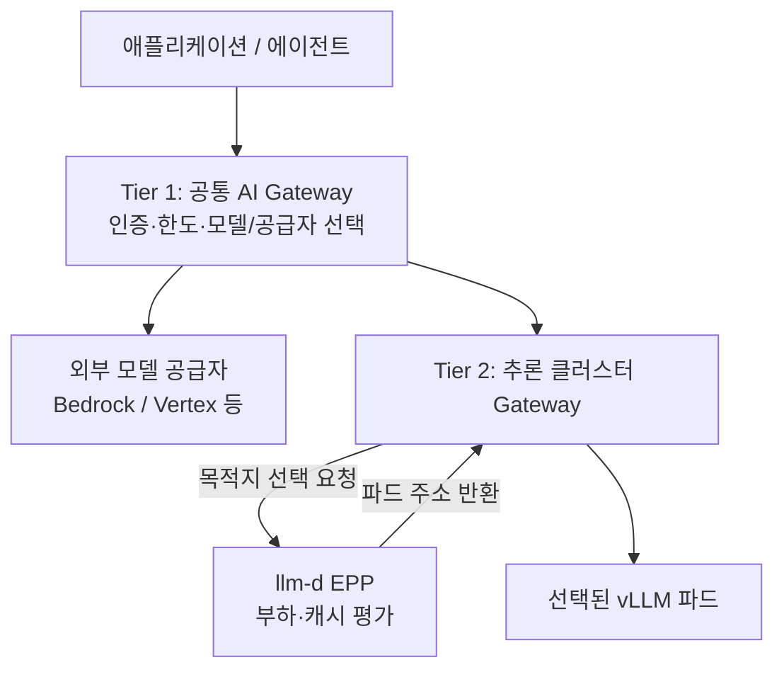

외부 공급자를 선택한 요청은 그 공급자의 API로 전달되므로 자체 클러스터의 Tier 2를 반드시 거치는 것은 아니다. 자체 호스팅 모델 경로에서는 Tier 2가 파드 상태를 알고 최종 엔드포인트를 선택한다. 앞단에서 이미 사용량을 제한했더라도 내부 큐와 캐시를 고려한 배치는 여전히 필요하다.

두 계층을 구분하면 운영 책임도 명확해진다. 팀별 토큰 예산이나 공급자 장애 조치는 Tier 1에서, 특정 vLLM 파드의 과부하나 캐시 친화성은 Tier 2에서 다룬다. [Agent Router 공식 설명](https://github.com/theagentrouter/agent-router)의 Two-Tier 패턴도 이 책임 분리를 기준으로 한다.

이번 자료의 설치 계획은 외부 공급자 통합보다 **HTTPRoute → InferencePool → llm-d EPP → vLLM** 경로에 초점을 둔다. Agent Router의 다중 공급자 기능을 사용한 실습으로 해석하지 않는다.

## Gateway API: 설정 리소스와 추론 확장

Gateway API는 Kubernetes에서 게이트웨이와 라우팅을 선언하는 API다. 실제 프록시를 구현하는 **Envoy Gateway**와 구분한다. API 리소스만 설치하면 트래픽이 처리되는 것이 아니라, 이를 해석하고 데이터 플레인을 구성하는 컨트롤러가 필요하다.

| 리소스 | 정의하는 대상 | 이 글의 연결 |
|---|---|---|
| `GatewayClass` | 어떤 컨트롤러가 게이트웨이를 구현하는지 | Envoy Gateway 구현 선택 |
| `Gateway` | 리스너·프로토콜·포트 등 진입점 | 추론 요청을 받는 HTTP 리스너 |
| `HTTPRoute` | 요청 조건과 백엔드 참조 | 경로·모델 헤더에 따라 풀 선택 |
| `InferencePool` | 추론 파드 집합과 선택 확장 연결 | 모델 서버 라벨, 포트, EPP Service |

앞의 세 리소스는 기본 Gateway API의 관계다. `InferencePool`은 Gateway API Inference Extension이 추가하는 추론용 리소스로, API 그룹도 `inference.networking.k8s.io`로 다르다. 기본 API와 확장 API를 각각 설치·지원해야 하는 이유다. [Gateway API 개요](https://gateway-api.sigs.k8s.io/docs/concepts/api-overview/), [InferencePool 정의](https://gateway-api-inference-extension.sigs.k8s.io/api-types/inferencepool/).

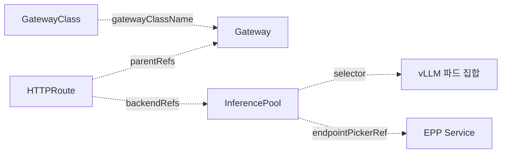

이 그림의 화살표는 **설정 참조 관계**다. 요청이 GatewayClass나 InferencePool 객체를 네트워크 홉으로 통과하는 것은 아니다. 컨트롤러가 이 관계를 설정으로 바꾸고, 데이터 플레인이 그 설정에 따라 요청을 보낸다.

일반 HTTPRoute의 백엔드는 Service일 수 있지만, 이 추론 경로에서는 InferencePool을 참조한다. 그리고 EPP Service는 HTTPRoute의 모델 백엔드가 아니라 **파드 선택을 요청하는 외부 처리 서비스**다. EPP 포트와 모델 서버 포트를 구별해야 한다.

## BBR과 EPP: 모델 선택과 파드 선택

### BBR이 필요한 이유

BBR(Body-Based Routing)은 HTTP 요청 본문을 읽어 라우팅에 필요한 정보를 얻는 기능이다. 추론 요청은 여러 모델이 모두 같은 `/v1/chat/completions` 경로를 사용하고, 실제 모델명은 JSON의 `model` 필드에 담는 경우가 많다.

```json
{
  "model": "Qwen3-0.6B-FP8",
  "messages": [
    {"role": "user", "content": "이 문서를 요약해줘"}
  ]
}
```

URL만 보면 어떤 모델 풀을 선택해야 하는지 알 수 없다. **BBR은 본문의 모델명을 라우팅 판단에 연결하고, EPP는 선택된 풀 안에서 실제 파드를 고른다.** BBR은 질문의 의미를 분석해 더 적합한 모델을 추천하는 시맨틱 라우팅과도 다르다.

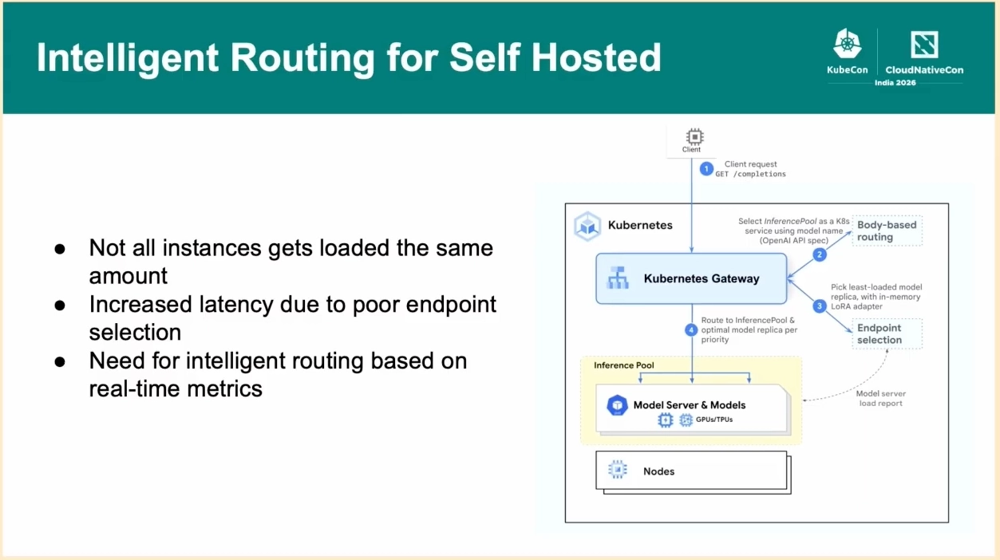

*출처: [7W-1] Envoy: Agent Router, 27쪽. 오른쪽의 Body-based routing과 Endpoint selection이 서로 다른 판단 단계다. 그림의 요청 메서드 표기는 개념도로 보고, 본문의 실습 호출은 POST를 사용한다.*

### Body → Header → Route → Pool → Endpoint

외부 처리 방식의 BBR은 모델명을 헤더로 전달해 HTTPRoute가 매칭할 수 있게 한다. 예를 들어 GKE의 공식 구현은 `X-Gateway-Model-Name`을 사용한다. 이후 선택된 풀의 EPP가 파드를 고른다. 헤더 이름과 필터 연결 방식은 구현별로 다르다. [GKE Body-Based Routing](https://docs.cloud.google.com/kubernetes-engine/docs/how-to/configure-body-based-routing).

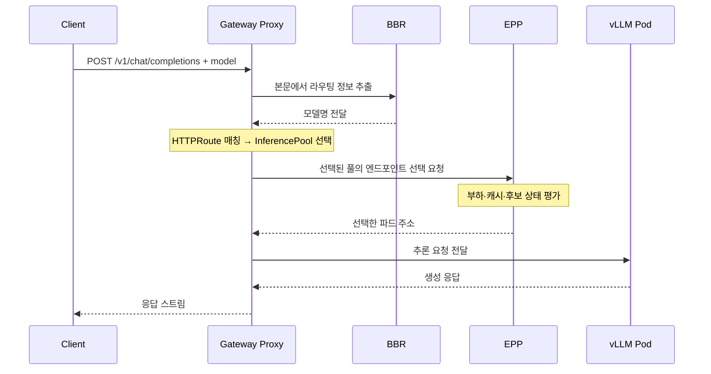

| 구분 | BBR | EPP |
|---|---|---|
| 판단 범위 | 어떤 모델의 풀로 보낼지 | 그 풀의 어느 복제본으로 보낼지 |
| 핵심 입력 | 본문 `model` 등 라우팅 필드 | 풀 후보, 요청 정보, 부하·캐시 신호 |
| 판단 결과 | Route가 사용할 모델 정보 | 실제 엔드포인트 |
| 실패 시 확인 | 본문 추출·모델 매핑·Route 매칭 | 후보 발견·선택기 통신·스케줄링 |

BBR과 EPP는 서로 다른 역할이지만 반드시 별도 Pod 두 개로 구현해야 하는 것은 아니다. 게이트웨이에 본문 처리 기능이 통합돼 있을 수도 있다. Agent Router의 AI 외부 프로세서가 담당하는 본문 해석과 별도 BBR 배포를 중복으로 구성하지 않도록 선택한 구현의 흐름을 확인한다.

### 현재 실습 예시가 다루는 범위

뒤의 HTTPRoute 예시는 `/v1/` 요청을 **하나의 Qwen 풀**로 보내는 구성이다. 모델별 분기가 없으므로 별도 BBR 없이 EPP의 파드 선택을 관찰할 수 있다. 그 YAML만으로 본문의 `model`에 따라 여러 풀을 고르는 기능이 구현되지는 않는다.

여러 모델을 같은 URL로 제공하려면 본문 기반 모델 분기나 명시적인 헤더·호스트 분기 등을 추가해야 한다. 또한 라우팅용 헤더를 내부 처리기가 생성하는 구성이라면 클라이언트가 보낸 동명 헤더의 처리 정책도 정해야 본문과 헤더가 충돌하지 않는다.

이 구분으로 보면 요청의 전체 흐름은 **Tier 1에서 정책·공급자 선택 → 자체 호스팅 경로의 모델 풀 선택 → Tier 2의 EPP에서 파드 선택 → vLLM 추론**이다. Gateway API는 이 흐름을 선언하는 리소스 관계이고, BBR과 EPP는 서로 다른 시점의 판단을 담당한다.

## 프리픽스 캐시를 고려하는 방법

### 캐시 재사용과 부하 사이의 균형

같은 문서를 반복 분석하는 요청이라면 공통 프리픽스를 이미 계산한 파드를 선택하는 편이 유리할 수 있다. 하지만 그 파드에 대기열이 길다면 캐시가 없는 파드에서 새로 계산하는 쪽이 더 빠를 수 있다.

판단을 단순화하면 다음과 같다. 실제 스케줄러 구현의 공식이 아니라 선택 이유를 설명하기 위한 관계다.

```text
첫 토큰까지의 시간 ≈ 라우팅 지연 + 대기 시간 + 남은 프리필 계산 시간
```

캐시 친화성만 높이면 핫스폿이 생길 수 있고, 부하만 균등하게 만들면 재사용 기회를 잃을 수 있다. 캐시 적중률과 지연시간을 함께 측정해야 하는 이유다.

### 요청 이력 기반 추정과 KV 이벤트 기반 추적

| 방식 | 판단에 쓰는 정보 | 주의할 점 |
|---|---|---|
| 요청 이력 기반 친화성 | 특정 프리픽스를 어느 서버로 보냈는지 | 캐시가 이미 축출됐어도 남아 있다고 추정할 수 있음 |
| Precise Prefix-Cache-Aware Routing | 모델 서버가 발행하는 KV 블록 이벤트 | 이벤트 연결·인덱스 갱신 상태가 중요함 |

정밀 라우팅에서는 모델 서버의 캐시 생성·제거 이벤트를 받아 인덱스를 갱신하고, 요청과 겹치는 캐시가 있는 서버를 평가한다. 이때 전달하는 것은 캐시 위치를 추적하기 위한 정보다. 이벤트 구독 자체가 파드 사이에 KV 텐서를 복사하는 것은 아니다.

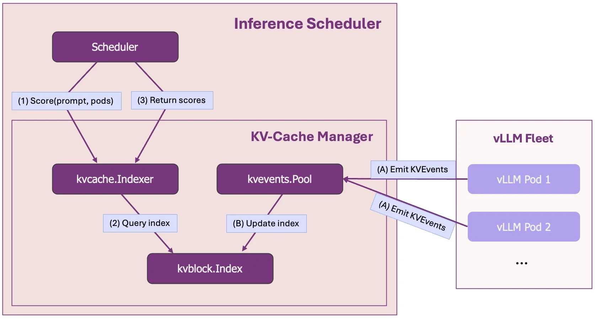

*출처: [7W-2] llm-d, 2쪽. A·B 화살표는 상태 갱신 경로, 1·2·3 화살표는 요청의 캐시 친화성을 평가하는 경로다.*

이 그림은 두 흐름을 분리해서 읽는 것이 중요하다. 파드에서 발생한 KV 이벤트는 인덱스를 계속 갱신하고, 요청이 도착하면 스케줄러가 그 인덱스를 조회한다. 요청이 들어올 때마다 GPU 메모리 전체를 검색하거나 모든 KV 텐서를 네트워크로 가져오는 구조가 아니다.

프리픽스는 **앞에서부터 연속된 토큰 문맥**이다. 공통 문서 앞에 매번 다른 시각이나 요청 ID를 붙이면 재사용 가능한 공통 부분이 줄어들 수 있다. 의미가 비슷한 문장을 찾는 시맨틱 캐시와도 구분해야 한다. 토큰 시퀀스, 모델과 캐시 호환 조건이 맞아야 이전 계산 결과를 사용할 수 있다.

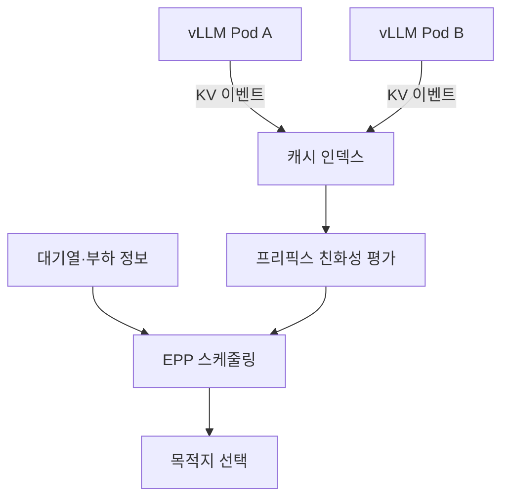

캐시 위치를 파악하는 **인덱싱**, 캐시가 있는 곳을 고르는 **라우팅**, CPU나 스토리지로 캐시 계층을 넓히는 **오프로딩**은 서로 다른 기능이다. 프리필과 디코드를 서로 다른 워커에 맡기는 분리 서빙 역시 별도의 KV 전송 구성이 필요하다.

## 실습 환경과 준비 과정

자료의 실습은 단일 GPU 환경에서 작은 모델을 두 파드로 실행하고 라우팅 변화를 관찰하는 구성이다. 아래 버전은 자료에 기록된 값이며, 전체 조합의 호환성을 새로 검증한 목록은 아니다.

- Kubernetes: K3s `v1.36.4+k3s1`, Ubuntu 24.04 기반 GPU 노드
- 추론 서버: `vllm/vllm-openai:v0.28.0`, `Qwen3-0.6B-FP8`
- 모델 저장: MinIO의 `models/Qwen3-0.6B-FP8` 경로
- GPU 공유: HAMi를 이용한 vLLM 파드 2개 구성
- 외부 노출·관찰: MetalLB, kube-prometheus-stack, DCGM Exporter
- 게이트웨이: 자료 마지막에 Gateway API `v1.3.0`, Envoy Gateway `v1.9.1` 설치 기록

### 1. GPU와 클러스터 확인

드라이버와 컨테이너 런타임이 준비된 뒤 Kubernetes에서 GPU 자원이 보이는지 확인한다. 자료는 NVIDIA device plugin으로 시작한 다음, GPU 공유 실습을 위해 HAMi로 전환한다. 동일 GPU 자원을 관리하는 장치 플러그인을 중복 배포하지 않도록 전환 구성을 확인한다.

```bash
nvidia-smi
kubectl get nodes -o wide
kubectl get runtimeclass
kubectl describe node <GPU_NODE_NAME>
kubectl get pods -A
```

MetalLB 주소 풀은 실제 네트워크에서 사용할 수 있는 주소로 구성한다. 자료의 사설 IP나 NodePort는 해당 실습 환경의 값이다.

### 2. MinIO에서 모델 로드

자료는 모델을 내려받는 Job과 MinIO로 업로드하는 단계를 연결한다. vLLM은 S3 호환 경로에서 Run:ai Model Streamer를 사용해 모델을 읽는다.

```text
모델 저장소 → 다운로드 Job → MinIO → vLLM 모델 로드
```

vLLM 실행 인자의 핵심은 다음과 같다. MinIO 주소와 자격증명은 컨테이너 환경 변수 및 Kubernetes Secret으로 별도 전달돼 있어야 한다.

```bash
vllm serve s3://models/Qwen3-0.6B-FP8 \
  --served-model-name Qwen3-0.6B-FP8 \
  --load-format runai_streamer \
  --host 0.0.0.0 \
  --port 8000 \
  --max-model-len 8192
```

`/vllm-cache`에 남기는 컴파일 관련 파일과 추론 중 GPU에 생성되는 프리픽스 KV 캐시는 구분한다. 컴파일 캐시 디렉터리를 공유했다고 해서 두 파드의 추론 KV 캐시가 공유되지는 않는다.

모델 준비 Job은 다음처럼 두 단계로 나뉜다. 자료의 구조를 읽기 좋게 정리한 예시이며, `vllm` 네임스페이스, MinIO Service, `minio-credentials` Secret이 먼저 준비돼 있어야 한다. 이미지 태그와 다운로드 의존성은 재현 실험에서 별도로 고정한다.

```yaml
apiVersion: batch/v1
kind: Job
metadata:
  name: model-loader
  namespace: vllm
spec:
  backoffLimit: 1
  template:
    spec:
      restartPolicy: Never
      initContainers:
        - name: hf-download
          image: python:3.12-slim
          command: ["sh", "-c"]
          args:
            - |
              set -eu
              pip install --no-cache-dir huggingface_hub
              hf download Qwen/Qwen3-0.6B-FP8 --local-dir /model
          volumeMounts:
            - name: model
              mountPath: /model
      containers:
        - name: s3-upload
          image: quay.io/minio/mc:latest
          command: ["sh", "-c"]
          args:
            - |
              set -eu
              mc alias set localminio \
                http://minio.vllm.svc.cluster.local:9000 \
                "$MINIO_ROOT_USER" "$MINIO_ROOT_PASSWORD"
              mc mb --ignore-existing localminio/models
              mc mirror --overwrite /model localminio/models/Qwen3-0.6B-FP8
          envFrom:
            - secretRef:
                name: minio-credentials
          volumeMounts:
            - name: model
              mountPath: /model
      volumes:
        - name: model
          emptyDir:
            sizeLimit: 5Gi
```

`initContainers`의 다운로드가 성공해야 업로드 컨테이너가 시작된다. 두 컨테이너는 `emptyDir`를 통해 파일을 넘기며, Job이 끝난 뒤 모델의 보관 책임은 MinIO 저장소로 이동한다. 업로드 오류와 다운로드 오류를 구별하려면 컨테이너별 로그를 따로 본다.

```bash
kubectl -n vllm logs job/model-loader -c hf-download
kubectl -n vllm logs job/model-loader -c s3-upload
kubectl -n vllm get job model-loader
```

자료에는 다운로드한 파일 10개와 약 1.03GB의 모델 데이터, Job 완료 시간이 41초로 기록돼 있다. 이는 해당 실습 환경의 기록이다. 실제 재현 시에는 완료 여부 외에도 모델 설정·토크나이저·가중치 파일이 같은 경로에 함께 업로드됐는지 확인한다.

vLLM 쪽에서는 S3 호환 저장소 정보를 다음과 같이 전달한다. 아래는 컨테이너의 `env` 필드 발췌다.

```yaml
env:
  - name: AWS_ENDPOINT_URL
    value: http://minio.vllm.svc.cluster.local:9000
  - name: AWS_EC2_METADATA_DISABLED
    value: "true"
  - name: RUNAI_STREAMER_S3_USE_VIRTUAL_ADDRESSING
    value: "0"
  - name: AWS_DEFAULT_REGION
    value: us-east-1
  - name: AWS_ACCESS_KEY_ID
    valueFrom:
      secretKeyRef:
        name: minio-credentials
        key: MINIO_ROOT_USER
  - name: AWS_SECRET_ACCESS_KEY
    valueFrom:
      secretKeyRef:
        name: minio-credentials
        key: MINIO_ROOT_PASSWORD
```

MinIO를 읽지 못하는 경우에는 S3 endpoint, 접근 권한, 객체 경로를 먼저 확인한다. 모델 다운로드·로드 실패와 GPU 메모리 부족은 서로 다른 단계의 문제이므로, 파드가 재시작한다는 증상만 보고 메모리 옵션부터 바꾸지 않는다.

### 3. 단일 서버 응답 확인

게이트웨이를 연결하기 전에 모델 서버 자체가 요청을 처리하는지 확인한다. 기존 Service에 포트 포워딩하면 자료의 NodePort 주소에 의존하지 않고 점검할 수 있다.

```bash
kubectl -n vllm get deploy,pods,svc
kubectl -n vllm port-forward svc/qwen3-0-6b-fp8 8000:8000
```

다른 터미널에서 실행한다.

```bash
curl -fsS http://127.0.0.1:8000/v1/models

curl -fsS http://127.0.0.1:8000/v1/chat/completions \
  -H 'Content-Type: application/json' \
  -d '{
    "model": "Qwen3-0.6B-FP8",
    "messages": [{"role": "user", "content": "대한민국의 수도를 한 문장으로 설명한다."}],
    "max_tokens": 128
  }'
```

이 호출은 기본 서빙 점검이다. Service 포트 포워딩은 특정 파드로 연결되므로 파드 간 분산이나 llm-d 라우팅을 검증하는 경로로 사용하지 않는다.

### 4. HAMi로 두 파드 구성

자료의 두 파드 구성에서는 각각 GPU 코어와 메모리 비율을 50%로 요청한다. 다음은 **전체 Deployment가 아닌 주요 필드 발췌**다. HAMi 설치 및 스케줄러·런타임 구성이 선행돼야 한다.

```yaml
spec:
  replicas: 2
  template:
    spec:
      schedulerName: hami-scheduler
      runtimeClassName: nvidia
      containers:
        - name: vllm
          resources:
            requests:
              cpu: "1"
              memory: 2Gi
            limits:
              nvidia.com/gpu: "1"
              nvidia.com/gpucores: "50"
              nvidia.com/gpumem-percentage: "50"
```

자료에서는 `--enforce-eager`, `--gpu-memory-utilization 0.8`, `--kv-cache-dtype fp8`도 사용한다. 가중치의 FP8 형식과 KV 캐시의 FP8 형식은 별도 설정이다. GPU 지원 여부와 공유 환경의 실제 메모리 제한을 확인해야 한다.

두 파드가 같은 물리 GPU를 공유하므로 이 구성은 라우팅 동작 관찰에 적합하다. 독립된 GPU 두 장의 처리량이나 장애 격리를 입증하는 환경으로 해석하지 않는다.

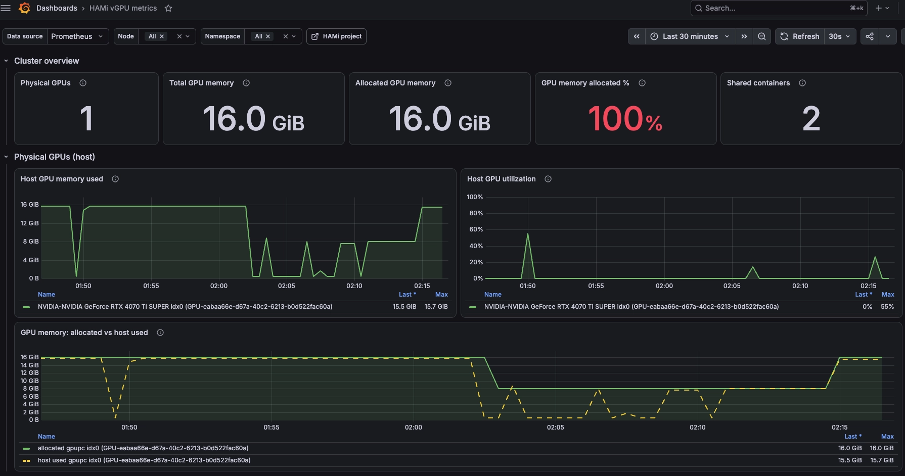

*출처: [7W-2] llm-d, 28쪽. Physical GPUs 1, Total GPU memory 16.0GiB, Shared containers 2가 표시돼 있다.*

이 화면에서 `GPU memory allocated 100%`와 `Host GPU utilization`은 다른 값이다. 전자는 할당량을, 후자는 시간에 따른 실제 GPU 활동을 보여준다. 모델과 캐시를 위해 메모리를 확보한 상태에서도 요청이 없으면 연산 사용률은 낮을 수 있다. **메모리 할당이 가득 찼다**는 사실만으로 GPU가 계산 작업으로 포화됐다고 결론 내릴 수 없다.

### 5. 모니터링을 먼저 연결

라우팅을 바꾸기 전에 관측 경로를 준비한다. 자료는 GPU 하드웨어를 보는 DCGM Exporter, 공유 자원을 보는 HAMi 메트릭, 모델 요청을 보는 vLLM 메트릭을 함께 수집한다.

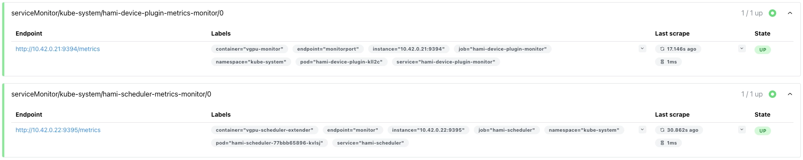

*출처: [7W-2] llm-d, 22쪽. 서로 다른 두 exporter가 각각 UP인지 확인하는 화면이다.*

Prometheus의 target이 UP이라는 것은 수집 연결이 성공했다는 뜻이다. 파드가 GPU를 원하는 비율로 사용하는지, 요청 분산이 좋은지는 별도 메트릭으로 판단해야 한다. 수집 간격이 15초인데 부하 실험이 몇 초 만에 끝나면 변화가 충분히 보이지 않을 수도 있다.

vLLM Service를 대상으로 한 ServiceMonitor 예시는 다음과 같다. kube-prometheus-stack이 `monitoring` 네임스페이스에 설치돼 있고, release 이름이 `kube-prometheus-stack`인 구성을 가정한다. 실제 Prometheus의 selector가 다른 경우 라벨도 맞춰야 한다.

```bash
kubectl label svc qwen3-0-6b-fp8 -n vllm \
  app=qwen3-0-6b-fp8 --overwrite
kubectl patch svc qwen3-0-6b-fp8 -n vllm --type=json \
  -p='[{"op":"add","path":"/spec/ports/0/name","value":"http"}]'
```

```yaml
apiVersion: monitoring.coreos.com/v1
kind: ServiceMonitor
metadata:
  name: vllm-qwen3-0-6b-fp8
  namespace: monitoring
  labels:
    release: kube-prometheus-stack
spec:
  namespaceSelector:
    matchNames:
      - vllm
  selector:
    matchLabels:
      app: qwen3-0-6b-fp8
  endpoints:
    - port: http
      path: /metrics
      interval: 15s
```

`selector`는 Pod가 아니라 **Service의 라벨**을 선택하고, `port`에는 숫자 8000 대신 **Service 포트 이름**을 사용한다. Service가 선택한 파드 엔드포인트를 수집하므로 대시보드에서 `pod` 라벨을 유지하면 파드별 비교가 가능하다.

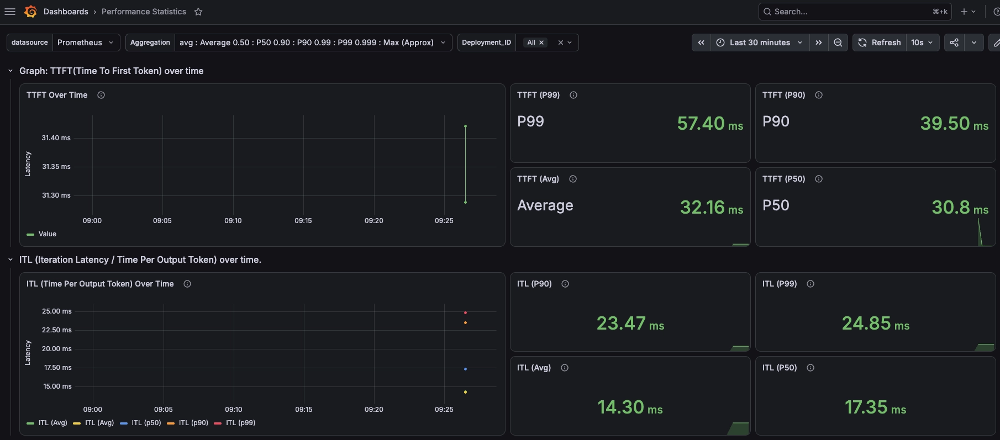

*출처: [7W-2] llm-d, 26쪽. 단일 서버 준비 단계의 관측 화면이며 llm-d 도입 전후 비교 결과가 아니다.*

화면에는 TTFT 평균 32.16ms, P99 57.40ms가 표시돼 있다. 평균만 남기면 느린 요청의 영향을 파악하기 어렵다는 점을 보여준다. 아래쪽 패널은 ITL/Time Per Output Token 표기를 함께 쓰므로, 실제 비교에서는 대시보드 이름뿐 아니라 사용한 메트릭과 집계 식까지 확인한다.

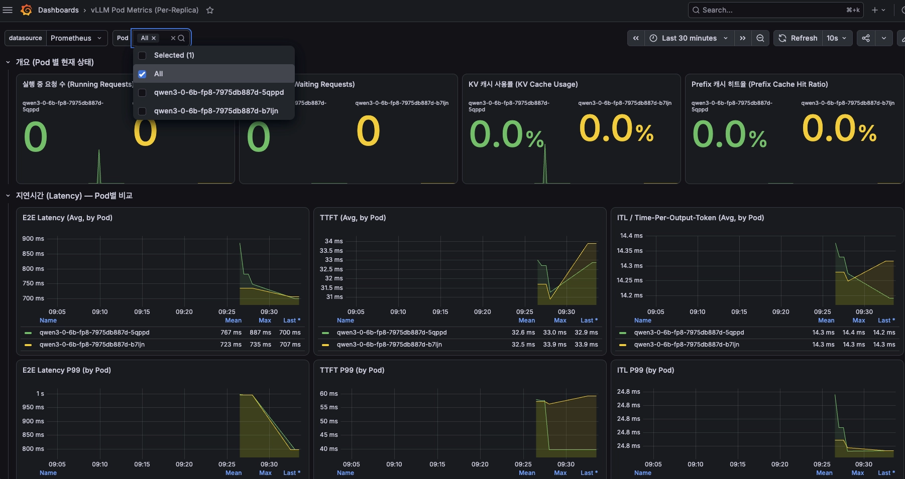

*출처: [7W-2] llm-d, 27쪽. 두 파드를 구분해 요청·캐시·지연을 관찰하는 대시보드다.*

이 화면의 목적은 전체 처리량 하나를 보는 데 있지 않다. 어느 파드에 대기열이 생기는지, 같은 시각 다른 파드는 비어 있는지, 프리픽스 적중이 한쪽에만 집중되는지를 함께 확인하는 데 있다. 이후 라우터 정책을 바꿔도 이 관찰 기준을 유지해야 원인을 비교할 수 있다.

## llm-d 연결과 검증 순서

### 자료에 기록된 범위

자료 마지막에는 Envoy Gateway 컨트롤러 파드의 정상 기동까지 기록돼 있다. EPP 배포, KV 이벤트 구독, 캐시 라우팅 성능 비교 결과는 제공된 PDF에서 확인되지 않는다. 다음 순서는 자료의 설치 계획을 바탕으로 정리한 후속 검증 과정이다.

### 1. Gateway와 API 지원 확인

Gateway API와 Gateway API Inference Extension은 구분해서 설치·확인한다. 게이트웨이 구현체가 `InferencePool` 백엔드를 지원하도록 구성돼 있어야 한다.

```bash
kubectl get crd gatewayclasses.gateway.networking.k8s.io
kubectl get crd httproutes.gateway.networking.k8s.io
kubectl get crd inferencepools.inference.networking.k8s.io
kubectl -n envoy-gateway-system get deploy,pods,svc
kubectl get gatewayclass
```

컨트롤러 파드가 Running이라는 사실만으로 실제 Gateway 데이터 플레인과 추론 경로가 준비됐다고 판단하지 않는다. Gateway의 주소와 상태 조건, Route의 참조 해석 결과를 별도로 확인한다.

### 2. InferencePool과 EPP 연결

기존 vLLM 파드의 라벨을 기준으로 풀을 정의하고 추론 포트 `8000`을 지정한다. EPP Service를 연결한 뒤 HTTPRoute의 백엔드가 일반 Service가 아닌 해당 `InferencePool`을 참조하도록 구성한다.

```bash
kubectl -n vllm get pods --show-labels
kubectl explain inferencepool.spec
kubectl -n vllm get inferencepool -o yaml
kubectl get gateway,httproute -A
kubectl -n vllm get endpointslices
```

Inference Extension의 기본 참조 EPP를 설치했다고 해서 llm-d의 정밀 캐시 라우팅이 자동으로 활성화되지는 않는다. 선택한 llm-d 릴리스의 이미지, `EndpointPickerConfig`, 캐시 플러그인 구성을 함께 맞춰야 한다. 자료의 예전 플러그인 이름과 현재 문서의 이름을 섞어 하나의 배포 파일로 사용하지 않는다.

아래는 `InferencePool` v1의 리소스 연결을 보여주는 예시다. `llm-d-epp`라는 EPP Service가 `vllm` 네임스페이스에서 9002번 포트를 제공하고, 해당 풀을 대상으로 설정돼 있어야 한다. 이 YAML은 EPP 자체를 배포하지 않는다.

```yaml
apiVersion: inference.networking.k8s.io/v1
kind: InferencePool
metadata:
  name: qwen3-pool
  namespace: vllm
spec:
  selector:
    matchLabels:
      app: qwen3-0-6b-fp8
  targetPorts:
    - number: 8000
  endpointPickerRef:
    name: llm-d-epp
    port:
      number: 9002
```

여기서 `8000`은 모델 추론 포트이고 `9002`는 EPP와 통신하는 포트다. 둘을 바꾸면 모델 요청을 선택기에 보내거나, 외부 처리 호출을 모델 서버에 보내는 잘못된 구성이 된다. KV 이벤트에 사용하는 `5557`은 이 둘과도 별도다.

같은 네임스페이스의 `inference-gateway`에 연결하는 HTTPRoute는 다음처럼 작성할 수 있다. Gateway의 리스너와 InferencePool 지원 설정은 선행 조건이다. 서로 다른 네임스페이스를 사용하면 Gateway의 Route 허용 정책과 참조 조건도 검토해야 한다.

```yaml
apiVersion: gateway.networking.k8s.io/v1
kind: HTTPRoute
metadata:
  name: qwen3-inference
  namespace: vllm
spec:
  parentRefs:
    - name: inference-gateway
  rules:
    - matches:
        - path:
            type: PathPrefix
            value: /v1/
      backendRefs:
        - group: inference.networking.k8s.io
          kind: InferencePool
          name: qwen3-pool
          port: 8000
```

두 리소스의 연결은 [InferencePool 공식 예시](https://gateway-api-inference-extension.sigs.k8s.io/api-types/inferencepool/)의 v1 필드를 기준으로 정리했다. 적용 전 `kubectl apply --dry-run=server -f <파일>`로 설치된 API의 스키마와 참조 구성을 점검한다. 스키마 검증 성공만으로 실제 EPP 통신까지 보장되는 것은 아니다.

### 3. KV 이벤트와 캐시 인덱스 확인

자료의 계획은 vLLM에 프리픽스 캐싱과 KV 이벤트 발행을 활성화하고, EPP 측에서 이벤트를 구독하는 방식이다. ZeroMQ 이벤트 포트로 `5557`을 사용하는 예가 나온다.

확인해야 하는 조건은 다음과 같다.

- vLLM이 실제 KV 이벤트를 발행하고 구독자가 각 파드의 이벤트 포트에 도달한다.
- 모델 식별자, 토크나이저, 블록 크기 등 캐시 매칭에 필요한 설정이 서로 일치한다.
- EPP가 이벤트를 수신하고 캐시 인덱스를 갱신한다.
- 파드 재시작이나 캐시 축출 이후 인덱스 상태도 갱신된다.

프리픽스 캐싱을 켜는 것과 라우터가 캐시 위치를 아는 것은 별개의 단계다. 설정 파일의 옵션 유무만 확인하지 말고 이벤트 수신 로그와 반복 요청 결과를 함께 확인한다.

자료에서 제안한 모델 서버 측 설정의 핵심은 아래와 같다. **기존 vLLM 컨테이너에 병합할 필드 발췌**이며, 모델 경로·MinIO 환경 변수·리소스 설정은 앞의 구성을 유지한다. KV 이벤트 형식과 토픽은 선택한 llm-d 소비자 설정에 맞춰야 한다.

```yaml
env:
  - name: POD_NAME
    valueFrom:
      fieldRef:
        fieldPath: metadata.name
args:
  - --enable-prefix-caching
  - --block-size
  - "16"
  - --kv-events-config
  - '{"enable_kv_cache_events":true,"publisher":"zmq","endpoint":"tcp://0.0.0.0:5557","topic":"kv@$(POD_NAME)@Qwen3-0.6B-FP8"}'
ports:
  - name: http
    containerPort: 8000
  - name: kv-events
    containerPort: 5557
```

`$(POD_NAME)`은 컨테이너의 `args`에서 Kubernetes가 확장하는 환경 변수 참조다. 이를 셸 스크립트로 옮길 때는 같은 문법을 그대로 사용하면 명령 치환으로 해석될 수 있으므로 `${POD_NAME}` 등 셸 문법에 맞게 바꿔야 한다. 자료의 한 줄짜리 설정을 Deployment로 정리할 때 놓치기 쉬운 부분이다.

컨테이너 포트를 선언하는 것만으로 이벤트 구독이 연결되지는 않는다. 소비자가 어느 파드 주소·포트·토픽을 구독하는지, Pod discovery가 어떤 라벨을 사용하는지 확인한다. 두 파드의 이벤트를 Service 하나의 임의 엔드포인트로 연결하면 전체 캐시 상태를 보지 못할 수 있다.

### 4. 실제 Gateway 경유 호출

Gateway의 주소와 리스너 포트로 동일한 모델 요청을 보낸다. hostname 조건이 있는 HTTPRoute라면 요청의 Host 헤더도 맞춰야 한다. 이 단계부터 Gateway 접근 로그, EPP 선택 로그, 파드별 요청 지표를 연결해 목적지를 확인한다.

```bash
kubectl -n <GATEWAY_NAMESPACE> describe gateway <GATEWAY_NAME>
kubectl -n <ROUTE_NAMESPACE> describe httproute <ROUTE_NAME>
kubectl -n <EPP_NAMESPACE> logs deploy/<EPP_DEPLOYMENT> --tail=100
```

`Accepted`, `Programmed`, `ResolvedRefs` 등은 해당 리소스와 구현체가 노출하는 조건을 확인한다. 특히 Route의 참조 실패와 EPP 통신 실패를 모델 서버 장애와 구분한다.

## 라우팅 효과를 측정하는 방법

### 비교 조건 고정

비교 대상은 일반 분산 경로와 EPP를 거치는 추론 인지 경로다. 가능하면 같은 게이트웨이에서 선택 정책만 바꿔 비교한다. Kubernetes Service와 Gateway를 직접 비교하면 프록시 홉이나 연결 처리 차이도 결과에 포함된다.

모델·파드 수·GPU 자원·입출력 길이·요청률·동시성은 동일하게 유지한다. 데이터셋과 난수 시드도 기록하고, 콜드 캐시와 웜 캐시 측정을 분리한다. 앞선 실행이 캐시를 데운 상태에서 다음 경로를 측정하면 비교가 왜곡될 수 있다.

| 시나리오 | 요청 패턴 | 관찰할 내용 |
|---|---|---|
| 반복 프리픽스 | 같은 긴 접두사와 서로 다른 짧은 질문 | 캐시 재사용과 첫 토큰 지연 변화 |
| 다양한 프리픽스 | 여러 접두사 그룹을 혼합 | 파드 간 분산과 캐시 중복 |
| 부하 증가 | 같은 패턴에서 요청률을 점진적으로 증가 | 캐시 친화성과 대기열 사이의 균형 |
| 파드 재시작 | 캐시를 만든 뒤 대상 파드 재시작 | 후보·캐시 인덱스 갱신과 오류율 |

같은 프리픽스를 같은 파드로 보냈다는 사실만으로 성공을 판단하지 않는다. 캐시 적중이 늘었어도 해당 파드에 요청이 몰려 지연이 증가할 수 있다.

### 자료의 캐시 벤치마크 화면 읽기

자료에서는 ShareGPT 기반 온라인 벤치마크를 반복하는 Job/CronJob을 구성하고, 프리픽스 캐싱용 벤치마크로 전환해 시드 변화에 따른 차이를 관찰한다. 이 과정은 llm-d 설치에 앞서 **입력 데이터만 달라져도 캐시 지표가 크게 변한다**는 사실을 확인하는 단계다.

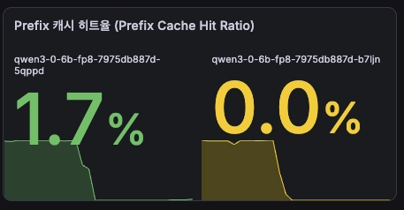

*출처: [7W-2] llm-d, 29쪽. 자료의 시드 변경 관찰 화면으로, 두 파드가 1.7%와 0.0%를 나타낸다.*

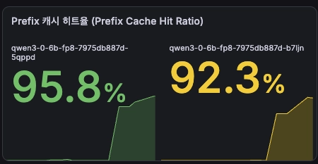

*출처: [7W-2] llm-d, 29쪽. Prefix Caching Benchmark의 고정 시드 화면에서 95.8%와 92.3%가 표시된다.*

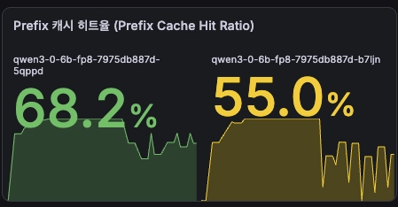

*출처: [7W-2] llm-d, 29쪽. 시드 변경 시 같은 패널이 68.2%와 55.0%를 나타낸다.*

이 세 장을 단순한 개선 전후 표로 읽으면 잘못된 결론에 도달한다. 앞의 일반 반복 벤치마크와 뒤의 프리픽스 캐싱 벤치마크는 입력 패턴이 다르고, 시드도 캐시 재사용에 영향을 준다. 높은 적중률이 관찰됐다는 사실은 확인할 수 있지만, 그 원인을 llm-d의 라우팅 개선으로 돌릴 수는 없다.

고정 시드는 재현성을 높이지만 반복 실행에서 이전 캐시를 계속 재사용하게 만들 수 있다. 반대로 시드를 바꾸는 실험은 입력 다양성을 늘리는 대신 동일 조건 비교가 어려워질 수 있다. 따라서 경로 A와 B를 비교할 때는 **같은 시드 목록을 같은 순서로 실행**하고, 각 경로에서 캐시를 어떤 상태로 시작했는지 기록한다.

### 발표 데모와 로컬 실습 결과 구분

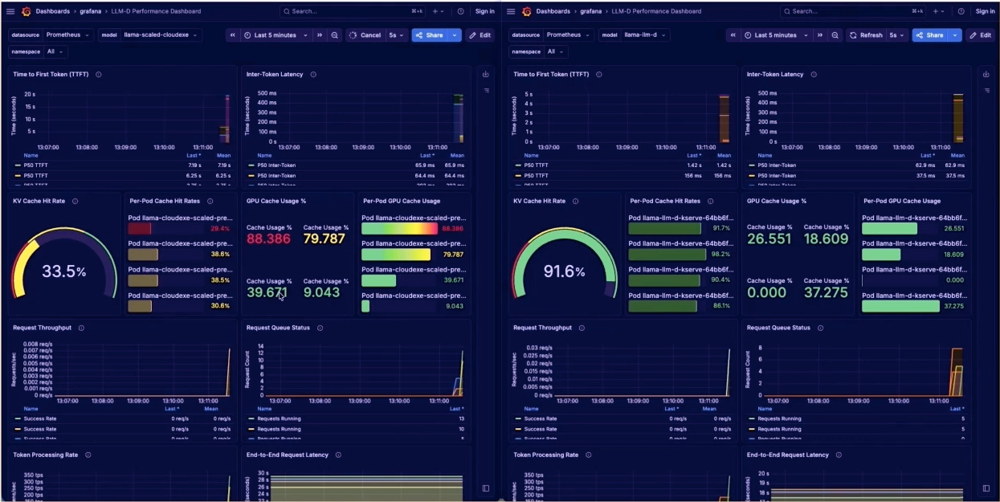

*출처: [7W-2] llm-d, 9쪽. 발표 데모 화면의 캐시 적중률은 왼쪽 33.5%, 오른쪽 91.6%다.*

이 그림은 라우팅 전략에 따라 캐시 활용과 지연이 달라지는 모습을 보여준다. 다만 비교 환경과 전체 벤치마크 조건이 이 캡처 하나에 모두 담겨 있지는 않다. Qwen3-0.6B-FP8과 단일 공유 GPU 실습에서 같은 수치를 기대할 근거로 사용하지 않는다.

그림에서 따라 할 부분은 특정 숫자가 아니라 **관찰 항목의 배치**다. 위에서 TTFT와 토큰 지연을 보고, 가운데서 파드별 캐시 사용과 적중률을 확인하고, 아래에서 요청률과 큐 상태를 확인한다. 캐시와 부하를 함께 판단한다는 라우터의 설계를 대시보드에서도 같은 방식으로 검증하는 구성이다.

### 지표 해석

첫 토큰까지의 지연인 TTFT(Time To First Token)는 대기와 프리필 개선을 관찰하는 지표다. 토큰 간 지연인 ITL(Inter-Token Latency)은 출력 스트림의 간격을 나타낸다. 프리픽스 캐시 재사용이 좋아졌다고 해서 디코드 자체가 같은 비율로 빨라지는 것은 아니다.

파드별 실행 중 요청 수와 대기 요청 수, 처리 토큰 수, 캐시 사용량·적중률을 함께 본다. 전체 평균만 보면 한 파드에 집중되는 지연을 놓칠 수 있으므로 P95/P99도 확인한다.

자료에서 사용하는 캐시 카운터 이름이 해당 vLLM 버전의 `/metrics`에 존재한다면, 관찰 구간의 적중률을 다음처럼 계산할 수 있다. 실제 라벨과 메트릭 이름은 배포 버전에서 확인한다.

```promql
sum(rate(vllm:prefix_cache_hits_total[5m]))
/
sum(rate(vllm:prefix_cache_queries_total[5m]))
```

두 카운터의 집계 단위를 확인해야 하며, 이 비율을 곧바로 요청 단위 적중률로 해석하지 않는다. 요청이 없는 구간에는 분모가 0이 될 수 있다. 누적 카운터의 단순 비율보다 동일 시간 구간의 증가율을 비교하는 편이 실험 변화 파악에 적합하다.

Prometheus에서는 vLLM 외에 EPP와 Gateway의 상태도 수집한다. ServiceMonitor의 라벨 선택자, Service의 포트 이름, Prometheus의 모니터 선택 조건이 맞아야 실제 스크레이프 대상에 포함된다.

### 결과를 기록할 때

측정 결과에는 경로, 요청률, 동시성, 시드, 캐시 초기 상태, 성공 요청 수, 오류율, TTFT·ITL 분포, 파드별 요청 분포를 함께 남긴다. 처리량만 높고 오류가 증가한 경우나 캐시 적중률만 높고 꼬리 지연이 나빠진 경우를 구별할 수 있어야 한다.

자료에는 최종 비교 수치가 없으므로 처리량 향상 배수나 TTFT 개선율을 기입하지 않는다. 반복 벤치마크용 CronJob은 실험을 마친 뒤 중지해 후속 측정과 GPU 사용량에 영향을 주지 않도록 한다.

### 재현 실험의 실행 순서

1. vLLM 두 파드가 Ready이고 파드별 메트릭이 수집되는지 확인한다. 모델 로딩과 컴파일 중인 시간을 측정 구간에서 분리한다.

2. 일반 분산 경로에서 콜드 캐시 요청과 웜업 후 반복 요청을 나눠 실행한다. 두 조건의 결과 파일을 구분한다.

3. 같은 데이터·시드·요청률로 EPP 경로를 실행한다. 클라이언트 측 지연과 서버 측 메트릭을 같은 시간 구간으로 맞춘다.

4. 같은 프리픽스만 반복하는 경우와 여러 프리픽스를 섞는 경우를 각각 비교한다. 한 파드로의 집중이 캐시 친화성 때문인지, selector 오류로 후보가 하나뿐이기 때문인지 구분한다.

5. 요청률을 높여 대기열이 생기는 지점을 관찰한다. 캐시 적중률이 높은 상태에서도 TTFT가 급증한다면 캐시 이점보다 큐 지연이 커졌을 수 있다.

6. 결과를 보관하고 해당 벤치마크 CronJob을 중지한다. 이미 실행 중인 Job은 CronJob 중지만으로 종료되지 않으므로 별도로 상태를 확인한다.

```bash
kubectl -n vllm get cronjob,jobs

# 실제 벤치마크 CronJob 이름으로 대체한다.
kubectl -n vllm patch cronjob <BENCHMARK_CRONJOB> \
  --type=merge -p '{"spec":{"suspend":true}}'

kubectl -n vllm get jobs --sort-by=.metadata.creationTimestamp
```

결과에는 다음 항목을 함께 남기면 실험 조건과 해석을 다시 확인할 수 있다.

```text
경로: 일반 분산 / llm-d EPP
모델·이미지·EPP 설정 버전:
GPU 및 파드별 자원:
데이터셋·시드·입출력 길이:
요청률·최대 동시성·요청 수:
캐시 시작 상태: cold / warm
성공 요청 수·오류율:
TTFT: P50 / P95 / P99
토큰 지연: 사용 메트릭 / P50 / P95 / P99
처리량: 요청/s / 출력 토큰/s
파드별 대기열·요청 분포·캐시 적중률:
```

## 문제를 좁히는 순서

| 증상 | 먼저 확인할 지점 | 구분해야 할 원인 |
|---|---|---|
| Gateway 경유 요청 실패 | Gateway·HTTPRoute 상태와 백엔드 참조 | 라우팅 설정 문제와 모델 서버 오류 |
| EPP 후보가 없음 | InferencePool selector와 파드 라벨 | 파드 존재 여부와 풀 편입 여부 |
| 반복 요청에도 캐시 이점 없음 | 프리픽스 동일성, 이벤트 수신, 플러그인 설정 | 캐시 생성 실패와 캐시 위치 추적 실패 |
| 특정 파드만 지연 증가 | 파드별 대기열과 선택 결과 | 캐시 친화성 편중과 실제 자원 부족 |
| 지표가 비어 있음 | `/metrics`, ServiceMonitor, Prometheus targets | 수집 실패와 실제 무트래픽 |
| 두 파드 전환 후 메모리 오류 | 모델·KV 캐시 예산과 GPU 공유 설정 | 파드 수 증가와 GPU 용량 증가의 차이 |

Gateway → EPP → 모델 서버의 요청 경로와 모델 서버 → 인덱스의 상태 전달 경로를 나눠 보면 원인을 좁히기 쉽다. 요청이 성공한다고 해서 캐시 정보를 이용한 선택까지 정상이라는 뜻은 아니다.

## 마무리

Agent Router는 모델 공급자 앞에서 API와 정책을 통합하고, llm-d는 모델 서버 집합 안에서 부하와 캐시 상태를 반영해 요청을 배치한다. Envoy는 실제 트래픽 전달을 담당하며 외부 처리 프로토콜을 통해 이러한 판단과 연결된다.

이번 주차의 핵심은 **파드 수보다 요청 배치 방식이 캐시 재사용과 대기 시간을 좌우할 수 있다**는 점이다. 캐시 적중률, 파드별 부하, 사용자 지연을 함께 측정해야 라우팅의 효과를 판단할 수 있다.

## 참고

- 학습 자료: `[7W-1] Envoy: Agent Router` PDF, 38쪽; `[7W-2] llm-d` PDF, 31쪽. 2026-09-17 제공 자료 기준이다.
- [Agent Router 공식 저장소 및 명칭 변경 안내](https://github.com/theagentrouter/agent-router)
- [Agent Router 아키텍처](https://theagentrouter.ai/docs/concepts/architecture/)
- [Envoy External Processing](https://www.envoyproxy.io/docs/envoy/latest/configuration/http/http_filters/ext_proc_filter)
- [Gateway API Inference Extension: InferencePool](https://gateway-api-inference-extension.sigs.k8s.io/api-types/inferencepool/)
- [Gateway API: API Overview](https://gateway-api.sigs.k8s.io/docs/concepts/api-overview/)
- [GKE: Body-Based Routing 동작과 구성](https://docs.cloud.google.com/kubernetes-engine/docs/how-to/configure-body-based-routing)
- [llm-d Router 아키텍처](https://llm-d.ai/docs/dev/architecture/core/router)
- [llm-d Endpoint Picker](https://llm-d.ai/docs/dev/architecture/core/router/epp)
- [llm-d Precise Prefix Cache Routing: 0.8 문서](https://llm-d.ai/docs/0.8/well-lit-paths/foundations/precise-prefix-cache-routing)
- [llm-d Precise Prefix Cache Routing 배포 가이드](https://github.com/llm-d/llm-d/blob/main/guides/precise-prefix-cache-routing/README.md)

공식 문서의 `dev`와 저장소의 `main`은 변경될 수 있다. 실제 배포에는 선택한 릴리스의 이미지·차트·설정 예제를 함께 고정한다.
